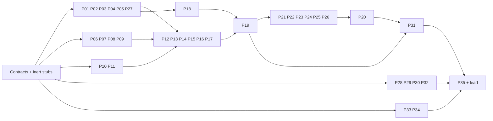

# S10 · 全栈验收定稿计划（fullstack-acceptance，L）

状态：**lead 冻结（2026-10-12）**。候选无开放问题；候选「定稿裁决」L1–L14 采纳，下方「lead 定稿裁决」覆盖正文与 L1–L14 中的任何冲突。

## lead 定稿裁决（冻结；覆盖正文）

| # | 裁决 | 落点 |
|---|---|---|
| L15 | **进程监督复用共享 helper。** P05 `test/fullstackharness` 的进程监督建立在 `internal/testharness` 共享 subreaper + CLOEXEC lease + pidfd 监督（S6 FIX-ORPHAN）之上，只补 fullstack 特有部分；不得另起一套。 | P05 |
| L16 | **并行开工顺序。** 现在：P00，随后 NOW 包（P01–P05、P09、P13、P17、P32 的纯判定/内核 reader/监督 adapter/hermetic runner 自测部分）；WAIT 包按 §0「可立即实现 vs 依赖」表在对应 S6/S7/S8/S9 交付物合并后启动；与 S7/S8/S9 包拥有同一文件的包（如 P06/P07/P08 触及 `internal/drillobserve`、`internal/agent/agent.go`、`internal/storage`）在那些文件的上游 owner 合并后以合并树为基线启动，不并行编辑同一文件。 | §0、§10 |
| L17 | 同 S7 L16–L18：重型套件按测试分区、单元 600s 不变；包只跑授权的定向检查；三硬闸/`make gates`/whole-race/drill 只由 lead 在同一候选上跑，drill 与 go test 严格串行；最终全套 `run-drills.sh` + `--live-grow` 前先报成本。 | 全部包 |
| D-A / agent freeze | **Release-mode SLO: 500 ms.** Measure exporting and importing candidates built with `CGO_ENABLED=0`, `-trimpath`, release `-s -w -X ...ReleaseVersion=...` flags and no race instrumentation. Race candidates retain functional assertions in a separate arm. Instrumentation overhead is not production latency. Receipts bind executable SHA, toolchain, race/CGO settings and duration; a race-built candidate is rejected by the budget checker. | Agent upgrade / retained terminal; lead decision 2026-10-22 |
| D-A / sole-voter reload | **Release-mode SLO: ≤5 s**, including the first durable write. Same release-build and receipt requirements; preserve the real observer overlay and production timers. | S6 `TestSoleVoterReloadWithinBudget` |
| D-A / Tier-A transfer | **Release-mode SLO: 30 s**, retaining the original absolute deadline through both image cuts. Both artifacts and the original ctl use the release profile; race products keep functional coverage. | S7 T35/T36 |
| D-A / durable progress | **Release-mode SLO: 10 s**, anchored at the original T46 cut through the first receiver durable Sync. A release miss remains a product defect; push prepare-accepted is `not_covered` only with measured upload-bound evidence. No budget is widened. The release witness still needs 9.178–9.283 s for the 9 MiB upload at 1 MiB/s, after 2.249–10.883 s to reaccept Prepare; measured cut-to-Sync is 11.564–20.192 s, so this cell remains `not_covered`. | S7 T46 push prepare-accepted |

## 候选稿原状态行

状态（合成时）：**候选，待 lead review/freeze**。日期 2026-10-12；静态核查快照 `faeab41bf445ccbf0a83194a6bae7e89c0858bd0`，工作树干净。本文是实施合同候选，不是通过收据。本轮未执行 build/test/vet/make/lint/Docker/drill/ssh/installed tether，未访问用户运行目录；所有拟执行项仍为 `NOT_RUN`，成本为 `ESTIMATE / NOT_MEASURED`。

权威顺序：stages-plan §S10 与 §-1 已定裁决 → CLAUDE / architecture §21、§22 / testing-standards → S5、S6 冻结合同 → **当前仓库已经冻结的 S7、S8、S9 计划之 lead 裁决**。草稿和 critique 的旧 HEAD、S7/S8/S9 “仍为候选/不存在”措辞不再成立。S0–S5 按用户裁决关闭；S6 真同 PID broker cut 已实现，最终 gates/drill 仍需交回；S7 contracts 已在树上，实际续传仍在实施。S8/S9 冻结不等于实现完成。

## 定稿裁决

| # | 裁决及理由 | 落点 |
|---|---|---|
| L1 | 五代按每个 required agent/broker 的五个不同 successor **executing SHA**计；选择 `T0→T1→T0→T2→T3→T4→T5`，拒绝 ABA 两件冒充五件，也不把十一轮往返当范围要求。机制件、发行 N-1、ABI reader 分账。 | §2、§7；P01/P04/P10/P27 |
| L2 | 使用两台 agent host、四个真实独立安装 runtime，四 SID/bucket 全部升级和采样。Config.SID 与 bucket single-flight 使“两个 agent 加四个 ctl HOME”不可实现。 | §1、§3.1；P11 |
| L3 | 有限传输按预登记 cohort 接力；首四 ID 跨完整升级、逆序回滚、再升级，并分别证明 sender/receiver leg。其后 cohort 不冒充原四 ID；任何调用不超过 S7 原 deadline。 | §3.3；P14/P19 |
| L4 | S9 两个真实相邻版本反复实际切换；逐步记录完整目标向量与 component direction。末次恢复 pin 是显式额外步骤，不能删掉成本或用 same-SHA no-op 凑换代。 | §2.2 |
| L5 | agent 必须提供自身 `runtime.NumGoroutine()`；父测试 helper 只签 harness。每映像再次 exec 前做同代五轮真实资源结算，另做固定产品 SHA 的 soak。 | §4；P03/P06/P07/P25/P26 |
| L6 | 三完成点保留 full stamp、nonce、sequence、revision、direction、scope、原始 View；历史 completed 不能替代 fresh current proof。两代门用 activation/retirement 全事件及实际 effect，周期计数只作补充。 | §5；P00/P01/P18/P24 |
| L7 | private observer 沿既有 sealed custody；不新增公开端口。producer、codec、decoder、启动、raw、predicate、mutant、ledger 逐条单 owner；永久 init loop 与可关闭 collector 分开计。 | §5.3、§10.3 |
| L8 | 日志只经现有 logs owner，增加多 SID/unit 的 strict 完整读取；四类流、prelogger、rotation/truncate、cursor/end fence 都是签收条件。tail/grep 空结果不证明零异常。 | §5.5；P09 |
| L9 | M01–M11 是十一**缺陷族**，展开为 50 个固定子例；M10 是真实 scheduler/harness 变异，其余 product/source_gate 分列。编译失败、setup、timeout、安全拒绝不算 continuity mutant 被杀。 | §8；P20 |
| L10 | 独占 quiet 校准/99 与 default/live-grow 两轮分开；全部显式禁 retry/attribution。新 99 的长 ceiling 只作用于其 launch units，不放宽其它 drill。 | §9 |
| L11 | 新逻辑第一天落最终 leaf/test package；P00 永久合同及惰性失败桩先合并。共享文件等待对应上游 owner 合并后再编辑；S10 内每文件恰一 owner。 | §10–§11 |
| L12 | whole-race 是完整发现集合的覆盖承诺，重型测试从第一天按 Test 分区；新增单元 600s，超过 420s 就拆。所有 spawn 复用已落地 supervisor，并保留清理时发现的 leak failure。 | §6、§12 |
| L13 | current 全客户端正常 profile 的 deferred 集合对**每 action、每 attempt、四角色、所有 runtime**为空；legacy/unsupported/资源拒绝是独立安全负臂，不删除合法错误码。 | §5.2、§7 |
| L14 | stage closed、源码存在、expected match、native GREEN、内审 Pass、外审 Pass 六者不同。补清 carry 后才勾 A–H；最终停外审门，不 commit/push/现网部署。 | §13–§14 |

## §0 范围、出口与落地顺序

S10 只实现验收支撑、观测接线、跨域整合与所暴露的 bug 修复；不新造传输协议、事务引擎、特权升级器、持久 ctl resume 或平台能力。四层升级只能走真实产品 CLI；fixture 不代写 `.prev`、selector、marker、journal、store，不代做迁移/reconnect/GC。

| §S10 scope / exit | 必须交付的 AND 条件 | 唯一收口 owner |
|---|---|---|
| scope 1 / E1 | 99 N1 default single 与 N3；四层正序、完整逆序、再升级；每实例五个 novel successor SHA；4 原双向 TCP/SSH、2 PTY、4 exec、4 tier-B、10/s；SS/RF 两拓扑独立；先无升级校准；每代资源与 soak；全部正常成功臂 native GREEN0 | P19、P25、P26 |
| scope 2 / E2 | §8 全 50 子例 baseline→指定 assertion-red→restore；真实 raw rc；命中窗口与 overlay 执行身份齐全 | P20 |
| scope 3 / E2 | 正常 profile 所有 action/attempt 无 deferred/rejected/unknown/缺失；legacy policy 及安全拒绝各有原码和业务无损证据 | P01、P24、P27 |
| scope 4 / E3 | plan §5 十二行、R1–R16、A–H 每叶项一一关联 Test/drill/预算/身份/命令/native rc/raw/活文档；carry 闭合；最终必需 evidence 无 NOT_RUN | P33、P34、P35 |
| scope 5 / E4 | 同候选三硬闸+gates；全套 default 与 live-grow 判词逐 unit 等于冻结 expected；所有结构/库存/ledger/命名/层次/tag/race/安装门 | P28–P32、P35 |
| scope 5 / E5 | 三固定内审 lane＋部署 raw 审计，root 逐 finding 回复并修复重验；报告首行 Pass；全暂存，无未跟踪/未暂存，未 commit；停外审门 | P35、lead |

E1 的“零重启/重连/EOF”约束原业务进程、原 ctl 与外部业务连接。agent/broker 计划同 PID exec、NATS/Caddy 产品计划换进程、内部 NC/TLS/yamux/WSS carrier 重建分别记账；自然结束有限任务的真 EOF/exit 是预声明终态，不算中断。原无限 cohort 在最终封口前不得自然结束或换身份。

### 可立即实现 vs 依赖 S6/S7 交付物

| 状态 | 可以完成的工作 | 不能提前签的结果 |
|---|---|---|
| NOW，P00 先落 | stdlib 证据 types/ports、closed vocabulary、失败 stub；P01–P05 纯判定/内核 reader/监督 adapter；新 fixture 文件、恶意 raw selftests、静态 coverage/cost 模型、docs 草稿 | 不把合成 fixture 或 stub rc 当产品行为 |
| NOW，可绑定实际 S7 P00 | `xfercontract.Identity/Origin/BudgetSeal/Status/TrackerFrozen` adapter、保留责任表、strict decoder；S8/S9 用冻结接口的 S10 侧 ports | 实际 handler 仍每次创建 filetransfer；broker 活 transfer 拒切未取消 |
| WAIT-S6-close | 接最终 37 single/sole/N3、ENDPOINT-RESUME、blackout、store ACK/flock、FIX-MATRIX/FIX-ORPHAN 收据；已存在实现不重造 | 不拿旧“integration pending”否认代码，也不代签 S6 出口 |
| WAIT-S7 对应包 | 真 rate/BudgetSeal、四 runtime、Sync-prefix、原 OFD、primitive、exact history、tracker-before-reaper、GC/courier/endseal | P14/P23、99 的活传输成功臂 |
| WAIT-S8 对应包 | 产品 stage/prev/effective selector、完整 View/query nonce、current rollback、incarnation/G.1、持续域锁、真实八格、A-6 冻结收据 | P18/P24/P27；不能继续用旧 install flock 代域锁 |
| WAIT-S9 对应包 | 两版 catalog、helper/launcher/retrofit、证书权限、canonical 路由、真实 cohort、pre-repair gate、旧/临时进程退休 | P11/P15/P19；旧 caddy.sh 的 root-only key 不能直接给 User=tether |
| SERIAL，lead final | 所有共享 inventory/gate/docs 文件等 S7/S8/S9 同文件最后 writer 合并；freeze 同一候选后顺序执行全量与部署 | 早期并行实现不豁免 S0–S9 出口复核，不允许两个 stage 同时编辑同文件 |

上游未交回时继续 NOW 包；待接线测试明确 pending，禁止空 `Skip`、总通过 stub、alias 吞字段。交回必须有接口 fingerprint、实际 source path、Test/arm exact key、raw receipt 与 build/runtime SHA；发生不兼容由 P00/原 owner 更新一份合同，再通知消费者。

## §1 按当前代码裁决的事实

以下行号均属本文 HEAD；这是静态依据，不是运行证明。

| 争议 | 代码证据与裁决 |
|---|---|
| 两 runtime 可服务四传输 session | 不可。`internal/agent/agent.go:64,1252,1752` 单 SID；`internal/agent/transfer.go:19` Handler 同 SID；`internal/broker/transfer.go:341–347` 同 bucket single-flight。采纳 budget 的四 runtime 方向，拒绝另三稿仅换 ctl HOME。 |
| S7 rate/ports 仍待产品裁定 | 过期。冻结计划 lead LQ2；`internal/xfercontract/contracts.go:261–268` 已有 BudgetSeal，`:26–36` 已有 domain/resource 名；`contractstub/stub.go:1–4,45–58` 是失败桩。合同 NOW，行为 WAIT。S8/S9 当前也已冻结，critique 对其“未见/候选”的时间性判断更新。 |
| exec=16MiB、PTY=8MiB 足够计价 | 错。`internal/execsession/runtime.go:594–606` stdin 另 `max(64KiB,len(input))`，`pty.go:504–512` 输入另 256KiB。原225MiB算式已超正常224MiB；采用 §3.4 真峰值。 |
| 同 PID 五次 exec＋父 leak helper 可以签 agent G | 错。`internal/testharness/leakgate.go:69–75,104–105` 读调用者；exec 重置 child Go heap。采纳 task/conn/honesty 的同代独立采样。 |
| host flock 已贯穿 cut | 错。`internal/agent/upgrade.go:111–125` flock 回调结束才 reexec；`:317,412` ReExecOnly 只保进程内 admission。S8 长域锁为必需交付物。 |
| 现 flow fixture 可直接供长 99 | 错。`flow_fixture.py:388–400` 有限2400记录；`:577–589` 自启动 agt1、10/s、600s collector；`:1033–1048` remote cleanup 另有吞错。P12/P11 参数化并明确关闭其 scheduler。 |
| private custody 可直接 Close/Join 五轮 | 错。`internal/drillobserve/custody_linux.go:43–61,130–187` init 永久 writeLoop，无 stop；`:254–269` Flush 不是 Close。不虚构 API，分别验永久固定成本与可关闭消费端。 |
| Kind 加一即可被 decoder 接收 | 错。`flow_observation.py:31–34,111` Kind/Domain 双闭合集；`:373` retain_events=False 仍解码验证。P06 同时改 schema、两条解码路径及反向库存。 |
| cleanup 后无进程即测试无泄漏 | 错。`process_supervision_linux.go:51–59` 解释 worker-thread exec 丢 Pdeathsig；`:328–370` 清漏后仍返回125。`process_cleanup_linux.go:89–90` 跳 Z/X，不能代 wait/reap 证明。 |
| settle 后 registry 应立即空 | 错。`procrequest/registry.go:27,282–319` 保 settled record 到原 lease 过期；`execsession/runtime.go:419–433` terminal-ack 才 retire 数据资源；`revoke.go:166–179,245–274` 有独立 tombstone/revocation 时钟。 |
| heartbeat PTY 足证 current rollback | 错。`execsession/pty.go:24–56` retained PTY 仍需 decoder；`:763–768` zombie ReapHeld 仍非终态；`ptysession/control.go:452–514` 多成员清场要两次空 census。补 §6 有限见证。 |
| 已有 recreation Test 就是拒旧权限 | 恰相反。`internal/agent/session_destroyed_pty_test.go:360–387` 现在要求重建 SID 后旧 PTY 仍 running。必须消费 S8 反转断言及 late G.1 的新回归，不能只查测试名。 |
| broker ACK/JS supplier 已齐全 | 未齐。`hot_update_broker_probe.py:299–317,529–535` 只读外部 witness；`:307–308` floor≥1 不适用 single。`test/hotupdate/broker_lifecycle_seam_test.go:395–403` 明确 single cursor=0，以真实 ACK rows/absence 证明。P08 交真实 pre-replay producer。 |
| JS before==after 能用于 infra 重启 | 错。`hot_update_broker_probe.py:322–328` 整行相等含 server_id/consumer_seq。§5.4 固定 store/stream/NUID，允许经证明的 server/consumer 迁移及序号推进。 |
| ABI1 或库存证明所有 prev 可读 | 错。`agentimage/capability.go:54–65,74–84` 还验 required domains；`brokerimage/preflight.go:78,89–90,127–130` 绑定实际 reader/SHA；`codec.go:262–276,317–325` strict private closure。§7 要真实非空双向 decode。 |
| 现活传输可直接做 99 | 错。`agentimage/bundle.go:89–93` 仍含 transfer deferral；`brokerimage/store_reload.go:606–616` 非空 census 拒切。S7 取消 capable 拒切后才签。 |
| `./local.sh build` 会 restage | 错。`test/simcluster/local.sh:49–54` 只有 `--build` 调 staging；`simcluster:57–65` build 消费已有 vendor。真实入口为 `./local.sh --build build`，后接完整 COPY/runtime 对账。 |
| 当前 local reload/wait 是旧 waitVersion | 错。`internal/cli/cluster_roll.go:420–465` 单次 reload＋running proof；`:366` 只是通用 poll；`cmd/tether/cluster_upgrade_drive.go:141–149` 用 RollBrokerStep，`:363–387` 老 waitVersion 不作现路径证据。现 N3 `cluster_upgrade.go:156–162` 要 backup。 |
| 日志 helper 都可签无异常 | 错。`logs.sh:53,79,94,101,118,157,179` tail/缺失行为只宜诊断；`:188` 已有 strict snapshot 可扩展。`logrotate.go:184–205` rename 失败可能原 inode truncate；`cmd/tether/agent.go:325–341` prelogger/fd2 另有边界。 |
| 全包 race 自动覆盖新包 | 错。`test/e2e/all_phases_test.go:317–321,332–359` 是 owners＋exact partitions；`:712–715` 才是 tag 声明。`parallel/partition_coverage_test.go:32–55,101` 要发现集合恰覆盖一次，不能只改条数。 |
| enum 分母仍15，生产扫描器也扫新脚本 | 错。`enum_switch_default_test.go:59–137` 当前48 family，`:654–660,767–777` 钉成员。`broker_image_contract_test.go:26–41` 仅生产 Go；700行 test/script 必须另门。 |
| Agent观察接线可直接在原文件增长 | 不可。`legacy_file_code_ceilings.tsv:64` 钉agent.go为1292 code lines；现文件已到帽，`agent.go:2785–2798` 的旧观察循环移入P06，`custody_linux_test.go:443` 的source锚同批更新。不是放宽原帽。 |
| Agent≤125 足符冻结命名面 | 不足。`structural_budget_test.go:945–947` 是≤125；S5/CLAUDE 要恰125，另加 exact gate。`:859–872` AllOS caps、`:1019–1032` 每文件棘轮照守。 |
| run-all 不含 installer lint / lint 可证有效 unit | 两说都错。`tests/run-all.sh:32` 已调用；`lint-install.sh:16–20` 只防 heredoc command substitution。有效 UID/capabilities/cert/retrofit 另消费 S9 渲染及真 launch。 |
| 2700s可容纳整场／宽 soak 会杀+1 | 不可。`run-drills.sh:96,104,114,528–534` 默认 retry、attribute、min(2×worst,2700)；`97-soak-cycles.sh:45–59` G容差2*NPROC+16。采用 §4/§9 分开判据。 |

## §2 工件、运行身份与精确滚动轨迹

### 2.1 工件目录与真实产品入口

`T0..T5` 是最终合并 source/tree、同 toolchain/非stamp flags 的六份机制件，以独立 ReleaseVersion stamp 产生六个 SHA；每件均有全部 required decoder。实际stamp入口是 `Makefile:6` 的 `-X github.com/LinZiyang666/tether/internal/proto.ReleaseVersion=...`（变量声明见 `internal/proto/version.go:40`）；六份完整flags摘要各自记录。它们只签长 generation/retirement 链，不签六个实现版本的兼容性。S8 capable A/B 必须来自其要求的可辨识实现/独立 provenance；真实 adjacent release 与固定 v0.6.0 各自建目录，S2 gen-1 只用于 ABI 机制边界。

两代fleet与旧service-image退休的managed集合是agent/broker及S9实际host support，不包含合同要求一直保留的原业务child和原ctl；它们另有固定身份/退出责任账。所有ctl都来自当前capable代码，stamp不同不冒真实发行兼容。

每 artifact 记录 `source_commit, tree_digest, dirty_digest, toolchain, flags, role, release, image_epoch, read_epochs, required_domains, archive_sha, binary_sha, vendor_sha, image_id, copy_manifest_digest`。所有机制件在 READY 前构建完；原 ctl 全场不换 PID，执行管理命令的短 ctl 另监督。逐 target `/proc/PID/exe` 独立 FD hash，不能只采产品自报 SHA。

P04 的身份协议：读 `(boot_id,pid,start_ticks,pid_namespace,image_generation,cut_id)`；open `/proc/PID/exe` 得独立 FD，fstat+hash；重开 current exe 对比 dev/ino/hash 并重读 cut/gen；前后身份或 cut 变化则只重做**只读采样**，不能重发升级。same PID exec 的 ABA 由 generation/cut sequence 拒绝，不能只比 PID/ticks。保原 FD 到本次 judge 完成，然后 Close/Join；不持有所有旧 image FD 到全场结束假造资源泄漏。

供给链是 `source/tree → staged immutable bytes → vendor manifest → Docker COPY manifest → product stage receipt → executing SHA`，每箭头 exact hash join。开跑前使用真实 `./local.sh --build build`；仅 `build` 重烘焙旧 vendor 的负控必须红。root-owned 安装路径只能消费 S8 `tether upgrade stage` 的 grant/双 SHA/selector 入口和 S9 catalog/helper；READY 后禁止 fixture install/cp/chown/restart 服务。installer 的 never-start 承诺保持；S9 retrofit 与证书读权限在其产品步骤取得，不靠 fixture 修绿。

CLI argv 由 P18 的 `command-bindings.json` 冻结到真实 command tree 和帮助 golden：agent `node upgrade`/tx query/rollback 用 S8 最终入口；single broker 用 broker admin reload/status 与 S8 transaction adapter，不 `cluster init`；N3 用 `cluster upgrade --broker-only` 的实际签名、account seed、真实 backup receipt 与 `--backup-taken`；infra 用 S9 `admin infra upgrade` 或 `cluster upgrade --component nats|caddy`，`--rollback` 不与 `--to-version/--expect-sha256` 混传。没有落地命令的 binding 不能运行，更不能 fallback 旧裸 exec。

### 2.2 六轮 tether＋明确的 infra 收尾

记 `A=(NATS2.14.5,Caddy2.7.5)`，`B=(NATS2.14.6,Caddy2.7.6)`，SHA 从 S9 单源 catalog 读取。初态 `(T0,A)`。下表每行结束前所有当前责任/旧 owner 已结清，才准下一行；每实际 component action 单独生成 grant/Tx/Cut，不复用旧 forward receipt。

| 步 | 目标 `(tether,infra)` | component actions 与执行顺序 | 计数与传输 cohort |
|---|---|---|---|
| R1 | `(T1,B)` | agent forward → broker forward → NATS forward → Caddy forward | novel1；C0 leg1 |
| R2 | `(T0,A)` | Caddy reverse → NATS reverse → broker reverse → agent reverse | 完整四层 current rollback；C0 leg2 |
| R3 | `(T2,B)` | agent forward → broker forward → NATS forward → Caddy forward | novel2，完整再升级；C0 leg2 |
| R4 | `(T3,A)` | Caddy reverse → NATS reverse；两者退休后 agent forward → broker forward | novel3；**mixed vector**，不标整栈 forward；C1 leg1 |
| R5 | `(T4,B)` | agent forward → broker forward → NATS forward → Caddy forward | novel4；C1 leg2 |
| R6 | `(T5,A)` | Caddy reverse → NATS reverse；两者退休后 agent forward → broker forward | novel5；mixed vector；C1 leg2 |
| R7 | `(T5,B)` | NATS forward → Caddy forward | 显式 infra-only final pin，不计 novel；C1 leg2 |

R4/R6 是两个串行、独立完成的产品计划，先完整退出 infra reverse 责任再启动 tether forward；不能把一个错标 forward 的 parent 交给 judge。同 epoch、全客户端 capable 是此机制 profile 的前提；真实发行的“先升级 broker 再 agent”兼容约束另由 §7 验证。N3 broker 每 hop 重新读 leader/role 并转移领导权，不能信规划时 leader-last；NATS 根据实际 JS quorum/current/readiness 决定顺序，不能把 tether voter count 当 NATS topology。所有 peer、non-voter、四 agent、共址/helper 均在 fleet census；停止/失联不是从 roster 删除。

正常单 component≤120s，单完整 rollout≤900s，maintenance≤8s，原业务控制/flow≤5s。R2/R3、R5/R6/R7 另受 §3.3 更紧的传输窗口排程上界；不是放宽产品预算。S9 临时入口、helper/launcher 更新与旧 worker 退休全部进入 StepManifest；不以 old service 仍活保业务却签 completed。

## §3 真实混载、有限接力与容量

### 3.1 四 runtime 的固定映射

| runtime | host / unit | SID / NID | UID / HOME / binary domain | tier-B |
|---|---|---|---|---|
| a0 | agt1 / tether-agent-a0.service | s10-small-push / a0 | sim-a0 / `/home/sim-a0` / `/opt/s10/a0` | small push |
| a1 | agt1 / tether-agent-a1.service | s10-small-pull / a1 | sim-a1 / `/home/sim-a1` / `/opt/s10/a1` | small pull |
| a2 | agt2 / tether-agent-a2.service | s10-large-push / a2 | sim-a2 / `/home/sim-a2` / `/opt/s10/a2` | large push |
| a3 | agt2 / tether-agent-a3.service | s10-large-pull / a3 | sim-a3 / `/home/sim-a3` / `/opt/s10/a3` | large pull |

每个 domain 自有 config、canonical binary、actual-prev、marker、identity、unit、日志及独立 ctl HOME，禁止共享可替换 pathname/inode。绝对 HOME 路径仅属 sim fixture。四实例全部在 RequiredComponents、所有 layer 的 cohort/maintenance-installed ACK、SHA/资源/日志矩阵中；没有不升级的隐形供给 agent。host/UID 由受管 provision manifest 创建，run 前校验实际用户和权限，不假定 UID 数字可用。S8 shared sibling/no-systemd/user unit 是另外能力收据，不混入主 lane。

### 3.2 原业务与控制请求

原 cohort 从第一次 READY 到最终 seal：a0/a1 各一条原双向 TCP，a2/a3 各一条原真实 SSH channel；每 runtime 一个普通 exec，a0/a2 各一个可靠 PTY。所有方向带随机 nonce、sequence、length、digest、独立发送和接收 ledger；SSH 记录一次 accept/handshake 与原 socket identity，不用纯 TCP echo 代签 SSH。源在运行前按总 ceiling 预声明足量 records（`ceil(ceiling*rate)+固定drain tail`），不得沿用2400记录或故障后增改 expected。长期任务不靠 slave keeper 保活。

唯一 P17 scheduler 每100ms固定一个 slot，模式 `read/read/read/write/short-exec`，四 runtime round-robin；read 分 `node ls/ps/status`，write 是有唯一 effect token 的可靠 exec，short-exec 验真实结果与 exit。每个 slot 自 scheduled 时刻计5s绝对预算，预建身份/连接不免除正常命令的 discovery/auth/queue 成本；不重试整个业务命令。连接级内部 attempt 可续同 CallID，但逐个保留。最大 pending create 是结果而非 admission throttle；满额/未按时 launch 是失败，不能停表或降10/s。

独立 finite witnesses 覆盖输入输出非空、terminal、撤权、cancel，不替换原长 cohort。SS 独立两拓扑臂各有真实 AEAD 双向数据、salt/nonce/FIFO/rotation/revoke 与原 socket；RF 独立两拓扑臂用真实 remote-fs/hangfs 供给、正常请求与已决定健康判词跨代。已知 wedged/probe-in-flight 的诚实 defer 是另一个安全负格，不能冲抵正常 RF hot 成功。每臂均有自己的原 cohort、10/s与 sealed 结束证据。

### 3.3 S7 期限可行的 finite cohort

只消费已冻结产品 `--rate-limit`，不暂停 producer、reaper、receiver 或延长 ByteDeadline。每 cohort 仍是四并发调用，大小 small=`66,549,440B`、large=`1GiB`，两种大小各 push/pull。small rate=`65,536B/s`，large=`1,048,576B/s`；按 S7 公式 small 每腿最早1015.463867s、总budget2092s；large 每腿最早1024s、总budget2108s。这不是吞吐承诺：实际慢于原 deadline 就失败，不能把算术当实测 GREEN。

C0 四原 ID 的 leg1 承担 R1，leg2 承担 R2、R3；C1 是 C0 四任务 exact settle/cleanup 后的新调用，leg1 承担 R4，leg2 承担 R5、R6、R7。每ID贯穿其分配的完整四层动作，禁止按组件换单。首四ID明确跨完整 forward/reverse/reupgrade；后四ID是预登记接力，证据不宣称“同四传输贯穿全场”。C1 的 mixed/reverse/forward 各角色责任如 §2，不能套 C0 的 overall direction。

每 cohort 的具体 deadline 表：四调用实际 start skew≤5s；从最后一个 leg1 首 durable receipt 起，leg1 指定整段所有 cut 最晚900s完成；四调用各自 `0<ack_chunks<total`。四 leg2 首 Sync receipt 的交集必须在原 start 后1050s内建立；从各自最早 leg2 receipt 到最后指定 cut ≤840s，且绝对最后 cut≤1890s。因此相对最早可能结束2030.927734s仍有≥140s切换余量；完成/结算仍以每调用2092/2108s为准。所有工件的immutable供给bytes提前准备；每步target-issued Prepare→产品Stage→Start仍在该步实时执行并计预算，不能预先用T0 source/grant替未来T3授权。P19 开跑前用 S6/S8/S9 同 profile 已有 upper-bound receipts 加和检查这840s排程可行，缺证据不得启动认证。实际超窗口为 INCOMPLETE4/业务超 deadline 为 ASSERT-FAIL1；不得压测后改rate或靠短文件救绿。

push leg1=ctl→OBJ、leg2=OBJ→agent；pull leg1=agent→OBJ、leg2=OBJ→ctl。表内每 component/hop 保存四 ID 的 `Identity+Origin+EntryNonce+NUID+BudgetSeal+phase`，sender 以未完成原 source/ACK、receiver 以未完成原 tmp/Sync-prefix 证明，prepare/courier-only 分格，不冒充字节接收。每层最终必须有 sender 与 receiver 两方向的真实非空格；R1/R2 与 R4/R5 提供对应配对，S7 全窗矩阵补精确 syscall 窗。某格自然先完成只能报 missing coverage，不能填其它 cohort。

每个 bucket 前一调用 exact START=1/TERMINAL=1、terminal内容匹配、无 pending Grant/publication/consumer/cleanup 后才接力；`failed/unknown` 绝不以新 ID 替代。持续目标完整性、默认GC、迟到消息封口详见 §5.4。原无限流/PTY/exec 和10/s从 C0 前一直持续到 C1 最后 seal，不在接力时重启。

### 3.4 正常 replay 峰值冻结

每 agent 的最坏计划 reservation，以全部 capacity而非当前bytes计：原flow8MiB＋原exec16.0625MiB＋原PTY（有者）8.25MiB＋最多6个未结清控制exec96.375MiB＋两个finite exec32.125MiB＋一个finite PTY8.25MiB＋两个新短流16MiB＋tier-A见证8MiB，合计 **193.0625MiB**。控制输入≤64KiB；6槽来自4 create/s分配四节点和5s固定deadline的边界峰值；不靠 reject/排队降速守容量。原terminal未ACK见证占上述两个finite exec/一个PTY槽，不另藏一份。

193.0625≤224，保正常32MiB相对256MiB硬限余量，另30.9375MiB未消费 headroom；若 S7 inline 或新 adapter 实际reservation不同，P02按真实allocator重算且不得超过224，不在实施者手里抬门。tier-B pending/reader/receipt copy属于S7 non-replay64MiB、sealed32MiB等共同账，不能移记成零；每process独立计算。broker 按实际承载所有flow/SS/transfer replay reservations求和，不能把四agent分摊值当broker峰值。SS正常与容量饱和分臂，32flow/256MiB硬背压的上游反例另保留，不拿饱和臂校准正常门。

## §4 资源回收、同代检查与预算统计

### 4.1 三条独立资源轴

1. **父 harness**：每实际 lifecycle Test 的 direct body 调共享 G/FD 双 helper，≥5次真实创建、I/O、取消/terminal-ack、Close/Join；失败构造、partial import、exec返回、normal stop均有轮次。逐调用登记 leak anchor，不能一个大Test名替五个隐藏helper站点。
2. **仍活 product 同代**：每个被测 agent/broker 每一映像退出前，以相同PID/ticks/SHA/cut-gen运行≥5个真实 create→I/O→settle cycle，读取自己的 G、分类FD、owner/consumer/temp集合。维持原长cohort与10/s，匹配同一背景 census（短请求全结算的调度间隙）取前后 floor；采不到匹配 census 为缺证据，不能暂停 scheduler。背景长期资源必须同身份，新增未知资源不能列作“noise”。G容差沿共享helper的冻结值2，五轮每轮+1必红；不按CPU核数放宽。每轮源和结果非空，末轮采样早于下一exec、业务fixture teardown。
3. **跨代与最终**：核对持有者多重集、旧 generation release、consumer/temp/lock/old executable退休；最终 natural drain→terminal/ACK→产品sweep→idle census，不能靠杀daemon/runtime.Close/unlink/temp清理制造回基线。永久broker-store/datadir锁继续由当前owner持有，归零的是旧owner份额和本次upgrade-domain临时锁，不错误要求运行broker释放其唯一store锁。

P03 的纯资源判定器分别判三轴；P25 拥有 `TestFiveGenerationResourceBaseline` 及其真实多代输入，父helper不代子G。真实+1G、+1FD泄漏mutant必须在该映像离开前红；跨exec下降只能记“runtime换代”，不能冲销同代失败。profile-dependent固定观察器FD/G在初始baseline声明，采样器临时FD在采样结束关闭且独立验收。

### 4.2 task release/retention 表

| task状态 | 必需保留 | 允许释放 / 必须验证 |
|---|---|---|
| live exec/PTY | 原child身份、sole waiter、pipe/master/OFD、三replay或PTY两replay、control/KA、courier | 不得提早close/AllowReap；byte/control offset单调 |
| ReapHeld zombie | 原PID/start ticks占位、session/PGID责任、仍产出尾流的source | 真EOF/明确cleanup前不得terminal/reap；独立wait证据 |
| terminal-unacked | exact TerminalID/exit/signal、未ACK输出/replay/终态责任 | 不能为floor丢输出；传完并精确terminal-ack后再退休 |
| settled-unexpired | 原lease、kind、terminal receipt、必要retained-domain元数据 | pipe/master/pidfd/replay budget应已释放；metadata保到原lease到期 |
| expired/collected | 仅合同规定的不可重执行围栏 | 生产Sweep实际运行；晚create/resume得到原拒绝，不新建child |
| abandoned/tombstone/revoked | 按现2min/15min/最长lease等生产时钟保存所需结算/撤权信息 | 逐项签原expiry与已过时间；不统一重写为“allowed_retained” |
| transfer pending/settled | S7 Grant、canonical publication、cleanup责任；settled结果按原retention | 未决无TTL丢责；完成数据FD可先释放，history/courier/GC各有退休证据 |

kernel 资源表按 `resource_id,kind,owner,FD,flags,OFD-witness` 的**多重集**，覆盖exec六资源、PTY master/input/output、raw sockets、pidfd、handoff memfd、sealed batch、custody memfd/seqpacket、locks、temp和consumer。独立 kcmp(KCMP_FILE) 比原与当前FD引用；socket辅以SO_COOKIE，dev/ino不冒充OFD。权限/capability在READY前自测；不支持该证明不得签GREEN。不得调用 `net.Conn.File()` 改原socket flags；witness仅显式dup且列入峰值账。

Activate后handoff暂存为0；当前合法数据与固定custody FD均恢复CLOEXEC。新exec/PTY业务child报告无handoff/custody/mode环境、无私有FD；错关original留dup、同inode重开、漏CLOEXEC、泄漏辅助FD分别有反例。custody init writer本就活到进程结束/exec，计固定一份；消费端 `Drain/Close/Join` 五轮验的是实际collector/socket/batch，而非假想的product Close。

### 4.3 soak 与校准

独立 C1/C3 无升级校准，与对应 A/B 相同artifact、CPU/内存限制、WSS拓扑、10/s、原业务和transfer profile；先 seal 原始分布，不能看升级结果后重算floor。A/B 自己仍取自身 warm/live/idle baseline，不能拿另一实例较小数字代用。C1/C3跑一个完整无cut finite cohort，A/B跑两个同参数cohort；这一duration/次数差异写入manifest，不把校准总wall与A/B总wall直接相比。比较以相同workload相位及background census为单位。SS/RF在各自arm内另封无cut校准子段，原始n/分布与总成本单列，不拿C1/C3的TCP/transfer分布代签SS/RF。

99.K 用97形状至少6cycle：agent kill、broker restart、partition、transfer concurrency，每次真实效应先证明；固定被测 survivor agent和broker的PID/ticks/**SHA**，它们从不被kill、exec、restart。其它victim可以变化。97原RSS/Threads/high-water/slope仅签其宽阈值；S10叠加 exact owned FD/consumer/temp归零、同代五轮G门和+1/轮真实坏控。ctl/collector也测，但不能替产品。最终先采产品仍活的资源，再supervisor清fixture；出现未预期survivor变化，整条series不可判，不能重置baseline继续绿。

### 4.4 全样本预算表

| 指标 | 边界、单位与硬门 |
|---|---|
| local freeze | 同一进程 BOOTTIME，从**最早 required pump暂停**到所有required pump/source/control可用的最后时点；exec/init/import/thaw/carrier准备全部计入，≤500ms，消费S8正式A-6 |
| control latency | scheduler同clock的 `finish_ns-scheduled_ns`；10/s全部slot，包括排队、attempt、失败、未发出、取消与deadline；每逻辑操作≤5s |
| live flow gap | 每方向全部arrival间隔；首尾窗口至判定时的无进展尾段也算，≤5s；不能只保两次成功之间的gap |
| transfer progress | 原ID逐leg生产JS ACK/真实Sync durable watermark；healthy窗口每10s推进，metadata/courier等待另分类，不能filesize代Sync |
| component / rollout | 首次发出本component Prepare/升级请求→三完成点全部成立≤120s（包含该步产品stage，预供immutable bytes的构建另计）；该行完整四层计划≤900s；R7单列；maintenance原绝对8s不续期 |
| replay / state / FD | 8MiB/flow、256MiB/node，normal≤224MiB；public16MiB、sealed32MiB、non-replay64MiB、handoff64MiB/16384等各按所属合同；同时copy/dup/witness峰值计入 |

每列报告 n、scheduled/started/completed/failed/censored/missing、min/p50/p95/p99/max、最差slot/cut/raw引用；nearest-rank `ceil(p*n)` 从排序后的完整有效时长计算，分位不替逐项max硬门。失败/右删失单列并使对应成功判据失败，不能从样本总体消失；无样本不是0。跨机不减两个BOOTTIME；仅同clock配对，跨host靠本地起止和S7 remaining预算协议。

10/s slot落在极短freeze内不是必然。三种覆盖分列：固定scheduled全集；由准备事件触发但不改变freeze时长的额外targeted probes；真实 `attempt interval ∩ cut interval` 证明。不得要求每个20ms窗每类均非空而人为sleep拉长freeze；组合矩阵每类必须有实际overlap格，缺失则INCOMPLETE。targeted probes的额外容量列入§3.4 finite槽，不能悄悄把10/s提升后继续声称相同校准。

## §5 P00 合同、观测与独立判据

### 5.1 精确签名及永久失败桩

`test/hotupdate/acceptance/contract` 只依赖stdlib；不import agent/broker/upgradetx/infra实现。产品DTO转换只在P18/P14/P15 adapters；原始JSON完整保存，严格校验投影无丢字段。以下为P00冻结的导出方法集；各实现owner在其最终包落函数体，P00只写factory类型、interfaces和 `contractstub`。stub返回 `ErrContractStub`，不产生FD/goroutine/副作用、不返回空成功；正fixture/driver、生产代码到stub的可达边都由gate拒绝。

```go
package contract

import (
    "context"
    "encoding/json"
    "errors"
)

type Digest [32]byte
type Key struct { Role, Host, Unit, SID, NID, Domain string; UID uint32 }
type Process struct { Key Key; BootID, PIDNS, InstanceID string; PID int; StartTicks uint64 }
type Stamp struct {
    Process Process
    TxID, CutID, Direction, QueryNonce, ScopeDigest string
    Generation, Revision, Sequence uint64
    AtBootNS int64
}
type Artifact struct {
    ID, Role, Release, SourceCommit, Toolchain, ImageID string
    Tree, Dirty, Flags, Archive, Binary, Vendor, CopyManifest Digest
    Epoch uint64
    ReadEpochs []uint64
    Domains []string
}
type Step struct {
    ID, ParentID, Action, Direction, Cohort, Leg string
    Target Key
    From, To string
    DependsOn []string
    DeadlineNS int64
}
type Profile struct {
    ID, Topology, Regime, Tier, EvidenceRoot string
    CommandBindings RawRef
    ProbeRate int
    StartNS, EndNS int64
    BudgetDigest, WorkloadDigest Digest
    Required []Key
    Steps []Step
    Artifacts []Artifact
}
type RawRef struct { Path string; SHA Digest; Bytes int64; Schema string }
type Receipt struct {
    Kind string
    Stamp Stamp
    Known, Complete bool
    RunningSHA Digest
    ResourceIDs []string
    Evidence RawRef
}
type View struct {
    Stamp Stamp
    Historical, Current json.RawMessage
    Phase, Outcome, Code, Detail string
    Deferred []string
    Control, Resources, Released Receipt
    Raw RawRef
}
type Resource struct {
    ID, Kind, Domain, OFD, State string
    Owner Stamp
    FD int
    Flags uint64
    Bytes int64
    ReleaseAfterNS int64
}
type Sample struct {
    Stamp Stamp
    ExeSHA Digest
    Goroutines, FDs int64
    Resources []Resource
    Consumers, Temps, Locks, OldImages []string
    Complete bool
    Raw RawRef
}
type Slot struct { ID, Class string; Target Key; ScheduledNS, DeadlineNS int64 }
type Attempt struct {
    SlotID, CallID, Phase string
    Index uint64
    StartedNS, FinishedNS int64
    Sent, Completed bool
    RC int
    Code string
    Raw RawRef
}
type Interval struct { Stamp Stamp; ResourceID, Event string; AtNS int64; Raw RawRef }
type Result struct {
    Verdict string
    RC int
    Failures, Missing []string
    Inputs []RawRef
}
type Distribution struct {
    Count, Failed, Censored, Missing uint64
    MinNS, P50NS, P95NS, P99NS, MaxNS int64
}
type Evidence struct {
    Profile Profile
    Views []View
    Samples []Sample
    Slots []Slot
    Attempts []Attempt
    Intervals []Interval
    Raw []RawRef
}
type Snapshotter interface {
    Sample(context.Context, Key, string) (Sample, error)
    Drain(context.Context, Key, string) (RawRef, error)
    Close() error
    Join(context.Context) error
}
type Driver interface {
    Stage(context.Context, Step) (View, error)
    Apply(context.Context, Step) (View, error)
    Query(context.Context, Key, string, string) (View, error)
}
type Fixture interface {
    Start(context.Context, Profile) (RawRef, error)
    Sample(context.Context, string) (Evidence, error)
    Drain(context.Context, string) (RawRef, error)
    Stop(context.Context) error
    Join(context.Context) error
}
type PlanFunc func(Profile) ([]Step, error)
type JudgeFunc func(Evidence) (Result, error)
type QuantilesFunc func([]Attempt, []Slot) (Distribution, error)
type ReaderFactory func(Profile) (Snapshotter, error)
type DriverFactory func(Profile) (Driver, error)
type FixtureFactory func(Profile) (Fixture, error)
var ErrContractStub = errors.New("fullstack contract not wired")
```

失败factory的精确名为 `contractstub.NewSnapshotter(Profile)(Snapshotter,error)`、`NewDriver(Profile)(Driver,error)`、`NewFixture(Profile)(Fixture,error)`；纯函数桩为 `Plan(Profile)([]Step,error)`、`Judge(Evidence)(Result,error)`、`JudgeResources(Evidence)(Result,error)`、`Quantiles([]Attempt,[]Slot)(Distribution,error)`，全部立即返回ErrContractStub且零side effect。实现通过factory注入，真实driver启动时验不是stub，不能等运行一半才发现。

P01实际 `Plan(Profile)([]Step,error)`、`Judge(Evidence)(Result,error)`；P02 `Quantiles([]Attempt,[]Slot)(Distribution,error)`；P03 `JudgeResources(Evidence)(Result,error)`；P04 `NewSnapshotter(Profile)(Snapshotter,error)`；P18 `NewDriver(Profile)(Driver,error)`；P19 `NewFixture(Profile)(Fixture,error)`（三者同属fullstackharness，构造器不重名）。P19实现Fixture命令adapter，不让Python自己维护第二套truth。`evidencecmd` 单一纯判定入口 `validate|judge|quantiles --profile FILE --evidence DIR`；严禁读raw时执行其command字段。Python负责供给/采集/原生verdict接线，调用预先构建的judge artifact；run-all selftest使用静态恶意raw和对应Python协议检查，不在hermetic gate中构建或运行部署。

上述DTO的磁盘codec由schema定义snake_case、必填字段无omitempty；Go领域struct不直接依默认JSON反射序列化；Role仅 `agent|broker|nats|caddy|ctl|fixture|support`，Topology=`single|quorum`，Regime=`calibration|quiet|default|live-grow|control`，Tier=`hermetic|deploy|source_gate`。99及E1只接受Tier=deploy，不能由hermetic raw升格。Result native仅 `GREEN=0,ASSERT-FAIL=1,SETUP-RED=2,PRODUCT-RED=3,INCOMPLETE=4`；不混入CLI exit64/74/75/77。P00另冻结工作负载/transfer/ABI/CLI binding JSON schema，对所有未知/重复字段、空required数组、错role/无效值fail-closed。RawRef允许引用完整S7/S8/S9 schema，绝不将复杂状态压成任意 `map[string]any` 或三布尔。

### 5.2 完成、deferred、两代与身份联合判定

`Historical`保完整S8 Record/Metadata；`Current`保完整Observation/Attempt/Census；P18按S8冻结types逐字段映射并对canonical digest比对。Receipt必须匹配目标Key、producer Process、TxID/CutID/generation/revision/direction、fresh query nonce、scope digest与完整expected集合；sequence单调，旧revision/跨forward→reverse/跨scope/replayed nonce一律拒签。known=false、complete=false、missing与空表不同；合法无此domain须有role/capability与scope的显式not_applicable证据。三个完成点全部成立、当前exe独立hash相同、旧责任退休且锁release确认后才whole-step完成。

正常deferred集合从实际所有emitter→wire reply→每attempt→current journal取union，不只扫 `DeferredReasons` 有序输出列表或最后一次query。漏列某reason、漏broker、先defer再success、silentretry、unknown census各单独控制；任一非空使正常profile失败。代码中的合法容量、平台、quorum、legacy安全拒绝仍保留。`legacy_session_busy`、S8 `legacy_busy`、`upgrade_deferred`、S9 `infra_not_ready` 等按**原namespace与真实CLI class**分账，不发明alias统一为75。process terminal≠settled，agentboot ready≠S8 completed，broker serving≠old_generation_released，S7 Status unknown≠network unavailable。

P00的联合表从S8冻结§4.1逐格承接，P01/P18拒绝其余组合；raw保完整CutStage而不是只留View.Phase：

| namespace / phase | stage、outcome、custody条件 | CLI/native签收 |
|---|---|---|
| S8 prepared/staged/ready | none、pending；grant/双工件/preflight依次成立，无业务effect | stage成功只签该动作；不签升级完成 |
| S8 freezing | pristine、pending；scope已封，原owner仍可thaw | 正常应继续，超过原deadline失败 |
| S8 activating | pristine/partial_active/active、pending；effect前durable partial_active，Control可尚未到 | 不因无Control误判“不曾接管” |
| S8 serving_new / migrating | partial_active/active或active/retiring、pending；Control真实可用，Resources/Released尚缺 | ready/serving不是completed |
| S8 completed | released、success；当前同attempt三receipt全Known+Complete、fresh proof、seq barrier、真实退休齐 | 请求目标实际达成才0；native正常臂还需全部业务oracle |
| S8 deferred / rejected | none、deferred/rejected；无不可撤回effect，selector恢复可信 | 保真实原码/64或75；正常profile红，安全拒绝子臂可GREEN |
| S8 rollback_pending / rollback_blocked | forward引用reverse，partial_active/active/retiring、pending，当前业务/pins仍有owner | 不叫rolled_back；缺prev不自动破坏新业务 |
| S8 rolled_back | released、rolled_back，引用completed reverse，其target为RecordedPreviousSHA | 自动回滚后原upgrade目标未达为64；显式rollback达到目标可0 |
| S8 recovery_required / abandoned | unknown，实际cutstage；abandoned另需原owner可信死亡且custody全空 | 非成功，不重发业务或篡改历史 |
| S8 cancelled | cancelled；none/pristine或未激活reverse，明确当前已知服务owner | 不等于rolled_back；按实际S8终态/exit表 |
| S7 Status live/terminal/unknown | live可含pending settlement；terminal须exact history；unknown须原owner complete ready census。PhaseSettled才签cleanup责任已结清 | terminal不推导temp/consumer=0；网络失败不能改unknown |
| S9 Prepared..Retiring / Completed / Deferred / Halted | 用冻结infracontract枚举1..11；Completed要求Census.Complete、OldOwnerPending=0及所有actual observation；Halted保真实责任 | Completed可0；已列infra安全拒绝75，Halted不得自动0 |
| drillobserve / native verdict | poison/缺fresh proof/缺stream不可被产品success覆盖；缺覆盖与业务assert分别保留 | 0/1/2/3/4按§9联合规则，CLI74/75等不直接当drill rc |

S8的全部Phase/Outcome/Direction/CutStage、S7 Status/Phase/PrimitiveOutcome、S9 Phase/Action/Observation.Kind及既有agentboot phase按各自原namespace加入schema，源码发现与冻结表双向校验。表内范围简写只表示引用该上游精确枚举，不允许读者自行接受中间任意整数或新string；production新增成员先改一份P00合同及其实际正负case。

每resource记录 `activate(authority,gen)` 与 `retire(authority,gen)` 连续事件区间；写/读/Wait/accept/primitive真实effect必须归唯一可执行owner。两同SHA owner重叠也红；50ms短第三代不能因250ms采样漏掉。resource chain最多两live generation，候选inactive不拥有effect权；完整fleet最多两个release，离线/unknown纳入拒绝而非过滤。interval事件缺口/poison失去签收资格，不能用期末count=0补齐。

### 5.3 private observation 的具体接线

P00冻结以下产品侧观察签名，由P06在最终drillobserve包实现；不让production import test合同。P00的test合同用等价schema与失败factory供并行编译，P06/P07在真实观察实现合并后才接线：

```go
type RuntimeBinding struct {
    Domain, InstanceID string
    Generation uint64
}
type RuntimeCounters struct {
    Binding RuntimeBinding
    PID, StartTicks, Goroutines, FDs uint64
    ReplayReserved, ActiveExec, ActivePTY, RetainedRecords uint64
    CourierPending, Consumers, Temps, UpgradeLocks, OldOwners uint64
    Sequence, AtBootNS uint64
    ExeSHA [32]byte
    Nonce [12]byte
    BootID, PIDNS, CutID, ScopeDigest string
    Unknown uint16
}
func RunRuntimeSamples(done <-chan struct{}, b RuntimeBinding, observeDomains func())
func EmitRuntimeSample(c RuntimeCounters) error
```

`RuntimeBinding`只传产品真实instance/generation，不靠fixture期望值冒实际值。sampler的G/FD和身份必填已知；无现有安全getter的业务计数标unknown，P16必须从同stamp的实际domain/owner事件补齐并交raw，不调用Export/Freeze来采样、不直接读私有map。`execsession.ObserveRuntime`当前只发各domain的log reservation（runtime.go:899–929），不能把log数量当task数；broker G的真实来源是runtime_introspect.go:58。custody private request只带query nonce/scope，不能覆盖产品generation。Linux内核采样在P06的custody_linux.go，非Linux twin在custody_other.go显式unknown/unsupported；SHA每映像启动算一次并由P04独立核验。错误标sticky observation poison，不能改变业务控制流或默填0。

P06唯一修改原drill custody codec/closed表与Python decoder。新 `Kind=runtime-sample, Domain=agent`，`At=BOOTTIME ns`；Values固定：`[schema=1,pid,start_ticks,generation,goroutines,fd_count,replay_reserved,active_exec,active_pty,retained_records,courier_pending,consumer_count,temp_count,upgrade_lock_count,old_owner_count,sample_sequence]`。Digest绑executingSHA，Nonce绑本轮采样请求；Data起始LE uint16为unknown bitmap（bit i对应Values[i]），随后为各含LE uint16长度的UTF-8 `boot_id,instance_id,pidns,cut_id,scope_digest`，总长受MaxData约束，不得输出secret。不能采到的量必须标schema中的显式unknown bitmap，不能默认0；decoder检单位、bounds和identity。

P06把现有 `observeAgentRuntime` 的250ms循环连同原因注释移入 `drillobserve.RunRuntimeSamples`，P07在原Run观察站点传 `watchCtx.Done()`、固定binding和 `execsession.ObserveRuntime(a.processRuntime)` 回调，并删除原包级loop函数；不另建ticker、不新增Agent方法。当前agent.go code帽1292已满（legacy账本:64），直接加采样语句会越帽；移出旧loop后再落小接线，先过逐文件门。P06同步更新 `custody_linux_test.go:443` 对旧调用的source锚，并保原“Run结束取消观察、不碰业务锁”的断言。普通运行Hook=nil不启动loop、不做/proc采样或分配。broker G由P16复用admin runtime的真实NumGoroutine，并独立绑定cut/stamp进入同raw闭包；它保原 `admin_runtime` schema v2，不制造未接producer的broker runtime-sample Kind。P08只拥有store witness。fresh drain要求本次nonce的sample在request之后且custody barrier序号已覆盖它，不能拿上一次tick＋TDOK冒充fresh。collector在既有seqpacket控制协议增加固定有界sample-request消息；只有原custody writeLoop读取该socket，区分ACK/sample-request后将nonce交有界mailbox，不能两个goroutine竞争Recv。product loop只设置待采nonce，下一个既有tick采样；不由低层drillobserve import agent/execsession。

P16的broker reader直接开本机已授权Unix admin连接，用SO_PEERCRED锁定服务PID/UID，并由P04核pidns/start_ticks/exe；在本次request/response前后核S8当前cut/generation与fresh nonce query。原 `adminsock.Client.Call`（client.go:24–55）没有peer credential收据，因此不能只套它的返回值自填身份；P16在自有harness reader实现这条只读验证，使用SyscallConn而非File()。保存完整response及本地send/receive区间；缺BrokerImage/未知FD=-1/身份变化均不签该样本，只可重试只读采样。它与agent custody样本的来源不同，资源judge保source-kind，不能互相冒充。

freeze、activation、retirement、store-before-replay、Sync/primitive、terminal publication等沿上游实际owner观察点；P08补当前缺失的store reader：在 `storage.OpenCurrent` 的真实RO验证连接关闭前读取预登记真实业务ACK行/absence，封raw event，然后才允许后续replay；不另开RW池、不建test专用SQL表、不让observer暂停恢复。预登记Key来自本场真实CLI nonce并经sealed配置传入，SQL只准固定业务表/列白名单。N3接实际OpenCurrent路径，single允许index/term=0。product reader与独立外部ACK ledger交叉核对；“先抹ACK再由replay补回”必须在pre-replay断言红。

P16消费 sealed batches、SCM_RIGHTS、序号/incarnation与poison；writer queue溢出、FD/archive上限、截断、未知kind、错误nonce、fresh ACK缺失、channel-close不完整都sticky SETUP-RED2。批次及时封口归档，容量按长99提前核定，不能增长超过既有256MiB私有custody上限而丢旧证据；达到上限先停止认证并留原失败。public报告只给opaque IDs、digest和raw引用；secret材料仍sealed/private，不写一般日志。

### 5.4 持久化、传输、入口的独立证据

P08连续独立flock contender持自己的OFD，以非阻塞LOCK_EX尝试整个cut；任一可成功窗即红，成功立刻释放且保命中receipt，不能通过contender抢锁来实施业务修复。store identity/schema/pragmas/所有writer/read-only backup关闭、pre-replay ACK rows与absence分别签；current rollback禁止还原旧SQLite/JS快照。

P14真实观察两tier/两direction atomic destination：旧完整/新完整/不存在三态，逐Write/Sync/primitive事件关联独立只读内容快照，并连续采样；“中间半文件后恢复”负控必须被杀。原source/tmp/parent OFD、Sync-prefix/hash状态、固定NUID/idx→physicalseq、once primitive、START与TERMINAL完整原始集合联合断言。S7 sender/receiver和publication owner实际join/retirement、所有sent attempt已结清或被fence拒绝、default GC完成后，做fresh drain＋独立history扫描seal，再做第二次fresh drain/scan。2s静默只作附加观察，不代owner退出或默认120s跨窗的迟到帧证据。

JS immutable项：store目录身份、stream创建身份、原object NUID/geometry/content、canonicalSTART/TERMINAL bytes；允许变化项：实际server PID/ID、已证退役与新建consumer、fetch序号和Sync序号单调推进、JS current replica集合。逐项判，不对整个before/after JSON求相等。default reaper对活版本不删，对有retirement proof的真实孤儿须删；P14在99接实际GC pass/owner/cleanup收据，不只引用63摘要。

P15在每个NATS/Caddy cut前绑定真实client cohort：NC/raw socket incarnation、NATS serverID/cid、socket→Caddy accepted socket→pidfd/exe；证明至少一个原工作负载与其JS sender/receiver确实经过被切节点。fresh canonical 443 TLS首握手、authenticated WSS、短raw SSH/TCP每步持续成功；无hint客户端也经canonical路径，不接受改8443 URL代签。S9 H0及所有discovered connect_urls信任/证书/路由在READY前验证，切中不能harness改hosts/URL/restart client。N1不LDM，N3按S9先move再LDM；旧及临时Caddy、旧NATS、helper/launcher worker均实际退出才签对应完成。

### 5.5 唯一严格日志 owner

P09扩展 `logs.sh` 的严格snapshot入口，冻结shell接口 `fullstack_logs_start ROSTER_JSON CURSOR_JSON`、`fullstack_logs_drain CURSOR_JSON RAW_DIR END_JSON`、`fullstack_logs_verify CURSOR_JSON END_JSON`（原rc先保存；stdin不是隐式配置）。roster必含每流host/unit/SID/HOME/boot/invocation/source-kind；cursor/end按P00 schema有版本和digest。增加显式unit/SID/HOME参数，由受管roster映射，调用者不直接拼log路径。四类流：broker slog（含合法legacy companion）、broker journal/panic、每agent slog、每agent boot.err；每unit prelogger journal另列子流，覆盖fd2重定向之前。READY前取得start cursor/boot/invocation/file dev+ino，封口取end fence；通过旧FD/spool跟踪rotation，检测同inodetruncate/重写、journal vacuum/游标缺失、read rc、short read、overflow。保完整bytes长度/digest及不漏区间证明。

缺必需流、权限失败、映射漏SID、空journal无有效cursor、截断或archive溢出为SETUP2，不能解释成0异常。诊断tail仍可用，不能进入absence proof。selftests真实制造轮转、原inode截断、prelogger panic、unit错配及中途丢字节；四流集合删除一项必须拒签。所有日志生成命令、journal reader和远端收集器归P05监督，cleanup错也污染本场证据。

## §6 任务、PTY 与跨层 integration 的非空窗口

P13/P21复用34/36真正业务语义，新增有限见证而不改原长cohort：本地ctl和远端child各有controlling tty；记录原ctl waitpid、terminal status、termios与FD恢复；不在远端偷偷持slave保活。输入必须触发实际syscall `0<n<attemptLen`，cut时 `Accepted>Applied` 且pending suffix非空；输出至少一段读出未ACK。resize由接收端中途主动改winsize，重放旧controlSeq必须不再次改变；signal以子进程handshake证明exact一次；KA保原absolute deadline，导入/回滚不能续期。

current rollback在新代ACTIVE接纳后分别保：新活exec、新活PTY、terminal未ACK任务、settled但lease未过期PTY。全部以原handle/原ctl/真实bytes和exit/signal/TerminalID续接，effects恰一次；不能仅以append token或“新任务数”签。另有leader exit23成为ReapHeld zombie、foreground持slave/pipe继续>200ms尾流，跨broker/NATS cut和reverse后，按尾字节→真EOF→terminal→ACK→真正reap顺序核对，sole-wait和exit courier均恰一次。

撤权victim有多PGID与stopped成员；产品捕获session身份并两次空census后退休，fixture nuke之前已无成员/zombie。业务主动setsid逃离仍沿S4 scope_out；测试helper的setsid后代则必须被P05父死监管。S8同SID delete/recreate、删除事件丢失、late register/G.1/farewell/transfer settlement组合中，旧incarnation拒绝且被清场，新incarnation survivor正常；P24检查旧 `TestPTYSessionRecreationBoundary` 的断言已反转，名字相同不算证据。

所有本机build/probe/daemon/ctl/helper/collector命令经 `testharness.StartProcess` 或 RunProcess/Output/CombinedOutput，必须join其返回waiter，不能Cmd.Wait绕过supervisor。P05对Python/shell使用同一共享supervisor的测试专用launcher adapter；远端容器内先注册cgroup/unit＋lease/deathwatch，再启动真实child。host docker client死亡必须导致remote lease关闭或容器侧supervisor发现owner死亡；不是只kill host PID。独立测试杀owner：timeout、panic、SIGKILL、worker-thread exec、setsid孙进程；按namespace/PID/ticks/cgroup普查，连zombie/reap责任一起核对。应急kill成功仍保supervisor125为失败，不改绿。

## §7 兼容、deferred 与上游 intake 矩阵

| cell family | 冻结集合与必需真实证据 |
|---|---|
| ordinary wire | `W-c{old,new}-a{old,new}-b{old,new}-{exec,run,kill,expose,transfer}`，八角色格×五verb=40格；每格真实三角色SHA、argv、native结果/effect。固定v0.6.0与动态最近可达release各标artifact-set，不能假old server替真binary |
| carrier ALPN | new/old agent×new/old broker四格；实际REGISTER六字段、协商ALPN、exactOK/bufio边界，继承S5行，不由普通wire格代签 |
| image readers | running/candidate/recorded-prev三reader × disk-select前/freeze前/finalPrepare三门；export epoch在ReadEpochs且双向相邻至多1；每role完整domain/manifest/private adjunct非空decode与实际继续I/O |
| retained domains | live/prepared/courier-only/terminal-unacked/settled-unexpired/revocation/cleanup/idlelistener/salt-filter各自required；删除一项即preactivation拒绝或reverse rollback_blocked保业务，不先Take再丢资源 |
| snapshot/storage | public append-only字段＋strict private decoder/descriptor/runtimebuild union；DB schema/OpType/commandVersion零变；当前state而非旧快照；同toolchain和真实不同toolchain SHA256State导出→导入→继续hash |
| infra config/store | S9两版非空NATS store/consumer/OBJ/history双向、Caddy实际config/ACME树双向、helper/launcher actual-prev；解析成功不代运行 |
| legacy first migration | busy拒绝、idle仍defer、显式interrupting仅非热、capable idle fence＋late-create负控、capable→legacy热拒绝；S8最终39 cell keys及真实error class；39旧X/Y/P/F/BR不是40格 |
| deployment shapes | single、sole-voter、N3各有S6/S7/S9终态；no-systemd、真正user unit、共址/shared-binary S8证据各自分列。99主lane仍只有default single与N3，不让sole-voter替single |

S10机制六件不冒充N-1；S8 A/B的source差异要求仍生效。没有ReadEpochs广告的旧reader只能按其真实decoder能力拒绝/接受，不推定邻代可读。proto wire库存不验证omitempty/零值语义（`wire_inventory_test.go:37–41`），public image库存也不验证import行为（`image_field_inventory_test.go:42–46`）；每新增零值/未知字段的实际双向decoder测试另签。

P34 intake核实S6最终37与ENDPOINT-RESUME；S7的63/61/37.T及原状态/原FD/history/GC；S8 38/39及A-6/incarnation/rollback/域锁；S9 85/86/32/73/98、stock首迁与unit权限。不能把99正常profile要求deferred为空推广到旧客户端、N2/quorum不足、未知平台/第三方Caddy活责任。S9首发linux/amd64+systemd+pidfd/cgroup/nft、stock filesystem ACME/受管路由的范围保持冻结。

## §8 十一变异族：50 个必需独立子例

每个子例有 `surface, source_path, function, patch_digest, compatible_artifact_set, role, topology, window, hit_event, expected_assertion, baseline_rc, mutant_native_rc, restore_rc`。product overlay必须进入实际被测tether及嵌套build，保存GOFLAGS/overlay摘要、build与executingSHA；source_gate在实际临时源码树造违例，由真正scanner红。harness mutant记录scheduler/judge对象digest，不伪造产品ELF变化。所有变异隔离sandbox、单缺陷；原树恢复后重验同断言。

| family / exact child keys | 实际改变与非空命中 | 杀死它的独立断言 / owner |
|---|---|---|
| M01A M01B（2） | agent回裸reexec；broker回Run-unwind/reexec；保候选能力使路径真正进入已接纳cut | 原child/PTY/flow丢失或原socket被关闭；P21/P22，driver不得把preflight拒绝算kill |
| M02E M02P M02F M02X（4） | exec replay/retained checkpoint、PTY pending/control/KA、flow replay/FIN、xfer Sync-prefix分别遗漏 | 实际未ACK/partial窗口下原handle字节/终态、receiver offset/hash；P21–P23 |
| M03E M03P M03F M03X（4） | 对应exec/PTY/flow/xfer实际applied/read offset改±1，命中非零前缀 | 双端sequence/digest、短写suffix/实际Sync检查；P21–P23 |
| M04A M04B M04P（3） | agent原raw socket、broker原accepted socket、PTY master分别提前Close | 原OFD/socket、尾字节/EOF/accept=1；P21/P22 |
| M05E M05P M05X M05R（4） | exec create漏registry、PTY create漏registry、xfer重复permit/entry、reverse漏ACTIVE后新retained work | 真effect=1、原handle/nonce、terminal-unacked与settled-kind保留；P21/P23/P24 |
| M06A M06B M06R M06F（4） | agent/broker两个同SHA owner都ACTIVATE；短暂第三resource generation；非voter/agent引入第三fleet release | 全activation intervals＋effect owner＋完整census；P24 |
| M07A M07B M07N M07C（4） | 只换磁盘，跳agent/broker exec、NATS restart、Caddy binary切换而谎报完成 | 独立exe FD hash/current revalidate、old process retirement；P04/P15/P25 |
| M08E M08P M08A M08B M08D M08X M08C M08O（8） | 每轮分别park exec G、park PTY G、漏agent FD、park broker G、漏broker FD、留xfer consumer、留旧Caddy、留collector worker | 同映像五轮+1门、exact资源集合、实际old-exit与Close/Join；P03/P13–P16/P25/P26 |
| M09A M09B（2） | agent/broker report目标SHA却继续运行旧bytes | independent `/proc/exe` FD、cut/gen一致读；P04/P24 |
| M10S M10C（2） | **harness**实际少launch一个固定slot；实际漏发一个预登记targeted cut探针 | 独立不可改schedule/required-cell ledger与raw launch守恒；P17/P19，不能同时改expected使绿 |
| M11W M11I M11O M11P M11Q M11F M11S M11X M11D M11C M11L M11U M11K（13） | 依次造成双waiter、双exec input/output owner、双PTY input/control owner、双raw flow、双SS cipher actor、双transfer receiver primitive、双SQL writer、双Caddy accept owner、提前释放域锁、错关原FD留dup、业务spawn泄露custody FD | 每实际资源exact单权/once effect/连续flock/OFD/CLOEXEC/child-private-FD；P08/P21–P25 |

M11C所指是**同一已封口责任错误双owner**；S9合法临时入口与main在各自明示generation下接不同新连接不误判。M11D必须命中实际writer准入边而不是第二进程启动前被正常store锁拒绝；拒绝另作正控。M02/M03/M05/M08/M11的exec与PTY子例不得用flow/xfer/store红代签。

全部50子例各在其真正可执行层（Go真binary integration或真实deploy）取得 `0→1→0` 与目标assertion；拓扑敏感B/N/C/D/L/F格各在single与N3适用cell执行，artifact/census不支持时不是略过而是未完成。deploy专用 `100-hot-update-fullstack-controls` 按相同50键提供现场控制入口；M07N/C、M08C、M11C等依赖受管基础设施的反例必须在真实deploy命中，M10必须真实漏launch；每个child留原native，不进入99正parent。既有39.P/F/BR历史损失继续保native PRODUCT-RED3及原精确签名，不改成ASSERT1或GREEN。新的安全拒绝测试可以native GREEN0，但不是continuity mutant kill。

## §9 99 arms、最终目录与成本

### 9.1 原生资产及运行制度

99正arms固定 `C1 C3 A B S1 S3 F1 F3 K`：C1/C3独立无升级校准；A=single，B=N3全轨迹；S1/S3=SS两拓扑的完整升/回/再升；F1/F3=RF两拓扑同轨迹；K=N3固定survivor六cycle。SS/RF的五novel链由A/B签，各自仍须完整四层组合，不能把单域上游绿外推。每child fresh INSTANCE/卷/端口；parent仅聚合，不另运行同一组child。所有arms用现alnum语法与 `# arms / # fixture / # grows / # worst / # forgoes` 五元header，fixture采用现闭合词表，不引入未登记“FULLSTACK”类型。

99 parent必须所有required child真实GREEN0，缺child或覆盖窗为INCOMPLETE4；custody/log/supply坏为SETUP2；assertion坏为1；历史产品签名才3。仍输出原 `DRILL-VERDICT verdict=… rc=… assert_fail=… setup_red=… product_red=… not_covered=… nc_gap=… nc_guard=… pass=… -- name`，原rc先保存再pipe/cleanup；join优先1→2→3→4→0。timeout无drill_end按runner INFRA-ABORT，不能shell改成普通4。

三套结果分开：quiet C1/C3/A/B/S1/S3/F1/F3/K逐个 `-j1 --no-retry --no-attribute`，不与任何build/go test/lint/grow并发；全目录default（冻结worker数和grow cap，默认grow cap=5）完整一次；同目录 `--live-grow`（grow cap=0）完整一次。两个全目录也显式 `--no-retry --no-attribute`。诊断重跑另目录，不覆盖第一次失败。性能只能用quiet，default/live-grow结果不能代签A-6；功能收据仅在候选、artifact、profile、arm、regime要求全部等价时引用。

实施时从simcluster目录执行下列命令模板；`S10_RAW`必须是该candidate专用的新外部结果目录，`S10_JOBS`在校准前按机器容量冻结并记manifest。变量替换后的完整argv、环境digest、原process rc写receipt；本候选文档不执行命令。quiet分两次确保C1/C3先完成；两轮全目录不传drill过滤参数：

```sh
./local.sh --build build
./run-drills.sh -j 1 --no-lpt --no-retry --no-attribute --logdir "$S10_RAW/calibration" 99-hot-update-fullstack.C1 99-hot-update-fullstack.C3
./run-drills.sh -j 1 --no-lpt --no-retry --no-attribute --logdir "$S10_RAW/quiet" 99-hot-update-fullstack.A 99-hot-update-fullstack.B 99-hot-update-fullstack.S1 99-hot-update-fullstack.S3 99-hot-update-fullstack.F1 99-hot-update-fullstack.F3 99-hot-update-fullstack.K
./run-drills.sh -j 1 --no-retry --no-attribute --logdir "$S10_RAW/controls" 100-hot-update-fullstack-controls
./run-drills.sh -j "$S10_JOBS" --grow-cap 5 --no-retry --no-attribute --logdir "$S10_RAW/default"
./run-drills.sh -j "$S10_JOBS" --live-grow --no-retry --no-attribute --logdir "$S10_RAW/live-grow"
```

P32默认读取P19已冻结manifest中的99 exact unit ceiling映射，所以上述两个无过滤全套命令同样获得长arm上限；不依赖只在单跑99时传的环境开关。worst仍写现有五元header的每arm字段，ceiling新映射逐项核对它。50 control child保存baseline0、mutant1、restore0三次原子receipt，其mutation unit的native expected=ASSERT-FAIL1；父100按原join得1。expected-verdicts本来允许ASSERT-FAIL（文件头:6），不新增waiver、不把mutation红变GREEN。全套process rc仍可能因这些有意红及既有PRODUCT-RED/INCOMPLETE非零，原值照录；E4判断是逐unit exact expected match，不能称“全套native GREEN”或“suite rc0”。99全部正arm独立必须GREEN0，任何未预声明红均失败。

P32为runner增加**exact unit ceiling表**读取与硬上限校验；旧unit保持 `min(2*worst,2700s)`，仅99新unit按下面预登记专属上限取min，不能全局 `--drill-timeout 12000` 放宽旧suite。省略/未知unit/重复条目/低于实际传输minimum均fail-closed；超时杀整个监管树。该表是功能配置，变更必须重封候选，不能放receipt白名单。

### 9.2 可复算成本表（不是历史25分钟承诺）

| unique launch unit | 数量 | estimate/unit | declared worst/unit | effective ceiling/unit |
|---|---:|---:|---:|---:|
| 99.C1、99.C3 | 2 | 2200s | 2400s | 4800s |
| 99.A、99.B（两组finite cohort＋同代资源、R7） | 2 | 4800s | 6000s | 12000s |
| 99.S1、99.S3、99.F1、99.F3 | 4 | 2000s | 2700s | 5400s |
| 99.K | 1 | 1500s | 1800s | 3600s |
| 100的50 child，首轮按每例最高估计 | 50 | 180s | 600s | 1200s |
| S5 D-5联合live fuzz | 2实际target，一个联合invocation | 30s fuzz/target＋发现/build | 以现make fuzz门；分开记录overhead | 不是drill unit |
| 新heavy integration每顶层Test | 按§11实际发现集合 | 先定向测量，目标≤420s | 600s | 600s；既有900s tagged watchdog例外保原合同 |

99一套串行估计 `2*2200+2*4800+4*2000+1500=23500s`（约6.53h），50 controls另9000s（2.5h），不是把parallel lanes简单除二称实测。此成本来自真实文件大小、两腿期限、三套regime和观察收口；不得为符合原25min或70–90min删臂、加速原deadline或少跑一轮。quiet与两套full中的99至少3套功能执行；若full模式并发，按DAG/worker/grow critical path算预计wall，仍不能用contended结果替quiet。

P31在上游最终manifest合并后，生成完整 `launch catalog`：key=`regime/drill/arm/artifact-set/mutation/cell`，列required/expected-native、fixture、grows、before/after build成本、worst/effective ceiling、实际wall、peak FD/RSS/JSbytes、raw路径。已有34/36/75/37/63/38/39/85/86 terminal复跑可引用同candidate full中完全相同cell，不能重复计parent与child或把一臂成本覆盖23/50个subcase。32/61/70/72/73/98、sole-voter、38/39所有新增格及full目录其它drill都在实际catalog集合内；历史成本只能作估计输入。全量总成本=`quiet unique units + controls unique units + default unique units + live-grow unique units + build/gates/platform/fuzz`，不能签尚未生成的固定总wall。

freeze前lead核对catalog集合与资源容量；执行后P35只填独立measured-cost ledger。`drill-costs.tsv` 是LPT功能输入，若按新测量更新必须重新封候选/重算调度，不能把它伪装成纯收据更改。所有原预算硬门保持，机器资源不足仅减并发或等待可用环境。

## §10 单 owner 工作包与文件清单

下表是**唯一文件归属manifest**。每个完整路径只在本表分配一次；其它章节引用不构成第二writer。目录不是隐式write授权，新增文件必须先由P00/lead扩manifest并运行重叠检查；不得临场让集成包随意改所有产品文件。已知产品观测增量仅P06/P07/P08；其它业务bug回原S6–S9 owner修复并交回，S10集成包只交最小复现/patch建议与复验。共享源待上游对应包合并后按新树基线领回，不用互相cherry-pick抢writer。

所有新code文件（含test/Python/shell/tool）≤700行；下列同一包内职责也按文件拆到最终位置。NORMAL=纯数据/文档或机械适配，HARD=并发、生命周期、证据真实性或跨域集成。依赖是合并/最终tests-pass条件；开发可在P00后依contracts并行，不能把失败stub接产品凑绿。

| 包 / name | 难度 | 文件数 | depends-on | 排他文件清单 |
|---|---|---:|---|---|
| P00 Contracts | HARD | 6 | — | `test/hotupdate/acceptance/contract/types.go`；`test/hotupdate/acceptance/contract/ports.go`；`test/hotupdate/acceptance/contract/vocabulary.go`；`test/hotupdate/acceptance/contract/schema.json`；`test/hotupdate/acceptance/contract/contracts_test.go`；`test/hotupdate/acceptance/contractstub/stub.go` |
| P01 PlanJudge | HARD | 4 | P00 | `test/hotupdate/acceptance/plan.go`；`test/hotupdate/acceptance/judge.go`；`test/hotupdate/acceptance/plan_test.go`；`test/hotupdate/evidencecmd/main.go` |
| P02 BudgetJudge | HARD | 3 | P00 | `test/hotupdate/acceptance/budget.go`；`test/hotupdate/acceptance/quantiles.go`；`test/hotupdate/acceptance/budget_test.go` |
| P03 ResourceJudge | HARD | 3 | P00 | `test/hotupdate/acceptance/resources.go`；`test/hotupdate/acceptance/retirement.go`；`test/hotupdate/acceptance/resources_test.go` |
| P04 KernelIdentity | HARD | 4 | P00 | `test/fullstackharness/identity_linux.go`；`test/fullstackharness/identity_other.go`；`test/fullstackharness/ofd_linux.go`；`test/fullstackharness/identity_linux_test.go` |
| P05 ProcessSupervision | HARD | 4 | P00、S6 FIX-ORPHAN | `test/fullstackharness/process.go`；`test/fullstackharness/process_linux.go`；`test/fullstackharness/process_test.go`；`test/fullstackharness/cmd/supervise/main.go` |
| P06 ObservationProtocol | HARD | 8 | P00、S7/S9 observation handoff | `internal/drillobserve/custody.go`；`internal/drillobserve/custody_linux.go`；`internal/drillobserve/runtime_sample.go`；`internal/drillobserve/runtime_sample_test.go`；`internal/drillobserve/custody_other.go`；`internal/drillobserve/custody_linux_test.go`；`test/simcluster/drills/lib/flow_observation.py`；`test/simcluster/drills/lib/fullstack_observation_test.py` |
| P07 AgentGauge | HARD | 2 | P06、S7/S8/S9 agent owner | `internal/agent/agent.go`；`internal/agent/runtime_observation_test.go` |
| P08 StoreWitness | HARD | 4 | P06、S6/S9 store owner | `internal/storage/current.go`；`internal/storewitness/witness.go`；`internal/storewitness/witness_test.go`；`test/hotupdate/fullstack_store_witness_test.go` |
| P09 StrictLogs | HARD | 4 | P00 | `test/simcluster/drills/lib/logs.sh`；`test/simcluster/drills/lib/fullstack_logs.py`；`test/simcluster/drills/lib/fullstack_logs_test.py`；`test/simcluster/tests/hot-update-fullstack-logs-test.sh` |
| P10 ArtifactSupply | HARD | 3 | P00、S8/S9 supply | `test/simcluster/lib/stage.sh`；`test/simcluster/lib/fullstack-artifacts.py`；`test/simcluster/lib/fullstack-artifacts-test.py` |
| P11 RuntimeProvision | HARD | 5 | P05/P06/P10、S7/S8/S9 provision | `test/simcluster/drills/lib/flow_fixture_transport.sh`；`test/simcluster/drills/lib/flow_observer_service.py`；`test/simcluster/drills/lib/caddy.sh`；`test/simcluster/drills/lib/fullstack_provision.py`；`test/simcluster/drills/lib/fullstack_provision_test.py` |
| P12 OriginalFlowFixture | HARD | 4 | P00/P05/P11 | `test/simcluster/drills/lib/flow_fixture.py`；`test/simcluster/drills/lib/flow_fixture_peer.py`；`test/simcluster/drills/lib/fullstack_flow.py`；`test/hotupdate/fullstack_flow_supply_test.go` |
| P13 TaskPTYFixture | HARD | 3 | P00/P05 | `test/simcluster/drills/lib/fullstack_tasks.py`；`test/simcluster/drills/lib/fullstack_pty.py`；`test/simcluster/drills/lib/fullstack_tasks_test.py` |
| P14 TransferFixture | HARD | 3 | P00/P05、S7 real continuation | `test/simcluster/drills/lib/fullstack_transfer.py`；`test/simcluster/drills/lib/fullstack_transfer_test.py`；`test/fullstackharness/transfer.go` |
| P15 InfraCollector | HARD | 3 | P00/P04/P05、S9 real cohort | `test/simcluster/drills/lib/fullstack_infra.py`；`test/simcluster/drills/lib/fullstack_infra_test.py`；`test/fullstackharness/infra.go` |
| P16 CustodyCollector | HARD | 3 | P00/P04/P05/P06 | `test/simcluster/drills/lib/fullstack_collect.py`；`test/simcluster/drills/lib/fullstack_collect_test.py`；`test/fullstackharness/custody.go` |
| P17 RequestScheduler | HARD | 3 | P00/P02/P05 | `test/simcluster/drills/lib/fullstack_requests.py`；`test/simcluster/drills/lib/fullstack_requests_test.py`；`test/fullstackharness/schedule.go` |
| P18 ProductCLIDriver | HARD | 4 | P00/P01/P05、S8/S9 CLI | `test/fullstackharness/driver.go`；`test/fullstackharness/driver_test.go`；`test/fullstackharness/command-bindings.json`；`test/simcluster/drills/lib/fullstack_cli.py` |
| P19 DrillFixtureAssembly | HARD | 5 | P01–P18 | `test/simcluster/drills/99-hot-update-fullstack.sh`；`test/simcluster/drills/lib/fullstack_fixture.py`；`test/simcluster/drills/lib/fullstack_manifest.json`；`test/simcluster/drills/lib/fullstack_fixture_test.py`；`test/fullstackharness/fixture.go` |
| P20 MutationIntegration | HARD | 4 | P19、P21–P27 | `test/simcluster/drills/100-hot-update-fullstack-controls.sh`；`test/simcluster/drills/lib/fullstack_mutations.py`；`test/simcluster/drills/lib/fullstack_mutations.json`；`test/simcluster/drills/lib/fullstack_mutations_test.py` |
| P21 TaskPTYIntegration | HARD | 3 | P05/P07/P13/P16/P18、S8 | `test/hotupdate/fullstack_task_exec_test.go`；`test/hotupdate/fullstack_pty_exec_test.go`；`test/hotupdate/fullstack_task_helpers_test.go` |
| P22 FlowSSIntegration | HARD | 2 | P04/P12/P15/P16/P18、S6/S9 | `test/hotupdate/fullstack_flow_exec_test.go`；`test/hotupdate/fullstack_ss_exec_test.go` |
| P23 TransferIntegration | HARD | 2 | P08/P14/P15/P16/P18、S7/S9 | `test/hotupdate/fullstack_transfer_exec_test.go`；`test/hotupdate/fullstack_transfer_helpers_test.go` |
| P24 TransactionIntegration | HARD | 3 | P01/P04/P08/P18、S8 | `test/hotupdate/fullstack_transaction_test.go`；`test/hotupdate/fullstack_incarnation_test.go`；`test/hotupdate/fullstack_ownership_test.go` |
| P25 FullstackIntegration | HARD | 3 | P19、P21–P24 | `test/hotupdate/fullstack_rollout_test.go`；`test/hotupdate/fullstack_resource_test.go`；`test/hotupdate/fullstack_helpers_test.go` |
| P26 SoakIntegration | HARD | 2 | P03/P07/P08/P19 | `test/simcluster/drills/lib/fullstack_soak.py`；`test/hotupdate/fullstack_soak_test.go` |
| P27 CompatibilityIntake | HARD | 3 | P00、S7/S8/S9 compatibility | `test/hotupdate/acceptance/compatibility.go`；`test/hotupdate/acceptance/compatibility_test.go`；`test/simcluster/drills/lib/fullstack_compatibility.json` |
| P28 SourceGates | HARD | 8 | P00；最终P01–P27 | `test/architecture/fullstack_contract_test.go`；`test/architecture/fullstack_source_test.go`；`test/architecture/fullstack_controls_test.go`；`test/architecture/layering_test.go`；`test/architecture/structural_budget_test.go`；`test/architecture/build_tags_test.go`；`test/architecture/dataplane_lifetime_test.go`；`test/architecture/simcluster_gate_set_test.go` |
| P29 InventoryLedgers | HARD | 17 | P00；最终P01–P28、S7/S8/S9 ledgers | `test/determinism/testdata/test_function_inventory.txt`；`test/determinism/enum_switch_default_test.go`；`test/determinism/leak_assert_shape_test.go`；`test/architecture/testdata/structural_budget_golden.txt`；`test/architecture/testdata/legacy_file_code_ceilings.tsv`；`test/architecture/testdata/image_field_inventory.txt`；`test/architecture/testdata/broker_state_inventory.txt`；`test/architecture/testdata/flow_frame_inventory.txt`；`test/architecture/testdata/ss_state_inventory.txt`；`test/architecture/testdata/fullstack_ownership.tsv`；`test/architecture/testdata/fullstack_observation.tsv`；`test/architecture/legacy_ctx_background_sites.go`；`internal/proto/testdata/wire_field_inventory.txt`；`internal/proto/wire_inventory_test.go`；`cmd/tether/error_code_coverage_test.go`；`test/architecture/image_field_inventory_test.go`；`test/determinism/test_inventory_test.go` |
| P30 RaceMatrix | HARD | 5 | P00；最终P01–P29 | `test/e2e/all_phases_test.go`；`test/e2e/parallel/partition_coverage_test.go`；`test/e2e/parallel/shard.go`；`test/e2e/parallel/inventory_test.go`；`test/e2e/parallel/testdata/matrix_units_golden.txt` |
| P31 DrillLedgers | HARD | 7 | P19/P20/P26/P27/P32、upstream manifests | `test/simcluster/expected-verdicts.tsv`；`test/simcluster/expected-verdicts-log.md`；`test/simcluster/tests/assert-identity.baseline.tsv`；`test/simcluster/tests/kept-sites.baseline.tsv`；`test/simcluster/drill-costs.tsv`；`test/simcluster/README.md`；`test/simcluster/hot-update-fullstack-ledger.tsv` |
| P32 HermeticRunner | HARD | 5 | P00；最终P09–P20/P26 | `test/simcluster/run-drills.sh`；`test/simcluster/lib/manifest.sh`；`test/simcluster/tests/run-all.sh`；`test/simcluster/tests/hot-update-fullstack-test.sh`；`test/simcluster/tests/hot-update-fullstack-test.py` |
| P33 Documentation | NORMAL | 12 | P00；内容P19/P27；签字消费P34/P35结果 | `CLAUDE.md`；`docs/requirements.md`；`docs/distributed-broker-architecture.md`；`docs/usage.md`；`docs/broker-ops.md`；`docs/cluster-runbook.md`；`docs/deploy-tier-gotchas.md`；`docs/testing-standards.md`；`test/hotupdate/README.md`；`docs/reviews/INDEX.md`；`docs/reviews/hot-update-fullstack-acceptance-plan.md`；`test/README.md` |
| P34 CoverageClosure | HARD | 4 | P00；闭包P21–P33、S0–S9 intake | `docs/reviews/hot-update-tasklist.md`；`docs/reviews/simcluster-coverage-inventory.md`；`docs/reviews/hot-update-fullstack-coverage.tsv`；`test/architecture/fullstack_docs_test.go` |
| P35 FinalEvidence | HARD | 4 | P00–P34 | `docs/reviews/hot-update-fullstack-acceptance-tasklist.md`；`docs/reviews/hot-update-fullstack-acceptance-evidence.md`；`docs/reviews/hot-update-fullstack-acceptance-review.md`；`docs/reviews/hot-update-evidence.md` |

### 10.1 编译与合流 DAG



图中integration组内部依赖以文件表为准；P21–P24可在P19装配前依harness直接运行各自Test，P25才必须全部合流。P31读取P32的runner合同，P32测试用内存合成manifest，不反向依赖P31实际结果，避免编译/落地环。P33先交未签claims草稿，P34先交coverage规则/schema；P33/P34首次合并互不依赖，P35在两者合并后生成最终结果，再由原owner回填对应字段。文件表中的“最终receipts”不是反向编译/合并依赖，不能据此形成P33↔P34↔P35环。

### 10.2 每包验收、mutations 与账本交付

所有包交文件code before/after和`ownership row=Pxx`；下表 `I`=test/field/codec库存delta，`L`=direct五轮G+FD两个实际anchor及scope，`R`=原始证据/ledger row。`L=无`仅纯声明/纯函数/文档，不能自动用于启动了进程的测试。ledger实际写入只有P29/P30/P31/P34，产品/fixture owner交具体row内容，不能“请别包自行找”。

| 包 | 目标与拥有 Test / selftest | 必须杀的 mutation/control | I / L / R；tests-pass额外前置 |
|---|---|---|---|
| P00 | `TestFullstackContractsFailClosed`，精确字段/签名/失败stub | 空成功stub、unknown vocabulary、DTO字段丢失 | I合同全闭包；L无；R contracts digest；P28可达门 |
| P01 | `TestFullstackPlanRequiresEveryRuntime`、`TestFullstackCompletionRequiresCurrentStamp` | 少实例、ABA计数、历史completed、wrong nonce/reverse stamp | I Test；L无；R step/receipt规则；真实输入P18/P24 |
| P02 | `TestFullstackBudgetIncludesScheduledAndCensoredSlots` | last-pump代earliest、漏failed/tail、225MiB误计 | I单位/预算pin；L无；R全quantiles；P17真实slots |
| P03 | `TestFullstackResourceJudgeSeparatesRetention` | 跨exec抵G、放宽+1、settled误收或漏replay | I资源类/retention；L无；R三轴；P25/P26真实样本 |
| P04 | `TestFullstackExecutableReadRejectsExecABA`、`TestFullstackOFDWitnessRejectsReopen` | M07/M09、sameinode-reopen、错close留dup | I kernel字段；L identity FD lifecycle双anchor；R exe/OFD；P05用于死亡臂 |
| P05 | `TestFullstackSupervisorReapsOnOwnerDeath` | 仅Pdeathsig、丢waiter、remote child残留、吞125 | I全部spawn站点；L Test direct监督五轮；R fatal census；P11远端实接 |
| P06 | `TestRuntimeSampleCustodyRejectsPoison`＋Python协议selftest | 丢kind/domain/nonce、retain_events=False漏验、queue gap | I observation两向codec；L可关闭batch/socket五轮，init固定数另账；R私有schema；P07 producer |
| P07 | `TestAgentRuntimeGaugeComesFromObservedProcess` | 父G冒充、样本跨generation、M08E/P/A | I agent observation site/ctx-root；L direct同代cycle；R每250ms真实G；P13/P16 |
| P08 | `TestFullstackStoreWitnessPrecedesReplay` | 抹ACK再replay补回、single floor≥1、短暂unlock | I storage观察点；L StoreWitness五轮RO/contender双anchor；R pre-replay/flock；S6/S9真实gate |
| P09 | `FullstackLogCaptureTest`全部四流 | 缺SID、rotate/truncate/prelogger/vacuum/shortread | I logs mapping/cursor schema；L collector在P16的实际lifecycle中覆盖本站点；R四流raw；P11实际unit |
| P10 | `FullstackArtifactSupplyTest` | 旧vendor重烘、COPY少文件、diskSHA代exeSHA | I工件集合；L无（selftest不build）；R全hashchain；P04 running端 |
| P11 | `FullstackProvisionTest` | 两SID冒四、共享bin、READY后restart/chown、wrongcert | I unit/UID/domain；L远端供给由P05/P25 direct Test覆盖；R READY roster；S7–S9实际交回 |
| P12 | `TestFullstackFlowSupplyOutlivesSchedule` | 2400条耗尽、600s第二scheduler、remote cleanup吞错 | I原socket/source集合；L flow keeper五轮双anchor；R双端ledgers；P16/P19 |
| P13 | `FullstackTaskPTYTest` | 假partial write、winsize重复、KA续期、slave keeper | I task/TTY ledger；L在P21 Test实际五轮登记；R ctlwait/termios/pending；S4真实adapter |
| P14 | `FullstackTransferFixtureTest` | 元数据冒receiver、同名新NUID、半目标恢复、晚terminal | I S7全raw schema；L在P23 direct五轮；R每leg/primitive/history/GC；S7真实worker |
| P15 | `FullstackInfraCollectorTest` | WSS没走被切节点、URL代socket、旧Caddy仍活 | I infra physical fields；L在P22/P25实际观察生命周期；R cohort/canonical/oldexit；S9 |
| P16 | `FullstackCustodyCollectorTest` | 只Flush不Join、fresh ACK重放、超限丢旧batch | I cursor/batch ownership；L P25 direct collector五轮；R双drain/seal；P06/P07/P08 |
| P17 | `FullstackRequestScheduleTest` | M10S、start时计时、失败样本消失、隐式重提任务 | I slot/attempt exact集合；L scheduler在P25 direct五轮；R schedule hash；P18真实CLI |
| P18 | `TestFullstackDriverNeverRepairsProductState` | fixture写prev/selector、重复unsafe send、missingbackup | I argv/rawView/tag映射；L driver短命进程五轮；R command/native/raw；S8/S9真实命令 |
| P19 | `FullstackFixtureAssemblyTest` | 漏requiredchild/leg、错mixed direction、同ID超期 | I9正arms/StepManifest；L由P25真实Start/Drain/Stop/Join；R99每格；P21–P26最后实跑 |
| P20 | `FullstackMutationManifestTest` | overlay未入nestedbuild、红在错window、只改expected | I50 exact子例/实际sourcebinding；L用各integration anchor，不伪独立泄漏证据；R0→1→0；P21–P27 |
| P21 | `TestFullstackTasksRetainCurrentRollbackState`、`TestFullstackPTYPendingControlAcrossLayers`、`TestFullstackPTYZombieTailAndSessionCleanup` | M01A/M02E/P/M03E/P/M04P/M05E/P/R/M11W/I/O/P/Q | I Test；L每Test实际exercise五轮双anchor＋子G；R任务全窗；S8incarnation |
| P22 | `TestFullstackOriginalFlowsUseEveryInfraCut`、`TestFullstackSSStateAcrossInfraRollback` | M01B/M02F/M03F/M04A/B/M11F/S | I Test/ALPN；L双anchor；R原socket/WSS/crypto；S6/S9 |
| P23 | `TestFullstackTransferCohortsRespectOriginalBudget`、`TestFullstackTransferSealsLateTerminal` | M02X/M03X/M05X/M08X/M11X | I Test/两个leg；L双anchor；R真实Sync/OFD/atomic/history；S7/S9 |
| P24 | `TestFullstackRollbackRequiresFreshCurrentProof`、`TestFullstackIncarnationRejectsLateCleanup`、`TestFullstackOwnershipIntervalsAreExclusive` | M05R/M06全/M09全/M11D/L/U/K | I Test/状态联合表；L真实rollback两向五轮；R authority/fullfleet；S8 |
| P25 | `TestMixedWorkloadSurvivesFullStackRollout`、`TestFiveGenerationResourceBaseline` | 所有role混接、M07全/M08资源、M10C | I两个必须Test及helpers；L父fixture direct五轮＋每child同代五轮分开；R E1；P21–P24 |
| P26 | `TestFullstackSoakRejectsOneLeakPerCycle` | fixed SHA变化、+1/轮、cleanup先杀再采 | I K/cycle集合；L固定live product五轮＋父双anchor；R soak6；P07/P08 |
| P27 | `TestFullstackCompatibilityMatrixIsComplete` | 删broker轴、只广告无decoder、legacy alias、漏retained | I40格＋ABI/ALPN/infra全集；L无；R intake identity；S7/S8/S9原始receipts |
| P28 | `TestFullstackSourceContracts`、`TestFullstackGateControls` | 701行、Agent124/126、空scanner、错layer/ctx/tag/stub | I gate-control/实际roots；L无；R门的正负/磁盘control；P29实际union |
| P29 | `TestFullstackInventoriesCoverActualUnion`（置enum/leak现owner测试文件） | 漏field/member/errorroot/leakanchor、死账本 | I所有actual union；L检查实际anchor非自造；R各delta与移位；P01–P28 |
| P30 | `TestFullstackPartitionsCoverEveryDiscoveredTest` | 同count换Test、漏子包/tag、重复selector、600→更大 | I exact tuple/test集合；L风险包↔tuple；R成本≤420；全部integration |
| P31 | ledger crosscheck既有入口扩新行 | 漏child、native3改0、parent双计、成本白名单 | I assert identity/expected/cost；L无；R9＋50及上游unique units；P32 |
| P32 | `FullstackHermeticRunnerTest` / run-all entry | 新Python不执行、shebang错、全球放宽ceiling、retry混结果 | Ihermetic两向集合/ceiling；L子进程监管selftest；R run-all含lint-install；P09–P20/P26 |
| P33 | 活文档逐clause改写 | 旧hardcut当hot、innerreconnect冒业务重连、cold恢复冒无损 | Iclaim/path/command；L无；R文档claim evidence；P34/P35 |
| P34 | `TestFullstackDocumentationClaimsHaveReceipts` | 空raw/旧candidate/无叶项勾选/合成N-1 | I12行/R1–16/A–H叶项；L无；Rcarry和覆盖闭包；P27/P31/P33 |
| P35 | 同候选最终验证与三路内审执行收据 | 删除必需receipt/用diagnostic覆盖first run/外审误签 | I候选绑定；L无新增runtime；R五出口＋review；P00–P34 |

### 10.3 跨包 artifact 唯一 owner

| artifact / 接缝 | 唯一实现或写入 owner | 消费者 / 不允许留下的空白 |
|---|---|---|
| 所有P0类型/fields/factory/命名schema | P00 | 后续包仅实现；字段变化先回P00 |
| executing SHA/OFD/kernel私有资源reader | P04 | P03/P15/P24；不能fstat代OFD |
| 所有Go/Python/shell/remote启动监督adapter | P05 | P10–P26；不能只监督顶层driver |
| private observation schema/codec/双decoder及runtime sampler | P06 | P07/P08产生，P16消费；增Kind必须真实端到端 |
| agent Run→runtime sampler的真实binding与结束取消接线 | P07 | P06 sampler→P16→P03；Threads/父G不代签 |
| pre-replay ACK producer和flock contender | P08 | P14/P24/P25；不能把外部witness路径留给“supplier” |
| 四类完整日志mapping/cursor读取 | P09 | P11/P16；每SID和prelogger不可遗漏 |
| source→vendor→COPY供给收据 | P10 | P11/P18；运行期stage归产品 |
| 四runtime/unit/cert/observer首次启动 | P11 | P19；caddy.sh与flow_observer_service移交明确 |
| 原flow/SSH/SS预声明持续源 | P12 | P19；关闭内置600s scheduler |
| 双TTY/普通任务/有限seam | P13 | P21；ctl Wait/termios/原child由真实adapter负责 |
| 四transfer分leg/目标原子/JS/history/GC读取 | P14 | P23/P19；不是只收末态hash |
| 每infra切点真实cohort/canonical/oldexit | P15 | P22/P19；不得未走被切节点 |
| custody intake/raw归档/drain/Close/Join | P16 | P19/P25；永久product init成本另计 |
| 唯一10/s slots与launch/effect账 | P17 | P02/P19；M10expected由预封manifest独立生成 |
| 产品CLI stage/query/rollback与RawView适配 | P18 | P19/P24；不改产品state |
| fixture orchestration/99正manifest/原生结束 | P19 | lead/P35；guard/stop顺序不能无人实现 |
| 50 mutation sourcebinding与运行收据 | P20 | 每integration owner交hit predicate，不交第二runner |
| 结构/source scanner路径及真controls | P28 | P29/P30；移动前后函数/Test/site map随首个move同时落 |
| field/test/enum/error/ctx/leak ledger行 | P29 | 各包交delta；不能等final才补anchor |
| matrix单元、600/900、exact发现union | P30 | 每新Test首落同批登记，不恢复累计大包 |
| native expected/assert/成本/README行 | P31 | P19/P20交执行集合；五资产联动 |
| run-all/hermetic/每unit有效ceiling | P32 | 新Python每个测试入口被实际调用 |
| 活文档与叶项claim | P33写 prose，P34写coverage/tasklist | P35只签结果，不代补实现 |
| 最终raw索引、candidate、review | P35 | lead逐finding裁决，不能借review给缺失artifact补证 |

## §11 测试分区、生命周期 anchor 与平台

### 11.1 从第一天登记 exact matrix union

P30以最终源码实际发现的 `(package, Test/Fuzz/Benchmark, tags)` 集合为分母；selector只按裸Test名去重会吞掉不同包同名Test，必须保package键。已有Flow/Broker per-Test partitions和tagged动态shard保留；任何移动同时交旧路径→新路径、旧Test→新Test、scanner site→新site、tuple→新tuple映射，由对应唯一owner同批更新。不能先把新测试塞进重型总包，等600s超时再拆。

| 文件/包集合 | race与matrix归属 | unit预算及闭包 |
|---|---|---|
| `test/hotupdate/acceptance/...`、`test/hotupdate/evidencecmd` | 新 `TestFullstackAcceptanceMatrix`，逐实际package的untagged `race=true` tuple；纯小包可整包 | 合同、失败stub、schema与所有纯judge；与现递归hotupdate分区做并集去重，恰覆盖一次 |
| `test/fullstackharness/...` | 新 `TestFullstackHarnessMatrix`，逐package `race=true`；process死亡测试按顶层Test分区 | 本机reader、OFD、supervisor、driver、collector；命令包无Test也列compile闭包 |
| `internal/drillobserve`、`internal/storewitness` | `TestLeakRiskMatrix`明确整包race tuple | 观察编解码、真实RO witness生命周期；不假设import风险自动带入 |
| `internal/agent`、`internal/storage` | 原属矩阵的完整race闭包追加实际新Test | 不删除原tuple，不把新增Test藏在过滤器外 |
| `test/hotupdate/fullstack_*_test.go` | 普通supply/store测试进现untagged exact partitions；P21–P26重型真binary文件只用 `hotupdate_integration`，由tagged实际发现逐Test分区 | 新顶层Test每unit 600s，目标≤420s；既有900s watchdog单元保留其原合同，不把900泛化给新增Test |
| `test/architecture`、`test/determinism`、`test/e2e/parallel` | 现门集合＋实际新增Test inventory | source/control/tuple发现都真跑；不另在门测试里fork `go test` |

`TestMixedWorkloadSurvivesFullStackRollout` 是合同明确允许的 **hermetic缩比**：同样四runtime、原业务、六tether换代，用短而非空的真实transfer payload、真实receiver和原生产预算。agent/broker走真binary/CLI；infra段消费S9已交回的hermetic Driver/Host seam与本地真实NATS/TLS连接切换，明确记录fixture host操作，不伪称systemd/nft/root helper已经执行。该层不构建Docker部署、不下载外网artifact，也不以伪CLI成功应答签产品；它不签部署profile的66,549,440B/1GiB、慢速两腿期限、真实Caddy受管升级或quiet吞吐。`TestFiveGenerationResourceBaseline` 每次exercise跑一个真实image交接及该映像的同代资源结算，五轮共享已构建六件工件，不能把“完整五代链”再无谓嵌套五遍。大文件/完整时间窗、四层真实产品CLI与S9特权路径由99独立签；P00 Tier门防止把hermetic host receipt灌入部署通过集合。

每Test首落附 startup、I/O、cut、settle、five-cycle、supervisor join 的分项成本；首轮实测>420s立即拆不同顶层Test/减少重复构建，由union门证明原case无丢失。若单一不可分生命周期本身超过600s，先回lead裁定测试分解，不能自行抬timeout。构建缓存以source/flags/toolchain/artifact hash为键，隔离mutable homes/store，不能跨不同overlay误复用。唯一fork `go test` 的入口仍在 `test/e2e`；死亡测试通过预构建测试专用child/launcher实现，不在新 `_test.go` 嵌套跑另一个go test。

### 11.2 direct leak anchor 与析构矩阵

P29为每个实际 `AssertNoGoroutineLeak`、`AssertNoFDLeak` 调用分别记 `file:Test → exercise`，直接在Test体内，循环次数≥5；两个helper各自真正重复同一生命周期，不能只给一次业务循环外套两个空检查。下表冻结语义和anchor函数名，具体辅助函数留在相应owner已分配文件；没有资源的纯judge不加假anchor。

| Test / owner | direct exercise anchor | 真正覆盖对象 |
|---|---|---|
| `TestFullstackOFDWitnessRejectsReopen` / P04 | `exerciseOFDWitness` | pidfd/OFD采样FD创建、出错、关闭；Linux真实内核权限 |
| `TestFullstackSupervisorReapsOnOwnerDeath` / P05 | `exerciseSupervisedProcess` | target/supervisor/waiter与setsid后代，正常及fatal owner死亡 |
| `TestRuntimeSampleCustodyRejectsPoison` / P06 | `exerciseRuntimeSampleCustody` | 可关闭测试consumer/batch；不冒充产品永久init loop可Close |
| `TestAgentRuntimeGaugeComesFromObservedProcess` / P07 | `exerciseAgentRuntimeObservation` | 既有观察loop启动/Run退出、producer样本身份；子G另读 |
| `TestFullstackStoreWitnessPrecedesReplay` / P08 | `exerciseStoreWitness` | RO query/封receipt/Close、独立flock contender与其Join |
| `TestFullstackFlowSupplyOutlivesSchedule` / P12 | `exerciseFlowSupply` | 原flow keeper与remote collector，正常/partial start/错误cleanup |
| P21三个Test / P21 | `exerciseTaskRollback`、`exercisePTYPendingControl`、`exercisePTYRetirement` | 各Test自己对应一种实际业务生命周期及父helper资源 |
| P22两个Test / P22 | `exerciseOriginalFlowCut`、`exerciseSSCut` | raw socket/carrier、SS actor/private reader，分别非空 |
| P23两个Test / P23 | `exerciseTransferCohort`、`exerciseTransferEndSeal` | real worker/consumer/tmp、late terminal与两次fresh drain |
| P24三个Test / P24 | `exerciseCurrentRollback`、`exerciseIncarnationCut`、`exerciseOwnershipCut` | runtime/域锁/查询与权威区间，非仅解析View |
| P25两个Test / P25 | `exerciseMixedRollout`、`exerciseGenerationResourceCycle` | fixture Start/Sample/Drain/Stop/Join全链；父与子报告分开 |
| `TestFullstackSoakRejectsOneLeakPerCycle` / P26 | `exerciseFixedImageCycle` | 固定live产品每cycle effect/settle与精确owner集合 |
| `TestFullstackDriverNeverRepairsProductState` / P18 | `exerciseProductDriver` | 每次CLI child、pipe、cancel、lost reply、waiter |

所有拥有资源的构造器执行同一析构case表：未起target的partial失败、target已起但collector未READY、control ctx取消而业务仍活、产品lost reply、observer poison、late terminal、正常Stop、owner panic/timeout/SIGKILL。必须记录原业务是否应存活与各target/child/supervisor谁wait；cleanup异常保留为失败。先读产品自身退休证据，再停fixture观察端；最后才应急清场，清场不反向修改先前结果。实际新增import raft/yamux/tunnel/pty的包逐个通过risk-package门和whole-race归属，不加例外。

Linux真binary、pidfd/OFD/cgroup/PTY所需能力缺失只能报SETUP/未运行，不能Skip后签Pass。portable contracts/pure judge及非Linuxreader twin必须编译；后者明确返回unsupported，无假零资源。kernel相关Test文件以OS后缀或linux build条件隔离，portable supervisor/driver selftest不因缺/proc而伪通过。Darwin cross-build、tag compile、`vet-tags`和上游要求的native lifecycle分别留收据；S4的native豁免只约束历史S4，不自动豁免S6最终平台出口。S9首发Linux受管infra范围不扩成Darwin实机升级承诺。

## §12 结构、库存与门禁实施合同

### 12.1 不留后置 slim pass

P28/P29在第一个实现包合并时启用现有all-OS direct caps与S10新增工具manifest门。Broker保持≤70 production files、≤285 methods、code<18000且当前结构golden不变宽；Agent **恰125 methods**、≤19 files、code<8000，Runtime≤39 methods；cmd/tether≤57 files、code<14000、非CLI代码当前量化档不增长且绝不跨1300；cluster≤32 files、code<4000。既有legacy逐文件ceiling只减，不通过删注释、搬进不被扫描目录或抽空旧门达标。

新增每个Go生产/测试、Python/shell/tool文件≤700 code lines；Go按现门剥注释，脚本先用非空非纯注释行计数并以物理行≤700作额外保守上限。P28显式扫描§10 manifest中所有新工具文件，不能依赖仅扫internal/cmd的S6门。新leaf首落注册all-OS包总量：`internal/storewitness`生产≤2文件/<1000 code；acceptance纯judge生产≤10文件/<6000 code，contract≤3文件/<1800 code；fullstackharness生产≤14文件/<8000 code。每文件仍≤700，聚合上限不是鼓励填满。drillobserve沿上游合并后的实际原帽分配，超限先职责拆分并更正唯一文件manifest，不能偷偷增加host方法。

同文件 `// gate-control: Test...` 指向真正正负control；新fullstack_contract/source/docs等gate各有自己的control。`fullstack_controls_test.go`只共享fixture及磁盘变异工具，不能替其它文件的同文件控制。至少杀701行、新Test漏inventory、Agent124/126、漏leaf/OS twin、空source root、绕传递layering、legacy帽加一、stub接真实driver、unknown vocabulary、漏matrix selector、错误tag locality；需有真实临时源码树上的负控，不全用手写string喂纯函数。

### 12.2 精确库存与分层

| 约束 | 实施与对抗控制；唯一owner |
|---|---|
| layering | acceptance/contract/contractstub stdlib-only；pure acceptance不import产品控制实现；fullstackharness只消费contracts、中性leaf、testharness和真实CLI，不import agent/broker内核。生产禁止import test树或stub；storewitness仅stdlib及drillobserve，不反向import storage/broker；原agentboot/upgradebudget/execsession→ptysession→pty/workload/terminalio等传递规则全部保持。P28 |
| ctx | 新Background仅进程/loop root或结构性无ctx站点，逐行 `ctx-root:` / `ctx-none:`；原调用链传ctx。test控制取消不能截断数据面对象；新增数据面导出ctx-free，`Runtime.Close(ctx)`唯一旧例外不扩；永久loop和可停止loop分别指明stop owner。P28/P29 |
| naming | 文件/函数按职责命名，首注释basename准确，origin指向真正冻结plan条款；不新增pN/dN/bN/gN/round/review事件文件或函数。命名递减账本不增；test/README主题目录映射由P33更新，原18个p*/d*目录集合不变。P28/P29/P33 |
| enum | 以源码现48个family＋S7/S8/S9最终新增union为准；逐family成员与switch真实集合对账，闭合string vocab也有反向扫描，default不能代穷举。未知值/删family/删member/单纯改count均红，不用CLAUDE旧15数字签收。P29 |
| errors | 扫实际所有新leaf emitter，包括上游xfer/upgrade/infra roots和新增可发射站点；`brokerCodeHints`、`brokerCodeExitClasses`、`runFailureReasons`、`runFailureExitClasses`四表双向核对，map/function-return/别名常量不遗漏。local observation/setup错误不伪装wire码；原namespace、CLI class、native drill rc分列。死allowlist/unresolved site不增。P29 |
| fields/codecs | public wire、agent image、broker private adjunct、flow-frame、SS private state、xfer/upgradetx/infra、drill-observation各列actual producer→encode→decode→consumer union。S10预期public wire/image/broker业务格式零delta，实际差异必须解释；新增private observation必须登记真实delta，不能借“private”免审。零值、unknown field、retained Kind、codec/runtime mismatch由行为Test验证。P06/P27供行，P29写账本 |
| ACL/CLI | 产品现有admin权限用于采样，不授普通agent/fixture广域权限；若上游新增subject/CLI必须消费其ACL订阅双向与command-tree golden收据，S10无公开CLI扩张。installer真实unit/UID/Restart/ExecStart/capabilities/证书由P11/P27消费S9渲染＋live receipts，lint-install仅签自身检查。P27/P29 |
| inventories | test/field/matrix golden只追加；移位/改名必须保义、显式mapping与理由，不能自动删旧行掩盖测试丢失；结构/ctx/naming/kept-sites等递减ledger只减。新leak调用与anchor首落同批，不能在最终审查补一个从未执行的anchor。P29/P30/P31 |
| tags | integration tag只在自己的test/hotupdate目录，新portable helper不用integration tag。tag发现集合、Makefile tags、文件总数按actual union核验，不冻结旧“24”。P28/P30 |
| 其它现门 | TLS验证配对、inbox两半、NATS版本/ping单源、spawn隔离及stall证据、Raft leader身份、seedSession、fuzz语料帽、CI发布三闸、gate_registry与nolint活站点全部原样执行；本次无意修改不意味着可跳过。P35 |

### 12.3 hermetic 与最终 gates

P32的 `hot-update-fullstack-test.sh` 按shebang运行所有新Python selftest，逐个完整路径与实际执行结果双向对账；日志独立wrapper也进run-all。selftest只用临时本地fixture/标准库/假命令协议，不调用Docker、ssh、安装tether、真实产品部署或网络；需要Linux内核/真实产品的用例归Go集成或deploy，不能混进架构scanner。新Go门总边际预算 **estimate<10s**，新增Python/shell自检 **estimate≤20s**；逐门实测另记，原run-all约2分钟计时测试不靠删掉缩短。

`tests/run-all.sh`现有 `lint-install` 真入口保留，gate-set对wrapper集合双向核对。新增门同时登记CLAUDE和现make gates可达目录，tag vet首先执行，lint最后执行；只能一个进程拥有golangci-lint全局锁。

P35最终串行跑 `make test`、完整 `make e2e-parallel`、单独 `make lint`、`make gates`。最后一项内部按仓库原规则再调用lint，二者严格串行，各留真实rc；“单份lint”指唯一执行owner与无并发实例，不删除make gates内既定lint以省一份收据。并行矩阵通过后不再全量串行复核，只有某失败unit可定向定位。Go全量/gates与deploy全套严格串行，不与quiet arm争资源。

S5 carry的联合live fuzz由P35在同候选执行 **`make fuzz FUZZ='^Fuzz(FlowFrame|SSFrame)$' FUZZ_MIN=2 FUZZTIME=30s`**，保存start/end exact集合 `{internal/flow:FuzzFlowFrame, internal/agent/ssproxy:FuzzSSFrame}` 与原rc。只有数量≥2不够；各自曾跑过也不等于本次联合invocation。30s/target之外发现、构建开销单列；不加进push/PR确定性门。

## §13 覆盖闭包、活文档与原始收据

### 13.1 总计划十二行及要求映射

每行同时要求Test、真实drill具体arm、预算/身份、命令/native rc/raw、对应活文档；下表是required key索引，不是通过清单。上游项由P27/P34验原始receipt，跨层项由S10补；不能“有一个相似Test”就将整行勾完。

| plan §5行 | 必需Test来源 / 真实drill | R要求 / tasklist叶项 / 活文档 |
|---|---|---|
| 1 唯一owner/接纳 | S1/S8幂等与权限；P24三Test；38/39及99.A/B、M05/M06/M11 | R3/R5/R7/R8/R9；C2/C3/C5/F1/F2/F3；architecture§22、usage |
| 2 普通exec | S1–S3真进程；P21 Task/Retirement；34/35、99.A/B | R2/R4/R5/R6/R16；B1/C1–C7/C10/C11；architecture、usage |
| 3 PTY | S4完整控制/终态；P21两个PTY Test；36/39.P、99.A/B有限seam | R2/R4/R5/R6；B2/C4/C8/C10/C11；architecture§22.7、testing |
| 4 SSH/TCP | S5/S6原socket/Endpoint；P22 OriginalFlows；75/37、99.A/B且每infra cut有受影响cohort | R1/R2/R4/R5/R11/R16；B2/D1–D4/D6；architecture§22、broker-ops |
| 5 SS | S5密码/解析/撤权＋P22 SS；70/72/75、99.S1/S3；联合fuzz | R2/R4/R5/R6/R11；B2/D1/D3/D5/D6；architecture、testing |
| 6 tier A/B | S7两tier两方向/Sync/primitive/GC＋P23两Test；61/63/37.T、99.A/B两cohort | R2/R4/R5/R6/R16；B3/E1/E2/E3/E5/E6；usage、architecture |
| 7 remote-fs/控制任务 | S3/S8 remote-fs能力/挂载stall/cancel＋P17/P25；34相关arm、99.F1/F3和A/B混合请求 | R3/R6/R10；B4/C9/H2；usage、gotchas、testing |
| 8 broker/持久化 | S6单机/sole/N3＋P08/P24 pre-replay与flock；37全部必需臂、99.A/B | R1/R5/R8/R16；D4/E3/E4/E5；broker-ops、cluster-runbook |
| 9 NATS/JS | S9真版本、quorum/readiness、store单owner；P15/P22/P23；85与99每步 | R1/R3/R8/R9/R11/R12/R13；G1/G3/G4/G5/G6；ops/runbook |
| 10 Caddy | S9 reload/binary/权限与入口；P15/P22；86及99.A/B/S/F | R1/R3/R8/R11/R12/R13；B6/G2/G5/G6；ops、gotchas、usage |
| 11 rollback/兼容/首次迁入 | S8完整实际decoder/40格/incarnation；P24/P27；38/39及99.R2 current-state reverse | R7/R9/R12/R13/R14；C9/C10/F1–F7；architecture§21/§22、usage |
| 12 全栈多代清理 | P25两必需Test＋P26；99全部9正arms及100 controls | R1–R16；A6/H1–H10；所有活文档及coverage inventory |

P34将主tasklist原始A–H各顶层bullet转为稳定claim key，保留原文和历史收据。当前实际数量为 **A7/B6/C11/D6/E6/F7/G6/H10**；C7等嵌套子句继续拆 `C7.<clause>`，不让顶层勾遮住缺失子项。写入leaf manifest的 `source_heading, original_text_digest, claim_id, child_ids, required_receipt_keys, upstream_owner, final_owner`，不靠易漂移行号或相似标题匹配；原文改变须人工重审映射。A1–A5/A7为规划历史证据，A6=本次校准；其余按十二行展开，H逐项分别对scope/资源/mutations/coverage/docs/gates/最终命令/review/report/外审停点，不能用H4一个链接代十项。当前已勾条目仍审其范围和未完子句，历史[x]不作当前候选自动通过。

### 13.2 明确 carry，不用“上游全绿”吞掉

| carry | S10最终签前的具体处置 / owner |
|---|---|
| S5 ENDPOINT-RESUME、D2/D4/D6 broker半 | P34消费S6最终production回归、intended mutant、最终matrix-load收据；原S5红和转交决定保留。S6若仍pending，不签E1/E3 |
| S5 D5联合live fuzz | P35执行§12.3 exact invocation；P34核两个start/end target及raw rc，不能用parser未改免跑 |
| S5 D6/P29 README completion audit缺口 | P33按已授权carry状态修审计schema，P34逐行区分历史COMPLETE/carried/当前required；审计既不能要求伪造旧P29收据，也不能全删guard。新的fullstack_docs门检查实际raw/hash/required集，而不只检查链接存在 |
| C4/C8/C10与同SID recreation | P21/P24消费S4控制/终态、S8最终Prepare后删除/丢事件/晚register/G.1/transfer settlement与旧boundary Test反转；组合current rollback再签 |
| C9 systemd/user/no-systemd | body-equivalent S3 U不叫 `systemctl --user` 实测；P27要求S8/82 U3真正user-unit与no-systemd终态及共享域证据 |
| S6/S7/S8/S9未签聚合项 | P34 intake逐stage出口、原drill子臂、compatibility、inventory及final receipt；缺一不填completed，contractstub、包内局部green不可冲抵 |
| Darwin与S9平台范围 | P35分别核上游native必需项、cross-build与合法历史exception；不得把S4豁免扩至S6，或把S9linux首发范围误写全平台 |

最终required evidence集合不得含NOT_RUN/NOT_RECORDED/PENDING/空raw/无效hash。历史保留记录可以有当时NOT_RUN，但不进入当前成功证明集合；scope_out明确列出而不伪造测试。若某required条件缺失，报告仍Fail并留原数据，不为实现“全勾”造回执。

### 13.3 活文档逐clause改写

P33按 actual source→真实CLI argv→doc clause→receipt 对账。requirements§6.8按S10要求注明已交付能力及未覆盖边界，同时保持WHAT权威，不塞HOW细节；architecture§22写最终完整约束，并逐项处理§21中仍将计划升级等同hard-cutover的句子。保留整机故障、业务程序自身升级、unsupported legacy/infra/platform的边界；同PID exec、内部carrier迁移、外部原socket与新增入口分别描述。

usage/broker-ops/cluster-runbook给可执行产品stage/query/upgrade/rollback顺序、真实completion语义、N1/N3与sole区别、N2/quorum/replica拒绝、共享bin/共址域、backup前置与实际错误码。发行兼容“broker先升”的运维建议与99验证agent-first机制轨迹属于不同前提，不能把测试顺序宣传为任意旧版兼容顺序；首次迁入明确capable与legacy路径。

gotchas保留#73等历史原判，不将未跑臂改“已修复”；逐条审WSS路由/身份、Caddy证书权限、prelogger日志、旧版本退出与#89相关限制，不把cold恢复写成hot无损。testing-standards、test/README、test/hotupdate/README、simcluster README同步实际矩阵、supervision、leak scope、成本、exact命令、native rc；lint-install的覆盖说明仅限其真实heredoc检查，unit正确性引用S9实际证据。

过程产物归docs/reviews；顶层只保下一次开发仍需读的活基线。只重指活文档引用，旧冻结S5/S6/S7/S8/S9报告不追改。INDEX追加日期、范围、一句内审结论和plan路径，明确独立外审尚未开始。

## §14 最终候选、固定内审与停止点

P35先封 `candidate_id`：HEAD、dirty patch摘要、全部未跟踪功能文件摘要、工具链、六tether及两对infra artifacts、COPY/image/vendor、所有functional manifest/profile/schedule/expected/cost/binding/gate/decoder摘要。每部署raw索引连接到此ID及每个运行实例exe证明；只保存镜像ID或自报git SHA不够。source扫描、部署与判定脚本本身也在candidate中。

完成顺序固定：上游intake AND → P00及并行包整合/定向验证 → profile成本校准并冻结所有functional输入 → 同候选三硬闸+gates/platform/fuzz → restage/COPY核验 → quiet正arms及controls → default全目录 → live-grow全目录 → coverage/docs审计 → 三路内审/修复/必要重跑 → final证据和暂存。准备工件可早做，实际scope行为只签同候选；执行期间不得修改fixture或预算救绿。测得cost写独立 `hot-update-fullstack-ledger.tsv` 结果列，若修改LPT输入drill-costs或ceiling即重新封候选和相关运行制度。

收据后填白名单仅限指定evidence/tasklist/review中的结果字段：raw地址/digest、原rc、时间、解释和签字；不包括expected、catalog、schedule、预算、profile、脚本或功能文案。P33的能力声明须在签前经doc audit；改语义不能称纯receipt。最终index与执行树差异逐文件/字段列明，由lane C核验只属白名单；任何产品/观察/判据修复使受影响baseline/mutation/restore、drill和review失效，按影响闭包复跑，三硬闸在最终代码树重跑。

三路内审固定宽度，**全部无条件启动**，不以初步finding数量删lane；继承主模型，不指定model，不启用弱模型。审查者只读实现，可加测试，修实现与逐finding裁决属于lead。此处是S10实施收尾安排，本次合成不执行审查或spawn。

| lane | 独立责任 | 必须交叉质疑 |
|---|---|---|
| A 任务/进程/PTY/传输 | 原child/ctl/TTY、pending状态、terminal/reap、S7两腿/预算/atomic/history/GC、同代资源 | 质疑B的carrier切换是否真作用于活receiver；质疑C的current rollback是否漏新任务 |
| B 连接/基础服务 | 原SSH/TCP/SS/OFD、物理WSS cohort、canonical入口、NATS单store/Caddy旧进程、N1/N3 | 质疑A的应用重连/keeper补偿；质疑C的running SHA是否证明实际目标实例 |
| C 身份/状态机/测试文档＋部署证据审计 | 40格与reader矩阵、full stamps/incarnation/两代、所有gate和source路径、账本与文档；亲读raw四流、vendor/COPY/exe、native rc、attempt守恒与catalog成本 | 质疑A/B的非空窗口、清场时点及证据独立性；独立抽取每lane至少一条正常、一条mutation、一条反向rollback链复算 |

每finding记录稳定ID、severity、具体代码/receipt、claim、反例、root ACCEPT或REJECT理由、唯一修复owner、实际diff、回归/变异/raw和最终candidate。驳回必须有代码或运行证据；“已修”无复验不关闭。修改后原lane复审并由另一lane交叉核验，review记录最终candidate与diff digest，不以修前报告盖章。部署审计不能只读生成的摘要，要打开原字节/JSON/rc文件并复算关键hash和区间。

仅当§0五出口全部AND、A–H叶项完整、所有required raw可复算，P35报告首行才为 `Pass`；否则首行 `Fail`，列未覆盖、疑问、建议与阻塞事实。内审Pass不等外审Pass。

最后由lead检查运行产物/凭据均在受控外部raw目录、不会被加入仓库，再按合同 `git add -A`；检查无未暂存/未跟踪源码，暂存内容对应最终candidate及允许的receipt差异。保留最终HEAD未改变的证明，不commit、不push、不部署现网，停独立外审门。外审本身不在S10候选计划执行范围。

## §开放问题

**无新增必须由lead裁决的产品/范围问题。** 推荐冻结本文L1–L14及有限cohort、四runtime、9正arms和50子例集合；S7 rate、S8编排、S9平台及版本选择已有上位冻结裁决，不重新开题。超过旧时长估计是实施成本事实，不是放宽scope或预算的请求；实际成本和840s cut排程能否满足由预校准证据判定，失败就修实现/排程后重封，不能把超时豁免藏为开放问题。

## §附录 A · 四份 critique 的逐项处置

编号取各critique最后的must-fix清单，分别为TASK 13、CONN 20、IDENT 14、HONESTY 15：**26 BLOCKER＋36 MAJOR，共62条，全部采纳**。前文F/D/C/X事实与反例归入对应must-fix，不能因重复而遗漏修正。时间性事实以本文HEAD的§1替换；这不是驳回批评的风险结论。表中“采纳”代表设计已修订，绝不表示未来Test/drill已经运行。

| ID / severity | 处置、具体修订与验收落点 |
|---|---|
| TASK-01 BLOCKER | 采纳。§6/§11.2所有spawn接共享supervisor及returned waiter；worker-thread exec、panic/timeout/SIGKILL、setsid、remote后代独立census，清漏仍保125。P05/P11/P25 |
| TASK-02 BLOCKER | 采纳。§3.1冻结四真实runtime的unit/SID/NID/UID/HOME/domain，四个全部升级、maintenance、资源/日志。单SID事实见agent.go:64,1252,1752。P11 |
| TASK-03 BLOCKER | 采纳。§4.1每映像再次exec前同SHA/owner五次业务结算＋产品自身G/分类FD；父helper独立，+1真mutant离开映像前红。P03/P07/P25 |
| TASK-04 BLOCKER | 采纳。§6双controlling tty、实际partial syscall、pending suffix/unacked output、resize去重/signal handshake/KA原deadline、原ctl Wait/termios；P13/P21及M02P/M03P/M11P/Q |
| TASK-05 BLOCKER | 采纳。§6 reverse保新活exec、新PTY、terminal未ACK、settled-unexpired各自原handle和唯一终态；incarnation victim/survivor实测。P21/P24、M05E/P/R |
| TASK-06 BLOCKER | 采纳。§2.2/§3.3六tether rolls＋显式R7、两组finite cohort；small2092s/large2108s、逐leglive窗，删除十一roll同ID全场。P14/P19 |
| TASK-07 MAJOR | 采纳。§6 ReapHeld leader exit23、>200ms尾流、多PGID/stopped、两次空census、sole-wait；先owner活着验再清fixture。P21 |
| TASK-08 MAJOR | 采纳。§8展开exec/PTY独立checkpoint/offset/create/retained/G/sole-wait/input/output/control mutation，不能由其它domain代杀。P20/P21 |
| TASK-09 MAJOR | 采纳。§4.2逐状态retention、原lease/tombstone；真实OFD/kcmp、CLOEXEC/私有FD child检查；永久custody与可关闭collector分账。P04/P06/P16 |
| TASK-10 MAJOR | 采纳。§3.2/§10.3 P12禁用旧flow_fixture 600s scheduler，持续源预登记，P05/P11管remote监督与Join；cleanup失败污染receipt |
| TASK-11 MAJOR | 采纳。§4.3固定产品PID/ticks/SHA的99.K，保97原宽阈值边界；新exact集合及同代门杀+1/cycle。P26 |
| TASK-12 MAJOR | 采纳。§1/§11按当前frozen S7/FIX-MATRIX/FIX-ORPHAN，新增exact package/Test tuples、600/420、spawn/observer/anchor行首落。P28–P30 |
| TASK-13 MAJOR | 采纳。§3.4补exec stdin64KiB与PTY input256KiB、finite/retained/新流峰值，最坏193.0625MiB≤224。原225MiB错误由runtime.go:594–606/pty.go:504–512证实。P02 |
| CONN-01 BLOCKER | 采纳。§2.1真实 `./local.sh --build build`，source/vendor/COPY/running逐件hash join；local.sh:49–54与simcluster:57–65证实旧命令不restage。P10/P04 |
| CONN-02 BLOCKER | 采纳。§3.1四独立安装runtime全入step/maintenance/custody/log/resource清单；不只升级两primary。P11 |
| CONN-03 BLOCKER | 采纳。§3.2持续flow/SSH/SS源按ceiling供足，明确host/SID/realm/WSS/NATS路由参数、去agt1/lab固定值与内置scheduler。P12/P11 |
| CONN-04 BLOCKER | 采纳。§3.3两cohort、sender/receiver两腿每层两向真实非空；原deadline及BudgetSeal不改，prepare/courier不冒receiver。P14/P23 |
| CONN-05 BLOCKER | 采纳。§5.4每infra cut先证实际socket→Caddy/NATS cohort，canonical443 freshTLS/WSS及新raw流持续；没有影响原业务的cut不签。P15/P22 |
| CONN-06 BLOCKER | 采纳。§5.3固定runtime-sample Kind/Domain/Values/nonce/identity/unknown位、双decoder、四unit启动与fresh-drain；P06/P07/P11/P16职责明确 |
| CONN-07 BLOCKER | 采纳。§4.1/§11.2父fixture五轮与仍活产品同代五轮分账，consumer/tmp/FD exact归零，M08 +1须真红。P03/P25/P26 |
| CONN-08 BLOCKER | 采纳。§5.3/§5.4 P08拥有实际OpenCurrent RO-close前ACK reader与连续flock contender，single cursor0用真实行/absence，不靠completed后文件。current.go:377–409与broker_lifecycle_seam_test.go:395–403 |
| CONN-09 MAJOR | 采纳。§2五novel successors、完整R2reverse、mixed component direction、额外infra收尾列manifest；不以ABA或多余十一roll代范围。P01 |
| CONN-10 MAJOR | 采纳。§4.4 earliest pause→lastusable、scheduled→result、全failed/censored/tail/max/分位按同clock；P02/P17 |
| CONN-11 MAJOR | 采纳。§5.2全activation/retirement intervals＋实际effects、fleet release与resource generation分开；短第三代/同SHA双owner也红。P24 |
| CONN-12 MAJOR | 采纳。§2/§5/§11 READY前一次供给，product stage/prev/selector独占；封口前无harness restart/nuke/stop补偿，失败不fallback。P11/P18/P19 |
| CONN-13 MAJOR | 采纳。§5.4/§10 P11独占caddy.sh与flow_observer_service.py，消费S9最终unit/helper/cert权限，READY前验证，禁止失败后chown救绿 |
| CONN-14 MAJOR | 采纳。§6全本机/remote启动接P05共享监管，docker client不是remote生命周期证据；fatal child/zombie独立census |
| CONN-15 MAJOR | 采纳。§11 actual exact partitions/whole union，既有900不扩大、新600/420、source scanner路径首落；P30 |
| CONN-16 MAJOR | 采纳。§9 quiet与default/live-grow三套分开，显式no-retry/no-attribute、exact99 ceiling，受竞争数据不签性能。P19/P32 |
| CONN-17 MAJOR | 采纳。§8 product/harness/source_gate不同surface，agent/broker旧路径分开，真实非空loss window；安全拒绝和compile失败不冒kill。P20 |
| CONN-18 MAJOR | 采纳。§5.4连续目标原子呈现、两次fresh drain前owner/sent-attempt封口、JS immutable/合法推进分项、真实default GC进99。P14/P23 |
| CONN-19 MAJOR | 采纳。§12.2 actual wire/image/private/flow/SS/observation union、48＋上游enum成员、leaf emitter/四classifier、ACL与codec行为逐项核；P29/P27 |
| CONN-20 MAJOR | 采纳。§9 final catalog逐unit/artifact/cell/regime、有效ceiling、wall/marginal/peak与去重成本；只99新units放专属cap。P31/P32 |
| IDENT-01 BLOCKER | 采纳。§2每required agent/broker T1–T5五不同executingSHA；release/epoch/cut generation分列，两个工件反复不算五novel。P01/P04/P10 |
| IDENT-02 BLOCKER | 采纳。§3.3按冻结S7预算定有限cohort和逐leg责任；原四ID全场十一roll承诺删除。P14/P19 |
| IDENT-03 BLOCKER | 采纳。§7 ordinary真实ctl×agent×broker八格×五verb=40格；fixedlegacy、dynamicadjacent、capable reader、机制件分账。P27 |
| IDENT-04 BLOCKER | 采纳。§7 wire/image/manager/manifest/private/DB/Go hash/infra双向实际decode，running/candidate/prev三门及retained全域，ABI1广告不代行为。P27/P24 |
| IDENT-05 BLOCKER | 采纳。§5.1/§5.2完整Stamp、nonce/sequence/revision/direction/scope及raw View，historical/current分开；replay/unknown owner拒签。P00/P01/P18 |
| IDENT-06 BLOCKER | 采纳。§5.2每action/attempt真实emitter union为空；删ordered-list项、漏broker、先defer后success、empty/unknowncensus独立控制。P01/P24 |
| IDENT-07 BLOCKER | 采纳。§3.1四真实runtime明确unit/UID/HOME/domain/SID/NID，全部进入required fleet与旧责任退休。P11 |
| IDENT-08 MAJOR | 采纳。§8 50 exact子例按role/domain/topology/window，双activation/current新work/多资源owner分别杀，真实patch/hit/native三联。P20 |
| IDENT-09 MAJOR | 采纳。§5.2/§7 namespace原词、phase/outcome/rc/custody联合验证；不混legacy_busy与legacy_session_busy，不混terminal/settled与ready/completed。P00/P18/P27 |
| IDENT-10 MAJOR | 采纳。§1/§11更新current S7合同和S6 exact分区、共享supervisor及实际发现集合；不恢复旧空-run tuple。P05/P30 |
| IDENT-11 MAJOR | 采纳。§6同SID复建＋丢删除事件＋late register/G.1/farewell/xfer settlement跨层；旧Test断言反转原码核对，独立survivor正常。P24 |
| IDENT-12 MAJOR | 采纳。§2.1/§5.1运行期stage/prev/effective selector只由产品生成，fixture不补prev，不以已copy文件替产品staged。P18 |
| IDENT-13 MAJOR | 采纳。§5.2全activation事件与effects，fleet全集含unknown/offline及per-resource chain分别限两代；200/250ms快照不能单签。P24 |
| IDENT-14 MAJOR | 采纳。§12.2最终upstream union核48＋新增enum、新leaf error roots、private adjunct/retained、zero-value；漏格/漏root/错codec真实control。P29 |
| HONESTY-01 BLOCKER | 采纳。§2.1实际--build restage与source→artifact→COPY→running全hash，Go新树/Docker旧vendor组合不能绿。P10/P04 |
| HONESTY-02 BLOCKER | 采纳。§2.2五distinct successor的最短合规主轨迹＋R7explicit pin，actual所有managed instances，不用ABA计数。P01/P04 |
| HONESTY-03 BLOCKER | 采纳。§3.3 small2092/large2108明确计算、两段接力、每原ID完整层组合及sender/receiver窗；不延原deadline。P14/P19 |
| HONESTY-04 BLOCKER | 采纳。§3.1四SID对应四runtime全roster；单agent Config.SID事实拒绝“四HOME即可”。P11 |
| HONESTY-05 BLOCKER | 采纳。§5.5 strict logs唯一owner，四流/各SID/prelogger、rotation原FD、同inode truncate、journal cursor/fresh end/短读失败，不以空grep签无异常。P09 |
| HONESTY-06 MAJOR | 采纳。§6/§11真实exact分区和成本、共享supervision全spawn点、fatal census；P05/P30 |
| HONESTY-07 MAJOR | 采纳。§5.3 live agent NumGoroutine不降级，producer/codec/decoder/periodic/freshnonce与跨exec身份闭合；P06/P07/P16 |
| HONESTY-08 MAJOR | 采纳。§9三regime分账、两full显式no-retry/no-attribute、unit-specific cap、去重catalog；失败首轮保留，诊断不覆写。P31/P32 |
| HONESTY-09 MAJOR | 采纳。§12.3 D5联合fuzz exact命令/集合/cost，§13.2 carried audit与聚合叶项逐项；stage关闭不等于全勾。P33/P34/P35 |
| HONESTY-10 MAJOR | 采纳。§8 M10真实scheduler/harness变异、独立预封expected slots，baseline/assertion-red/restore与native保存，不伪造production patch。P17/P20 |
| HONESTY-11 MAJOR | 采纳。§2.1独立exe FD dev/ino/hash，加当前exe/cut/generation采后重验；PID/ticks相同不能证exec一致。P04 |
| HONESTY-12 MAJOR | 采纳。§12新test/scripts700门、closed vocab、stub可达、ctx/tag/race/leak实际controls与platform twin；不外推生产scanner覆盖。P28–P30 |
| HONESTY-13 MAJOR | 采纳。§9/§14 measured cost另账，schedule/expected/profile/functional docs变更重新封候选；receipt白名单仅结果字段。P31/P35 |
| HONESTY-14 MAJOR | 采纳。§4.4 fixedscheduled/targeted/actualoverlap分开，不拉长freeze；§5.4 owner Join＋sent attempt闭合再双fresh drain/history，2s安静不代seal。P14/P17/P19 |
| HONESTY-15 MAJOR | 采纳。§14固定三lane无条件、C raw部署审计、root逐finding裁决、交叉复验绑定最终candidate；修前报告不能直接签H8/H9。P35/lead |

补充采纳MINOR：CONN-21/22、IDENT-15、HONESTY-16分别由§1当前source/CLI/backup、§12 exact Agent125/all-OS/ctx/anchor/installer、§2.2 R7 pin、§9真实verdict语法、§13.3 installer文案覆盖。四critique的非编号缺项均并入上表的具体设计；不存在“暂不处置”或靠未来lead默许的BLOCKER/MAJOR。
