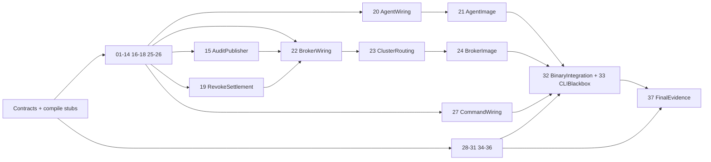

> Documentation pointer: P36 live contract is architecture §22.10; unchecked claims and the bounded audit are in hot-update-tasklist.md / test/hotupdate/README.md. All S7 product receipts remain PENDING / NOT_RUN; this pointer does not amend the frozen plan.
# S7 · transfer-continuation 定稿计划（XL）

状态：**lead 冻结（2026-10-12）**。下方「lead 定稿裁决」覆盖正文及候选「定稿裁决」表中的任何冲突；正文其余部分即为绑定计划。本稿不是实施或验收收据。

## lead 定稿裁决（冻结；覆盖正文）

| # | 裁决 | 落点 |
|---|---|---|
| LQ1 | **采纳 Q1 推荐，并加有界出口。** `session rm` 遇未结清的 receiver 提交权/未确认 START·TERMINAL 时，会话保持 `DELETING`、返回 rc75 并在错误中列出 pending transfer ID 与原因；结算完成后才删 history/OBJ/SQL。原 agent 永久不可达时不得无限阻塞：运营者显式 `session rm --abandon-unsettled-transfers` 为每个未结清 transfer 写一条 exact canonical TERMINAL（kind `failed`，reason `settlement_abandoned`，`outcome_unknown=true`），再按正常顺序删除；该终态**从不**声称 complete，`transfer-status`/history 如实呈现 outcome unknown。无此 flag 绝不删除。flag 进 CLI golden、usage/broker-ops 文档与错误码↔exit class 表。 | §6.4、P19、P27、P36；新增负控：无 flag 时 rc75 且无删除；有 flag 时 terminal=1 且 `outcome_unknown` 为真 |
| LQ2 | **采纳 Q2 推荐。** 生产 `transfer --rate-limit`（0 = 原公式与原行为），预算从原 start 计算、持久化于 `BudgetSeal`，超过 2108s 在首块前拒绝。 | §1.2、P01、P25–P27 |
| LQ3 | **采纳 Q3 推荐。** 存储条件不满足恢复地平线时首块前以 `transfer_storage_horizon` 明确拒绝，并在消息中给出所需 `Duplicates`/`MaxAge`；不自动改 TTL、不降级到 legacy。§5.3/JS11 的两处 reaper `List` 必须是有界 ctx + cancel/join —— 这同时关闭现网 OBJ_xfer 带 MaxAge 时 reaper 卡死并冻结全部 reconcile pass 的已知缺陷，必须有回归测试与变异收据。 | §2.1、§5.3、P04、P17 |
| L15 | **立即开工，不等 S6 drill 收口。** S7 各包以 S6 候选快照为基线并行实现；S6 收尾包（FIX-BLACKOUT 的 reliable-exec/控制准入路径、FIX-ROLL 的 `internal/cli/cluster_roll*.go` 与 `test/p13`、FIX-ORPHAN 的测试进程监管）在跑期间，S7 包不得编辑这些文件；集成包（P32）在 S6 收口后的树上重新验证。 | §12 DAG |
| L16 | **每个被测试拉起的进程都必须随测试死亡。** `test/transferharness` 与所有 drill fixture 使用 FIX-ORPHAN 交付的共享监管 helper（测试 panic/超时/SIGKILL 后零存活后代，按 PID+start ticks 普查）；不得各自写 Pdeathsig。 | P29、P32、P33、P35 |
| L17 | **重型套件从第一天按测试分区。** 新增集成/黑盒测试进 `test/e2e/parallel` 时按 FIX-MATRIX 的 per-test 分区模式登记，单元预算 600s 不变，实测超过 70% 的单元在本阶段内拆分或降开销。 | P35 |
| L18 | **包只跑授权的定向检查。** 三硬闸、`make gates`、whole-race 矩阵、Darwin 与 drill 只由 lead/P37 在同一候选上跑；drill 与 go test 严格串行。 | P37 |

## 候选稿原状态行

本稿合成时状态为候选。核对基线为 `0c7642e932432cad019e41f62cc8a24459158417`，只读 `git status --short` 为空；四稿的 `f2c9f54…` 与评审的 `2742ccf…` 均不是当前 HEAD。已读四份草案、四份评审、指定契约及实际实现；未运行 build/test/vet/lint/drill、部署或 installed `tether`。所有尚未实施的测试、平台和演练均为 `NOT_RUN`，成本为 `ESTIMATE / NOT_MEASURED`。

权威边界：上位 stages-plan 的阶段范围及 lead 已定裁决优先；沿用 `CLAUDE.md`、architecture §21/§22.4–§22.9、testing-standards 和冻结 S5/S6 合同。S0–S5 已关闭；S6 已实现 single / sole voter / N=3 的真实 same-PID broker cut，最终 gates/drill 关闭是本阶段实施入口。现有文档的旧 “production integration pending” 不覆盖实际代码，也不替 S6 补造 GREEN。S7 不接管 S8 的 ctl 死亡后重接管、SID/authority incarnation、两代事务与 legacy 首次迁入，不接管 S9 的 NATS/Caddy **binary** 切换，不接管 S10 五代全栈总验收。只有阶段内审，不新增阶段独立外审门。

## 定稿裁决（候选；lead 冻结后覆盖正文）

| # | 选择与理由 | 机械落点 |
|---|---|---|
| L1 | 一次调用只铸一个 `transfer_id`，一次 prepare 固定一个 NUID。采用自有 receipt writer；SDK `Put` 每次生成新 NUID，重试它不能满足同对象续传。 | §2、§7；capable 调用图中不存在 SDK Put；M01/M02 |
| L2 | 单 pending chunk，`idx→stream_seq` 为恢复依据；subject CAS 加 stream CAS。拒绝尚不知道上一 ACK seq 就发下一块的 bounded-4 猜测；stream seq 仅作条件写围栏，不作传输进度。 | §2.2；默认 120s 真超窗、迟到原包和 retry 竞争 |
| L3 | 只导出完整且已 Sync 的 sink 前缀；不导出未 Sync 的 partial suffix。选择较小状态空间，原 owner 在 freeze 前收齐或截回已 Sync 前缀；Import 不修文件。 | §3；short-write、Sync、SHA/offset/seq 联合断言 |
| L4 | `CommitReserved`、`Decided`、`HistoryConfirmed` 分立。broker 先持久授予 receiver 提交权；授予后只有 receiver 的闭门/primitive outcome 能裁决，watchdog 不能猜 failed。 | §4；两 tier、两 receiver；M06 |
| L5 | 完整 canonical START/TERMINAL 和未确认 publication 责任进入 ledger/image。Raft commit、NATS Flush、某 terminal 存在均不是 exact history ACK。 | §5；single/N3 同一 history CAS/readback 协议 |
| L6 | `status.state` 仅 `unknown/live/terminal`；`phase` 描述细节，complete/failed 是 terminal kind。unknown 只来自原 origin 的完整、就绪 census；unavailable 是错误。 | §6；不保留 O/W 各自相斥词表 |
| L7 | 创建 permit 与只读 status 分开；原 origin、entry nonce、intent、actor、agent instance 全绑定，permit 过期只阻止首次创建。它消除 result GC 后迟到 prepare 重造 worker 的窗口。 | §6.1；broker/agent 两端校验；M07 |
| L8 | 采用 public `ImageRef` 加 leaf sealed codec；不把详细 Snapshot 塞进 Bundle，不建 128MiB 私有池。沿用全 cut sealed32MiB、non-replay64MiB、shared replay256MiB 的共同预算。 | §8；真实 descriptor/encoder 双向库存 |
| L9 | 接受生产 `--rate-limit`，预算随 rate/size 从原 start 计算并持久化；零值保持原公式。四任务 live 窗必须靠预登记产品速率形成，不能 fixture 暂停 worker。 | §1.2、§10；lead 产品确认 Q2 |
| L10 | session 删除先撤销业务权限，transfer settlement barrier 完成后才删 history/OBJ/SQL；提供原责任专用的结算认证。保留审计与 auth 重连路径才能真实验收撤权。 | §6.4；lead 产品确认 Q1 |
| L11 | v1 要求 OBJ 保存期覆盖恢复地平线，并要求 history 保持不可提前淘汰。保留 48h OBJ 和已有运营配置；不满足者在首块前明确拒绝，不悄悄改 TTL 或降级。 | §2.1、§5.2；lead 产品确认 Q3 |
| L12 | legacy cap0 仅在创建前明确协商后进入一次性旧路径；已发送未知结果一律先查询。旧 ctl 仍收到 exact history ACK 后的旧 `ev.transfer` 通知。 | §7、§9；timeout 不触发 legacy fallback |
| L13 | broker tracker/watchdog 与注释原样搬到 leaf，再单独评审状态增量。新业务从第一天落最终 leaf，父包仅 wiring；不预支结构帽或安排尾声 slim。 | §11、§12；移动前后测试/扫描器映射 |
| L14 | `63` 正 parent 仅合并正臂，预期红 mutant 有独立 controls manifest。每个 sender/receiver leg、每个 cut 都独立非空，SHA 不能代替 syscall、OFD、history 和结束封口证据。 | §10；native 五态及 missing-child 阻签 |

## §0 六出口与范围逐项闭合

| exit | 必须取得的收据（AND） | 主 owner / 测试 |
|---|---|---|
| E1 对象 | 固定 NUID、每 idx 唯一物理 chunk seq、完整 size/SHA、SDK Get 可读；writer/read checkpoint 在 pinned embedded NATS 同 store_dir restart、R3 JS leader 故障后继续。默认120s超窗同时覆盖已接纳丢 ACK 与“查询 absent 后原包迟到”。 | P02/P03/P04/P14；T01–T09、T25 |
| E2 worker | 真同 PID A→B→A；prepare cache、source/tmp/parent 原 OFD、游标/摘要/预算、cancel 和 courier 同 cut；一次实际 rename/link effect；terminal ACK 前继续、后停止。 | P05–P10/P20/P21/P32；T10–T19、T35–T38 |
| E3 tracker | tracker/watchdog 全迁移，committed/entry identity/original start/预算保留；导入 live 优先于 primary/outbox 两处 reaper；single/N3 exact start=1、terminal=1；禁用导入后的 reaper mutant 必红；broker stripped code 明确下降。 | P11–P19/P22–P24；T20–T31、T39 |
| E4 ctl | 真二进制 tier A/B push/pull，在 prepare、Put/Get、Sync、commit/rename、finalize/courier 窗跨 agent/broker cut 与同 store JS restart；原 ctl PID、原调用 ID、原对象，目标只呈现旧完整或新完整内容；sent-unknown 不能触发 SDK Put。 | P25–P27/P32/P33；T32–T40 |
| E5 deploy | `63.A/A1/B/C1/C2/C3/R1/R2/X/W1/W2` 与 parent native GREEN0；四独立 session/bucket，small=66,549,440B 和 large=1GiB 各 push/pull；真实 Caddy/WSS，逐 leg 的 agent→broker→rollback cut；默认 reaper，10/s control slots，独立 cancel/session-rm victim；61 全41断言 GREEN；37.T single/N3 更新后 GREEN；独立64 controls被原 oracle 杀死。 | P28–P30/P37；§10、T41–T47 |
| E6 纪律 | 同候选三硬闸 `make test` / `make e2e-parallel` / `make lint`，另 `make gates`；whole-race、direct 五轮 goroutine+FD、所有库存/反向扫描/controls；Darwin cross-build/test-binary compile 与 native 分列；文档只按真实收据签。 | P34–P37；T48–T54 |

§S7 scope_in 的九项分别落在：writer/metadata/dedupe/receipt→§2；reader/chunk/hash/UNSUB-PONG→§3；worker/cache/FD/courier/legacy→§4/§8；tracker/watchdog/committed/startbudget→§5/§8；ledger/outbox/live-GC→§5；broker 幂等 prepare/commit/finalize/status→§6；ctl 同调用续接→§7；取消两侧 transfer busy→§8.4；真实 WSS 与 drill63→§10。上位 exits 的两大小、双向并行、120s 与 reaper 反例不得用短文件替代。tasklist 只签 B-3/B-6 中 transfer 半及 E-1/E-2/E-3/E-5/E-6；E-4 的持久化单 writer 已属 S6，不能重签或扩大 F/G/H 总项。

统一 receipt 必含 `source_sha, dirty_digest, artifact_sha, running_sha, test_or_arm, command, native_rc, mutation_id, raw_path, oracle_input_sha, reader_digest, wall_s`；cut 再含 `pid, process_start, boot_id, image_generation, cut_id`。当前全部 NOT_RUN。安全 defer 不替成功出口；窗口已过为 INCOMPLETE4，观察 custody 缺失/poison 为 SETUP-RED2。

## §1 代码核实、预算与命名

### 1.1 草稿/评审事实裁决

行号均指本稿 HEAD；SDK/server 行号指 go.mod 固定的 nats.go v1.52.0 / nats-server v2.14.6 module 源码，不是网络最新版。

| 争议/遗漏 | 代码证据与裁决 |
|---|---|
| SDK Put 可用同 name resume | 错。`jetstream/object.go:651` 每次 `nuid.Next()`；`:768–802` 是新 meta/旧对象 purge。`cmd/tether/transfer.go:682–694` rewind 后再次 Put 正是红线；P25 删除 capable 可达边。 |
| pointer CAS 已保证落地与终态互斥 | 错。`internal/broker/transfer.go:409–440` 仅认领 tracker/finalized/committed；`internal/transferpath/path.go:580–626` 独立执行 Renameat/Linkat。TE/CR 对。 |
| single publish 是 core best-effort，没有 JS ACK | 不准确。`internal/broker/broker.go:835–855` 已调用 JS PublishMsg 并返回错误；真正丢错在 `transfer.go:1115`，`:1153–1159` 仍无条件 onCommitted。保留原 primitive，修调用链。 |
| Raft 0011 去重能保证物理 history 一行 | 错。`internal/brokercontrol/audit_publisher.go:243–267` 允许 truncated Aux 跳过；`:388–413` 仅 MsgID；`:470–477` 重放可再次 publish。CR/TE 要求 exact history proof 对。 |
| 布尔 terminal 查询足以 ACK complete | 错。`internal/jsstream/jsstream.go:545–550` 遇到任一 complete/failed 即 true。新路径枚举完整匹配集并比较 exact canonical bytes；旧 helper 不可作为 v1 ACK。 |
| single staged replay 已退休 ledger | 错。`internal/broker/xfer_inflight.go:595–607` 已 committed 分支可直接 true，cluster `:615–638` 才有 cleanup/consume；两支都归统一 finalizer。 |
| ledger 晚 size 更新安全 | 不能据此承诺。`xfer_inflight.go:42–69` 未存 rate/effective budget；`:256` 读改写 terminal。所有 mutation 改 revision+nonce 串行，START 不得覆盖 exact terminal。 |
| 删除会话后按原 auth 重连交 terminal | 错。`internal/broker/audit.go:87–108` 先删 history/OBJ 再删 SQL；`internal/authcallout/handler.go:261–280,360–367,499–504` 对非 active 拒 CONNECT。须 §6.4 产品结算路径。 |
| 新 status 自动广播到原 owner | 错。`internal/broker/clusterwrite.go:61–64` 是旧 leaves 闭合名单；`internal/broker/reexec.go:313–322` 另有 hot 表。W 对其 owner 的要求采纳，其余补齐。 |
| continuation 可沿用 ONLINE gate | 错。`transfer.go:1757` 拒 STALE；gotcha #90 的已接纳续接与新准入须分开。 |
| reader 现有 hash/游标等于持久进度 | 错。`internal/jsstream/object_reader.go:209` 先 hash 后交调用者；`filetransfer/handler.go:415–435`、`cmd/tether/transfer.go:1011` 到 EOF 才 Sync。采用真实 Sync-prefix。 |
| failed PONG 的 dirty guard 已长期保留 | 错。`object_reader.go:127–133` refs0 删除记录；`:279` failed barrier 之后最后 Close 可抹掉保护。JS/CR 对。 |
| 同连接 cancel/join 排除迟到 Publish | 错。nats.go `nats.go:4458,4524` 检查 payload+headers、再入 reconnect buffer；`:1211–1215` 关闭缓冲值是 **-1**，0 是默认8MiB（`:1810`）。还需 retirement fence。 |
| subject CAS 经 purge 永久可靠 | 不足。server `stream.go:6454–6477` 无最后消息时 expected0 可再次通过；`:6492` 支持 stream-last CAS。`filestore.go:10363–10389` purge 保 LastSeq 单调，只有显式 reset/recreate 可重置，后者不属续传。 |
| UpdateObjectStore 保留 Duplicates | 错。SDK `object.go:559–595` 重建 config；broker `transfer.go:865–868,963–965` 两全量更新路径会丢该字段。所有 tether writer 要走 §2.1 配置归属。 |
| TTL List 只有一个风险点 | 错。`internal/broker/transfer_reconcile.go:253,401` 两处都 List；`:356–377` orphan purge 仅凭 age/reference，不能证明外地 live 不存在。 |
| tmp 为 O_RDWR，parent 已 Sync | 错。`transferpath/path.go:507` 是 O_WRONLY；`:458` done 合并关闭与完成，`:580–626` 无 parent Sync 且 link 成功后 unlink 失败被忽略。新目录 Sync 是语义增量，不能写成保持旧行为。 |
| Agent 已有持久 worker，farewell 可装 capability | 错。`internal/agent/transfer.go:17–34` 每次建 Handler；`:73–98` 只是带 TTL 的 prep cache。`instance.go:549–554` farewell 只有 inert releasing/roster flags；capability 要在正常 REGISTER/安装路径接。 |
| pending image gate 全在 upgrade_image | 错。`internal/agent/upgrade.go:659–711,861–902` 才管 prev reader/required domains；`upgrade_state.go:497` 一带管 durable commit 释放。P21 同时认领。 |
| S6 partial ACTIVE 已替 tracker 兜底 | 还没有。`internal/brokerimage/import.go:152` 先 ACTIVE、`:166,173` 开 store/control、`:222` CurrentOwners 仅三个 owner；`broker/reexec.go:782` 仍无界 WaitTransferAudit；`broker.go:1544` 有 eager cold finalize。P24 加第四责任并修顺序。 |
| public broker image 尚未入库存 | 评审对：现 `test/architecture/image_field_inventory_test.go` 已含 broker roots。只追加 transfer reachable ref，不能另造第二套 broker public inventory；`broker_state_inventory_test.go:30–40` 的S6 private **九kind**集合保持独立，其中四kind归broker-state-v1、五kind归broker-tunnel-state-v1。 |

### 1.2 固定期限、容量与进度单位

业务大小仍 `XferTierAMaxBytes=8MiB` / `XferMaxBytes=2GiB`，per-bucket single-flight 与 tracker 1024 slots 保持。tier A 总字节期限30s；tier B：`effective_rate=min(2MiB/s, requested_rate)`（0 表示2MiB/s），`effective_budget=max(300s, 2*ceil(size/effective_rate)*1s+60s)`，超过 `XferTierBMaxBudget=2108s` 在创建前拒绝，不能截成2108s后假称满足低速。旧 `XferBudget(tier,size,legs)` 和旧零字段行为不改；新三端消费同一 `BudgetSeal`，端的一腿预算也受原总 deadline 限制。pull source 未知时最多给2108s provisional ceiling；source pin/stat/hash 后、首块前把实际 size/SHA/rate/budget seal 到原 ledger，再从**原 startedAt**收紧。

本机用 BOOTTIME+bootID；跨机 wire 只传 `remaining_ns`，receiver 从 receipt 再扣此次 request 的完整 elapsed/已知排队时间，禁止比较不同机器 BOOTTIME 或重置完整预算。control logical operation≤5s；maintenance 仍沿 S6 固定≤8s，不因 transfer 延长；`upgradebudget.TransferProgress=10s` 是 healthy transfer 的持久进展窗，不借 flow 的5s或杜撰50%吞吐门。fault/slow 采用开始前冻结的 profile，记录不可用区间，不把该区间伪作 healthy。

`ByteDeadline` 到期关闭字节/rename新准入；`SettlementAttempt` 每次≤5s、退避500ms–2s，只传同一 outcome；`ResultRetention` 至少10min且越过 creation permit 到期；`OutboxLifetime` 到 exact history ACK/责任退休才结束。未决 grant、cleanup、未交付 START/TERMINAL 不按上述 TTL 消失；它们占原 slot，容量满拒新任务，状态暴露 pending reason，后台 owner 持续尝试而非 LIVE 永久屏蔽自身 finalizer。

恢复地平线 `ObjectRecoveryHorizon=2108s+120s=2228s`；OBJ `Duplicates>=H`，MaxAge=0 或 ≥H，server duplicates ceiling 可满足，存储 reservation 覆盖原版本直至结清。48h TTL 合法；短 TTL/服务器限制是显式 `transfer_storage_horizon`。窗长不是正确性的唯一锚，§2 CAS 仍需通过默认120s的独立测试。

## §2 固定版本 writer、配置归属和删除围栏

### 2.1 首块前的完整准入

`xferbucket` 接管 ensure/raise/converge 的策略，`jsstream` 保留低层 API。已有流先 INFO；只有权威404才 CREATE；resolve-before-create、disk/account/server sizing、raise-only replicas、不能 MaxBytes<=0、small-disk legacy收缩保护全部保留。修改已有流只复制**完整** `StreamConfig` 后改所拥有字段，不能经 `ObjectStoreConfig` 重建。创建后也 INFO→完整补 `Duplicates`→再 INFO 确认；确认前不给 writer 首块许可。

跨 broker 的 full-config writer 统一归 current cluster leader 的 `xferbucket.Coordinator`，single 为本机同一 coordinator；bucket key 串行，home 的 ensure、replica raise、size converge、publisher/reconcile 都提交 patch，不带旧 snapshot。用现有 cluster forwarding envelope 增加闭合 `transfer-bucket-config` verb，handler 只调用 coordinator，不加 OpType/SQL migration。配置API没有revision CAS，故leader身份本身不够：移交必须拿到旧coordinator“future gate已关且所有Update请求已有确定响应”的retirement proof；存在sent-unknown更新就保pending intent并拒新coordinator写配置，不能仅INFO相等便猜迟到请求已消失。计划cut在原deadline内join不了即defer；非计划旧owner丢失而无法取得proof时，既有传输继续，新的配置变更/依赖它的准入明确unknown，不能以可用性为由开启第二writer。读回digest与当前期望不符拒本次admission；运营者并发修改不属于tether内部单writer协议，检测到冲突则拒绝且不重放旧snapshot，文档要求配置维护避开更新事务。配置writer scanner扫全部UpdateStream/UpdateObjectStore emitter，不只新文件。

三端协商 `ChunkSize`：上限1MiB，下限32KiB，取 ctl、agent、broker实际 NATS MaxPayload 与 stream MaxMsgSize 的最小值，减去**实际编码的完整 headers**；metadata 单独检验。使用带最长 idx/seq/IDs 的编码上界，不能减一个拍脑袋常数。首块前固定 geometry、预留 `ceil(Size/ChunkSize)` receipts，最多65536（2GiB/32KiB）；大小/geometry 不兼容拒绝。重连后服务器上限更小则保持版本并报错/unknown，不分块改几何；同名新 NUID不解限。

### 2.2 receipt 状态机

chunk subject 保持 SDK `$O.<bucket>.C.<nuid>`；metadata subject/JSON/digest (`SHA-256=`+SDK格式)/chunk_size/size/chunks/NUID 均与旧 SDK相容。自有 headers 固定 `Tether-Xfer-Version=1`、`Tether-Xfer-Index`、`Tether-Xfer-Offset`、`Tether-Xfer-Length`、`Tether-Xfer-SHA256`、`Tether-Xfer-Intent`；`Nats-Msg-Id=xfer:<nuid>:<idx>` 仅窗内加速。receiver 校验 header 与已 seal 的版本；旧 SDK reader 可忽略扩展头。

chunk Index固定从0开始；checkpoint/status的ChunkIndex表示已Sync完整块数量，初始0、EOF为Chunks，下一个chunk的Index恰等该计数。DurableOffset指下一写入位置，LastConsumedStreamSeq初始0，仅指最后已Sync块；Header的idx/offset/len用无符号十进制，SHA256用64位小写hex。

每次只允许一个逻辑 pending chunk。attempt 固定 `{idx, offset, length, sha256, bytes, previous_subject_seq, expected_stream_seq, attachment_generation}`：第一块 subject expected=0，其后等原 receipt seq；再带 `Nats-Expected-Last-Sequence=expected_stream_seq`。其他 subject 写入导致 CAS拒绝时，先扫描原 subject 的 exact idx/bytes/header；确认 absent 且旧 attempt 的 stream fence 已被推进才构造下一 attempt。冻结/重试不能改旧 attempt headers、另铸 MsgID/NUID 或靠全流 LastSeq 猜已写块。

默认超窗负控固定时间线：t0查询absent并构造/实际发送两个同idx、同MsgID、同expected序号的竞争attempt；网络fixture先保留retry帧。t1放行原publish、让server接纳但丢ACK；一直保留已经sent的retry帧，到t1+120s+5s才放行它。此时MsgID窗确已过，CAS仍拒绝迟到retry；去CAS后出现两个物理seq。同一时刻才首次接纳两个请求会被新dedupe窗掩盖，不能算该mutant被杀；只在accepted后readback也不满足。history跨窗使用同样的已sent帧时间线与其subject CAS。

收到 ACK 时 raw readback 核对 seq/subject/header/body digest，持久对象 ACK 才推进 receipt 与 source cursor。ACK 丢失时同样按 idx/raw subject 查：exact一条→采纳；无条→CAS retry；多条、错序/不同内容→`transfer_object_conflict`，保留证据。第 N 块的 receipt 完整后才允许 N+1。传输 seek/read 使用原 source FD 的 ReadAt，不能根据新路径重新打开。

meta 仅在全部 receipt 连续、总 size/hash 核对后发布；记录原 metadata seq，expected-subject-seq CAS 只允许 absent 或**原版本原内容**；同名其他 NUID/geometry 一律 `transfer_object_version_mismatch`。lost meta ACK 读回 exact SDK JSON 才确认；不重 Put，不提前暴露半成品。source 预 hash 和发送后 fstat/hash 必须相符；同 inode 被改写不是快照，报 `transfer_source_changed`，不发布 meta。

### 2.3 迟到 HPUB 与 finalize-only cleanup

transfer data attachment 用专用 NATS connection，`ReconnectBufSize(-1)`，单 pending、关闭 admission 后 join 原 writer。cancel/ctx 返回不能被当作 server 已拒旧包；旧 attachment 的所有已发送 attempt fence 仍在责任表。finalizer 取得 writer 未来不能再铸 attempt 的正证明（正常 stop/join 或原进程死亡的权威证明），reader consumer 全退役后，按当前 stream seq 写入原 metadata 的 SDK deleted tombstone，使用 meta seq CAS + stream CAS。这个 **retirement fence 的真实 ACK** 必须晚于全部旧 attempt 的 expected stream seq，才允许对**原 NUID精确 subject** purge。即使原首包迟到且该 subject 已空，旧 global expected sequence 也必失败。ACK不明则读回/重试 fence，不能先 purge。

stream incarnation 固定为 stream name+created时间/配置身份；不允许 delete/recreate/reset 后继续，INFO不明保留 cleanup_pending。server filtered purge/TTL 不降低 stream sequence 的依赖以 pinned server 测试固定。无 writer停止证明、无法取得 fence ACK、foreign metadata、consumer delete/UNSUB 未结清都保留 slot/ledger/cleanup owner；GC 不可绕过 finalizer 调 SDK Delete。meta CAS 与 purge 间出现别的同名版本时，只保护/报告冲突，绝不能删除它。T04须证明 cleanup 完成后旧 reconnect HPUB不能复活对象，非仅“worker goroutine已退”。

## §3 reader、可信原子路径与持久 checkpoint

reader 保持每连接4 message且受 bytes window上限约束，最大32MiB/连接并记入共同 non-replay账。读取有自己的 `Fetched` cursor；只有 receiver 对完整 chunk 的真实 WriteAt 完成、`Sync()`成功后才能 `ConfirmSynced`，一次锁内提交 `{chunk_index, durable_offset, last_consumed_stream_seq, sha256_state}`。hash只覆盖这个前缀。`n>0,err!=nil` 必须先计真实 n，short-write继续剩余段或失败；不按请求长度记账。采用每完整块 Sync，healthy每10s有真实 durable advance；Sync阻塞无法靠确认消息冒充推进。

重连与连接仍健康两种恢复都实现：`ErrSlowConsumer`、subscription Dropped增加、delivery序号缺口、consumer删除、短批且nil、末块 timeout 都触发旧 fetch cancel+join→UNSUB+PONG→退役旧 consumer→从**已 Sync 的 stream seq+1**建新 consumer。新 consumer delivery ordinal从1计；全流 sequence 孔洞合法；不能拿旧 delivery count当全局 offset。Get metadata先验证固定NUID/size/SHA/geometry，cursor越界拒绝；读到EOF须验证总chunks/bytes/hash，不能短读成功。

`objectWindow` 的 dirty 状态独立于 reader refs：最后 Close 后 refs0但 PONG失败仍保留，后续 Open 同 Conn 先补 barrier；只有真实 barrier完成或物理 Conn关闭才清零。每 dirty Conn有唯一 bounded cleanup owner，旧 consumer删除责任可随 image携带并由恢复后的管理连接重试；内存已满拒绝新reader，不丢 dirty guard。两处TTL `List`使用真实可取消 context和截止（每 pass≤5s），取消后 join、释放 reconcile单飞锁，下一pass必须可进入；不准 fixture写meta解卡。

`transferpath` 增加可交接 AtomicReceiver，保留 root/path traversal/symlink/force/no-force防护。tmp沿用 O_WRONLY，不要求 Import读它；所有 IO用明确offset。receiver Freeze先关闭新写、join本轮，若有 partial suffix，**原 owner** Truncate到已Sync offset再Sync，hash/seq保持该前缀；失败/FS D-state超时保原owner并defer cut。pristine Import只读stat/flags/身份和checkpoint，要求size等于prefix，不Seek/Truncate/Fchmod/改共享OFD flags。源、tmp、parent均用原OFD转交，禁止按 `/proc/self/fd` path重开。

提交为局部不可切临界区：在有效 Grant下关闭 cancellation gate→真实 Renameat（force）或 Linkat（no-force）→记录 primitive outcome→parent Sync→关闭资源/记录cleanup。Freeze只能在其前或其后完成；不能把“syscall已进，结果不知”导出成未开始。Linkat成功即 landed；随后Unlinkat失败是cleanup_pending，不能第二次link/rename。parent Sync是新增行为；失败时保 `landed=true, durability=unknown`，不合成failed也不重跑primitive。仅在durability已确认时确定complete；后续可重试目录Sync。真正kill-9落在primitive与outcome登记之间，按§9诚实unknown，不承诺exactly-once crash recovery。

phase对应FD闭包：prepared持parent/验证身份；sending持source；receiving持tmp+parent；landed但待dirSync持parent和必要tmp cleanup引用；terminal courier-only无数据FD但仍有outcome/认证/重发责任；settled无隐形FD。done不是“成功”布尔值，改为明确 primitive/close/cleanup阶段。独立observer保原FD witness，用Linux kcmp(KCMP_FILE)或等价内核OFD比较签连续性；dev/ino/offset只能签inode，不能代签OFD。

## §4 worker、提交权与终态 courier

`xferworker` 是 Agent生命周期 owner；`xferreceive`/`xfersend`/`xfercourier` 是其有界子 actor。prepare cache、pinned source、原子receiver、pending writer/reader、两端期限、取消/撤权、结果/courier同一registry；session ctx替换只换transport bindings，不停止任务。真正 Agent.Stop/session_destroyed/register-gone走显式Revoke/Stop。每个 Control检查identity/entry nonce/owner generation，过期callback不可完成新entry。

| 状态 | 允许的转换与责任 |
|---|---|
| `Open` | 接纳/收发；deadline/cancel可先关闭receiver gate，得到“不曾进入提交”的真实确认后决定failed。 |
| `CommitReserved` | broker已持久记录Grant，可能回复丢失；仅原receiver可进入primitive。timeout/revoke只能请求闭门并询问outcome，不能抢写failed。 |
| `Decided` | canonical outcome和canonical audit bytes一次不可分的决定；不得只设置finalized再稍后造Ts/ReqID。 |
| `HistoryConfirmed` | exact START和TERMINAL receipt存在；可ACK courier、兼容旧ev，不能只凭Raft index。 |
| `CleanupPending` | writer fence、OBJ purge、tmp unlink、ledger退休尚有责任；不重复业务效果或审计。 |
| `Settled` | 所有owner可证明退休；只保有界结果缓存至permit/result retention均结束。 |

两receiver（push agent、pull ctl）和tier A/B都在实际primitive前调用 `Reserve`；不是当前 `markCommitted`（它只说明 broker已开始转发commit）。Grant `{entry_nonce, grant_nonce, receiver_instance, terminal_id, intent_digest, object_version}` 在primary或fallback outbox真实Sync后发出，重复reserve返回同Grant；双目录不可写时不授予提交权。Grant一旦可能发送，不能因deadline/Grant ACK丢失解除责任。receiver保存Grant与本地gate；再次收到reserve/commit只回原状态。

TerminalID固定为hex(SHA256("xfer-terminal-v1\n"+SID+"\n"+TransferID+"\n"+EntryNonce))，Grant与未授Grant的确定失败共用同一terminal slot；START有独立start identity，content ReqID仍由canonical row派生。未授Grant失败的ReceiverOutcome.Grant为零值，只能在Open且有closed-gate/no-syscall证明时被接受；空Grant不能授权primitive。

cancel获胜须有receiver不可逆关闭gate且no-syscall的确认；之后任何迟到Grant/commit不能落地。rename先赢则 `already_committed` / pending-durability，绝不改成failed。已进入syscall但结果不明，保留CommitReserved及原owner/slot；允许主命令按截止exit74并给只读status方法，但后台不能“替用户重试整文件”。kill或origin不可达后没有closed-gate/outcome证明，不因60s slack合成failed。冷恢复只有旧schema/start-only、或新schema确认未授予Grant且worker已闭门的责任可沿确定性合成规则；已授予Grant不能猜。

courier保存exact bytes、TerminalID、reply、authentication binding、attempt/ACK和cleanup责任。每次重发同bytes，ACK同时核验identity、kind、canonical digest、history stream+seq+record digest；收到相反terminal返回 `transfer_terminal_conflict`，保双方证据，不ACK。transport离线不释放courier，数据deadline只停止新字节。new broker确认后发旧 `ev.node.<nid>.transfer.<id>.<kind>`，兼容oldctl；旧事件入口映射回同一decision，不另建审计。cap0 oldbroker的legacy ev只能标best-effort，不能写`history_confirmed`。

## §5 tracker、ledger、history 与 reaper

### 5.1 原样迁移与不可覆盖记录

把 `transferEntry/transferTracker/reaped`、identity CAS、bucket/maxentries、`claimAbandonedPush`、committed区分、watchdog和历史注释从broker整段搬到xfertrack。评审交付两个diff：机械移动视图与状态机增量视图，不能用删注释换行数。callbacks改接口是机械适配；新增Grant/creation fence/HistoryConfirmed明确列为行为变化。Broker只保旧方法薄adapter和当前bindings，不在父包新增GC/业务状态机。

`xferledger.RowV1` 持 `{Identity, Origin, Permit, Intent, EntryNonce, Revision, SourceSeal, StartedAt, BudgetSeal, Phase, Grant, ReceiverOutcome, CanonicalStart, CanonicalTerminal, StartDelivery, TerminalDelivery, HistoryReceipts, Cleanup, Retention}`。source seal、terminal staging、historyACK、cleanup退休都在同一entry serializer下revision CAS；字段只允许规定单向增补，不能读旧start文件覆盖terminal。canonical JSON字段序/归一化沿schema，broker Ts只铸一次，ReqID仍由exact normalized record内容派生；START也持久stage且可跨leadership replay。

primary/outbox写tmp→file Sync→rename→dir Sync的现有规则保留。exact terminal优先于start-only，outbox先对账；两目录same-key出现不同canonical值是conflict，不覆盖、不删除、不任选一个ACK。image/磁盘/history任何不一致同样fail-closed。consume顺序primary durable unlink先，成功后outbox；按key+entryNonce+revision退休，不能裸ID删除新entry。single staged已确认分支也必须走cleanup+consume。两目录皆不可写时保内存decision、高声报错、不发durableACK；后续planned cut可带内存责任，但真实崩溃不假称它已持久。

### 5.2 exact history，不依赖 dedupe 窗或 Raft Aux寿命

`xferhistory` 是single直接publish和N3 `AuditPublisher.PublishTransferAudit` 的唯一v1 history写入器。继续原 `proto.SubjAuditTransfer(sid)`，旧history消费面不改；schema仅加omitempty的continuation identity/TerminalID字段。创建前检查history `MaxAge=0`、`DiscardNew`、无按条数/subject限额驱逐旧记录，拒绝不安全配置；容量满返回pending而不淘汰证据。S7不自动改运营者的history retention。

算法固定：读现有 `SubjAuditTransfer(sid)` 的last subject sequence H（无消息为0）；在有界pass中按该subject完整扫描该transfer在≤H的所有START/TERMINAL原始行，校验完整canonical内容和计数。exact唯一已存在→返回其seq/digest；任一相反/重复/不可解码匹配行→conflict/unknown；确证absent→用 `Nats-Expected-Last-Subject-Sequence=H` 发布exact bytes。SDK有 `WithExpectLastSequencePerSubject`（jetstream_options.go:643）。所有迟到attempt都保原H，同subject其他transfer插入会使CAS失败并重新scan；原包与retry争同H至多一个成功。其他audit.call/proc/port subject不改变此CAS，持续10/s控制审计不会使terminal永久饥饿。scan不能在第一条terminal提前返回；用subject-filter跳过其他审计而非逐条遍历整个history。scan超时返回unknown保outbox，不把不完整扫描当absence。history不TTL/rollup/手工purge且不删除未结清session，故已写transfer-subject末序号不会退回0；这与可purge的OBJ不同，history无需全stream CAS。此证明跨120s、leader换代和publisher checkpoint失败仍成立。

默认窗的独立测试直接构造相同production Writer而保留JS Duplicates=120s（绕过的是broker准入fixture，不是receipt/CAS算法）；T05另证生产准入强制≥H。history默认窗亦为120s（`internal/jsstream/replicas.go:25`），T24按真实墙钟穿过它，不把配置改短代替超窗。

N3仍先通过现有 `OpTransferAudit`+content ReqID提交canonical row，**不新增 OpType/commandVersion/SQL migration**；Raft ACK只更新`raft_committed`。publisher收到同Aux或重试ReqID均调用上述guard，真实history receipt另回origin。origin在exactSTART/TERMINAL receipt前一直保本地outbox；Aux被截断仍能重新提交同canonical row，不能信publisher“checkpoint已越过”而退休。v1不得走session-gone accepted bounded loss返回nil的旧分支；无history即unknown/pending。source owner故障且本地盘丢失不承诺无损，保持§9边界。

只有exacthistory确认后才ACK courier/ctl、发布旧ev、允许清理。old无v1字段的历史事件继续原兼容路径，不能给它贴v1确认标签；同candidate所有可能成为leader的broker都须具v1 guard能力，否则创建前协商legacy。测试同时验证同一ReqID/Apply=1但physical history=2的mutant会红。

### 5.3 GC 与活责任优先

新leaf `xfergc` 只产生候选，不能直接Delete/Purge。local `Live`（含已导入sleeping、pendinggrant、pendingstart/terminal/cleanup）在primary和outbox两处disposition都先于年龄判断；manager自己的finalizer仍被调度，不因Live把已决定结果永久挡在replay外。原corrupt/unreadable/quarantine/census错误保守语义全保留，不能改空集。

cross-home leader对每次purge取得原origin的有界census/retirement proof，包含entryNonce、version、writer gate已关、owner generation、creation permit失效；本地无tracker、对象老、leader新home均非证明。origin不可达保留并报告unreapable，不猜孤儿。对legacy无owner receipt的真正孤儿继续现有保守年龄/uptime/ledger规则，但不得把新版本活对象归legacy。回收正控必须清理已证明孤儿，负控必须保住外地活上传，禁止以“所有对象都不删”通过。

byte deadline eligibility从durable `BudgetSeal`+原start计算；旧零字段按旧size公式。合成terminal的deterministic Ts/DurationMs仍固定tier floor，避免回滚改变content ReqID；**等待多久可合成**与**合成行时间戳**是两套明确字段。已经canonical的事件永不再算Ts。

## §6 wire、准入、路由和结算认证

### 6.1 创建资格与 status 真值

`transfer-probe` 是无副作用 capability 查询；`transfer-permit` 是有副作用的创建资格申请，不能假称 probe。ctl先铸business ID，提交完整intent；当前home broker签 `CreationPermit`，绑定SID/NID/actor FP/agent instance/intent/origin broker+process instance+boot/ID，通常30s，最大5min，只约束**首次创建**。结果一旦sent-unknown不向新home申请第二permit。broker/agent处理顺序：先查相同ID已存在的entry并核intent，再查permit新建资格；已存在live即使permit过期仍可续接。GC最早在permit过期且责任全结清、result retention到期之后。迟到original/retry不能第二次创建；tmp随机suffix另用`NewTempToken`，不是业务`NewTransferID`。

status只读；不会mint permit、create tracker、ensure bucket或动ledger。请求携原Origin及Identity，非owner静默、原owner必须给权威响应。原owner不在/恢复census未完成/私有state损坏/权限无法证明返回 `transfer_owner_recovering` 或 `transfer_result_unknown`，不返回unknown。cold boot先对账durable intent/grant/outbox后才声称ready；不能因内存空回答unknown。原boot失配且无法验证persisted authority也只能unknown-result74。已过期permit+完整原origin census证明无责任，才是state unknown；这不授权创建新任务。

独立只读CLI只给transfer-id/node而没有Origin时，controller走只读origin resolver：广播查询现成员及durable已知origin，持entry的一方返回可验证Identity/Origin，冲突响应报conflict；找不到且任一可能origin/census不完整即unknown-result74。只有完整authority集合的absence proof才可回state unknown，非owner silence不能证明不存在。此查询不接管数据或重开任务，符合ctl死亡后不提供resume的范围边界。

`state=live` 包含prepared/sending/receiving/commit_reserved/terminal_pending/cleanup_pending；`state=terminal` 只在 exact history receipt可提供时返回，kind=complete/failed。cleanup尚未完成可附cleanup_pending，但不得提前退休slot。unknown表示权威查无记录，JSON query本身exit0；传输主命令无法确认结果是exit74，二者分开。已接纳ID的continuation允许ONLINE/STALE，仍要求identity、session/settlement授权；新permit/prepare只允许ONLINE。OFFLINE不把unknown误说failed，已有exactterminal可以回执。

### 6.2 冻结 wire 形状

版本名只用 `transfer-v1`（capability/image domain）与 `xfer-state-v1`（sealed codec）；`TransferVersion string→transfer_version,omitempty` 加到正常NodeRegisterReq/Resp与prepare协商，零字段保旧bytes。ImageABIVersion仍1，不提高全局proto epoch；签名canonical旧扩展全零时逐字保持旧格式，新字段出现则签完整v1 canonical extension，不能把未知字段删掉后验签降级。

下面字段是P0/P01的精确manifest，所有JSON按列出的snake_case；request required字段不加omitempty，旧carrier新增pointer/string才omitempty。所有mutating请求都有 `CallID→call_id`，同logical operation重试不变；TerminalID不能充当CallID。embedded `Identity` 展平只在canonical encoder处理，不依赖匿名JSON偶然顺序。

| type | 字段（Go type；wire name） |
|---|---|
| `Identity` | `SID,NID,ActorFP,AgentInstance,TransferID,EntryNonce,IntentDigest,ObjectVersion string`；依次 `sid,nid,actor_fp,agent_instance,transfer_id,entry_nonce,intent_digest,object_version` |
| `Origin` | `BrokerID,InstanceID,BootID string; Generation uint64`；`broker_id,instance_id,boot_id,generation` |
| `Intent` | `Verb,Tier,Path,SHA256 string; Size int64; Force bool; RateLimitBPS int64; ChunkSize uint32`；`verb,tier,path,sha256,size,force,rate_limit_bps,chunk_size`；pull未知source由后续SourceSeal补齐，原intent digest不改 |
| `CreationPermit` | `Identity Identity; Origin Origin; IssuedAt,CreateUntil time.Time; PermitNonce,Signature string`；`identity,origin,issued_at,create_until,permit_nonce,signature` |
| `BudgetSeal` | `StartedAt time.Time; Size,RateLimitBPS,EffectiveBudgetNS,RemainingNS int64; SourceSealed bool`；`started_at,size,rate_limit_bps,effective_budget_ns,remaining_ns,source_sealed` |
| `SourceSeal` | `Size int64; SHA256 string; ChunkSize uint32; Chunks uint32; RateLimitBPS int64; SourceFingerprint string`；对应snake_case，fingerprint为stat身份digest，不含路径secret |
| `TransferPermitReq/Resp` | Req=`CallID string, Intent Intent, TransferID string, AgentInstance string`；Resp=`Permit *CreationPermit, Code string, Error string` |
| `TransferProbeReq/Resp` | Req=`CallID string, SID string, NID string`；Resp=`Version string, HistoryGuardVersion string, BucketConfigVersion string, InstanceID string, MaxPayload int64, MaxMsgSize int64, Code string, Error string`；原broker身份/NKey绑定响应，不据超时推cap0 |
| `TransferStatusReq/Resp` | Req=`CallID string, Identity Identity, Origin Origin`；Resp=`State StatusState, Phase Phase, Identity Identity, Origin Origin, Budget BudgetSeal, DurableOffset int64, ChunkIndex uint32, LastConsumedStreamSeq uint64, Terminal *TerminalReceipt, CleanupPending bool, Code string, Error string` |
| `TransferSourceReq` | `CallID string, Identity Identity, Origin Origin, Source SourceSeal`；响应复用StatusResp，不再造set-size/describe另一套 |
| `TransferReserveReq/Resp` | Req=`CallID string, Identity Identity, Origin Origin, ReceiverInstance string`；Resp=`Grant *CommitGrant, Code string, Error string` |
| `CommitGrant` | `Identity Identity; GrantNonce,ReceiverInstance,TerminalID string`；`identity,grant_nonce,receiver_instance,terminal_id` |
| `ReceiverOutcome` | `Grant CommitGrant; Primitive CommitPrimitive; Outcome PrimitiveOutcome; Bytes int64; SHA256,Code,Error string; ParentSynced bool; TmpCleanupPending bool`；outcome=`not_entered/inflight/landed`，不把close-error冒充failed |
| `TransferTerminalReq/Resp` | Req=`CallID string, Identity Identity, Origin Origin, Outcome ReceiverOutcome`；Resp=`Receipt *TerminalReceipt, Code string, Error string`；broker仅认第一次合法outcome并铸canonical audit，replay必须exact匹配 |
| `TerminalReceipt` | `TerminalID,Kind,CanonicalDigest,ReqID,HistoryStream string; HistorySeq uint64; Bytes int64; SHA256,Code string`；`terminal_id,kind,canonical_digest,req_id,history_stream,history_seq,bytes,sha256,code` |
| `TransferCancelReq` | `CallID string, Identity Identity, Origin Origin, Reason CancelReason`；响应StatusResp；不能顺带mint第二Grant |
| `TransferCensusReq/Resp` | Req=`CallID string, SID string, Origin Origin`；Resp=`Origin Origin, Ready bool, Entries []Protection, Digest string, Code string`；每Protection含identity/phase/version/creationUntil/writerRetired，不能只有bool |
| existing prepare/commit/finalize carriers | additive `Continuation *TransferContinuation→continuation,omitempty`，其中 `Version string, Permit *CreationPermit, Identity Identity, Origin Origin, Budget BudgetSeal, Source *SourceSeal, Settlement *SettlementCapsule`；**PushPrepareResp/PullPrepareResp另按上位契约增加顶层 `ObjectVersion string→object_version,omitempty`**，v1必须等于Continuation.Identity.ObjectVersion，不一致拒绝；既有payload/legacy字段不改 |
| `SettlementCapsule` | `Identity Identity; Origin Origin; ReceiverNkey,Issuer,Nonce,Signature string`；能力不是bearer token，CONNECT仍证明receiver NKey；不在status JSON/log输出 |
| `ImageRef` | `Schema,ResourceID,Digest string; Count uint32; EncodedBytes uint64`；public Bundle仅 `Transfers *ImageRef→transfers,omitempty`，无receipt/secret数组 |

proto wire DTO与leaf typed state分开，但字段映射必须由P01的roundtrip golden逐项核对；不能多个包各写一份词表。所有标识拒newline/非法subject token/重复或未知enum，CallID/actor从subject和认证上下文核验。内部state另含bootdeadline、FD refs、owner nonce等，不能漏入§8库存或意外扩到wire。

### 6.3 subject/ACL/路由表

原push/pull/push-commit/finalize/ev subjects兼容保留；新增统一 `tether.ctrl.by.<actor>.s.<sid>.node.<nid>.transfer.<tid>.<op>.req`，op严格为 `probe,permit,status,source,reserve,terminal,cancel,census`。agent→broker用认证agent subtree `tether.s.<sid>.ev.node.<nid>.transfer.<tid>.<op>.req`，只允许source/reserve/terminal/cancel；broker→agent复用定向node CMD，payload含原origin与identity。census/config为broker身份的cluster forwarding verb，ctl不能调用跨owner管理census。subject builder/parser同一表，禁止字符串散落拼接。

所有需命中original owner的continuation是plain broadcast SUB，cold `Broker.Run`和hot `wireLate`表共同消费同一leaf registration descriptor；`isBroadcastClusterSubject`明确新leaves。permit由current home唯一应答；其余由Permit指定origin（不是当前home）应答。`transfer-bucket-config`走leader forward，census directed原origin但无queue随机应答。N3创建前对当前eligible broker集合逐一做定向只读probe，Version/HistoryGuardVersion/BucketConfigVersion均须为transfer-v1；集合变化后新准入重验，未证明的leader不能承接v1publication。N3测试强制origin为follower、ctl ingress为另一非home、随机queue receiver为第三台，handler-only测试不能代签路由。

JS API权限双向冻结：broker配置owner须可调用 `$JS.API.STREAM.UPDATE.OBJ_xfer-<sid>`，同时具其既有INFO/CREATE/精确PURGE；正控用真实broker连接验证。ctl/agent保现sid-scoped `STREAM.MSG.GET`、consumer CREATE/INFO/DELETE/MSG.NEXT 和 `$O.xfer-<sid>.C/M.>`，不新增STREAM.UPDATE/CREATE/DELETE/PURGE；现 `internal/auth/permissions_transfer_test.go:14` 的负向规则保持。新status/terminal/reserve等subject分别做allow-own/deny-other，settlement角色不得获得这些OBJ权限。

ctl ACL仅自己的actor+session+node+transfer操作；agent ACL仅自己的source/reserve/terminal；禁止直接history publish/stream purge。reply使用既有 `_TINBOX` 私有root，旧 `_INBOX` grant仍按cap选择。existing push-commit/finalize被重放时进入同controller，不保第二套终态入口。P19更新auth模板，P23更新cold/hot/cluster分类，P34逆向扫描实际SUB与权限差异。

### 6.4 session rm：撤权优先，责任不能被删除

沿已有MarkDeleting状态立即撤销普通业务权限、禁止permit/prepare/new byte work，通知原worker关闭gate并settle。`finalizeSessionRm`先调用所有原origin的settlement barrier；只有exact history确认、writer/receiver/consumer/late-attempt退休证明齐全后，才沿既有history→OBJ→SQL删除顺序完成。5s控制预算内未结清，`session rm`回retryable75并保持DELETING；后台继续，不能为让命令快绿删证据。删除请求幂等，不改变已授予Grant的归属。

同步修整流orphan路径：`internal/broker/audit.go:169–187` 先尝试DELETING finalize，但`:215–246` 只用ACTIVE集合保history/OBJ，旧代码会在finalize返回pending后把DELETING流当孤儿删除。P19将仍有durable settlement责任的DELETING SID纳入protected集合；查询/跨origin census不完整则禁止删该流。冷启动和周期pass都调用相同barrier，保持只为ACTIVE ensure history的旧规则，不能为DELETING重建一个空history。T31追加broker cold restart、finalize75、随后orphan sweep，原history/OBJ必须仍在；结清后下一pass又必须真正删掉。

prepare时给receiver签SettlementCapsule，保存在worker/ledger sealed state。auth_callout增加独立 `transfer-settlement` CONNECT role，正常NKey签名再验证issuer、entry nonce、original receiver、durable未结清责任；即使session已DELETING也只授予**该entry** terminal/status/cancel-settlement和私有reply权限，无CMD/新prepare/OBJ读写。伪capsule、跨actor/transfer复用、已退休entry、不可访问原origin均fail-closed。capability无独立TTL删除最后责任；退休以ledger proof为准，避免到期又封死唯一结算路径。agent正常REGISTER不会因这条路径恢复业务授权。

旧连接的permission缓存不能被当成即时断字节证据；worker在Thaw/commit前重新判revoke tombstone，未知authority不继续。reserve前撤权的victim应得到确定failed且目标不变；primitive先赢则记录真实landed/complete，不能强改failed。演练observer从删除前连续收history，取得terminal及publisher/cleanup drain，再允许流被删；删除后不查询不存在的history来“证明没有矛盾”。

## §7 ctl 与机械禁止“Put重试=resume”

`cmd/tether`只参数、Cobra wiring和展示；一次调用engine在`xferclient`。唯一business ID生成点在入口，`Invocation`保存原permit、identity、NUID、intent、source FD、writer/reader checkpoint、local atomic outcome、terminal receipt；任何retry闭包均不能调用ID factory。`--rate-limit`在首个副作用前解析并seal，不能运行中自动减速。新增 `tether transfer status <transfer-id> --node <nid> [--json]` 为只读；S7无跨ctl进程 `--resume`。

capable与legacy在创建前构造不同不可互换的engine类型。SDK Put只允许出现在 `jsstream/object_legacy.go:PutLegacyOnce` 的**一次调用**适配器；只有 `xferclient/legacy.go` 与filetransfer的cap0分支可调用，两者都在创建前选择且每invocation有一次性调用gate。legacy遇sent-unknown退出结果未知，不能进入resume loop。生产capable包不接收 `jetstream.ObjectStore`/Put closure，只有§2 Writer接口；AST+类型别名追踪gate从capable入口追到实际SDK selector，禁止Put/rewind/newTransferID可达，allowlist只有PutLegacyOnce及上述两个legacy caller的exact函数且反向非空。M01在capable恢复分支重新接SDK Put，必须被结构门和物理NUID oracle独立杀死。

共享 `cli.Retry` 当前会自动重试sent请求（`retry.go:118,183`附近），不能在外层只写一句status-first。新增 `RetryTransfer`（既有 `RetryFamily` 的成员）：一次attempt报告 `{Sent,Reply,Err}`，任何Sent且结果不明立即返回 `ErrTransferReconcileRequired` 给engine，禁止helper内部重发。engine先status/resolve pending，得到可重放原mutation证明后才发同CallID；连接建立失败且未sent可在原5s内重试。trace记录每次send/status/resolve/replay顺序，测试故意让底层偷偷重发必须红。

| 窗口 | 同调用动作 | 禁止动作 |
|---|---|---|
| permit/prepare reply丢失 | 查询原origin；live继续原entry，权威miss且permit有效才重发原prepare | 新home新permit、换ID、timeout当cap0 |
| chunk/meta ACK丢失 | §2 raw receipt/CAS恢复 | Seek(0)+Put |
| commit/reserve已送，reply丢失 | status先行；原Grant/phase继续，已landed仅settle | `commit_lost`造failed、再次rename |
| pull已rename，finalize ACK丢失 | 保local outcome，重发同TerminalID并核exacthistory | 忽略finalize错误打印OK、重新Get |
| Ctrl-C/撤权 | 关闭字节准入，取消协议+结算；已赢的commit如实报already_committed | 后台整文件重传或先打印failed再complete |
| 原截止仍不明 | exit74、同ID/phase、只读status提示；结算owner不被UI超时删掉 | 教用户再push当resume、宣称failed receipt |

新稳定code集合：`transfer_intent_conflict`, `transfer_permit_expired`, `transfer_owner_recovering`, `transfer_result_unknown`, `transfer_object_conflict`, `transfer_object_version_mismatch`, `transfer_source_changed`, `transfer_storage_horizon`, `transfer_payload_unsupported`, `transfer_capacity_exceeded`, `transfer_terminal_conflict`, `transfer_commit_inflight`, `transfer_durability_unknown`, `transfer_reconcile_required`。保现有 `transfer_budget_exceeded/transfer_canceled/session_not_found_or_deleting/not_a_member/not_owner_or_creator/transfer_unknown` 等，不造近义重复code。

exit：exact complete=0；确定参数/path/intent/version/source错误=64；identity/permission拒绝=77（已sent同时呈unresolved信息）；存储/容量临时拒绝、owner recovering、session DELETING=75；主调用sent未知、inflight、durabilityunknown、historyconflict=74。`transfer_reconcile_required`是engine内部控制值，不直接向用户打印“重试成功”。确定failed只有匹配failed receipt才这样称；stderr进度行不含terminal字样，stdout只出一次结果。P27薄转发到leaf code classifier，P34扫描真实emitter→classifier→CLI exit三向集合和非空controls。

## §8 P0 接口、image 与 current ownership

### 8.1 P0先落的精确签名与编译stub

P00永久拥有§12清单中的contracts文件与 `xfercontract/contractstub`。contracts只定义types/interfaces/Factory函数类型和ErrContractStub，**不放会被后续owner替换的生产占位实现**；stub实现全部接口、返回ErrContractStub且不打开FD/建goroutine/写盘，生产import该包即gate红。实际constructor由各实现包的唯一owner新增在最终文件，编译断言 `var _ Factory = New`；P0 test用同签名stub证明consumer能够独立编译，集成包落地前不得把stub接进产品。P0合并前冻结字段、函数、receiver、资源kind、errors、Test名和mapping，不允许各包另发明同义DTO。

下面省略package限定的value type均指`xfercontract`；`Deadline=controlbudget.Deadline`，所有新dataplane/lifecycle export **无 context.Context**。JS/SQL/NATS操作在adapter内部从显式deadline派生有界ctx；ctx-root/ctx-none逐点账本。不以一个全局Background逃避归属。

```go
// internal/jsstream/object_contracts.go
type Writer interface {
    Append(uint32, []byte, controlbudget.Deadline) (xfercontract.ChunkReceipt, error)
    ResolvePending(controlbudget.Deadline) (xfercontract.ChunkReceipt, bool, error)
    Finalize(controlbudget.Deadline) (xfercontract.ObjectReceipt, error)
    Freeze(controlbudget.Deadline) (xfercontract.WriterState, error)
    Stop(controlbudget.Deadline) error
}
type WriterFactory func(jetstream.JetStream, xfercontract.ObjectSpec) (Writer, error)
// NewTransferWriter has WriterFactory's exact signature.
type ResumeReader interface {
    ReadChunk(controlbudget.Deadline) (xfercontract.Chunk, error)
    ConfirmSynced(xfercontract.SinkCheckpoint) error
    Freeze(controlbudget.Deadline) (xfercontract.ReaderState, error)
    Stop(controlbudget.Deadline) error
}
type ReaderFactory func(jetstream.JetStream, xfercontract.ObjectSpec,
    xfercontract.SinkCheckpoint) (ResumeReader, error)
// NewTransferReader has ReaderFactory's exact signature.

// internal/transferpath/transfer_contracts.go
type FileSource interface { TakeFile(string, string) (*os.File, error) }
type AtomicReceiver interface {
    WriteAt([]byte, int64) (int, error)
    Sync() error
    Commit(xfercontract.CommitGrant, controlbudget.Deadline) xfercontract.ReceiverOutcome
    Freeze(controlbudget.Deadline) (xfercontract.AtomicState, []handoff.Resource, error)
    Stop(controlbudget.Deadline) error
}
type ImportFactory func(xfercontract.AtomicState, FileSource) (AtomicReceiver, xfercontract.Salvage, error)
// ImportAtomic has ImportFactory's exact signature.

// internal/xferworker/contracts.go
type Manager interface {
    Prepare(xfercontract.Prepare, controlbudget.Deadline) (xfercontract.Status, error)
    Start(xfercontract.Identity) error
    Apply(xfercontract.Control, controlbudget.Deadline) (xfercontract.Status, error)
    Status(xfercontract.Identity) (xfercontract.Status, error)
    Freeze(controlbudget.Deadline) (Frozen, error)
    Thaw(Bindings, controlbudget.Deadline) error
    Stop(controlbudget.Deadline) error
}
type Frozen interface {
    Export() (xfercontract.WorkerState, []handoff.Resource, error)
    DetachPristine() (xfercontract.Salvage, error)
}
type Factory func(Config) (Manager, error) // New
type ImportFactory func(Config, xfercontract.WorkerState, transferpath.FileSource) (Manager, xfercontract.Salvage, error) // Import

// internal/xfertrack/contracts.go
type Manager interface {
    Admit(xfercontract.CreationPermit, xfercontract.Intent, controlbudget.Deadline) (xfercontract.Status, error)
    SourceSeal(xfercontract.Identity, xfercontract.SourceSeal, controlbudget.Deadline) (xfercontract.Status, error)
    Reserve(xfercontract.Identity, xfercontract.ReserveRequest, controlbudget.Deadline) (xfercontract.CommitGrant, error)
    Finish(xfercontract.Identity, xfercontract.ReceiverOutcome, controlbudget.Deadline) (xfercontract.TerminalReceipt, error)
    Cancel(xfercontract.Identity, xfercontract.CancelRequest, controlbudget.Deadline) (xfercontract.Status, error)
    Status(xfercontract.StatusRequest, controlbudget.Deadline) (xfercontract.Status, error)
    Freeze(controlbudget.Deadline) (Frozen, error)
    Bind(Bindings, controlbudget.Deadline) error
    Stop(controlbudget.Deadline) error
}
type Frozen interface {
    Export() (xfercontract.TrackerState, []handoff.Resource, error)
    DetachPristine() (xfercontract.Salvage, error)
}
type Factory func(Config) (Manager, error) // New
type ImportFactory func(Config, xfercontract.TrackerState) (Manager, error) // Import sleeping

// internal/xferledger/contracts.go
type Store interface {
    Update(xfercontract.Key, uint64, xfercontract.LedgerMutation, controlbudget.Deadline) (xfercontract.LedgerRow, error)
    Scan(controlbudget.Deadline) (xfercontract.LedgerCensus, error)
    Retire(xfercontract.Key, string, xfercontract.RetirementProof, controlbudget.Deadline) error
}
type Factory func(Config) (Store, error) // New
// internal/xferhistory/contracts.go
type Publisher interface {
    Confirm(xfercontract.CanonicalRecord, controlbudget.Deadline) (xfercontract.HistoryReceipt, error)
    Lookup(xfercontract.Key, controlbudget.Deadline) (xfercontract.HistorySet, error)
}
type Factory func(Config) (Publisher, error) // New
// internal/xferimage/contracts.go: codecs are pure, versioned and bounded.
func EncodeWorker(xfercontract.WorkerState) ([]byte, error)
func DecodeWorker([]byte) (xfercontract.WorkerState, error)
func EncodeTracker(xfercontract.TrackerState) ([]byte, error)
func DecodeTracker([]byte) (xfercontract.TrackerState, error)
```

最后四个codec签名在P0以 `type WorkerEncoder func(WorkerState)([]byte,error)`、`WorkerDecoder func([]byte)(WorkerState,error)`、对应TrackerEncoder/TrackerDecoder和stub导出编译证明，P10/P18才定义上述实际函数体；contracts不含无body函数声明。现controlbudget只有 `Now() (int64,error)`，没有Clock类型（`internal/controlbudget/clock.go:17`）；本稿固定本地 `Clock func()(bootID string,nowNS int64,err error)`，adapter调用现Now并返回已验证bootID，不修改controlbudget。

独立actors精确签名：`xfersend.New(SendConfig)(Sender,error)` 的接口是 `Seal(Deadline)(SourceSeal,error), Step(Deadline)error, Freeze(Deadline)(SenderState,error), Stop(Deadline)error`；`xferreceive.New(ReceiveConfig)(Receiver,error)` 是 `Reserve(CommitGrant)error, Step(Deadline)error, Freeze(Deadline)(ReceiverState,error), Stop(Deadline)error`；`xfercourier.New(CourierConfig)(Courier,error)` 是 `Acknowledge(TerminalReceipt)error, Step(Deadline)error, Freeze(Deadline)(CourierState,error), Stop(Deadline)error`。`xferfinal.New(FinalConfig)(Finalizer,error)` 是 `Advance(Identity,Deadline)(Status,error), Stop(Deadline)error`，通过revision消息提交；`xfergc.New(GCConfig)(Collector,error)` 是 `Pass(Deadline)(LedgerCensus,error), Stop(Deadline)error`；`xferbucket.New(BucketConfig)(Coordinator,error)` 是 `Apply(ConfigPatch,Deadline)(BucketSeal,error), Freeze(Deadline)(ConfigWriterState,error), Stop(Deadline)error`；`xfercontrol.New(ControlConfig)(Controller,error)` 是 `Handle(Request,Principal,Deadline)(Response,error), Stop(Deadline)error`；`xferclient.New(ClientConfig)(Invocation,error)` 是 `Run(Deadline)(TerminalReceipt,error), Cancel(CancelReason,Deadline)(Status,error), Stop(Deadline)error`；`xferauth.New(AuthConfig)(SettlementVerifier,error)` 是 `Verify(SettlementCapsule,NKeyProof,Deadline)(SettlementGrant,error), Stop(Deadline)error`。这些接口及Config由P0固定，**不允许 `any`/`map[string]any` 或待定callback**。

Config冻结如下（未列字段不得自行添加；无package前缀的端口归xfercontract，leaf合同用alias，避免循环import）：`Base`仅 `Clock Clock; UTC func()time.Time; Capacity CapacityAccount; Observe func(Observation)`。`WorkerConfig`=`Base, Identity Identity, Authority Authority, Transport Transport, MakeSender SenderFactory, MakeReceiver ReceiverFactory, MakeCourier CourierFactory`；`SendConfig`=`Base, Identity Identity, Intent Intent, Budget BudgetSeal, Source *os.File, Writer ObjectWriter, Transport Transport`；`ReceiveConfig`=`Base, Identity Identity, Budget BudgetSeal, Reader ObjectReader, Atomic AtomicPort, Transport Transport`；`CourierConfig`=`Base, Identity Identity, Outcome ReceiverOutcome, Capsule SettlementCapsule, Transport Transport`。`TrackerConfig`=`Base, Origin Origin, Ledger LedgerPort, History HistoryPort, ResolveReceiver ReceiverResolver, Finalizer FinalizerPort`；`FinalConfig`=`Base, Decisions DecisionPort, Ledger LedgerPort, History HistoryPort, Objects ObjectRetirer, ResolveReceiver ReceiverResolver`；`LedgerConfig`=`Base, Root string, FallbackRoot string`；`HistoryConfig`=`Base, JS jetstream.JetStream, SID string`；`GCConfig`=`Base, JS jetstream.JetStream, Owners OwnerResolver, Finalizer FinalizerPort`；`BucketConfig`=`Base, JS jetstream.JetStream, Authority ConfigAuthority, Limits StorageLimits`；`ControlConfig`=`Base, Tracker TrackerPort, Authority Authority, Permits PermitSigner, Buckets BucketPort, Transport Transport`；`ClientConfig`=`Base, Identity Identity, Intent Intent, Source *os.File, Destination AtomicPort, Transport Transport, MakeWriter WriterFactory, MakeReader ReaderFactory, MakeCourier CourierFactory`；`AuthConfig`=`Base, Issuers IssuerVerifier, Owners OwnerResolver`。每leaf的`Config`是对应type alias，client Config无ID factory和SDKPut入口；legacy单独 `LegacyConfig{Base, Intent Intent, TransferID string, PutOnce func(Deadline)(LegacyResult,error)}`，只有legacy.go能使用。

端口方法同样冻结：`CapacityAccount.Reserve(Reservation)(ReservationID,error); Release(ReservationID)error`；`Transport.Request(Request,Deadline)(Response,Attempt,error); OpenData(Identity,Deadline)(jetstream.JetStream,error); CloseData(Identity,Deadline)error`；`Authority.Check(Identity,AccessKind,Deadline)error`；`ReceiverResolver.Resolve(Identity,Deadline)(ReceiverOutcome,error)`；`OwnerResolver.Census(Origin,Deadline)(LedgerCensus,error)`；`ObjectRetirer.Retire(Identity,RetirementProof,Deadline)(CleanupReceipt,error)`；`PermitSigner.Issue(Intent,string,string,Deadline)(CreationPermit,error); Verify(CreationPermit)error`；`IssuerVerifier.Verify(SettlementCapsule,NKeyProof)error`；`ConfigAuthority.Acquire(string,Deadline)(ConfigWriterProof,error); Retire(ConfigWriterProof,Deadline)error`。`DecisionPort.Read(Key,Deadline)(LedgerRow,error); Pending(Deadline)([]LedgerRow,error); AcceptHistory(Key,string,uint64,HistoryReceipt,Deadline)error; AcceptCleanup(Key,string,uint64,CleanupReceipt,Deadline)error`。`LedgerPort/HistoryPort/ObjectWriter/ObjectReader/AtomicPort/TrackerPort/FinalizerPort/BucketPort`逐字复用上列Store/Publisher/Writer/ResumeReader/AtomicReceiver、Tracker的Admit至Status、Finalizer、Coordinator接口；本表没有第二套实现类型。`Bindings`仅 `JS jetstream.JetStream; Transport Transport; Authority Authority; Ledger LedgerPort; OwnerGeneration uint64`，替换bindings只在frozen状态完成。value types的字段闭包是§6.2及本节state表，P0把它们机械编码，不重新选择协议。

legacy合同另固定 `NewLegacy(LegacyConfig)(LegacyInvocation,error)`，`LegacyInvocation`只有 `Run(Deadline)(LegacyResult,error), Stop(Deadline)error`，无checkpoint/resume接口；`LegacyResult{Kind string; Bytes int64; SHA256,Code,Error string; BestEffort bool}`不能转换成HistoryConfirmed收据。SDK单次primitive固定 `PutLegacyOnce(jetstream.JetStream,string,string,io.Reader,controlbudget.Deadline)(*jetstream.ObjectInfo,error)`，P0的LegacyPutFactory与P02实际函数编译对齐。

私有state固定闭包：WriterState=`ObjectSpec, receipts[], pendingAttempt, metaReceipt, attachmentGeneration, retirementFence`；ReaderState=`ObjectSpec, SinkCheckpoint, consumerIdentity, connectionIdentity, dirtyBarrier, deletePending`；AtomicState=`phase, tmp/parent/source ResourceRef, dev/ino/mode/flags, durableOffset, commitGrant, primitiveOutcome, dirSyncPending, unlinkPending`；WorkerState=`schema, lineage, admission/revocations, entries[], actor states, canonicalOutcomes, couriers[], resultRetention, capacityReservations`；TrackerState=`schema, origin, generation, admission/provisioningFence, entries[], reaped[], watchdogDeadlines, pendingStart/Terminal, grantSlots, ledgerRevision/census, cleanup[], configAttempts`。这里的每个字段都对应真实编码字段；P0固定field table，P10/P18实际reflect+encoder gate验证，不拿本表代替实现库存。

关键value shapes固定：`Key{SID,TransferID string}`；`ObjectSpec{Identity Identity; Bucket,Stream,StreamCreated,SHA256 string; Size int64; ChunkSize,Chunks uint32}`；`ChunkReceipt{Index uint32; StreamSeq uint64; Offset int64; Length uint32; SHA256 [32]byte}`；`Chunk{Receipt ChunkReceipt; Data []byte}`；`SinkCheckpoint{ChunkIndex uint32; DurableOffset int64; LastConsumedStreamSeq uint64; SHA256State []byte}`；`CanonicalRecord{Identity Identity; Kind,ReqID,Digest string; Bytes []byte}`；`HistoryReceipt{Stream,RecordDigest string; Sequence uint64}`；`HistorySet{Start,Terminal []CanonicalRecord; Receipts []HistoryReceipt; ScannedThrough uint64; Complete bool}`。`Request{Op Operation; CallID string; Identity Identity; Origin Origin; Intent *Intent; Permit *CreationPermit; Source *SourceSeal; Reserve *ReserveRequest; Outcome *ReceiverOutcome; Cancel *CancelRequest}`，Operation只probe/permit/prepare/status/source/reserve/commit/terminal/cancel/finalize/census/bucket-config；每op只准其规定字段组合，未知/多余分支拒绝；config内部请求用独立`ConfigPatch`，不塞公网Request。`Response{Status *Status; Permit *CreationPermit; Grant *CommitGrant; Receipt *TerminalReceipt; Probe *ProbeResult; Code,Error string}`；`Attempt=controlbudget.Attempt`；`Principal{NKey,FP,SID,NID,InstanceID string; Role PrincipalRole}`。`Control{Kind ControlKind; Identity Identity; Grant *CommitGrant; Outcome *ReceiverOutcome; Receipt *TerminalReceipt; Reason CancelReason}`，Kind仅start/grant/cancel/revoke/receipt；重复/跨kind字段拒绝。Reservation列出ReplayBytes/NonReplayBytes/SealedBytes/PublicBytes/HandoffBytes int64、FDs/Resources uint32，ReservationID为不可复用string；Salvage为`Resources []handoff.Resource`，不能只返回FD号。

tier A没有OBJ，其ObjectVersion为空、Chunks=0，intent仍绑定inline size/SHA；原inline payload在准备开始执行前复制到有容量reservation的worker state，重放只复用这份bytes（上限8MiB，计共享数据/replay预算及sealed峰值）。checkpoint保inlineoffset/hash、原tmp/parent、Grant与outcome，不能因无NUID把tierA排除image。首请求未收全不能称prepared；capable路径对同ID重复inline只返回原state，不重复写目标。tierB ObjectVersion必须为permit中非空固定NUID，不能以tierA空值绕过版本校验。

### 8.2 同一事务的 freeze/import/rollback

worker freeze关闭admission→join IO/primitive→Sync-prefix→冻结courier/result→export；tracker freeze同时围住permit/prepare/provision/sourceSeal/reserve/finalizer/watchdog/audit callbacks/reconcile/config writer，先阻Add再有界join。已经进入callback的barrier专测；只timer.Stop不算join。每一步共用原cut deadline，超时保旧owner/store/连接并Thaw，不起晚写后台线程让cut假成功。

agent public Bundle追加Transfers Ref；broker public Bundle同样Ref。worker/tracker详细state封在独立 `xfer-state-v1` sealed resource；source/tmp/parent分别kind `xfer-source-v1/xfer-tmp-v1/xfer-parent-v1`，resource ID与name都固定、文件+error也登记salvage。leaf TakeFile是两参数 `(resourceID,name)`；外层tunnel/brokerimage的单参数adapter明确拼 `ID/name`，不猜singleton名。nested transfer资源并入全cut ownership union、封口digest与容量检查，不能列在descriptor却没进入handoff。

broker `Import` 在NewStore/NewControl之前构造纯sleeping tracker、登记taken资源，并立即由Imported持有；Activate开始前把它放入RuntimeSlot的第四责任。保留原CurrentOwners签名，新增 `CurrentTransferOwner(Imported)(xfertrack.Manager,bool)` 与 `InstallTransferOwner(RuntimeSlot,xfertrack.Manager) error` 包函数；实际slot负责StopCurrent同步第四owner。NewStore/NewControl nil+error或partial+error均不能丢它。新store/control建立后才Bind当前backend；业务subscriptions、eager cold scan、reaper、watchdog晚于tracker安装。ACTIVE后只能fresh current freeze/export，禁止pristine Repack。

Exec返回：只关闭Prepared dup，不关闭original；旧manager先Bind恢复后当前store/NC/authority，再Thaw。真实exec成功旧heap消失，新manager从sleeping到安装再激活，不能让旧worker等完成。callbacks带generation/nonce，旧generation无权退休current ledger。部分ACTIVE失败用当前slot重新cut，包含新generation已推进的receipts/outcome；旧DB/WAL/旧offset不可回灌。

### 8.3 共同容量账与状态库存

保全局 public JSON16MiB、sealed所有域总32MiB、handoff metadata64MiB/16384resources-FD上限、non-replay64MiB/process、共享replay256MiB；不另立transfer128MiB。按实际ChunkSize预留receipt（idx/seq/offset/len/SHA和编码开销），连同pending payload、reader窗口、SHA marshal、canonicalevents、grant/outbox、codec同时存在的输入/输出copy、finalPrepare重导出、original+Prepareddup+custody witness+partial salvage峰值记账。先reservation再FD/首块/Grant副作用；容量不足可拒新任务或defer cut，不能丢活任务凑预算。每个资源Taken一次、转交一次、关闭一次，witness在judge后释放。

S5 flowwire/frame/ssstate closed集合、S6 broker-private九kind集合不扩成大杂烩；xfer private descriptor独立，但全cut union gate读取真实WorkerState/TrackerState、codec声明和运行时build输入，检查缺字段/多字段/错tag/悬空ref/重复FD/超界。public库存复用已有agent+broker roots；wire、private、public、test、leak、race是不同账本，不互相代签。

### 8.4 取消transfer busy的条件

删除agent `busyChecks`中已capable transfer的拒切，expose等原独立责任不误删；broker census空/非空都可迁移capable tracker，不能要求传完才cut。legacy worker、unknown ledger、prev缺transfer-v1、不可representable syscall、budget/资源不足仍诚实defer，不冒充成功。`requiredUpgradeDomains`按**retained责任**加入transfer-v1，courier-only/prepared也算；pending prev reader缺域时只禁新transfer创建，不隐藏capability诱导fallback。持久upgrade commit才释放pending域gate；normalREGISTER安装ACK和route复用走实际路径，farewell不承担能力安装。

## §9 兼容、crash 与平台边界

| producer / consumer | 普通互通 | 本阶段能签的连续性 |
|---|---|---|
| new broker / new agent+ctl | v1、exact history、source seal、Grant | tier A/B，同调用、agent/broker samePID、JS同store restart |
| new broker / old agent或ctl | additive wire；oldctl按旧ev得到原native结果；oldagent不被假定拥有Grant | 旧路径仍工作；legacy live责任拒hot cut，不以newctl的status成功代签oldctl |
| old broker / new agent+ctl | 创建前明确cap0才legacy；timeout不降级 | 无v1 hot连续性承诺 |
| old broker / old agent+ctl | 原baseline | 保原语义，不包装为S7通过 |

SDK格式互通、旧ordered push consumer自动reset、新pull consumer按sink-prefix resume分三份测试；不得由“旧SDK可Get”推导它也实现offsetresume。new/prev两份真实SHA都必须具transfer-v1且读取同codec才允许hot A→B→A；真正N-1发行第一次迁入仍S8。

planned cut、carrier/NATS连接重建、同store server restart属于S7；kill-9/断电不承诺任意offset或rename exactly-once持久恢复。cold仍可从durable ledger/outbox补exact审计，start-only按既有保守规则收敛；pendingGrant/syscall未知不伪造failed，目录盘丢失/dual-stage失败明确丢失证据边界。ctl进程死亡后由新进程接管不是S7，不能新增resume命令偷扩范围。

Linux做实际samePID/FD/observer证据；Darwin普通tier A/B path、codec、拒unsupported-before-Take、cross-build/testbinary compile单列。native无runner写NOT_RUN，沿S4 L6既有平台例外只适用于其已授权范围；**不能借此放宽S6入口已冻结的native收据要求**。本阶段平台验收照testing-standards所列要求，缺必需平台收据使对应出口未签，不能以Linux loopback代替。

## §10 测试、live fixture、drill63 与成本

### 10.1 测试注册表（名称冻结，非“以后补测试”）

下表T号是本计划引用，不给Go测试加阶段编号前缀。每个测试的完整Test名进入test inventory；旧测试不因移动被删除。race使用整包，不以本表selector代替。barrier只可用于hermetic精准窗口；deploy只使用真实CLI、已预登记生产rate/网络条件与读取型observer。

| T | Test（owner） | 实际触发、oracle、对应mutation |
|---|---|---|
| T01 | `TestTransferWriterResumesSameVersionAfterServerRestart`（P02） | 真实file-store embedded JS，pending ACK时stop→restart同dir；固定NUID/全部idx物理seq/SDK Get/hash；M01/M02 |
| T02 | `TestTransferLatePublishAcrossDefaultDedupWindow`（P02） | 真墙钟等待默认120s+边界余量；absent后两个请求已sent，先接纳原包并丢ACK，再隔120s+5s放迟到retry，枚举raw chunk全集；去CAS须多块而非编译失败；M02 |
| T03 | `TestTransferMetadataRequiresAllReceipts`（P02） | 最后一块ACK丢失、同名foreign meta、metaACK丢失；读回exact及完整性；M03 |
| T04 | `TestTransferRetirementRejectsLateReconnectPublish`（P02/P17，测试文件P02） | 原HPUB未到、writer停止、fence确认+purge后放旧包，raw无复活；移fence mutant红 |
| T05 | `TestTransferBucketConfigPreservesOperatorLimitsAcrossOwners`（P04） | 48h TTL、duplicates ceiling不足、短TTL、ensure/raise/shrink交错、leader移交；全config字段digest与首块零副作用；M14 |
| T06 | `TestTransferReaderRecoversHealthyConnectionDrops`（P03） | 真实slow socket/ErrSlowConsumer、末块drop、consumer删除、短batch nil；原sink prefix恢复，Conn保持健康；M04 |
| T07 | `TestTransferDirtyWindowSurvivesLastReaderClose`（P03） | failedPONG→所有readerClose→同Conn新Open；必须补barrier，清理owner最终join；M05 |
| T08 | `TestTransferSyncedPrefixSurvivesShortWriteAndCut`（P07） | n>0+error、partial chunk、Sync未回、checkpoint前后cut；disk真实前缀/seq/hash原子；M08 |
| T09 | `TestTransferPayloadGeometryAndRTTBudget`（P02） | 实际headers、三端limits、32KiB/2GiB reservation、100ms RTT+WSS；1MiB几何单pending达默认2MiB/s及4MiB/s演练profile，control预算不被bulk饿死 |
| T10 | `TestTransferAtomicReceiverPreservesOriginalOFDs`（P05） | source/tmp/parent custody内核比较，pristine import无seek/truncate；M09 |
| T11 | `TestTransferAtomicLinkCleanupAndDirectorySync`（P05） | force/no-force，Linkat成功/Unlinkat失败、parentSync失败、close失败；effect恰1且durability/cleanup真实；M10 |
| T12 | `TestTransferReceiverCannotLandAfterBrokerFailure`（P11） | 两tier×push-agent/pull-ctl，cancel闭门先赢与Grant先赢两序；failed后primitive绝不能进入；M06 |
| T13 | `TestTransferReservationSurvivesLostReplyAndExpiry`（P11） | Grant已Sync reply丢失→deadline/revoke→迟到receiver；仍同Grant，无合成failed/TTL丢责；M06 |
| T14 | `TestTransferWorkerRetainsPreparedAndCourierOnlyStates`（P06） | 未commit prepare、zero-data、courier-only跨freeze/current rollback，保retained domain与结果 |
| T15 | `TestTransferSourceSealCannotOverwriteTerminal`（P13） | 晚sourceSeal与Decided竞争，revision失败不覆盖canonical；原rate/start持久；M11 |
| T16 | `TestTransferCourierRequiresExactHistoryReceipt`（P09） | opposite terminal、重复同kind、ACKlost、revoked无普通transport；只有exact停止；M12 |
| T17 | `TestTransferWorkerImageCodecMatchesDescriptors`（P10） | 真实state/encoder反射闭包，篡改hash/offset/phase/FD闭包/size，fuzz边界 |
| T18 | `TestTransferFreezeTimeoutKeepsOriginalOwner`（P06） | 已入callback/Sync D-state/commit临界区timeout，defer+Thaw后原任务继续，无晚writer |
| T19 | `TestTransferSourceMutationNeverPublishesMetadata`（P08） | 原路径替换、同inode更改、增长/截短；使用原FD并拒changed hash；无meta |
| T20 | `TestTransferTrackerImagePreservesBudgetsAndLiveProtection`（P18） | committed/Grant/startedAt/reaped/retention/双目录责任roundtrip，boot失配拒绝；M11/M13 |
| T21 | `TestSingleStagedTerminalActuallyRetires`（P12） | exacthistory早存在，single replay仍完成purge、primary→outbox consume；旧早return mutant红 |
| T22 | `TestTransferLedgerConflictNeverAcknowledges`（P13） | primary/outbox/image/history冲突、双不可写/不可读、nonce replacement；不能ACK或删证据 |
| T23 | `TestTransferStartAuditSurvivesLeadershipMove`（P15） | START已发未ACK、换leader和Aux截断；恢复同Ts/ReqID，raw start=1 |
| T24 | `TestTransferAuditPublishAckLossAcrossLeaderReplay`（P15） | JS ACK后publisher checkpoint失败→真超窗→换leader；同ReqID物理terminal仍1；M12 |
| T25 | `TestTransferHistoryCASRejectsLateSinglePublish`（P14） | single scan absent→两个attempt已sent，原包接纳丢ACK后隔120s+5s放迟到retry，exact全集，错误kind/bytes/actor/Ts均不ACK |
| T26 | `TestTransferPrepareReplayCannotCreateOnNewHome`（P16） | 原home follower、rehome、cacheGC、原prepare晚到新home；只能原permit/origin，副作用1；M07 |
| T27 | `TestTransferExpiredPermitNeverRecreatesWorker`（P06） | 双端结果GC后旧permit；无新FD、无worker、无Grant |
| T28 | `TestTransferStatusRequiresReadyOriginalOrigin`（P16） | cold census未完/损坏/非owner/STALE/新prepareONLINE；unknown只在完整证明后 |
| T29 | `TestTransferCrossHomeGCPreservesLiveAndReapsOrphan`（P17） | live old-age正保护+真实孤儿被收；失联origin不能删；M13 |
| T30 | `TestTransferTTLListCancellationReleasesNextPass`（P17） | 两个List实际TTL空流卡点，cancel/join后下pass运行，无fixture写meta |
| T31 | `TestTransferSessionRemovalAuditLifetime`（P19） | 真实session rm，普通CONNECT被拒、capsule仅结算、terminal先于history删除；跨actor盗用拒绝 |
| T32 | `TestTransferRetryReconcilesBeforeEverySentReplay`（P26） | cli真实helper attempt trace，sent丢reply→status→同CallID，私自第二send立即红 |
| T33 | `TestTransferClientNeverReputsAfterCommitUnknown`（P25） | lostcommit/finalize、不响应status、取消；SDKPut调用为0，businessID=1，exit74不是OK |
| T34 | `TestTransferCommandStatusRateAndExitCodes`（P27） | Cobra/JSON/两command golden、rate floor/cap、leaf code↔exit完整集合 |
| T35 | `TestTransferAgentExecAcrossEveryBoundary`（P32） | A/B tier×push/pull×prepare/write/Sync/preprimitive/postprimitive/courier，每格真binary同PID，原FD/offset/primitive/history；M08–M10 |
| T36 | `TestTransferBrokerExecKeepsTrackerBeforeReaper`（P32） | single/sole/N3的read/write两leg，eager coldscan早于install mutant必failed/purge红；M11/M13 |
| T37 | `TestTransferPartialActiveRollbackKeepsCurrentOwners`（P24/P32，测试文件P32） | NewStore partial与NewControl partial分别注入；Exec返回currentbackend重绑；newgeneration已进度后fresh rollback，不恢复旧checkpoint |
| T38 | `TestTransferWatchdogRollbackKeepsOriginalDeadline`（P21/P32，测试文件P32） | 真120s watchdog两receiver窗口，原deadline不刷新；courier/outbox/currentstate同回滚 |
| T39 | `TestTransferN3RoutingUsesOriginalFollowerOwner`（P23） | 真N3且非home ingress，每个newverb冷/热各一轮，队列误路由控制必超时红 |
| T40 | `TestTransferBinaryLegacyInteroperability`（P33） | 四象限真实old/newartifact；oldctl native结果与legacy ev；SDK format/ordered reset另取证 |
| T41 | `TestTransferObservationSchemaAndPoison`（P28） | 丢event/overflow/custody破坏/drain丢ACK是SETUP2；不能把raw字段缺失当0 |
| T42 | `TestTransferFixtureRejectsPartialDestinationAndLateTerminal`（P29） | in-place半目标后恢复及judge前后latefailed两个独立mutant；持续oracle红 |
| T43 | `TestTransferDrillManifestRequiresEveryLegAndChild`（P30） | earlyfinish、prepare伪sender、缺requiredchild、N混正parent；原生INCOMPLETE/不签GREEN |
| T44 | `TestTransferDrillControlsUseProductionMutations`（P30） | M01–M14真实源码overlay、nested GOFLAGS、实际runningSHA；compile/setup红不算kill |
| T45 | `TestTransferRevokeAndCancelVictimsAreIndependent`（P33） | Ctrl-C与session rm两独立victim，另四成功cohort不中断；tierA同样有跨cut责任 |
| T46 | `TestTransferCarrierAndJSRestartReceiptsAreDistinct`（P32） | S5 carrier更换、data NATS连接重建、同store server restart分别注入；四cohort两leg受影响连接映射 |
| T47 | `TestTransferObserverOFDWitnessRejectsReopen`（P28） | 同inode重开并恢复offset仍被内核OFD oracle拒绝；M09 |
| T48 | `TestTransferContractsAndInventoriesAgree`（P34） | actual wire/public/private/codec/headers/SUB/ACL全union，合成漏一字段与extra字段正负control |
| T49 | `TestTransferContinuationCannotReachSDKPut`（P34） | aliases/wrappers/closure真实调用图、legacyallowlist非空；M01 |
| T50 | `TestTransferErrorAndScannerRootsAreComplete`（P34） | newleaf emitter漏扫、旧路径死扫描、error未到exit、空roots均红，R1移动证明 |
| T51 | `TestTransferOwnershipAndBudgetsAreClosed`（P34） | 重复owner/漏资源、allOS第701行、legacyceiling+1、brokerimage第13file、Agent124/126methods红 |
| T52 | `TestTransferRiskPackagesHaveWholeRaceAndDirectLeaks`（P35） | 显式风险集合、矩阵tuple/anchor两向检查，移filetransfer/transferpath/drillobserve一项须红 |
| T53 | `FuzzTransferWorkerState` / `FuzzTransferTrackerState`（P10/P18） | boundeddecode/字段/资源/phase闭包，两个真实fuzzer精确集合与live invocation收据 |
| T54 | `TestTransferDocumentationClaimsHaveReceipts`（P34） | 旧命令/死路径/无receipt勾tasklist/原生rc形状篡改皆红 |

### 10.2 二进制窗口矩阵

E4完整矩阵由T35–T38/T46执行，行=`tierA/tierB × push/pull`，列=`prepare-accepted / source-pinned / sender-chunk-pending / receiver-write / Sync-pending / synced-prefix / grant-reply-lost / pre-primitive / post-primitive-pre-outcome / terminal-pre-history-ACK / cleanup-pending`，层=`agent exec / broker exec / JS same-store restart`。tierA无OBJ chunk时该格标结构性N/A并用inline发送未确认窗，不能整体跳过tierA；agent不承载ctl本地rename时agent列签其实际责任并同时由ctl持续执行，不声称agent迁移了ctl FD。所有适用格至少一个非空真实责任，receiver数据格必须有 `0<durable_offset<size`；courier格以pendingreceipt非空而非字节cursor代签。

rollback的R矩阵另有两cell：pristine import失败、ACTIVE已有新进度后失败；agent/broker × push/pull × tierA/B均覆盖。NewStore/NewControl部分构造各独立注入，不能混为一个“rollback成功”。源 A/B真不同SHA且capable，固定工件先建完再开业务；不能运行中编译消耗窗口。

### 10.3 live 四cohort、注入顺序与非空证明

固定四个独立session及bucket：`small-push`, `small-pull`, `large-push`, `large-pull`；small66,549,440B、large1GiB，都预先生成并保存SHA。small生产rate=256KiB/s，large=4MiB/s；逐腿最早完成分别253.867s和256s，small总budget568s、large1084s。参数首块前写manifest，运行中不能重提ID、调低速率、暂停源或暂停reaper。每个A/A1/B正臂都起完整四任务，不以相邻run补缺矩阵。

四session的agent用互不共享binary/upgrade marker/home的真实安装实例；可以共容器但不能共可替换binary路径。fixture预检实例/运行SHA/路径身份，防止把S8尚未承诺的shared-binary sibling迁移混入本阶段。

push leg1是ctl→OBJ，leg2是OBJ→agent；pull leg1是agent→OBJ，leg2是OBJ→ctl。**两个leg各做一次完整层次cut**，不能只升一次agent而声称双向数据都迁移。每leg在第一个已确认chunk/Sync-prefix后预登记以下窗口：

| leg / 目标时间（相对本leg首个durable receipt） | 必需cut与实际责任 | 非空与after证据 |
|---|---|---|
| leg1，≤30s | agent A→B：两pull sender在读原source，两push保prepare；随后各broker source owner A→B | sender `0<acked_chunks<total`，原source OFD、sameNUID、postcut新增receipt；prepared状态单独记不代签receiver |
| leg1，≤110s | single一台；sole-voter一台；N3先source-follower，再leader transfer后原leader，再第三台（artifact已分发） | 四ID仍属于原origin；每一broker hop有该leg活receipt、tracker/live/GC、运行SHA与samePID |
| leg1，≤190s | agent及broker显式current-state B→A rollback；C臂在独立copy该窗口做carrier/client fault | 每hop未完成leg与postcut推进；遗漏一个hop原生4 |
| leg2，≤30/110/190s | 重复同序；此时两push是agent receiver、两pull是ctl receiver，agent pull保courier/结果 | receiver `0<synced_bytes<size`、tmp/parent原OFD、postcut Sync；prepared/courier不能补receiver格 |

晚cut上界190s早于最早完成253.867s，保留约63.8s余量；若真实配置/升级耗时越过上界，立即登记not_covered，不用延长deadline救绿。四任务未必同步进入leg2，fixture按每个实际phase聚合；四者无法同时满足本hop窗口就是INCOMPLETE4，不能以另一个cohort替换。healthy每10s记录生产Sync/JS ACK推进；控制traffic从baseline开始每100ms一个slot直到drain结束，每个slot保存native rc/每attempt/5s总预算，新业务真实产生效果，不能只计成功响应率。

W1/W2是两个独立fresh launch unit，各四cohort、每个调用只遇一次真实120s agent watchdog rollback：W1命中leg1 agent pull sender，W2命中leg2 agent push receiver。W专用预登记rate为small1MiB/s、large8MiB/s；在已确认非空数据前缀后切新image并施加真实NATS重连网络黑洞，必须独立观察该leg的Publish/Get实际停在未决状态，不能只挡REGISTER而让字节先跑完。120s watchdog实际导出当前image后才撤黑洞；全程原ID/FD/版本，恢复后继续。small按预先测得的1MiB/s正常双腿约127s+真实不可用120s+≤30s控制余量约277s，仍在300s floor内；large按8MiB/s的128s是速率下界而非吞吐承诺，保持1084s原预算并以实际基线单列完成上界；不能在一个small调用里塞两次120s停顿。黑洞区间不是healthy10s进展窗，前后都须真实Sync/ACK推进。若故障未命中data attachment或文件已结束，原生4。watchdog时间不压缩，explicitrollback/R partialACTIVE与W1/W2分别签；A/A1/B仍保256KiB/s与4MiB/s的持续数据cutprofile。

`63.C1/C2/C3` 分别是三个native child：C1真实S5 TLS/yamux/WSS载体替换、C2强制实际transfer NATS data attachment重建、C3 embedded或隔离部署同**binary、同store_dir** JS restart；每child四cohort两leg均覆盖pending Publish/Get。记录connection/server/stream IDs及注入前后mapping，不能从broker exec推断外置NATS停止。另R3 leader失效/lostACK测试以真实JS集群执行。真实Caddy终止TLS/WSS；Caddy不换binary，external NATS同binary restart仅故障收据，均不代签S9。

`63.X` 有独立Ctrl-C victim与真实 `session rm` victim，分别选在reserve前数据窗，冻结oldtarget/absent状态；另四成功cohort占四bucket继续。tierA独立小inline任务在hermetic真实binary barrier及live可观测prepare/commit pending窗口切换；若短文件已完成则4，不靠banner计覆盖。没有 `member remove` 命令，不改DB、不伪发sys.events、不kill victim充抵撤权。

### 10.4 observation 唯一责任表与结束封口

P28唯一拥有schema、语义、poison/OFD wire；产品primitive owner只在自己§12文件发该schema；P29唯一拥有collector/judge/fixture生命周期；P30只调度。schema v1每条有 `process_start,boot_id,pid,generation,cut_id,transfer_id,entry_nonce,object_version,leg,phase,event_seq,boottime_ns`；bytes单位B，时间ns，seq无符号，secret/path/capsule只存digest。普通release Hook=nil无观测IO；immutable sealed custody+UNIX seqpacket由启动fixture授予，沿现drillobserve协议，不开放用户业务操控面。

| 观察点 / producer（唯一落点owner） | 额外字段 / 独立reader | poison、close与自检 |
|---|---|---|
| writer `Append/ResolvePending/Finalize`（P02） | idx/offset/len/sha/expected-subject/global-seq/actualACKseq/attachment；P29 raw JS按NUID读取全集对账 | event丢失/seq倒退毒化；M01–M03，不能只信writer自己receipt |
| reader `ConfirmSynced/Stop`（P03）与receiver `Sync`（P07） | fetch cursor与durable cursor分列，Sync syscall进入/成功、hashstate digest、consumer/drop/PONG/delete | 独立fd文件前缀与JS序列；末块drop/dirtyref0自检 |
| path `Commit/Freeze/ImportAtomic`（P05） | primitive入/出、errno、landed、dirSync、tmp/parent/source资源ref与OFD witness | P29在write/Sync/primitive边界独立open目标一次固定inode验旧完整/新完整/不存在；M08–M10 |
| worker registry/courier `Apply/Acknowledge`（P06/P09） | admission/generation/grant/outcome/attempt/ACK/stop nonce；实际原native ctl输出另采 | 接到对立kind不得消掉；T16/T42，晚发终态自检 |
| tracker `Reserve/Finish/Freeze`（P11） | phase、original deadline、revision、grantNonce、canonicaldigest、callback entered/joined | 与ledger/history独立读回关联，M06/M11 |
| ledger/finalizer/history（P13/P12/P14/P15） | primary/outbox revision、fileSync/dirSync、raft index、historyseq、publishercheckpoint、retirementproof | P29连续history原始cursor，不能插假日志补row；M12/M13 |
| image install/rollback（P21/P24） | selected reader SHA、ACTIVE、currentowner-generation、FD custody、installed-before-reaper | P29真实 `/proc` + kcmp独立核验，M09/M11；不支持内核证据为2 |
| control/transport（P23/P26） | 每logicalID slot与attempt的sent/phase/deadline/native outcome，Conn/server/stream变更 | P29所有slot无洞，C三child独立inj receipts |

四个成功transfer分别预置旧完整目标或不存在，force/no-force×push/pull均有覆盖。外部oracle在每个write/Sync/primitive边界检查目标内容；目标被in-place写半后再恢复仍红，最后SHA与rename count1不能掩盖中间损坏。no-force已有目标的确定拒绝另有victim，不混入四成功主任务。

结束顺序：全部canonicalhistory到达→所有courier/finalizer/watchdog取消或完成、consumer delete与writerretirement有产品receipt→每个进程observation fresh drainACK、独立JS扫描cursor封口→预登记quiet window（≥最后retry退避2s且所有owner已join；未join不能靠等2s替代）→第二次fresh drain/JS扫描→再停keeper/清fixture。missingACK/overflow/truncated/channel-close不完整是SETUP-RED2；earlyfinish/窗口未到是INCOMPLETE4；fixture trap只能在保存native verdict之后清理，不能kill迟到效果令计数归1。

fixture CLI同样冻结：`transfer_fixture.py start|sample|drain|judge|stop --manifest <path> --evidence <dir>`，start返回fixture PID与custody refs，sample只读，drain要fresh ACK，judge保留原native verdict，stop只在judge/失败取证后执行。P29交真实进程/文件/NATS采样实现及selftest，不依赖未分配owner的外部supplier。P30用现产品入口 `tether node upgrade <nid> --url <url> --sha256 <sha>`、`tether broker upgrade reload --socket <socket> --to-version <version> --expect-sha256 <sha>`，N3用 `tether cluster upgrade --broker-only`及已冻结S6逐节点路径；rollback安装capable原A工件，另W由真实watchdog触发。push/pull保持现位置参数，新增rate/status仅P27实现后才可用于driver。fixture不得替driver执行升级、写产品ledger或代替ctl续传。

### 10.5 production mutations（独立 controls run）

| M | 单独编译的生产变异 | 必须杀死它的独立证据 / owner |
|---|---|---|
| M01 | capable重连路径恢复为SDK Put/新NUID | T49静态 + rawNUID/seq/原调用ID；P25/P34，overlay P30 |
| M02 | 删除chunk CAS/receipt接纳守卫 | 真120s absent→lateoriginal/retry，物理重复idx；P02 |
| M03 | 未等最后receipt先发meta / 用同名foreignmeta | rawmeta时点和SDK Get完整性；P02 |
| M04 | 健康连接drop后不重建reader | 末块未Sync、10s持久进度和原deadline；P03 |
| M05 | refs0删除dirty guard或忽略PONG | 同Conn新reader提前fetch；P03 |
| M06 | watchdog在Grant已发后仍写failed | actual landed与failed同ID矛盾、两receiver/tier；P11 |
| M07 | permit过期/换home仍新建同ID | 原entryGC后重复worker/FD/Grant，副作用计数；P16/P06 |
| M08 | 丢checkpoint/错offset/hash ahead/提前Confirm | 三个独立overlay子例，Sync-prefix及内容失败；P07/P10 |
| M09 | Import按同路径同inode重开FD | kcmp原OFD不等，SHA相同也红；P05 |
| M10 | 再rename一次 / 先in-place写半再恢复 | 两个独立子例：primitive成功effect数、独立目标完整内容；P05 |
| M11 | 不导入tracker / 晚sourceSeal覆盖terminal / 重置deadline | 三子例：live-reaper、canonicalrevision、原start；P18/P13 |
| M12 | boolean terminal当ACK / 去history CAS / failed改complete | 三子例：exactdigest/全物理historykind/receiveroutcome；P14/P09 |
| M13 | bypass live-owner GC / 丢cleanup责任 / 停reaper假保护 | 三子例：活对象、真实孤儿回收、关闭后资源/lateHPUB；P17 |
| M14 | 全量ObjectStoreConfig覆盖Duplicates/TTL | 48h与serverlimit反例、fullconfigdigest，首块前准入；P04 |

每子例真实改产品predicate，记录source patch/hash、build selector、运行工件SHA；嵌套builder必须继承GOFLAGS overlay且artifact/runtime SHA匹配。编译失败、测试没命中、fixturesetup坏不能算mutation killed。controls的原judge须ASSERT-FAIL1（真正legacy失效用PRODUCT-RED3另签），earlyfinish仍4；上层只记录expected/actual，不把native1重写0。正parent不包含controls/N。

### 10.6 native资产、回归与成本

P30独占五份drill资产：driver、README覆盖/预算表、assert-baseline、expected-verdicts、expected-verdicts-log（§12有精确路径）。`63` header固定 `# arms: A A1 B C1 C2 C3 R1 R2 X W1 W2`，R1=pristine、R2=ACTIVE；每child必须原生GREEN0且无arms_missing。沿 `run-drills.sh` 现arm-split运行：每arm一个fresh launch unit、单独ceiling，**parent是runner的ARMS汇总，不是driver串行执行全部arm**。arm只用[A-Za-z0-9]+（`tests/arm-manifest-lint.sh:92`），不使用带点子arm名。positive parent AND所有child，run-drills现有missing-child规则保留。driver调用现 `drill_begin/drill_end`，保持原行：`DRILL-VERDICT verdict=… rc=… assert_fail=… setup_red=… product_red=… not_covered=… nc_gap=… nc_guard=… pass=… -- name`，不另写简化语法；先保存rc再pipe/cleanup。优先序ASSERT1→SETUP2→PRODUCT3→INCOMPLETE4→GREEN0。业务75与drill4不可混用。

独立 `64-hot-update-transfer-controls` 用23个arm：M01 M02 M03 M04 M05 M06 M07 M08A M08B M08C M09 M10A M10B M11A M11B M11C M12A M12B M12C M13A M13B M13C M14；不进入63required集合。每个control按原native ASSERT-FAIL1登记expected，64 parent是其native join，不伪GREEN；判定“mutant被杀”是receipt中的expected/actual关系。正臂与control的fixture/grows/worst/forgoes/case labels逐项与manifest一致。

61-transfer-edges全部41断言跑，保#84三脸（producer blocked/consumer slow/control仍可用）默认无限速baseline及短TTL真实List；37.T的capable活传输由拒切改为实际cut成功，single/N3两lane；legacy/unknown仍单列安全defer。S5/S6原flow/SS/exec/PTY/ENDPOINT-RESUME回归不删，真实旧N3 Run-unwind `39.BR` 保独立PRODUCT-RED3。不压缩default watchdog、reaper或120s dedupe常量、不禁GC。

以下是**排程估计，不是测量**；二lane并行，grow concurrency=1，共享artifact build/install串行。R1/R2两个cell、C1/C2/C3三个child、每个mutation子例都是实际launch unit，不能以一个臂的耗时覆盖全部。header的worst采用下表保守上界，真正unit ceiling=`min(2*worst,2700s)`，范围1800–2400s；达到timeout而没有drill_end按现runner记INFRA-ABORT，不能伪写五态或在shell外重标成4。十一个child总成本可超过2700s，因为parent是汇总行。

| launch unit | 数量 | 每unit估计 / 保守上界 | 合计估计（串行） |
|---|---:|---|---:|
| A single / A1 sole / B N3，四任务两leg两轮层次cut | 3 | 600/650/750s；各≤1200s | 2000s |
| C1 / C2 / C3，四任务两leg | 3 | 570s；≤1000s | 1710s |
| R1 / R2（tier/方向cells内部并发有资源上限） | 2 | 650s；≤1200s | 1300s |
| W1 / W2真实watchdog / X两victim+survivors | 3 | 450/450/580s；各≤1100s | 1480s |
| M01–M14，各子例单独native；M08=3、M10=2、M11=3、M12=3、M13=3，其余1 | 23 | 普通120–300s；含真超窗的M02/M12各≥125s；≤900s | 约5000s |
| hermetic默认120s chunk/history超窗（T02/T24/T25，不能改短窗代替） | 3 | 140–180s；≤300s | 480s |
| 61完整 / 37.T single+N3 / required旧回归 | 1 / 2 / 原矩阵 | 以原run预算；新增边际约600–1200s，旧全量另列 | 约1200s新增 |
| fixture selftests、image fuzzer、race/gates/build | 各独立 | 以仓库原预算；先实测，不挤进600s臂 | NOT_MEASURED |

新增drill/controls串行估计约13170s（219.5min），两lane理想下界约110min，含grow串行、冷启动与工件切换预留约2–3h；全矩阵/gates与原回归另记。最终P37填每launch actual wall、direct poll wait、baseline与marginal两列、峰值FD/RSS/JSbytes，不能以两lane简单除二当实测。资源不足减少同时运行lane，不能削scope或只保一大小。lead冻结成本如需缩减，应显式改范围/出口而非换短文件。

## §11 gates、库存、leak/race 与移动纪律

### 11.1 结构帽与第一天的最终落点

当前golden不是可消费到下一quantum的许可：Broker production files保持70、methods≤285、code<18000且当前16000量化行只可收紧；本阶段broker raw stripped code必须比基线下降。Agent恰125methods、≤19productionfiles、code<8000且golden6000不抬；execsession.Runtime保持39。cmd/tether按现门保持恰57files、code<14000且golden12000不抬；main nonCLI当前800量化行，不跨900，更不能拿旧S6正文1000或绝对1300作新增headroom。cluster按现门保持恰32files、code<4000/golden2000；tunnel≤22files、code<6000/golden4000；brokerimage≤12files、code<4000/golden2000；brokercontrol≤17productionfiles、ClusterAdmin≤86methods、**code<5000**/golden4000（`structural_budget_test.go:870`）。所有AllOS实体计数，不只Linux编译集。现有listenerimage6/<1200、brokermaint4/<900、controlbudget4/<500、clusterio4/<900及cluster/state15/<1800、storelock1/<300、logbridge1/<200、routecert1/<100等directcaps全部保持，不因本阶段新增leaf稀释。

每个新增代码文件（含测试/脚本）≤700实质代码行；Go生产文件沿现stripped-code scanner，脚本/测试另用保守总行数≤700签收，不能靠分号压行。既有文件不管是否已经>700，都受 `legacy_file_code_ceilings.tsv` **当前该文件ceiling**，不可升。关键例：proto/messages509、agent/upgrade676、upgrade_state335、agent/transfer140、roster749、broker/reexec1223、broker/transfer1204、xfer_inflight565、cmd/transfer922、main188、error_hints290；在原文件增接线前先原样搬其对应责任到本计划leaf，保注释和guard。不以删注释、改行压缩、多receiver假拆或延期slim换预算。P34保存baseline/after各file raw计数及净delta；所有legacy递减由P35收紧账本。

新leaf预算首登记：xfercontract≤3生产files/<1800code，contractstub≤1/<700；xferworker≤3/<1800；xfersend/xferreceive/xfercourier/xferfinal/xferhistory/xferbucket/xfergc/xferauth各≤3/<1800；xfertrack≤4/<2400；xferledger≤4/<2400；xfercontrol≤5/<2800；xferclient≤7/<3600；xferimage≤5/<2800；xferbridge≤2/<1200。每新type receiver方法<100、字段<100；若实测超过先按已定责任边界缩小实现，不提高帽。jsstream/transferpath/drillobserve新增的现有包预算按AllOS实测首次登记，不能遗忘“未过40methods但包已长大”的维度。

layering固定：proto/schema不import manager/image；xfercontract只std+controlbudget/handoff及NATS公开接口类型，禁止broker/agent/cmd；jsstream、transferpath不import worker/tracker；send/receive/courier只leaf/contracts；worker组装子actor；tracker不importbroker；finalizer/GC依赖端口接口，不能反向importtracker实现；image codec只契约/验证，不能业务IO；xferbridge可以依赖brokerimage+transfer leaf，不能importbroker；broker/agent/main是外层adapter。生产不得importcontractstub/testharness/clusterharness。所有common业务无OS tag；仅syscall twins使用linux/!linux，hotupdate_integration仅test/hotupdate下，其他tag按现locality表，不把新包放pN/dN前缀。

### 11.2 每个库存的唯一写者

P34写gate predicate、同文件 `// gate-control: Test…` 正负controls及真实扫描root；P35写所有golden/registry/matrix行，P36写CLAUDE门索引和文档claims；产品owner只交字段/站点delta，不直接编辑别人账本。以下交叉artifact不能“两边都以为另一边会做”：

| artifact | producer / 唯一writer | 必须对账的集合 |
|---|---|---|
| wire/header/subject/ACL manifest | P01 wire、P16 registration、P19 ACL；P34统一predicate，P35 golden | actualproto roots、newtop ObjectVersion、CallID、headers、正常REGISTER签名、两向权限、cold/hot SUB |
| public image inventory | P21/P24真实Bundle；P35既有golden | agent+broker roots含ImageRef，不能只扫agent |
| private xfer inventory | P10/P18 encoder与types；P34新gate/P35新golden | encoder读取/写入所有字段、nested资源ref、runtimebuild输入；不改S5/S6 closed namespaces |
| terminal ledger schema | P13唯一record/codec writer，P11 decision producer | START、TERMINAL、Grant、budget、revision、两目录冲突/retirement全闭包 |
| observation schema及custody | P28唯一schema writer | §10.4每producer与P29reader逐字段/单位/poison/close一致 |
| live fixture与collector | P29唯一实现/测试writer | source文件、独立目标oracle、OFDkeeper、rawJS/history、两个drain、teardown资源 |
| drill五资产与control overlays | P30唯一writer | nativechild名单、每leg/hop、每mutant生产patch、README预算/coverage、expected/base/log |
| test inventory、leak anchors、whole-race | P35唯一writer | T01–T54、全部原测试/迁移、每个directassert站点、矩阵tuple反向覆盖 |
| source scanner旧→新R1账 | P34 predicate，P35 frozen表 | 原guard的所有function/type定位仍命中真实leaf，root空集红 |
| final receipts与claims | P37只产receipt index；P36只按它改claims | 同候选source/artifact/runningSHA、native结果、NOT_RUN与measured成本 |

新增所有closed families进enum_switch_default登记：`StatusState, Phase, CommitPrimitive, PrimitiveOutcome, CancelReason, AuditDelivery, TerminalDisposition, ObjectWritePhase, ReaderPhase, LedgerMutationKind, RetryFamily, ObservationKind, AccessKind, Operation, ControlKind, PrincipalRole`；unknown有明确拒绝分支，裸default不能豁免穷举。错误扫描新增xfer各leaf、jsstream/transferpath/filetransfer真实emitter，含sentinel/包装/返回值，不只proto literal；emit→classify→exit各方向与空集合control均红。命名/测试清单冻结，合法新错误码一份表，不新开parallelerrornamespace。

ctx root：worker/tracker/courier/finalizer生命周期由显式Stop owner持有；每个内部root annotate `ctx-root`，operation deadline子ctx如实注明parent；不归ctx-none的Background不得加泛豁免。P34 allOS/alias/type scanner检查所有新dataplane export无ctx，包括Factory类型；既有ctx API不趁机扩大例外，纯control adapter可从deadline派生ctx。Agent Run exit、session destroyed/register-gone、rebuild替换、Import partial failure都有可见stop/join路径。

### 11.3 direct leak与整包race，不能靠import自动探测代签

显式风险集合包含 `internal/jsstream, internal/transferpath, internal/filetransfer, internal/drillobserve, internal/xferworker, internal/xfersend, internal/xferreceive, internal/xfercourier, internal/xfertrack, internal/xferfinal, internal/xferledger, internal/xferhistory, internal/xferbucket, internal/xfergc, internal/xfercontrol, internal/xferclient, internal/xferauth, internal/xferbridge, internal/agent, internal/broker, internal/brokerimage, internal/brokercontrol, internal/authcallout, internal/cli`。xferimage纯codec无root，但FD交接由worker/bridge/transferpath直接exercise；如果实现打开FD/启goroutine，必须立即加入同一显式集合，不用“没有import raft”躲开。

每个风险包有 `TestTransferLifecycleNoLeaks`（其自身包内，不跨包冒名）或本阶段明确适配的既有direct leak Test；单个Test函数取一次基线，≥5轮调用同包 `exerciseTransferLifecycle`（drillobserve用 `exerciseTransferCustody`），循环后函数体**直接**调用 `testharness.AssertNoGoroutineLeak` 与 `AssertNoFDLeak`。P35按 `path:Test→exercise`登记两assert共用锚，不能dead helper、子test一轮、空循环、提高容差或加豁免。每轮覆盖成功、timeout保旧owner再Thaw、cancel/revoke无transport、terminalpending→ACK、partialACTIVE current rollback、正常Stop；ledger包再含双目录不可写。

P29新增公共test/transferharness提供启动/停止真实binary和原始receipt接口，P32/P33共同使用；禁止跨包import另一份_test.go私有helper。它的生命周期测试也直接五轮双leak，并由P35追加显式风险和whole-race。纯声明xfercontract/contractstub与纯codec xferimage登记无IO/root事实并仍跑whole-race；一旦实际新增FD/goroutine，就补direct生命周期exercise而非申请豁免。

`TestTransferContinuationMatrix`追加每风险包 `(race=true,run="")` whole tuple，保原矩阵不删不改为去重；`test/hotupdate` 是 tags=hotupdate_integration且整包race，`test/cli_e2e` 增transfer真实binary race tuple并保原ReliableExec/Run。P35在风险包双登记（leak+race）中显式加filetransfer/transferpath/drillobserve及新leaf。P37跑完整e2e-parallel唯一全矩阵，不再串行复核一遍；tagged Go test spawn只由test/e2e发起，nested builders继承GOFLAGS。Darwin跨编译和native结果各自原rc。

### 11.4 迁移时就修扫描器和tag测试

P31拥有旧测试适配，保原Test名称、注释和行为断言；不能留broker私有struct假实现供旧测试独自绿。P34每个移动symbol记 `old_file:symbol→new_file:symbol→actual test/scanner`，至少包括tracker/watchdog、ledger dispostion、budget constants、code emitters、ctx sites、transferbusy guard、publisher与SUB表；T50给每root注入一个活负样本并断言非空。构建tag属于测试语义原位置，move不能把test/hotupdate的HotUpdate测试移出合法目录。P35同批更新 test inventory/matrix/legacyceilings；每package落地即交这些delta，禁止留到最后两轮gate repair。

## §12 严格不重叠的工作包、DAG与责任

下面是**唯一文件ownership manifest**。同一文件只出现一次；新增/修改/必要旧测试适配均算一个文件，不用目录通配符。P00 contracts永久归P00；后续实现只新增自己文件，不接管stub。引用某文件作为证据不等于写权限。任何实际新seam导致新增文件，先由lead在manifest中登记唯一owner/预算/测试，不允许两个包各补一半。HARD涉及并发、状态、协议、系统原语或证据；NORMAL为机械适配/清单/文档，但仍有明确完成门。

| 包名 | 难度 | 文件数 | 实现落地前置 | 唯一拥有文件 |
|---|---|---:|---|---|
| P00 Contracts | HARD | 21 | — | `internal/xfercontract/contracts.go`, `internal/xfercontract/state.go`, `internal/xfercontract/ports.go`, `internal/xfercontract/contractstub/stub.go`, `internal/xfercontract/contractstub/stub_test.go`, `internal/jsstream/object_contracts.go`, `internal/transferpath/transfer_contracts.go`, `internal/xferworker/contracts.go`, `internal/xfersend/contracts.go`, `internal/xferreceive/contracts.go`, `internal/xfercourier/contracts.go`, `internal/xfertrack/contracts.go`, `internal/xferfinal/contracts.go`, `internal/xferledger/contracts.go`, `internal/xferhistory/contracts.go`, `internal/xferbucket/contracts.go`, `internal/xfergc/contracts.go`, `internal/xfercontrol/contracts.go`, `internal/xferclient/contracts.go`, `internal/xferimage/contracts.go`, `internal/xferauth/contracts.go` |
| P01 WireBudget | HARD | 9 | P00 | `internal/proto/messages.go`, `internal/proto/xfer.go`, `internal/proto/version.go`, `internal/proto/transfer_wire.go`, `internal/proto/transfer_subjects.go`, `internal/proto/transfer_budget.go`, `internal/proto/transfer_codes.go`, `internal/proto/transfer_wire_test.go`, `internal/proto/transfer_budget_test.go` |
| P02 ObjectWriter | HARD | 5 | P00 | `internal/jsstream/object_writer.go`, `internal/jsstream/object_receipt.go`, `internal/jsstream/object_legacy.go`, `internal/jsstream/object_writer_test.go`, `internal/jsstream/object_writer_leak_test.go` |
| P03 ObjectReader | HARD | 5 | P00 | `internal/jsstream/object_reader.go`, `internal/jsstream/object_resume.go`, `internal/jsstream/object_reader_test.go`, `internal/jsstream/object_reader_lifecycle_test.go`, `internal/jsstream/object_resume_test.go` |
| P04 BucketConfig | HARD | 4 | P00 | `internal/xferbucket/coordinator.go`, `internal/xferbucket/config.go`, `internal/xferbucket/config_test.go`, `internal/xferbucket/lifecycle_test.go` |
| P05 AtomicPath | HARD | 7 | P00 | `internal/transferpath/path.go`, `internal/transferpath/path_test.go`, `internal/transferpath/transfer_atomic.go`, `internal/transferpath/transfer_atomic_linux.go`, `internal/transferpath/transfer_atomic_other.go`, `internal/transferpath/transfer_atomic_test.go`, `internal/transferpath/transfer_atomic_leak_test.go` |
| P06 WorkerRegistry | HARD | 4 | P00 | `internal/xferworker/owner.go`, `internal/xferworker/registry.go`, `internal/xferworker/worker_test.go`, `internal/xferworker/lifecycle_test.go` |
| P07 Receiver | HARD | 4 | P00 | `internal/xferreceive/receiver.go`, `internal/xferreceive/checkpoint.go`, `internal/xferreceive/receiver_test.go`, `internal/xferreceive/lifecycle_test.go` |
| P08 Sender | HARD | 4 | P00 | `internal/xfersend/sender.go`, `internal/xfersend/source.go`, `internal/xfersend/sender_test.go`, `internal/xfersend/lifecycle_test.go` |
| P09 Courier | HARD | 4 | P00 | `internal/xfercourier/courier.go`, `internal/xfercourier/retry.go`, `internal/xfercourier/courier_test.go`, `internal/xfercourier/lifecycle_test.go` |
| P10 WorkerCodec | HARD | 4 | P00 | `internal/xferimage/worker_codec.go`, `internal/xferimage/worker_validate.go`, `internal/xferimage/worker_codec_test.go`, `internal/xferimage/worker_fuzz_test.go` |
| P11 Tracker | HARD | 6 | P00 | `internal/xfertrack/owner.go`, `internal/xfertrack/watchdog.go`, `internal/xfertrack/grant.go`, `internal/xfertrack/tracker_test.go`, `internal/xfertrack/grant_test.go`, `internal/xfertrack/lifecycle_test.go` |
| P12 Finalizer | HARD | 4 | P00 | `internal/xferfinal/owner.go`, `internal/xferfinal/cleanup.go`, `internal/xferfinal/finalizer_test.go`, `internal/xferfinal/lifecycle_test.go` |
| P13 Ledger | HARD | 5 | P00 | `internal/xferledger/record.go`, `internal/xferledger/disk.go`, `internal/xferledger/replay.go`, `internal/xferledger/ledger_test.go`, `internal/xferledger/lifecycle_test.go` |
| P14 ExactHistory | HARD | 4 | P00 | `internal/xferhistory/publisher.go`, `internal/xferhistory/scan.go`, `internal/xferhistory/publisher_test.go`, `internal/xferhistory/lifecycle_test.go` |
| P15 AuditPublisher | HARD | 10 | P00, P14 | `internal/brokercontrol/audit_publisher.go`, `internal/brokercontrol/audit_publisher_test.go`, `internal/brokercontrol/audit_publisher_d8_test.go`, `internal/brokercontrol/audit_publisher_m5_test.go`, `internal/brokercontrol/audit_publisher_replicas_test.go`, `internal/brokercontrol/transfer_history_test.go`, `internal/schema/audit.go`, `internal/schema/transfer.go`, `internal/xferaudit/plan.go`, `internal/xferaudit/plan_test.go` |
| P16 ControlOwner | HARD | 6 | P00 | `internal/xfercontrol/controller.go`, `internal/xfercontrol/admission.go`, `internal/xfercontrol/continuation.go`, `internal/xfercontrol/routing.go`, `internal/xfercontrol/control_test.go`, `internal/xfercontrol/lifecycle_test.go` |
| P17 GarbageCollection | HARD | 4 | P00 | `internal/xfergc/collector.go`, `internal/xfergc/orphan.go`, `internal/xfergc/collector_test.go`, `internal/xfergc/lifecycle_test.go` |
| P18 TrackerCodec | HARD | 4 | P00 | `internal/xferimage/tracker_codec.go`, `internal/xferimage/tracker_validate.go`, `internal/xferimage/tracker_codec_test.go`, `internal/xferimage/tracker_fuzz_test.go` |
| P19 RevokeSettlement | HARD | 13 | P00, P01, P16 | `internal/authcallout/handler.go`, `internal/authcallout/transfer_settlement_test.go`, `internal/auth/permissions.go`, `internal/auth/permissions_transfer_test.go`, `internal/broker/audit.go`, `internal/broker/sessions.go`, `internal/broker/authcallout.go`, `internal/broker/transfer_session_removal_test.go`, `internal/xferauth/verify.go`, `internal/xferauth/settlement.go`, `internal/xferauth/verify_test.go`, `internal/xferauth/lifecycle_test.go`, `test/security/transfer_continuation_test.go` |
| P20 AgentWiring | HARD | 7 | P01–P03, P05–P09 | `internal/agent/agent.go`, `internal/agent/transfer.go`, `internal/agent/exec.go`, `internal/agent/conn_teardown.go`, `internal/filetransfer/handler.go`, `internal/filetransfer/transfer_lifecycle_test.go`, `internal/agent/transfer_lifecycle_test.go` |
| P21 AgentImageIntegration | HARD | 10 | P10, P20 | `internal/agent/upgrade.go`, `internal/agent/upgrade_state.go`, `internal/agent/upgrade_image.go`, `internal/agent/upgrade_domain_test.go`, `internal/agent/transfer_upgrade_test.go`, `internal/agentimage/bundle.go`, `internal/agentimage/freeze.go`, `internal/agentimage/restore.go`, `internal/agentimage/capability.go`, `internal/agentimage/transfer_image_test.go` |
| P22 BrokerWiring | HARD | 7 | P01, P04, P11–P19 | `internal/broker/broker.go`, `internal/broker/transfer.go`, `internal/broker/xfer_provision.go`, `internal/broker/xfer_inflight.go`, `internal/broker/transfer_reconcile.go`, `internal/broker/reconcile_passes.go`, `internal/broker/transfer_wiring_test.go` |
| P23 ClusterRouting | HARD | 5 | P16, P19, P22 | `internal/broker/clusterwrite.go`, `internal/broker/cluster_forward.go`, `internal/broker/transfer_home.go`, `internal/broker/transfer_audit_forward.go`, `internal/broker/transfer_route_test.go` |
| P24 BrokerImageIntegration | HARD | 12 | P18, P22, P23 | `internal/broker/reexec.go`, `internal/brokerimage/contracts.go`, `internal/brokerimage/codec.go`, `internal/brokerimage/cut.go`, `internal/brokerimage/import.go`, `internal/brokerimage/runtime.go`, `internal/brokerimage/transfer_import_test.go`, `internal/brokerimage/transfer_runtime_test.go`, `internal/broker/transfer_image_test.go`, `internal/xferbridge/owner.go`, `internal/xferbridge/bindings.go`, `internal/xferbridge/lifecycle_test.go` |
| P25 ClientEngine | HARD | 9 | P00, P02 | `internal/xferclient/engine.go`, `internal/xferclient/push.go`, `internal/xferclient/pull.go`, `internal/xferclient/status.go`, `internal/xferclient/legacy.go`, `internal/xferclient/errors.go`, `internal/xferclient/client_test.go`, `internal/xferclient/legacy_test.go`, `internal/xferclient/lifecycle_test.go` |
| P26 RetryTransport | HARD | 6 | P00 | `internal/cli/retry.go`, `internal/cli/retry_contracts.go`, `internal/cli/retry_test.go`, `internal/cli/transfer_conn.go`, `internal/cli/transfer_retry_test.go`, `internal/cli/transfer_lifecycle_test.go` |
| P27 CommandWiring | NORMAL | 7 | P01, P25, P26 | `cmd/tether/transfer.go`, `cmd/tether/main.go`, `cmd/tether/error_hints.go`, `cmd/tether/exitcode.go`, `cmd/tether/transfer_command_test.go`, `cmd/tether/testdata/command_tree_golden.txt`, `cmd/tether/testdata/command_tree_golden_runtime.txt` |
| P28 Observation | HARD | 5 | P00 | `internal/drillobserve/transfer.go`, `internal/drillobserve/transfer_ofd_linux.go`, `internal/drillobserve/transfer_ofd_other.go`, `internal/drillobserve/transfer_test.go`, `internal/drillobserve/transfer_lifecycle_test.go` |
| P29 DrillFixture | HARD | 9 | P00 | `test/simcluster/drills/lib/transfer_fixture.py`, `test/simcluster/drills/lib/transfer_observation.py`, `test/simcluster/drills/lib/transfer_oracle.py`, `test/simcluster/drills/lib/transfer_keeper.py`, `test/simcluster/tests/transfer-fixture-selftest.py`, `test/simcluster/tests/transfer-fixture-selftest.sh`, `test/hotupdate/transfer_fixture_test.go`, `test/transferharness/harness.go`, `test/transferharness/harness_test.go` |
| P30 DrillDriver | HARD | 14 | P00 | `test/simcluster/drills/63-hot-update-transfer.sh`, `test/simcluster/drills/64-hot-update-transfer-controls.sh`, `test/simcluster/drills/37-hot-update-broker.sh`, `test/simcluster/drills/lib/hot_update_transfer.sh`, `test/simcluster/drills/lib/transfer_mutations.py`, `test/simcluster/drills/lib/hot_update_broker.sh`, `test/simcluster/drills/lib/hot_update_budget.sh`, `test/simcluster/README.md`, `test/simcluster/tests/assert-identity.baseline.tsv`, `test/simcluster/expected-verdicts.tsv`, `test/simcluster/expected-verdicts-log.md`, `test/simcluster/tests/hot-update-broker-drill-test.sh`, `test/simcluster/tests/hot-update-broker-ledger-test.sh`, `test/architecture/transfer_drill_contract_test.go` |
| P31 LegacyTestMigration | NORMAL | 25 | P00 | `internal/broker/transfer_finalize_test.go`, `internal/broker/transfer_identity_test.go`, `internal/broker/transfer_watchdog_test.go`, `internal/broker/transfer_reconcile_test.go`, `internal/broker/xfer_ledger_disposition_test.go`, `internal/broker/xfer_unreadable_outbox_row_test.go`, `internal/broker/xfer_provision_test.go`, `internal/broker/xfer_terminal_dedup_test.go`, `internal/broker/xfer_converge_test.go`, `internal/broker/xfer_inflight_test.go`, `internal/broker/xfer_corrupt_outbox_permanence_test.go`, `internal/broker/xfer_corrupt_recovery_test.go`, `internal/broker/terminal_failure_outbox_test.go`, `internal/broker/transfer_audit_forward_test.go`, `internal/broker/transfer_compliance_test.go`, `internal/broker/transfer_home_test.go`, `internal/broker/transfer_home_cluster_test.go`, `internal/broker/transfer_budget_test.go`, `internal/broker/inbox_session_xfer_guards_test.go`, `internal/agent/transfer_test.go`, `internal/agentimage/freeze_test.go`, `cmd/tether/transfer_compliance_test.go`, `cmd/tether/transfer_abandon_test.go`, `cmd/tether/transfer_mode_test.go`, `test/cli_e2e/transfer_test.go` |
| P32 BinaryIntegration | HARD | 6 | P20–P24, P27–P29 | `test/hotupdate/transfer_exec_test.go`, `test/hotupdate/transfer_rollback_test.go`, `test/hotupdate/transfer_broker_test.go`, `test/hotupdate/transfer_restart_test.go`, `test/hotupdate/transfer_harness_test.go`, `test/hotupdate/transfer_legacy_test.go` |
| P33 CLIBlackbox | HARD | 4 | P19–P24, P27 | `test/cli_e2e/transfer_continuation_test.go`, `test/cli_e2e/transfer_revoke_test.go`, `test/cli_e2e/transfer_legacy_test.go`, `test/cli_e2e/transfer_status_test.go` |
| P34 Gates | HARD | 16 | P00 | `test/architecture/transfer_contract_test.go`, `test/architecture/transfer_state_inventory_test.go`, `test/architecture/structural_budget_test.go`, `test/architecture/layering_test.go`, `test/architecture/dataplane_lifetime_test.go`, `test/architecture/image_field_inventory_test.go`, `test/architecture/build_tags_test.go`, `test/architecture/broker_image_contract_test.go`, `test/architecture/flow_ss_contract_test.go`, `test/architecture/ctx_background_ledger_test.go`, `test/architecture/upgrade_budget_pin_test.go`, `test/determinism/topo_classification_test.go`, `test/determinism/cfgdb_ratchet_test.go`, `test/determinism/test_naming_test.go`, `cmd/tether/error_code_coverage_test.go`, `cmd/tether/wire_code_namespaces_test.go` |
| P35 LedgersRace | NORMAL | 16 | P00 | `test/architecture/testdata/transfer_state_inventory.txt`, `test/architecture/testdata/transfer_source_moves.tsv`, `test/architecture/testdata/structural_budget_golden.txt`, `test/architecture/testdata/legacy_file_code_ceilings.tsv`, `test/architecture/testdata/image_field_inventory.txt`, `test/architecture/testdata/broker_image_gate_rows.tsv`, `test/architecture/legacy_ctx_background_sites.go`, `internal/proto/testdata/wire_field_inventory.txt`, `internal/proto/wire_inventory_test.go`, `test/determinism/testdata/test_function_inventory.txt`, `test/determinism/test_inventory_test.go`, `test/determinism/enum_switch_default_test.go`, `test/determinism/leak_assert_shape_test.go`, `test/e2e/all_phases_test.go`, `test/e2e/parallel/inventory_test.go`, `test/e2e/parallel/testdata/matrix_units_golden.txt` |
| P36 Documentation | NORMAL | 10 | P00 | `CLAUDE.md`, `docs/distributed-broker-architecture.md`, `docs/usage.md`, `docs/broker-ops.md`, `docs/cluster-runbook.md`, `docs/deploy-tier-gotchas.md`, `docs/testing-standards.md`, `docs/reviews/hot-update-tasklist.md`, `test/hotupdate/README.md`, `docs/reviews/hot-update-transfer-continuation-plan.md` |
| P37 FinalEvidence | HARD | 1 | P01–P36 | `docs/reviews/hot-update-transfer-continuation-receipts.md` |

P31保留原test文件路径并改为调用真实leaf/adapter，避免同时改newleaf worker文件；需要原私有行为则通过正式只读/contract接口断言，不能export可变内部map只为测试。移动本体由P11/P13写新leaf，P22在自己的旧文件同步替换为薄adapter；两边接口由P0先固定，所以无共同文件。P23不写hot表文件：P16提供唯一registration descriptor，P22在cold、P24在hot消费；P23仅拥有broadcast分类/forward/owner路由，T39检查两套实际订阅。

### 12.1 依赖DAG与并行波次



这是落地DAG，不是串行派工：除P0必须先合并，所有包可基于其contracts并行开发；表中前置决定实现何时能合并/生产装配，不要求等前置写完才开始。目标是文件不重叠的37条后续lane，而非让37个实现者同时写broker.go。integration包可先用stub写wire/失败路径测试，但stub只能测试可达；最终tests-pass前置如下表。P34/P35从第一批leaf落地持续收delta，P37不承担补实现或补fixture。

### 12.2 每包目标、测试、变异、库存与 tests-pass 前置

`L(pkg)`表示该包direct五轮双leak+anchor+whole-race tuple，**不是省略实现**：包内测试文件已在manifest，P35登记两向行。`I`=public/private/wire/header inventory delta，`G`=结构/ctx/enum/error/scanner行，`R`=receipt/ledger，`—`仅适用于纯声明/文档无运行资源。所有行都要交baseline/after文件code count。

| 包 | 完成目标 / 拥有测试 | 必做mutation或gate control | 必交库存/anchor/ledger行 | tests-pass还需落地 |
|---|---|---|---|---|
| P00 | §8接口和inertstub编译，无产品行为 | stub接入生产import即红；错误签名编译control | I全部contracts DTO/ports与命名manifest；G分层 | 无 |
| P01 | additivewire/topObjectVersion/预算SSOT；wire golden与rate测试 | 零字段旧签名字节、漏新字段签名、rate overflow | I wire/headers/subjects；G enums/code预算 | P34/P35正式库存门 |
| P02 | 固定版本writer；T01–T04/T09 | M02/M03及retirement fence | I receipt/pending/meta；L(jsstream)与RawJS R | P03/P04/P17用于全reader/cleanup/limit集成 |
| P03 | sink-prefix reader/drop/dirty；T06/T07 | M04/M05 | I reader/consumer/dirty；Gctx；L(jsstream)复用P02 anchor并追加其exercise分支 | P02/P07真实收发 |
| P04 | 所有fullconfig writer和owner handoff；T05 | M14、旧snapshot覆盖 | I ConfigPatch/Seal；L(xferbucket)、配置归属R | P23跨brokerforward |
| P05 | 原FD/path/primitive/dirSync；T10/T11 | M09/M10 | I AtomicState/resources；L(transferpath)、primitive R | P28独立OFD witness |
| P06 | registry/cache/admission/revoke；T14/T18/T27 | expiredpermit复建、丢courier/prepared | I WorkerState；L(xferworker)；registry R | P05/P07–P10 |
| P07 | receiver Sync-prefix与Grant gate；T08 | M08、failed后primitive | I checkpoint/FD；L(xferreceive)；Sync R | P03/P05/P11 |
| P08 | pin/hash/size/source-seal/rate；T19 | 同inode变更、未seal首块 | I source fingerprint/seal；L(xfersend) | P02/P13 |
| P09 | exact courier/retry/结算auth；T16 | M12、ACK后再发 | I delivery/outcome；L(xfercourier)；courier R | P14/P19 |
| P10 | worker codec/descriptor；T17/T53 worker | 漏phase/FD、错hash、过大state | I worker private真实闭包；纯codec无leak豁免申请 | P05/P06实际state builder |
| P11 | tracker原样迁移+Grant/expiry；T12/T13 | M06、旧nonce晚callback | I tracker/Grant/watchdog；L(xfertrack)；decision R | P07/P12/P13 |
| P12 | exactACK→cleanup→consume；T21 | single早return、移primary先删屏障 | I cleanup/retirement；L(xferfinal)；两目录consume R | P02/P13/P14/P17 |
| P13 | durable revision/store/census；T15/T22 | M11晚seal、双目录冲突/双不可写 | I RowV1与schema；L(xferledger)；exact START/TERMINAL R | P11/P14 |
| P14 | fullscan+transfer-subject CAS；T25 | M12去CAS、任terminal true | I CanonicalRecord/HistoryReceipt；L(xferhistory)；history R | pinned JS即可，P15为N3测试 |
| P15 | N3 publisher/截断恢复；T23/T24 | checkpointACK丢失跨窗重放 | I AuditTransfer additive；L(brokercontrol)在transfer_history_test；publisher R | P11–P14/P23 |
| P16 | permit/idempotence/status/routerdescriptor；T26/T28 | M07、nonowner unknown、cap超时fallback | I Request/Response/SUB表；L(xfercontrol)；origin R | P01/P11/P19/P23 |
| P17 | 真GC正负/List deadline；T29/T30 | M13全部子例 | I Protection/Census；L(xfergc)；orphan/live R | P02/P11–P14 |
| P18 | tracker privatecodec/currentstate；T20/T53 tracker | M11空import、budget reset | I tracker真实闭包和全cut计费 | P11/P13实际state builder |
| P19 | session barrier/authcapsule/ACL；T31 | 盗用capsule、DELETING断链/误删history | I ACL/auth/secret refs；L(xferauth)、authcallout/broker现anchor扩展；session R | P09/P11/P12/P14/P22/P23 |
| P20 | persistentworker接实际Agent生命周期；原transfer回归 | rebuild误Stop、destroyed漏Stop、capability装farewell | G Agent125/ctxroot；L(filetransfer/agent)；normalREGISTER R | P02/P03/P19、P31 |
| P21 | agent required/pending/commit释放+image；T38接线/域测试 | 漏prepared域、提前释放、旧prev误准入 | I publicBundle；G domain/tag；沿Agent L | P18/P24/P32完整rollback |
| P22 | broker薄adapter、冷订阅/启动顺序 | M11/M13、删注释/原包留状态机 | G rawcode净下降与旧→新R1；L(broker)在transfer_wiring_test | P23/P24/P31 |
| P23 | broadcast/origin/forward/deadline join；T39 | queue误分配、STALE续接拒绝、无界Wait | I clusterverb/SUB；Gctxnone/OpType无变；沿broker L | P24 hot订阅 |
| P24 | fourth owner/currentbinding/S6slot；partialstore/control测试 | M11、ACTIVE后pristine、旧backend callback | I publicbrokerRef/resourceunion；L(brokerimage/xferbridge)；cut R | P21/P32真实exec |
| P25 | capable engine/legacy隔离；T33 | M01、commit_lost新ID、local landed再rename | I Invocation/CLI结果；L(xferclient)；attempt R | P02/P03/P05/P09/P16/P26 |
| P26 | sentunknown立即reconcile、专用dataConn；T32 | helper隐式sent重发、ReconnectBufSize(0) | G RetryFamily/ctx/错误映射；L(cli)；control R | P25 |
| P27 | 薄CLI/status/rate/exit；T34 | commandtree缺字段、unknown报0成功 | I两个commandgolden；Gcmd57/main800/error | P25/P26/P34 |
| P28 | observation schema/custody/OFD；T41/T47 | 丢event/poison/同inode重开 | I ObservationKind；L(drillobserve)；schema R | P05实际FD |
| P29 | live fixture独立IO/JS/history/结束封口；T42；test/transferharness公共测试支撑 | 半目标恢复、latefailed、缺drainACK | R schema→producer→reader矩阵；L(test/transferharness)、fixture自身资源清单 | P28及全部实际producer；T42在test/hotupdate |
| P30 | 63/controls/37.T/五资产；T43/T44 | N混parent、缺child、overlay未进入nestedbuild | G native/logoracle/预算；R每leg/child/M01–14 | P29/P32/P33与P34/P35 |
| P31 | 25旧测试调用真实leaf，名称断言不降级 | oldroot删除但scanner仍绿的control样本交P34 | G test迁移R1、原功能inventory守恒 | P20–P24/P27/P34/P35 |
| P32 | 完整tier×direction×layer×window与R两cell | M08–M13、lateinstall/rollback旧state | G taglocality；R每适用cell、whole-race | P19/P31与全部integration |
| P33 | 真CLI/legacy/撤权/cancel；T40/T45 | oldctl误OK、victim复用主bucket | R原native rc、原PID/ID与全history | P29公共test/transferharness；不import另一包_test.go |
| P34 | T48–T51/T54及现门controls | 每门真实正/负/空root、AllOS/alias/701行 | G全scanner路径和owner/容量check；不直接写golden | P01–P33、P35实际集合 |
| P35 | T52，所有inventory/leak/race同步 | 删除风险项/anchor/tuple、enum缺case、deadledger | I/G/L唯一账本writer，迁移和增量全记录 | P01–P34实际types/tests |
| P36 | 文档替换旧在途不保条款，命令真实可执行 | T54死路径/无receipt勾选control输入 | docsclaims、CLAUDE gate索引；无runtime L | P30覆盖表、P37结果；无代码依赖 |
| P37 | 同候选完整gates/drills/race/platform与receiptindex | 原生负控未真红则出口不签 | R六出口/成本/raw/index；不代写产品/fixture | P01–P36；缺任必需收据未完成 |

tests-pass互相引用表示最终联合集成测试依赖，不是实现编译循环：生产依赖只用P0接口，具体factory由P20/P22/P24/P27最外层注入。例如GC与finalizer互调只经immutable候选/retirementproof，不能互相import实现。跨包Test仅由表中“测试文件”owner写一个版本，合作方提供自己的接口实现和观察点，不各复制一个看似同名的测试。

P36先以NOT_RUN完成命令/实现文档并供P34验证；P37在冻结候选运行收据；最终仅receipt/claim填值由原owner完成，再跑bounded documentation audit。任何生产代码/配置/测试judge变化都使受影响同候选收据失效，不能用最后一次docs-only核对替重新验证产品。未授权commit/push/deploy不在本计划实施动作中。

## §开放问题（仅lead产品/范围裁决，三项）

| Q | 要裁决的产品影响 | 推荐及本稿已具体化的选择 |
|---|---|---|
| Q1 | `session rm` 遇未决receiver提交时，是否允许会话保持DELETING并回75，待结算后才删history/OBJ/SQL？ | **推荐允许**，采用§6.4的settlement-only NKey认证与barrier。立即删除无法同时保证撤权后exact终态可达及审计唯一；若lead要保持立即删除，必须明确缩减撤权验收并设计独立持久结算收据，不能只删本稿barrier。 |
| Q2 | 是否增加生产 `--rate-limit`，让较低速率有同源、持久化且≤2108s的rate-derived总预算？ | **推荐增加**，0保持旧行为，太低导致预算超过上限则首块前拒绝；采用256KiB/s small、4MiB/s large的预登记profile。否则现300s小文件预算无法覆盖所需两leg/watchdog窗口，不能只给演练延ctl超时。 |
| Q3 | v1是否在OBJ TTL/duplicates限制或history retention不足以支撑exact恢复时明确拒绝创建？ | **推荐拒绝**，保48h OBJ及现运营配置，不自动改TTL、不silent legacy fallback；返回 `transfer_storage_horizon` 并说明所需配置。若lead要求任意短TTL也续传，需要另增可持久的receipt/retirement存储产品范围，不能靠较长MsgID窗口替代。 |

这些问题不涉及代码事实、owner归属、测试位置或S8/S9既定边界；其余分歧已裁决，不留给实施者自行选择。lead冻结前改任一Q，须同步重评对应E出口/critique处置，不允许正文保两套互斥方案。

## §附录 A 四份critique的BLOCKER/MAJOR逐项处置

编号按各评审**末节“最终必须修正”顺序**：TE=crit-terminal §6（18条），CR=crit-crash末节（19条），JS=crit-jsnats §6（22条），DR=crit-drill §6（17条）。对应前文重复展开的D条目一并归此表，不另漏记；MINOR有价值部分也已吸收。共76条，均采纳其缺陷与修复义务；“按旧HEAD核对”采纳为按**实际当前HEAD**重核，不照抄旧hash。没有以scope-out拒绝任何BLOCKER/MAJOR。

| ID / severity | 处置与具体设计 | 实现 / 验证 |
|---|---|---|
| TE1 BLOCKER | 采纳；broker Grant与receiver闭门/primitive outcome联合互斥，两tier两receiver无failed后rename | §3/§4；P05/P07/P11；T12/M06 |
| TE2 BLOCKER | 采纳；Reserved/Decided/HistoryConfirmed分立，reserve持久后返回，Finish比较exact | §4/§6.2；P11/P13/P14；T13/T16 |
| TE3 BLOCKER | 采纳；未决Grant/syscall占责任slot，deadline/TTL/cold不得猜终态 | §1.2/§4；P06/P11/P17；T13 |
| TE4 BLOCKER | 采纳；session删除先撤权后settlement，专用认证，审计流最后删；Q1为产品影响 | §6.4；P19/P15；T31/T45 |
| TE5 BLOCKER | 采纳；original-origin创建permit，双端expired-before-create，resultGC不重造 | §6.1；P06/P16；T26/T27/M07 |
| TE6 BLOCKER | 采纳；claim+canonical bytes+Ts+ReqID单一revision决议，image/双目录/history冲突不覆盖不ACK | §5.1；P11/P13/P18；T15/T22 |
| TE7 MAJOR | 采纳；single JS错误贯通、confirmed分支仍cleanup/consume；不是换一个core publisher | §1.1/§5；P12/P14/P22；T21 |
| TE8 MAJOR | 采纳；history完整扫描+transfer-subject CAS，publishercheckpoint失败跨窗换leader仍物理一行 | §5.2；P14/P15；T24/M12 |
| TE9 MAJOR | 采纳；single迟到attempt固定H，absent→late与retry竞争由history subject CAS闭合 | §5.2；P14；T25 |
| TE10 MAJOR | 采纳；immutable START与publication责任进ledger/image，不重造Ts | §5.1/§8；P13/P15/P18；T23 |
| TE11 MAJOR | 采纳；cross-home每次purge要原owner positiveproof，不可localempty+age | §5.3；P17/P23；T29/M13 |
| TE12 MAJOR | 采纳；修改实际shared helper，SentUnknown立即出retry loop，由engine先status | §7；P25/P26；T32 |
| TE13 MAJOR | 采纳；link成功即landed，unlink/dirSync失败分别cleanup/durabilityunknown，禁止再primitive | §3；P05；T11/M10 |
| TE14 MAJOR | 采纳；实际watchdog/finalizer/callback有界join、nonce/gen退休和currentbackend重绑 | §8.2；P11/P12/P23/P24；T18/T37 |
| TE15 MAJOR | 采纳；public Ref、sealed detail；leaf双参数FileSource有显式单参adapter | §8.1–8.3；P10/P18/P21/P24；T17/T20 |
| TE16 MAJOR | 采纳；sender/receiver逐leg每hop非空、primitive/outcome/history联合oracle | §10.2–10.4；P29/P32；T35/T42 |
| TE17 MAJOR | 采纳；正parent剔除mutants，原assert.sh五态/childrc/missing-child | §10.6；P30；T43 |
| TE18 MAJOR | 采纳；单manifest包含types/Test/owner/错误族，D1–D14反例进T/M/race/leak | §6/§11/§12；P00/P34/P35；T48–T52 |
| CR1 BLOCKER | 采纳；Raft与history两段proof，outbox越过Aux截断，物理historyCAS | §5.2；P12–P15；T23/T24 |
| CR2 BLOCKER | 采纳；exact canonical/TerminalID/ReqID/scope，完整扫出相反或重复终态 | §4/§5.2；P09/P14；T16/T25 |
| CR3 BLOCKER | 采纳；Grant是提交权，watchdog不能赢在本地rename后；unknown不failed | §4；P05/P11；T12/T13 |
| CR4 BLOCKER | 采纳；真实session删除/auth ingress/history寿命结算合同及连续victim收据 | §6.4/§10.4；P19/P29；T31 |
| CR5 BLOCKER | 采纳；有副作用permit与只读probe/status分离，两端creation围栏 | §6.1–6.3；P16/P06；T26/T27 |
| CR6 BLOCKER | 采纳；Imported与current slot持sleeping tracker，partial NewStore/NewControl均不能丢 | §8.2；P24；T37 |
| CR7 MAJOR | 采纳；真实short n+Sync-prefix，pristineImport不truncate/seek/改flags，每phase FD闭包 | §3；P05/P07/P10；T08/T10 |
| CR8 MAJOR | 采纳；source seal按revision串行持久rate/budget/version，从原start计 | §1.2/§5.1；P08/P13；T15/M11 |
| CR9 MAJOR | 采纳；meta seq CAS、原NUIDpurge、writerretirement globalfence，cleanup未清不退休 | §2.3；P02/P12/P17；T04 |
| CR10 MAJOR | 采纳；START同canonical/outbox/image/historyguard，start=1独立断言 | §5.1–5.2；P13/P15；T23 |
| CR11 MAJOR | 采纳；knownorigin/cold-census真值，网络miss不unknown、不诱发新prepare，主结果74 | §6.1/§7；P16/P25；T28/T33 |
| CR12 MAJOR | 采纳；四种clock分开，未交付outbox无TTL丢责，Live不屏蔽自身finalizer | §1.2/§5.3；P09/P12/P17；T16/T21 |
| CR13 MAJOR | 采纳；parentSync为新增语义，WRONLY兼容，landed/durability/cleanup分立 | §1.1/§3；P05；T11 |
| CR14 MAJOR | 采纳；refs0 dirty保留、cleanup owner可join，最后Close→新Open反例 | §3；P03；T07/M05 |
| CR15 MAJOR | 采纳；统一词表/CallID/sourceSeal/Grant；复用真实broker公共root，leaf扫描非空 | §6/§11；P00/P34/P35；T48/T50 |
| CR16 MAJOR | 采纳；当前0c7642e基线及publisher/audit/sessions/auth/upgrade各唯一owner | §1.1/§12；P15/P19/P21/P34；T51 |
| CR17 MAJOR | 采纳；32/64/256/16MiB共同预算，最小geometry预留receipts、FD峰值，无128池 | §2.1/§8.3；P00/P10/P18/P34；T09/T51 |
| CR18 MAJOR | 采纳；完整window×tier×direction×layer，十类以上独立生产mutant联合oracle | §10.1–10.5；P30/P32/P33；T35–T47 |
| CR19 MAJOR | 采纳；正parent/control分开、native五态、逐leg非空、五资产和真实成本 | §10.3/10.6；P29/P30/P37；T43/T44 |
| JS1 BLOCKER | 采纳；MaxAge/Duplicates/servercap/H联合准入，48h合法、短TTL拒；Q3 | §2.1；P04；T05/M14 |
| JS2 BLOCKER | 采纳；fullStreamConfig只改owned fields、所有writers同coordinator，跨owner不覆旧snapshot | §2.1；P04/P23；T05 |
| JS3 BLOCKER | 采纳；健康Conn的drop/consumerdeleted/短批/末块timeout从Sync-prefix重建 | §3；P03；T06/M04 |
| JS4 BLOCKER | 采纳；refs0 dirty有独立owner/retirement，不随reader引用归零消失 | §3；P03；T07/M05 |
| JS5 BLOCKER | 采纳；-1禁reconnectbuffer但仍保immutableattempt，writer停止证明+retirementfence阻复活 | §2.3；P02/P17/P26；T04 |
| JS6 BLOCKER | 采纳；三端实际maxpayload+headers+streamlimit，32KiB–1MiB协商，ceil几何预留65536上限 | §2.1；P01/P02/P04；T09 |
| JS7 BLOCKER | 采纳；session rm后断链有NKey绑定settlement-only CONNECT及未决entry验证 | §6.4；P19；T31 |
| JS8 BLOCKER | 采纳；cold/hot同descriptor、broadcast分类、原origin应答，nonhome真N3测试 | §6.3/§12；P16/P22/P23/P24；T39 |
| JS9 BLOCKER | 采纳；默认120s墙钟，先absent后原publish迟到与retry竞争，raw物理全集 | §2.2/§10.1；P02；T02/M02 |
| JS10 MAJOR | 采纳；single ACK exactcanonical/TerminalID/ReqID而非bool/OBJdedupe | §5.2；P14；T25 |
| JS11 MAJOR | 采纳；两List都实际boundedctx/canceljoin，下pass收据，fixture不写meta | §3/§5.3；P17；T30 |
| JS12 MAJOR | 采纳；accepted续接允许STALE，新prepare只ONLINE，撤权不被STALE豁免 | §6.1；P16/P23；T28/T39 |
| JS13 MAJOR | 采纳；单pending先真实100ms RTT/WSS/productionrate压力门，不偷偷换未知seq四并发 | §2.2/§10.1；P02/P29；T09 |
| JS14 MAJOR | 采纳；完整已Sync前缀一次更新hash/offset/seq，partial由原owner处理 | §3；P07；T08/M08 |
| JS15 MAJOR | 采纳；unknown/live/terminal统一，原origin与readycensus，网络unavailable另码 | §6.1–6.2；P01/P16/P25；T28 |
| JS16 MAJOR | 采纳；publicref/count+sealedcodec，两Bundle真实库存；不采用publicSnapshot | §8.3；P10/P18/P21/P24；T48 |
| JS17 MAJOR | 采纳；完整Grant/expiry/cancel/导入撤权协议，Grant丢ACK仍live结算，明确CAS增量 | §4/§8；P11/P19；T12/T13 |
| JS18 MAJOR | 采纳；newdurable ACK后发legacy ev，两入口共decision，oldctl独立native结果 | §4/§9；P09/P22/P33；T40 |
| JS19 MAJOR | 采纳；SDKformat、orderedreset、newpullresume分签；R3 JS leader故障/lostACK | §9/§10；P02/P03/P15/P32；T01/T24/T40 |
| JS20 MAJOR | 采纳；四task逐方向大小role/leg/hop完整表，rate不替slow socket/drop | §10.3；P29/P30；T06/T43 |
| JS21 MAJOR | 采纳；assert.sh原语法、正manifest无N、所有child与五资产单writer | §10.6/§12；P30；T43 |
| JS22 MAJOR | 采纳；actualHEAD补全冷热接线/REGISTER/teardown/AtomicWrite，以及所有门增量 | §1.1/§11/§12；P20–P24/P34/P35；T48–T52 |
| DR1 BLOCKER | 采纳；四cohort每leg每cut表，A/A1/B的254s最早结束与190s最后cut；W1/W2真实120s outage另计原预算 | §10.3；P29/P30；T43 |
| DR2 BLOCKER | 采纳；N独立control manifest，childrc先存、arms_missing阻签 | §10.6；P30；T43 |
| DR3 BLOCKER | 采纳；brokerimage父包零新增productionfile，AllOS/currentlegacyceilings不升 | §11.1/§12；P24/P34/P35；T51 |
| DR4 BLOCKER | 采纳；按actual0c7642e重核，upgrade.go/upgrade_state.go和所有primitive/消费者唯一认领 | §1.1/§12；P05/P20/P21/P27；T51 |
| DR5 BLOCKER | 采纳；newverbs routingdescriptor、broadcast与完整unknown证明，sourcefollower反例 | §6.1/6.3；P16/P23；T39 |
| DR6 BLOCKER | 采纳；真实每块Sync后durablewatermark，collector不把Write/Confirm/filesize当Sync | §3/§10.4；P07/P29；T08 |
| DR7 MAJOR | 采纳；三端+ledger/reaper/TTL消费同rate-derived budget和原start；Q2 | §1.2/§5.3；P01/P13；T15/T20 |
| DR8 MAJOR | 采纳；Ref与32MiBsealed/64MiBnonreplay/16MiBroot统一，计copy/dup/salvage峰值 | §8.3；P10/P18/P34；T51 |
| DR9 MAJOR | 采纳；半目标、late/opposite terminal、drain封口各独立oracle和mutation | §10.4–10.5；P29；T42/M10/M12 |
| DR10 MAJOR | 采纳；按23mutant子例、R双cell/C三child/真120s/61回归计launchunit成本，两lane/grow1 | §10.6；P30/P37；receipt成本表 |
| DR11 MAJOR | 采纳；producer/schema/reader/poison/close/selftest唯一表，缺custody/drain为2 | §10.4/§11.2；P28/P29；T41 |
| DR12 MAJOR | 采纳；filetransfer/transferpath/drillobserve与全部actor显式风险双登记，direct五轮whole-race | §11.3；P20/P28/P35；T52 |
| DR13 MAJOR | 采纳；carrier、data NATS client、同storeJSrestart分别四cohort两leg，真实WSS+10/s | §10.3；P29/P30/P32；T46 |
| DR14 MAJOR | 采纳；真实Ctrl-C和session rm独立victim，另四成功cohort，tierA真实未决责任 | §10.2–10.3；P19/P33；T45 |
| DR15 MAJOR | 采纳；单一wire/domain/state/error/retry/Test名manifest，复用brokerroot，leaf反向扫描 | §6/§11；P00/P34/P35；T48/T50 |
| DR16 MAJOR | 采纳；pairedGC live/orphan，61全41、37.T single/N3、legacy/unknown拒绝独立签 | §5.3/§10.6；P17/P30/P37；T29 |
| DR17 MAJOR | 采纳；原FDcustody+真实内核OFD比较，reopen-same-inode mutant，witness记资源峰值 | §3/§8.3/§10.4；P05/P28/P29；T10/T47/M09 |

MINOR吸收：transfer10s从Go预算SSOT导出给shell，不新增5s/50%门；parentSync明确是新增语义；业务ID与tmpnonce分开；cluster-runbook、commandtree两golden和legacy递减账各有唯一owner。对草稿的拒绝均已在定稿裁决及§1.1给出代码依据，包括SDK重Put、公有Snapshot、128MiB池、boolhistoryACK、Raft=history、零ref抹dirty、只凭inode、非owner未知和正parent纳mutant。
