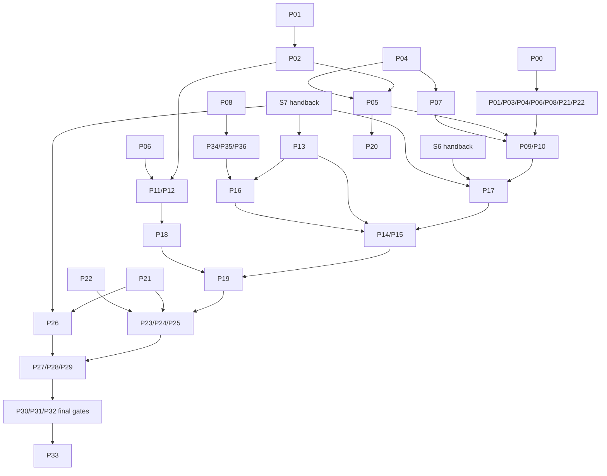

# S8 · 升级事务编排定稿计划（upgrade-orchestration，XL）

状态：**lead 冻结（2026-10-12）**。下方「lead 定稿裁决」覆盖正文与候选「定稿裁决」表中的任何冲突；正文其余部分即为绑定计划。

## lead 定稿裁决（冻结；覆盖正文）

| # | 裁决 | 落点 |
|---|---|---|
| LQ1 | **采纳 Q1 推荐。** root-owned 产品工件入口为显式 `tether upgrade stage`；installer 只做 retrofit，保持「installer 不启动 tether」的承诺；grant、两个 SHA、唯一 journal writer 与冷启动语义按 §5。 | §5、P05、P18–P20 |
| LQ2 | **采纳 Q2 推荐。** 事务历史保留最近 128 笔或 30 天（取较多）；下一次 Start 明确关闭前一回滚窗口；pending 永不 GC；空间不足时 defer 并说明原因。 | §3、P02 |
| L20 | **S7 并行时的开工顺序。** 现在开工（以 S6 候选 + S7 P00 为基线）：P00，随后 P01–P12、P18、P21、P22、P25（静态 case 表）、P26（新 fixture/collector）。与 S7 包拥有的同一文件重叠的包——P13–P17、P19、P28、P30–P33（共 68 个重叠文件：CLI golden/exitcode/error_hints/main、agentimage、agent upgrade*、broker/brokerimage 接线、proto messages/version、wire/inventory 账本、活文档）——等 S7 对应包合并后再以合并后的树为基线启动，不得与 S7 包并行编辑同一文件；其余包按 DAG。 | §11、§11.1 |
| L21 | 同 S7 L16–L18：每个被测试拉起的进程走共享监管 helper（FIX-ORPHAN）；重型套件按测试分区、单元预算 600s 不变；包只跑授权的定向检查，三硬闸/`make gates`/whole-race/drill 只由 lead 在同一候选上跑，drill 与 go test 严格串行。 | 全部包 |

## 候选稿原状态行

状态（合成时）：**候选，待 lead 审阅冻结**。日期 2026-10-12；只读代码基线 `e0a218b1ee2b1b372933d653ce8be5210af7e472`。四稿 `plan-txn/plan-fault/plan-n1/plan-deploy.md`、四批评 `crit-illegal/crit-double/crit-n1/crit-docs.md` 均已通读；S5/S6 冻结计划是格式与边界模型，stages-plan §S8 是范围合同。S7 的 `/home/weiland/s7wt/drafts/synth-plan.md` 已读，**仍是提案，不是现有接口或通过收据**。

本轮只做读取、静态核对与本文件写入；未构建、测试、运行演练或部署，所有下列验收均为 `NOT_RUN`。S0–S5 按本次任务视为关闭；S6 实现已存在，最终 gates/drill 收据待交回；不得用旧计划中的“尚未实现”覆盖当前代码。冻结后的过程文件名统一为 `hot-update-upgrade-orchestration-plan.md`、`hot-update-upgrade-orchestration-tasklist.md`、`hot-update-upgrade-orchestration-evidence.md`。S8 不增独立外审停点，最终全栈增量才外审；本候选的 lead 冻结仍是实现合同的入口。

## 定稿裁决

| 议题 | 候选裁决 | 理由 / 落点 |
|---|---|---|
| 事务真相 | 节点本地 durable journal；agent marker v2 additive，broker datadir `upgrade-state.json`；零新 Raft op、零 migration、`commandVersion` 不变 | 接受 txn 的本地事务边界，拒绝借新 Raft payload 存事务。旧副本 poison-skip 不能成为滚动一致性协议。§3/§12。 |
| 执行去重 | target-issued `prepare/start` grant；先固定 parent 全部步骤及 child handle，再发副作用 | 采用 fault 的有期限执行授权并补 boot/issuer 身份；standalone TTL120s，已登记parent的child最长到parent绝对deadline900s，bounded archive 的旧 ID 不能重新 Begin。§2/§3。 |
| 三完成点 | `control_ready`、`resources_migrated`、`old_generation_released` 各有完整、独立、不可复用的 receipt | 注册、SHA、计数为零都不能单独证明完成；completion 与 admission 共用序列屏障。§2/§4。 |
| 回滚 | forward/reverse 两套 attempt；reverse 从当前状态导出，独立 CutID/Generation/目标 SHA 与三 receipt | 原快照只能用于 pristine、尚无副作用的输入；partial ACTIVE 起必须 current cut，禁止恢复旧 DB。§4/§8。 |
| 锁与层次 | domain 长锁和 RMW 短锁不同 inode；component、host、cluster 三层分别完成和释放 | 拒绝“同 inode 二次 open 再 flock”；child 完成不等待 parent release，解除共址循环。§5。 |
| readonly-bin | 产品 root stage 发布两份 immutable SHA 工件；daemon 唯一 journal writer；canonical 启动入口按 component effective selector 启动 | 接受 deploy 的产品供给方向，补 grant、cold boot 和再升级。fixture 不得代放 `.prev`。§5。 |
| 默认 legacy | 所有 new broker 升级入口先过同一个 policy；busy 拒绝 64，无法证明 idle/quiescence 则 defer 75 | 保普通旧 wire，不保危险升级旁路；真实 old ctl 也必须验证。§7。 |
| 显式首次迁入 | 全部消费旧 upgrade 的 broker 先 capable；`--interrupting` 只签 `legacy_interrupting`，因果不明则 74 | 混版 queue probe 不能约束下一次 delivery；old UpgradeID 不是 S8 child ID。§7。 |
| capable→legacy | 热回滚硬拒绝，不提供绕过 v2 防重与 authority reader 的 flag | scope 允许明确拒绝；手工重装属于另行明确的停机操作，不能伪装本 stage 热成功。 |
| 新域兼容 | 现有 broker private 九种 kind **delta=∅**；独立 required `upgrade-cut-v1` sealed adjunct，实际 codec 与 capability 双重闭合 | private codec 当前是 exact closure，optional 零值不能自动兼容。S8 自供两份全域 A/B 工件。§6。 |
| incarnation | 从既有创建身份派生；在 single transaction / leader planner 内比较，所有 G.1 清理带同一 guard | 入口预查不能阻止 delete/recreate TOCTOU；不加 schema。§6。 |
| ABI / release | 明示 `ReadEpochs` 且双向相邻至多一 epoch；完整 managed fleet 至多两 release，资源链至多两 live generations | Epoch、Generation、ReleaseVersion、Go hash decoder 分开证明；不能只数 voter。§6。 |
| A-6 | 完整正常 profile、事前固定 500 ms freeze 硬门；5 s 请求/flow 与 10 s transfer 进展等沿用 SSOT | 拒绝把超标改成观察项或校准后抬门；失败样本全部保留。§10。 |
| 并行落地 | P00 先落精确合同及 fail-closed compile stubs；37 个包，整文件唯一归属，代码首次落最终 leaf | S5 接缝、S6 slim/tag/scanner/超时孤儿教训写入合同；文件转移须先改 manifest。§11/§12。 |

## §0 范围、出口与证据规则

范围包括 agent upgrade、broker reload、cluster roll、node wait 的薄适配；预检、事务与三完成点、全窗故障、三时点 current rollback、N-1/配置/ABI 矩阵、首次迁入、authority incarnation、两代限额、A-6、运维与演练闭合。NATS/Caddy **组件执行**属于 S9，本 stage 只校验配置兼容并预留 Component 字符串；五代混载与全栈 15 min 最终签收属于 S10。不得把 S9 unit 改造、Caddy 特权面或基础设施升级顺手塞入 S8。

| S8 出口 | binding 行为与独立反例 | 负责包 / 证据行 |
|---|---|---|
| E1 | 联合转换全集、非法拒绝、损坏 fail-closed、marker v1 零值、两代门；`TestCompletedRequiresRunningImageProof` 假 SHA 必红；Raft/schema 零 diff | P01–P08、P23、P30–P32；`S8.E1` |
| E2 | §8 全故障格逐格预声明；old owner dead 不签自动回旧；双激活/只换磁盘/旧 worker 不退/漏记新请求四 mutant 各红 | P21/P25/P26/P27；`S8.E2.*` |
| E3 | 实际 CLI R0/R1/R2 三时点，当前新任务与最新 ACK 保留；`TestRollbackExportsCurrentStateNotStaleSnapshot` | P23/P27；`S8.E3.R0/R1/R2` |
| E4 | drill 38 正族 GREEN；39 八个 wire 象限、策略/迁入各按语义判；历史 Y/P/F/BR 保 native PRODUCT-RED；31/33 回归 | P22/P24/P26–P29；`S8.E4.*` |
| E5 | A-6 正常全 profile 固定数值、三硬闸、所有 CLAUDE gates、native Darwin、CLI golden/wire inventory、活文档一致 | P26/P30–P33；`S8.E5.*` |

五出口是 AND；safe defer、unsupported prev 的 `rollback_blocked`、legacy 非热观察均不能代签成功臂。tasklist owner 为 A-6、B-4、F-1..F-7；同时补 C-10 PTY、C-4 旧 ctl 激活拒绝总表、C-9 no-systemd 半；coverage 行 11、全窗表 transfer 交界与 §7 数值均要有实际 receipt。S6 的 37.T 当前仍是 transfer defer；只有 S7 最终交回的新行为与同候选收据才能替换，不能提前把它标成连续成功。

每份 receipt 固定 source commit、dirty diff digest、binary SHA、实际执行路径、toolchain/flags、环境、原资源集合 digest、native rc、完整日志和观测起止时间。历史收据、机制件、真实 release、当前候选四列分开；本计划不宣称其中任何一列已经通过。

## §1 已核代码事实与草案事实裁决

以下行号均指本候选基线；后续搬移必须附 old→new symbol/scanner/tag-test 清单，不能继续引用旧路径。

| 分歧 / 缺口 | 代码证据 | 裁决 |
|---|---|---|
| S6 仍靠 Run unwind exec | `internal/broker/reexec.go:86,116,119` 已在 runtime reload 中关闭当前 store 并 ExecCommit | 当前实现已是同 PID cut，声称尚无实现的旧稿不成立；本 stage 接事务，不能重写成旧模型。 |
| register 等于控制可用 | `internal/agent/agent.go:1805,1811` 先 commit/MarkReady；forward/intake/sysEvents/reconcile/proxy 在 `:1249,1279,1305,1321,1333` 才建立 | illegal critic 正确。commit 必须后移到订阅集合、Flush、重协调及真实请求探针之后。 |
| 旧 marker 已有强证明 | `internal/agent/upgrade_state.go:429,494` 返回 committed 在写入前；`internal/binaryupgrade/boot.go:25` hash pathname；`:94` 仅按 self==prev 投影 | 旧字段只是 v1 兼容投影；v2 从 `/proc/self/exe`、当前 nonce 和 durable receipt 独立证明。 |
| install flip 成功天然 durable | `internal/binaryupgrade/install.go:204,214,219,238–241` 失败删除已落 journal/prev，目录 Sync 失败仍返回成功 | double critic 正确。v2 不复用该成功语义；保留 recovery intent，不 unlink 证据。 |
| rollback 已执行才报 rolled_back | `internal/binaryupgrade/marker.go:325,335` 在 exec 前写 rolled_back | 不能沿用到 v2；返回前最多 `rollback_pending`，reverse 三 receipt 齐全才 rolled_back。 |
| ReExecOnly 有同等保护 | `internal/agent/upgrade.go:310,317,412` 只有 install mutex，tracked=false；普通路径 `:111,125` 的 flock 已在 reexec 前释放 | 两者统一 v2 lock/store/prev/grant，不给 ReExecOnly 例外。 |
| 跨 exec FD 可等 ACTIVE 后取 | `internal/agentboot/image.go:396,401,403` 设置 Active 后即 closeAuxiliary/Thaw | 必须在辅助 FD cleanup 前 Take/Adopt 锁与 adjunct；不然死锁或提前 unlock。 |
| 补一个 optional private 字段即可 | `internal/brokerimage/codec.go:262,270,275–276,304,323–325` exact 四 core records；另五 tunnel kinds 有独立闭合词表 | N1 critic 正确；existing private 零变化，S8 required adjunct 真实 decoder 另闭合。 |
| authority 入口比较足够 | `internal/node/node.go:84,90,96–105` transaction 只查 ACTIVE；`internal/node/plan.go:29–39` 同；`internal/cluster/node.go:605,610,620` 才是 applyMu/planner 边界 | 比较放入这两个真正 write 序列，broker handler 的预查不算。 |
| incarnation 必須 migration | `internal/session/session.go:82` 已存 sid/owner/created_at/pin_hash；`internal/auth/pin.go:37,41–43` 随机 16-byte salt | 可从创建身份派生；用解析后的 salt，不散列整个可能重新编码的 PHC 字符串。 |
| G.1 不受影响 | `internal/broker/broker.go:2781` reconciliation 在注册写之外；`:2754–2765` upgrade 字段仅日志 | 增 guard 而非把 upgrade 日志偷塞 Raft 状态；G.1/lease/cleanup 单独接线。 |
| probe 后旧 upgrade 一定命中同一 broker | `internal/broker/upgrade.go:31–43` queue-grouped、无 leader gate；`:94–99` forward 只保 URL/SHA/ActorFP | mixed consumer 必须拒绝安全首次迁入；一轮 capability probe 不提供路由身份。 |
| 旧 agent 完全没有 smoke/prev/rollback | `v0.6.0:internal/agent/upgrade.go:564,568,590,602–610` 有随机 UpgradeID、prev 与目标标记 | docs 的“首跳没有这些机制”不实；缺的是 S8 image/quiescence/可关联授权，不是全部旧保护。 |
| cluster driver 可自然续原计划 | `cmd/tether/cluster_upgrade_drive.go:31,128,136,168,215–227` 随机 holder/step，按 release skip，最后 release | 必须持久 full ordered plan 与稳定 handles；重启不能重新规划漏节点或重发 side effect。 |
| S7 transfer 已可切 | `internal/brokerimage/store_reload.go:606,614` 仍对 in-flight transfer defer | 只把 S7 proposal 当接口需求；未交回前全域热能力不广告。 |
| dynamic prev 已统一可达过滤 | `test/simcluster/lib/stage.sh:99–105` clean 分支 all tags，dirty 才 merged；`:132–169` cache 未强验 toolchain/flags | N1 critic 正确；同时改 `prev-supply-test.sh:57–59,127–129` 的旧预期。 |
| 共址都是同 UID | `test/simcluster/drills/lib/colocated.sh:73,81` agent User=sim；installer `scripts/install.sh:1291,1299` broker User=tether、canonical ExecStart | 保留真实多 UID；不得 fixture chmod/chown 活业务目录来救升级。 |
| Pdeathsig 足以覆盖测试超时 | `test/hotupdate/harness_test.go:46,48,248,254` 有进程组/Pdeathsig/Wait，但依赖测试进程的取消或正常清理 | S6 已发生孤儿，增加测试进程之外的 supervisor 与 lifeline EOF 清理，不能只重复已有设置。 |

## §2 P00 冻结合同：身份、证明、接口与状态词表

### 2.1 类型与隔离

`internal/upgradetx` 只依赖标准库；wire、disk、private adjunct 不直接序列化 Engine 内存。下面所有 ID 均是长度受限的强类型字符串，生产生成为 128-bit 随机十六进制；SHA 为小写 64 hex；Generation/Revision/Sequence 为 `uint64`，Time 为 Unix nanoseconds `int64`。零值意味着“不知道/没有”，永不意味着成功。字符串 enum 不新增第 16 族；如实现确须 enum，必须显式归入既有 15-family gate，不能绕 scanner。

| 类型 | 冻结字段（Go 名称:类型；wire/disk 均 snake_case，optional 标 `omitempty`） |
|---|---|
| `Key` | `DomainID:string, Component:Component, SID:string, ConfiguredNID:string, ConfigPath:string, UID:uint32`；后四项可空/零，但角色对应的必填校验不能省 |
| `Handle` | `Key:Key, TxID:string, CutID:string, Generation:uint64, Revision:uint64` |
| `Owner` | `BootID:string, PID:int, StartTicks:uint64, InstanceID:string`；PID 单独不可作身份 |
| `Fence` | `Current:Handle, Owner:Owner, RunningSHA:string, PreviousSHA:string, Incarnation:string` |
| `Grant` | `Handle:Handle, ParentTxID:string, ParentSlot:string, ClientNonce:string, Issuer:Owner, ActorFP:string, Mode:Mode, SourceRelease:string, TargetRelease:string, SourceSHA:string, TargetSHA:string, ScopeDigest:string, CapabilityDigest:string, ExpiresAt:int64` |
| `Scope` | `ID:string, Participants:[]Key, Domains:[]Domain, Expected:[]Resource`；规范排序、去重、seal digest 后不可改 |
| `Resource` | `Domain:Domain, ID:string, Origin:string, Owner:Owner, Generation:uint64, State:string, Custody:string`；ID 是原始对象/worker/permit 身份，不是临时计数 |
| `Stamp` | `Attempt:Handle, Producer:Owner, Nonce:string, Sequence:uint64, At:int64, ScopeDigest:string` |
| `Census` | `Stamp:Stamp, Known:bool, Complete:bool, Resources:[]Resource, ExpectedDigest:string, Admitting:uint64, OldOwners:[]Owner` |
| `Receipt` | `Kind:ReceiptKind, Stamp:Stamp, Known:bool, Complete:bool, RunningSHA:string, Census:Census, EvidenceDigest:string` |
| `Attempt` | `Handle:Handle, Direction:Direction, SourceSHA:string, TargetSHA:string, SourceGeneration:uint64, Phase:Phase, CutStage:CutStage, Outcome:Outcome, Scope:Scope, Control:Receipt, Resources:Receipt, Released:Receipt` |
| `Action` | `ID:string, Handle:Handle, Kind:ActionKind, IntentDigest:string, ResultDigest:string, State:ActionState, Nonce:string` |
| `Record` | `Version:uint32, Key:Key, Revision:uint64, Grant:Grant, Forward:Attempt, Reverse:Attempt, Actions:[]Action, Reason:string, EffectiveSHA:string, RecordedPreviousSHA:string` |
| `Metadata` | `TxID:string, ReportedRevision:uint64, Window:WindowState, Pins:[]string, ArchivedAt:int64`；与 immutable execution record 分列 |
| `Observation` | `Nonce:string, At:int64, Current:Attempt, Census:Census, OwnerKnown:bool, RunningSHA:string, EffectiveSHA:string` |
| `View` | `Historical:Record, Metadata:Metadata, Observation:Observation, Code:string, Detail:string` |
| `Step` / `Plan` | Step=`Ordinal:uint32, Participant:Key, Grant:Grant, Kind:StepKind, DependsOn:[]uint32`；Plan=`Parent:Handle, Scope:Scope, Steps:[]Step, SourceManifestDigest:string, TargetManifestDigest:string, Deadline:int64` |
| `LegacyUpgradeProof` | `ParentTxID:string, Issuer:Owner, GrantNonce:string, TargetInstance:string, TargetKey:Key, SourceSHA:string, CandidateSHA:string, DispatchActionID:string, LegacyUpgradeID:string, ObservedSHA:string, ObservedNonce:string, State:string, Causal:bool`；旧身份字段可空，缺失不能推断关联 |

Component 字符串冻结 `agent|broker|nats|caddy`，后两者在 S8 执行返回 `unsupported_component`；Domain 冻结 `control|exec|pty|flow|ss|transfer_worker|transfer_tracker|broker_store|broker_runtime|authority|upgrade`。无某域的角色必须有 capability+scope 的明确 `not_applicable` 证明，不能靠未收集到计数 0。ReceiptKind=`control_ready|resources_migrated|old_generation_released`；Direction=`forward|reverse`；CutStage=`none|pristine|partial_active|active|retiring|released`。

Phase=`prepared|staged|ready|freezing|activating|serving_new|migrating|completed|deferred|rejected|rollback_pending|rollback_blocked|rolled_back|recovery_required|cancelled|abandoned`；Outcome=`pending|success|deferred|rejected|rolled_back|legacy_interrupting|unknown|cancelled`；Mode=`hot|legacy_interrupting`（新grant必须显式非空，旧请求缺字段不授权interrupting）。ActionState=`intent|observed|durable`；WindowState=`open|closing|closed`；StepKind=`broker_cut|agent_cut|home_converge|release`；ActionKind 只允许 §3.2 中的十项。

### 2.2 精确函数表与 stub

所有签名在 P00 落地，错误统一为 `*upgradetx.Error{Code string, Detail string, Accepted bool}`。局部纯状态/文件 API 无 ctx；有网络、等待或 process supervision 的控制面显式接上游 ctx。数据面 exported methods 不新增 ctx 参数。

```go
// internal/upgradetx
func ValidatePlan(plan Plan) error
func Transition(record Record, event Event) (Record, error)
func Completed(attempt Attempt, observation Observation) error
type Event struct { Action Action; Receipt Receipt; Phase Phase; CutStage CutStage; Outcome Outcome; Reason string }
type Store interface {
    Prepare(key Key, req PrepareRequest) (Grant, error)
    Start(grant Grant, fence Fence) (Record, error)
    Load(key Key, txID string) (View, error)
    Apply(expected Handle, event Event) (Record, error)
    PrepareReverse(expected Fence, req ReverseRequest) (Grant, error)
    Archive(expected Handle, death DeathProof) (View, error)
    CloseWindow(expected Handle) (Metadata, error)
}
type PrepareRequest struct { ParentTxID, ParentSlot, ClientNonce, ActorFP, SourceRelease, TargetRelease, SourceSHA, TargetSHA string; Mode Mode; Scope Scope; CapabilityDigest string; ExpiresAt int64 }
type ReverseRequest struct { ClientNonce, ActorFP, HistoricalTxID string; TargetSHA string; Scope Scope; ExpiresAt int64 }
type DeathProof struct { Owner Owner; Stamp Stamp; Custody Census; Reaped bool; NoOwnedFDs bool }

// internal/upgradeobserve
type Registry interface {
    Begin(resource upgradetx.Resource) (uint64, error)
    Finish(sequence uint64, resource upgradetx.Resource) error
    Snapshot(stamp upgradetx.Stamp) (upgradetx.Census, error)
    Seal(attempt upgradetx.Attempt, nonce string) (upgradetx.Receipt, error)
}

// internal/upgradelock
type Lease interface { FD() uintptr; DomainID() string; Close() error }
func Acquire(ctx context.Context, key upgradetx.Key, parentToken string) (Lease, error)
func Adopt(fd uintptr, key upgradetx.Key, parentToken string) (Lease, error)
func WithGuard(key upgradetx.Key, fn func() error) error

// internal/upgradeartifact
type Receipt struct { Grant upgradetx.Grant; CanonicalPath, SourcePath, TargetPath, SourceSHA, TargetSHA, ManifestDigest string }
func Publish(ctx context.Context, grant upgradetx.Grant, source io.Reader, target io.Reader) (Receipt, error)
func Verify(receipt Receipt, grant upgradetx.Grant) error
func Resolve(key upgradetx.Key, view upgradetx.View) (string, error)

// internal/upgradeauthority
func Derive(sid, owner string, createdAt int64, salt []byte) (string, error)
func Match(expected, actual string) error
type Guard struct { SID, Incarnation, InstanceID, ConfiguredNID string }
type Creation struct { SID, Owner, CreatedAtText, EncodedPINHash string }
type RowReader interface { QueryRow(query string, args ...any) *sql.Row }
func ReadCreation(reader RowReader, guard Guard) (Creation, error)
func CreationPredicate(creation Creation) (string, []any, error)

// internal/upgradecut
type Authority struct { SID, Incarnation string }
type State struct { Attempt upgradetx.Handle; SourceSHA, TargetSHA, ParentToken string; Authorities []Authority; Owner upgradetx.Owner; LockFD uint32; Scope upgradetx.Scope }
func Encode(state State) ([]byte, error)
func Decode(data []byte) (State, error)
func Take(state State, takeFD func(uint32) (uintptr, error)) (upgradelock.Lease, error)

// internal/upgradeport：控制面统一适配口，不反向 import agent/broker/cmd
type Endpoint interface {
    Prepare(context.Context, upgradetx.Key, upgradetx.PrepareRequest) (upgradetx.Grant, error)
    Start(context.Context, upgradetx.Grant, upgradeartifact.Receipt) (upgradetx.View, error)
    Query(context.Context, upgradetx.Key, string, string) (upgradetx.View, error)
    Rollback(context.Context, upgradetx.Fence, upgradetx.ReverseRequest) (upgradetx.View, error)
    Cancel(context.Context, upgradetx.Handle) (upgradetx.View, error)
    Archive(context.Context, upgradetx.Handle) (upgradetx.View, error)
    CloseWindow(context.Context, upgradetx.Handle) (upgradetx.View, error)
}
type PreflightProof struct { Grant upgradetx.Grant; ReadersDigest, ConfigDigest string; Census upgradetx.Census }
type FD struct { Index uint32; File *os.File; Kind string; Owner upgradetx.Owner }
type Cut struct { Attempt upgradetx.Handle; Owner upgradetx.Owner; Stage upgradetx.CutStage; Descriptor []byte; Auxiliary []FD; Scope upgradetx.Scope; Sequence uint64 }
type Activation struct { Attempt upgradetx.Handle; Owner upgradetx.Owner; Stage upgradetx.CutStage; RunningSHA string }
type RuntimePort interface {
    Preflight(context.Context, upgradetx.Grant, upgradeartifact.Receipt) (PreflightProof, error)
    Freeze(upgradetx.Handle) (Cut, error)
    ExportCurrent(upgradetx.Handle) (Cut, error)
    Activate(Cut) (Activation, error)
    Observe(upgradetx.Stamp) (upgradetx.Observation, error)
    Retire(upgradetx.Handle) (upgradetx.Receipt, error)
    Thaw(upgradetx.Handle) error
}
// internal/agentupgrade 与 internal/brokerupgrade 各自实现相同 constructor
func New(store upgradetx.Store, runtime upgradeport.RuntimePort, registry upgradeobserve.Registry) upgradeport.Endpoint
// internal/upgraderoll
func Run(ctx context.Context, store upgradetx.Store, endpoint upgradeport.Endpoint, plan upgradetx.Plan) (upgradetx.View, error)
```

P00 同时冻结 `upgradewire.Request`：`op, key, tx_id, query_nonce, grant, expected, prepare, reverse, artifact`（相应为 string/Key/string/string/Grant/Fence/PrepareRequest/ReverseRequest/artifact.Receipt，除 op/key 皆 omitempty）；Response=`view,omitempty; code,omitempty; error,omitempty`。op 精确为 `upgrade.prepare|upgrade.start|upgrade.query|upgrade.rollback|upgrade.cancel|upgrade.archive|upgrade.close_window`。`close_window` 经 Endpoint.CloseWindow 交唯一 store owner 处理，不增加任意 callback。Disk 解码器、wire 转换器、admin socket 与 agent forwarded handlers 均严格按 op 校验允许字段，拒未知 op/错角色/重复字段/超长集合。

生产 additive 字段冻结：`NodeRegisterReq.Incarnation string json:"incarnation,omitempty"`、`NodeRegisterResp.Incarnation`、`NodeLease.Incarnation` 同 tag；`NodeRegisterReq.Upgrade *UpgradeSummary json:"upgrade,omitempty"`、`ClusterHealthResp.Upgrade` 同 tag。`proto.UpgradeSummary` 只含 `TxID/CutID/Phase/Outcome/RunningSHA/Reason:string`、`Generation:uint64`、`Revision:uint64`，均 snake_case/omitempty；不在公开 health 泄露 SID/actor/resource 全集。完整 View 仅向原 actor/授权管理员查询。proto DTO 保持底层无反向依赖，upgradewire 负责 proto↔local 的显式转换，proto 不 import upgradewire；wire/adjunct/disk 类型互相不能用反射偷偷复用。

新 agent 事务 subject 使用 `proto.SubjCmdBy(sid, actor, nid, "upgrade-tx")`，broker 按原权限把 envelope 发 `proto.SubjCmdForwarded` 的对应 verb；旧 `upgrade` subject 仍先经统一 policy。broker remote 事务通过现有 signed targeted cluster trigger 的 additive action/envelope，绑定 TargetNode+actor+grant；本地 admin socket 使用上述同名 op。query 不广播完整私有 View；legacy proxy 的 issuer路由在targeted trigger上固定。P13 同时实现各 decoder/ACL，不能只加结构体。

compile stub 实现 Store、Registry、Endpoint、RuntimePort及artifact/lock合同的测试替身，一律返回 `upgrade_not_wired`，不广告 capability，不返回空成功。上面是分包 API 签名表，不能原样把多个package的函数无body塞进contracts.go：P00落可编译类型/interface与contractstub具名实现；各leaf函数由其owner在最终文件实现，P00的组合编译测试以stub实现这些精确方法集。不得使用全局可替换函数表、any或循环import来凑编译。P00 的编译测试只证明互相可链接及 fail-closed；不冒充功能测试。上述 DTO 类型、JSON tag、枚举词表、scope domain、disk/wire/adjunct 版本形成同一契约 inventory，后续改合同必须 P00 owner 先更新，不由消费者各自加字段。

## §3 本地耐久、防重、parent 续跑

### 3.1 唯一 store、grant 生命周期

broker 使用 canonical DataDir 下 `upgrade-state.json`。agent 可写安装目录保留 `.tether-upgrade.json`，v1 字段不删，新增 `version=2` 与按 Key 编码的 `entries`；共享 binary 的 agent 不得把不同 SID/NID/UID 混成一个 Current。readonly-bin 使用该 agent 自己可写且经预检的 `$HOME/.tether/agents/<sid>/upgrades/<domain>/<configured-nid>/upgrade-state.json`；这是产品路径说明，本轮未访问任何用户状态。canonical registry 在启动配置中持久记录唯一 store 路径；不得在两个位置双写或找不到就创建另一份。broker 无可写 datadir / agent 无可写受控状态目录时 preflight defer，尚未接受执行。

存储封装 `schema_version, key, revision, current, archives, metadata, checksum`；未知版本、截断、校验失败、路径 Key 不符均 `upgrade_state_corrupt`，不能按 idle。写临时文件→file Sync→rename→parent-directory Sync；durable receipt 只在全链完成后发布。reopen 后重新校验 record/action 与事实，不相信序列化的 `Durable=true`。没有记录 fsync 成功不等于 action 未发生。

Prepare 是 target 签发的惰性授权：standalone 120s绝对到期；已登记且持有reservation的parent可为全部固定child申请到parent绝对deadline的grant（最多900s），不逐步重置时钟。否则一条120s broker腿会使后续agent grant在发送前必然过期。授权绑定 boot ID/PID start/instance、actor、parent slot、source/target SHA、scope/caps digest；客户端不能自选执行 ID。相同 ClientNonce 的未过期 Prepare 返回同一 grant；issuer 重启使未 Start 的旧 grant 失效。Start 必须 CAS 当前 source proof、grant 与 parent reservation，先落 accepted record 后才执行。已 Start 的重试只能查询同一 TxID；不能重新发行“等价 SHA”执行。未知、过期、已 GC 的 Start/Rollback 返回 `upgrade_grant_unknown`/`upgrade_grant_expired`，**绝不 implicit Begin**。冷启动可恢复已 accepted journal，但不恢复过期 Prepare 的执行权。超期parent不能靠延长TTL续原执行权；须先query全部accepted child、释放原计划未执行权，再显式新plan，旧历史留存。

每个 component 恰有一个 Current；未决、`rollback_blocked`、`recovery_required`、owner unknown 都占 Current。完成记录进入 archive 后 execution 部分不再改；报告确认、pin/window 状态单调变动于 Metadata。下一 Prepare 可以预检，下一 Start 要先 durable CloseWindow、确认旧 attempt 的可执行请求已失效、没有 retained live owners、pin 可按历史保留或安全释放；不能覆盖前一笔 recorded prev。

建议 archive 最近 128 笔或 30 天（取能保留较多者），pending 永不 GC；达到空间上限 defer，不删除未决以腾位置。窗口关闭后旧历史仍可查，但无法再自动热 rollback；下一次升级必须明确展示这一后果。此保留/窗口策略是 §开放问题 Q2，安全协议不依赖具体天数。

parent 首个执行副作用前持久写入完整 managed participant snapshot、排序步骤、目标/源 manifest、全部 target-issued child grants、依赖、deadline、host slots、cluster holder。Prepare 不触发安装；若收集途中死亡，只清理未执行授权。Run 恢复只 query/续原 plan，不能按新 roster、ReleaseVersion 或缺节点重算成功；任何缺 participant、grant 过期未 start、leader/route 改变须明确 replan 新 parent，并证明旧 parent 无执行权。已有 accepted child 只能附着原 ID。

### 3.2 Action crash 恢复表

每项先 durable intent，effect 后查外部身份/结果，再 durable observed/result；action ID 绑定 attempt。所有动作都测试 intent 前、intent 后 effect 前、effect 后 receipt 前、receipt 后四种死亡。

| ActionKind | 实际 effect / 恢复证据 | effect 后 receipt 丢失如何处置 |
|---|---|---|
| `publish` | immutable source/target SHA slot、grant digest、目录 Sync | 校验完全一致才补 receipt；不按同 SHA 认领另一 grant |
| `select` | component effective selector 或可写 canonical flip | readback+目录 Sync；失败保原/新两 pin 与 recovery intent，不删 journal |
| `freeze` | admission fence、实际 owner/registry seq | owner 同一且可证明 fence 才继续，否则重新预检/unknown |
| `dispatch` | snapshot/FD 发送，接收 owner nonce/FD custody | query 对端既有 cut；无 custody 证明不重复交付可消费 FD |
| `activate` | 第一个可能产生外部 effect 的 ACTIVE、running `/proc` SHA | 用实际 owner/cut 与当前 export 决定 partial/current rollback，不能回旧 snapshot |
| `control` | SUB 集合、Flush、reconcile、真实新请求 nonce | 重新取当前 proof；历史控制 receipt 不足以继续 parent |
| `migrate` | 原资源逐 ID 的 ownership/terminal receipt | 已决项按 ID 查询，未决项续同一 owner，不复制任务 |
| `retire` | old owner reap、全部 FD/worker/permit 释放证明 | 独立 death/custody 观测后补 journal；PID 不见不等于资源清零 |
| `reverse` | current export + 新 reverse grant/cut | query reverse；绝不拿 forward receipt 签 reverse |
| `release` | component slot / host reservation / cluster expected-holder CAS | 每层独立 readback；parent完成最后写，release 未确认保持 pending |

legacy dispatch 的 intent 后若不能证明“尚未发送”，一律 `unknown`，禁止自动重发；旧协议没有因果 receipt 时不能用新 incarnation、同 SHA、时间接近推导 exactly once。

### 3.3 所有旧 writer 接管清单

P14 统一改 `BootUpgradeCheck`、install completion、upgrade report、register commit、watchdog、rollback、unlink、ReExecOnly；P17 接 FinishBoot/ACTIVE/retirement；P05/P17 改 binaryupgrade 的 v2 分支。旧 callback 在建立时捕获 Handle/revision，写时 CAS，不能重新读 Current 后认领下一笔。v1 path 保持可读与旧语义投影，但任何 v1 committed/rolled_back/BinaryReplaced 均不能直接提升 v2。

在 prepare/start/boot/late-report/watchdog/reverse/close-window/archive/GC 的真实入口注入 A 完成→B 开始→A 迟到，必须 B 完整保留。禁止完成后 unlink 唯一 v2 证据；v1 清 marker 的兼容显示由 projection 控制，archive 保留。

## §4 联合状态机与三个完成点

### 4.1 合法组合及失败边

| Phase | CutStage / Direction | Outcome 与可进入条件 |
|---|---|---|
| prepared/staged/ready | none，任一方向 | pending；依次满足 grant、双工件 durable、完整 preflight；无接纳业务副作用 |
| freezing | pristine，任一方向 | pending；先关准入并等待已登记 admissions，最终 scope seal；取消可 thaw 原 owner |
| activating | pristine/partial_active/active，任一方向 | pending；首个潜在 effect 之前 durable 标记 partial_active；无 control receipt 也可到达 |
| serving_new | partial_active/active，任一方向 | pending；真正 Control receipt 已获，尚不能完成；晚到资源 receipt 独立存储 |
| migrating | active/retiring，任一方向 | pending；Control 可用，逐 ID ownership/retirement 收敛；Resources 可先到但不越过 Control |
| completed | released，任一方向 | success；同一 attempt 的三个 Known+Complete receipt、当前 running proof 与 seq barrier 全齐 |
| deferred/rejected | none，任一方向 | deferred/rejected；尚无不可撤回 effect；若 select 恢复失败转 recovery_required，不能伪装拒绝 |
| rollback_pending/rollback_blocked | partial_active/active/retiring，forward 引用 reverse | pending；current cut 正在准备/缺可读 prev；保当前业务与所有 pins |
| rolled_back | released，forward 引用 completed reverse | rolled_back；reverse 的 target=该 record 的 RecordedPreviousSHA；绝不复用 forward completion |
| recovery_required | 任意实际 CutStage | unknown；durability/unflip/custody 不确定；不宣称执行回旧 |
| cancelled | none/pristine，或尚未激活的 reverse | cancelled；证明无 effect，或取消 reverse 后仍由已知新 owner 服务；不等于 rolled_back |
| abandoned | 任意，owner 有可信死亡证明 | unknown；全部 custody 已明确清场才能释放 Current；historical execution 事实不篡改 |

Store 验证组合，不只验证 Phase pair。每个合法边至少一正例，全部其余组合拒绝；receipt 乱序、错 cut/gen/direction/source/target/nonce/producer、partial ACTIVE/no control 与缺 domain 都有反例。terminal execution 不回退；已 completed 的手工回滚创建新 Current(reverse) 并引用历史 A，A/parent 的 completed 保持原事实。

### 4.2 完整 proof 与 admission 屏障

Control：agent register authority 校验成功后，forwarded command、intake、sysEvents、proxy、reconcile 全部订阅建立，Flush 确认，旧控制队列处理/隔离完成，再由外部发一个 nonce 绑定的真实无害控制请求；broker 先 auth_callout，再 CONNECT/SUB/Flush、store/readiness 和实际新请求。任一订阅失败不能提交。完成后 Query 仍用 fresh nonce 重新验证当前活性，历史 Control 不替代当前健康。

Resources：final cut seal 确定原始 scope，收齐 exec process/PID/startticks、PTY master/slave+child、flow stream/seq/FIN、SS salt/FIFO、transfer worker/tracker/terminal/result/grant/GC permits、broker store/runtime/listener/transport 与 aux lock 的精确身份。每项必须“已转到目标 owner”或“合法 terminal 已 durable 且不再有执行权”；scope 外迟到创建也必须纳入共享登记序列，不能被旧 census 误签为空。

Released：旧代 runtime goroutine、worker、timer、reaper、FD keeper/duplicate、grant courier、retained terminal、GC pin 与 active callbacks 都逐 ID 释放/移交；同 PID exec 不等于旧代释放，进程退出也不等于孙进程/独立 FD 释放。artifact rollback pins 与活 worker 分账：保历史工件不占 live generation；有执行权/retained owner 占。

Registry.Begin 在每个业务 effect **之前**登记 owner+resource+generation，返回 seq；Finish 只结算该 seq。Seal 与 Begin 共用 gate，读取 admitting=0、全 expected set、latest seq；完成 CAS 后新 admission 归新 generation。无法登记、scope 未 Known/Complete、producer 消失均 fail-closed。不用一个 `OldWorkers==0` 或 `pid gone` 汇总代替资源集合。

两个“already running/no-op”也走 fresh nonce query、完整 participant/census/authority/slot proof；只有 running SHA、目标 decoder/config 一致，资源已单代且无 unresolved attempt 才 `completed/no_op`。按 ReleaseVersion skip 的现有路径删除；parent 不得拿历史 completed 跨过当前 unknown。

## §5 canonical domain、持续锁与 root-owned 产品工件

### 5.1 namespace 与锁序

canonical domain 由规范化安装路径、真实父目录 dev/inode 与部署登记身份派生，**不按会被 rename 的 binary inode**，不按 SID 单独划域；解析 symlink/hardlink alias，未知 alias/clone family 拒绝。component Key 用 role/SID/configured NID/config path/UID，InstanceID 是 owner 身份而非 store namespace，确保冷启动能找到原记录。

同域登记册列出全部 agent/broker sibling、UID、config 与 service identity。已知 idle sibling 可串行升级；pending sibling 共享 parent slot 时顺序借 reservation，不另造 parent；独立竞争升级 defer。未知 sibling/不可枚举安装者不能按空 census 接纳。31/33 两个 agent 共享 binary 的顺序成功仍需成立。

长锁 `<domain>.lease` 和短 RMW `<domain>.guard` 是**不同 inode**，位于产品受控可写 domain control directory；v1 `.tether-upgrade.lock` 只由 v1 adapter 使用，不允许与 v2 长锁混作一个 OFD。锁序冻结 domain reservation→component sequencer→short store guard；现有 `upgradeMu→flock` 全部转适配，禁止持 short guard 等网络/exec/child completion。借用同一长锁的 child 用 parent token 验证，不再次 flock。

原 OFD 作为 required aux FD 跨 exec；import 先核 role/key/parent/cut，Take→Adopt 移除原 close list，再做 closeAuxiliary/Thaw。Close 仅由最终 reservation owner 执行；borrowed duplicate 的 cleanup 不调用 LOCK_UN。真实 exec 后 marker commit 能完成，同时外部 contender 仍失败；该测试同时攻击“同 inode 自锁”和“先 cleanup 释放”。

component slot 在本 component 三 receipt 齐后释放；host reservation 保护双工件、canonical selector、全部 sibling child 串行切换，直到所有 child completed/home converge；cluster holder 最后 expected-holder CAS release，parent 再完成。broker child 不等 agent 完成才完成，否则 driver 永远发不出 agent step。component、host、cluster 各有自己的 Handle/receipt，不能让 host reservation 计进 child 未释放资源。

### 5.2 root stage 与 effective artifact

产品入口冻结 `tether upgrade stage --grant <file> --source <file> --candidate <file> --receipt-out <file>`。daemon/parent 先签 grant，操作者可复制其非敏感授权文件给 root；root helper校验本地 issuer/peer credential、路径 allowlist、source=/proc running SHA、两个 manifest/decoder 与 parent slot，发布到 root-owned immutable SHA store 并返回 artifact receipt。权限/过期/另一 Tx 同 SHA 不可 adopt。root helper **只发布工件和 receipt，不写 daemon journal、不执行 Start、不启动服务**。

readonly产品链必须能直接执行：新ctl `node upgrade NID --url URL --sha256 SHA --prepare-only --grant-out grant.json` 获取target-issued惰性grant与TxID → 主机root运行上述stage（source可为该grant校验过的 `/proc/PID/exe`）→ 原actor `node upgrade NID --tx-id TXID --artifact-receipt receipt.json` 由daemon Verify后Start。broker对应 `broker upgrade reload --to-version VERSION --expect-sha256 SHA --prepare-only --grant-out grant.json` 与 `broker upgrade reload --tx-id TXID --artifact-receipt receipt.json`；resume从原grant取版本/SHA，不要求重传。保留现有 `--to-version/--expect-sha256` 首次调用合同（`cmd/tether/cluster_upgrade.go:507–519`）。whole-host/cluster driver保存同一parent slot并等待这些receipt，不能另起root事务。receipt丢失只对原grant重新读取/核验，不执行二次Start。grant到期则原Start拒绝；重新Prepare必须是新惰性授权，不能把旧receipt按同SHA自动认领。

`scripts/install.sh --hot-update-retrofit` 仅布置 control/artifact 目录权限、canonical 启动配置和必要模板；K.0 保持：installer 不 fork 已安装 tether、不启动 tether、不暗中升级 NATS/Caddy。离线 `--bin`/rootredirect/POSIX、原 `TestInstallShDoesNotForkTether`、lint-install 正负控都由 P20 接管。产品 stage 是显式独立命令，不能把 K.0 偷改成例外。

canonical 路径与 effective artifact 分开：首次安装的 S8 capable canonical 入口在 daemon 初始化前按 role/config/UID 找到唯一 journal，验证 selector、工件 SHA/reader，必要时同 PID exec immutable slot；不从 `os.Executable()` 当前 slot 推断安装路径，不形成 `.prev.prev`，不接受任意环境变量重定向。无 journal 时用 canonical 本身；有未决或损坏 journal 时按已知安全 effective selector 恢复/拒绝，不能回到“最新盘面就是当前”。private boot token 有深度上限且不可被普通控制请求伪造。

接受升级前 stage 必须提供 running source 和 candidate 两 SHA；rollback 只改该 component 的 durable effective selector 并 exec recorded prev。对 readonly-bin，canonical 路径可仍是 newer dispatcher，但下一次普通 systemd/user/nohup cold boot 必须按该 component selector 回到已回滚工件；再升级从 effective SHA 出发。多 UID sibling 的 selector 独立，host reservation 保护公共 publication。验证 forward→rollback→普通 cold boot→第二次 upgrade 全链，不能只证明一次映像切换。

install retrofit 的首次 canonical capable 安装属于 §7 明确的一次性非热迁入；不能在业务开始后由 fixture 改 ExecStart、放 prev、chown bin 来补前提。S8 只实现 tether 的这条路径，S9 可复用 artifact/grant 合同而自行决定 infra service policy。

## §6 ABI、新域、authority 与两代限制

### 6.1 兼容总表

| 面 | 规则 | 正证据 / 拒绝证据 |
|---|---|---|
| 普通 wire | ProtoVersion 不 bump，additive omitempty、零值合法；原字段含义保持 | 真 v0.6.0/new ctl×agent×broker 八格五 verb，旧控制操作不要求升级 tx |
| upgrade wire | 旧 entry/new tx/cluster child 共用 policy；新 op 有独立 decoder/ACL | 旧 ctl 真实错误映射、缺 grant/错 issuer/跨 actor/错角色拒绝 |
| manager/image ABI | `exportEpoch ∈ reader.ReadEpochs` 且 `abs(readerEpoch-exportEpoch)≤1`，双向检查 running/candidate/recorded prev | 不能用 generation=1 代替 epoch=1；跨 epoch 两跳拒绝；实际 decode 非空业务状态 |
| manifest / adjunct | descriptor 与实际 decoder union 一致；required `upgrade-cut-v1` 携带 tx/authority/lock，existing broker private delta=∅ | unknown kind/field/missing required domain 在 Take 前拒绝；不能只验证 descriptor version |
| DB / Raft | 当前 DB 唯一 writer，继续 S6 original datadir OFD/NoSnapshotRestoreOnStart；OpType/migrations/commandVersion 零变化 | baseline diff 机械门；第一次 Replay 前最新 ACK 值及 absence |
| Go hash state | S7 checkpoint 实际 decoder，reader能力独立于 release/epoch | 两个实际 toolchain 的导出→读入→继续 hash，最终 digest 相同；metadata 不算行为证据 |
| NATS/Caddy config | 当前与指定 N-1 二进制各解析同一实际渲染 config | 隔离环境真实 `nats-server -t`、`caddy validate`；不触 infra runtime，不以 pin 比较代替 |

所有预检在 disk select 前、freeze 前、final export 三门重做：真实 source/target/prev SHA、artifact provenance、ReadEpochs、完整 domains、manifest schema、role/config、权限/spawn/noexec、FD/RLIMIT、内存/replay/salt/FIFO、两代 census、legacy/quiescence、state目录 writable/durable。前两门通过不替代 final prepare。不能让能力广告领先真实 decoder/collector 接线。

`upgrade-cut-v1` 是独立 sealed adjunct，P07 负责 strict codec/field inventory/required-domain union；P17 接 agentboot 与 brokerimage import，在任何Take前验证每个SID的incarnation编码/完整性以及Tx/cut/source/target、锁引用与scope。这里不偷开broker store做权限预查：与**当前authority行**的比较在S6合法OpenCurrent之后、agent受控register结果返回之后完成，早于所有业务泵放行；第一可能store/transport/注册写副作用之前即标partial_active，mismatch走撤权并清场。不能为了写“Take前校验”破坏S6不开第二store的边界。agent一般一项，broker为精确authority map，不能用单个字符串代替多session。pristine Repack 仍须保全 adjunct；partial ACTIVE 走当前 export。既有 agentimage closed Bundle/四 core+五 tunnel private codec 不能悄悄扩成宽松 JSON。

P13/P17版本广告追加 `image-read-epochs 1`（实现确有邻纪元reader才列对应数字），仍保持现有 `image-abi v1` 最后一行、ProtoVersion与ImageABIVersion均不变；旧reader没有ReadEpochs只视为“可读自身显式ABI”，不能推导双向相邻。新增能力token为 `upgrade-tx-v1`、`authority-incarnation-v1`、`upgrade-cut-v1`，必须对应可调用decoder/collector；它们不冒充S7域。P19更新实际version命令测试，P13更新proto版本测试，P17更新真实parse与preflight而非只改广告。

S8 工件 A/B 都从包含最终 S7 与 S8 decoder/collector 的两个明确 source commits 构建、归档、checksum；B 必须有真实可辨识实现变化与独立构建 provenance，不能只用 ldflags 改 release 冒充不同兼容实现。S7 archive 仅证明 transfer codec；S2 gen-1 仅机制边界，二者都不自动签 S8 reverse。

| 首次引域 | S8 行为 |
|---|---|
| v0.6.0→S8 | 默认拒绝/defer；显式非热迁入，见 §7 |
| S7-only→S8 且 prev 不读 upgrade adjunct/authority | preflight 拒绝保业务；不能签全域热回滚。产品首次安装需明确非热步骤或另备真正 capable source，不能把 S7 close 当 capable source |
| S8 A→B，所有 decoder 齐 | 全 profile 热 forward/reverse 正臂 |
| S8 A→B，完整闲置且 fence 保持 | idle 正臂；late create 被 fence 拒绝，零 domain 不是未观测 |
| S8 B→S7/v0.6.0 缺 required reader | preactivation rejected；若是当前 rollback 目标则 rollback_blocked 保业务；capable→legacy 入口明确拒绝 |

### 6.2 authority 不增 schema 的闭合写边界

incarnation=`sha256(length-framed SID, owner, created_at, creation salt)`；salt 由 auth 的 PHC parser 提取，禁止输出 PIN/hash/salt，wire 只传摘要。当前无 PIN rotation API；未来若引入重盐，必须同时维护不变创建身份，不能无意使 incarnation 变动。首次普通新 agent register 零 expected 可学习值；带 image 的非空 expected 不得被新 register 值覆盖。

single：session ACTIVE/creation identity 读取、expected compare、node insert/update 在同一 SQLite transaction。cluster：在现有 Node.ProposeWithReqID 的 applyMu 内 planner 读取、compare 并产生已有 OpNodeRegister 的 SQL；不加新 op。guarded mutator 输入 `Guard{SID,Incarnation,InstanceID,ConfiguredNID}`，返回实际 incarnation。authority mismatch 先拒绝写入，再按撤权关闭旧域；不能先绑定重建 session 再清理。

creation绑定不是在SQLite里调用不存在的SHA函数：ReadCreation在实际transaction/planner读现有行，用Go派生incarnation比较，再把已比较的row identity转成SQL `EXISTS`条件，与实际mutation同一语句/transaction。Creation中的EncodedPINHash仅为进程内SQL绑定，不入wire/image/log；摘要仍只依创建salt。cluster用现有literal renderer安全渲染predicate，不把带问号/args的新格式加入Raftcommand。纯SQL参数接口的`any`仅对应database/sql既有参数，不允许业务proof变成any。

proc.MarkExited/Refile、port.FreeAllocation/guarded plan、session最终删除也各有真正guarded mutator，不能broker入口查完后再调用无guard的db.Exec。代码核验：`internal/broker/clusterwrite.go:1321–1329,1543–1548,1576–1577`分别委托proc与node；`internal/broker/cluster_forward.go:851,855`是另一真实入口；`internal/broker/audit.go:119`是single session最终删除。因此P34/P35/P36分别拥有proc/port/session持久化guard，P16拥有forward/G.1/晚退出/最终清理接线，P15唯一修改broker.go里的adjudicateLease与farewell调用，测试由P24独立攻击。这些是必改write-set，不留为“集成时看看”。

G.1 refile/reconcile、lease/farewell、node release、port/proc/flow/transfer cleanup 全部携带原 Guard；late G1 的每个 destructive write 再检查。删除旧 session 事件丢失、相同 SID 重建、finalPrepare 后 exec 的首个 register 必须发现 mismatch；旧事件迟到不能删除新 incarnation 的节点/端口/transfer。注册与 lease additive omitempty、image adjunct 非空 required；权限仍走现有 account/session NKey，不能靠裸 incarnation 充当授权。cluster 遵守现有 applied authority/readiness 边界，不虚构全局即时撤权保证。

继承了非空incarnation的hot image必须得到capable authority writer的确认；old/mixed leader只回零字段不能被当成“相同”。首次普通新agent连接旧broker可在legacy普通wire模式运行以满足八格互通，但不广告可进行S8 cut；所有可能注册/G.1/forward写入的broker尚未具备guard时，S8 authority连续性热预检defer。这与旧consumer迁入门相同，不用新broker一次探测替旧writer担保。

P24 把 `TestPTYSessionRecreationBoundary` 从记录不可判别翻成要求拒绝旧 incarnation 的回归；覆盖五个原撤权窗、事件丢失+重建、先 compare 后 recreate、G.1 晚清理、lease/reconnect、flow/transfer 并行终结。C-10 PTY 只在这些证据齐后勾。

### 6.3 两代与完整 fleet

ABI 限额、运行资源 generation 限额、release census 是三个独立门。完整 managed scope 包括所有 broker voter/non-voter、已登记 agent、共址 siblings、retained helpers 与未决事务；offline/unknown 不是不存在。只数 configured voters 或 ReleaseVersion 相同自动 skip 都拒绝。

复用现有 cluster upgrade expected-holder lease 做全 fleet release reservation，所有 node/cluster upgrade entry 先取同一 reservation；不造新 Raft op。parent 本地完整计划是依据，lease holder 编码不可把新 payload 塞进既有 op。release census 在 reserve 后复读、每步前复读；并发升级/新注册试图引入第三 release 必 defer。holder 过期也须核原 parent/child 未决集合，无法确定 owner 就不偷占；single 用同等本地 reservation。完成一个 forward 后 retained generation 未 retire，不得开始第三代。

## §7 Wire、CLI、legacy 与真实 N-1

### 7.1 命令与退出码冻结

保留 `node upgrade <nid> --url ... --sha256 ...`、既有 all/scope 参数，增加 `--interrupting`（仅 agent legacy）、`--tx-id`（只resume原事务，不能选择新ID）、`--prepare-only --grant-out <file>`、`--artifact-receipt <file>`。prepare-only与interrupting互斥；resume不得另传URL/SHA篡改grant；artifact-receipt只对原已知grant合法，具体产品链见§5。查询使用独立 `node upgrade-status <nid> --tx-id <id> --json`；等待 `node upgrade-wait <nid> --tx-id <id> --timeout <duration>`；回滚 `node upgrade-rollback <nid> --tx-id <id>`；`node upgrade-cancel`/`node upgrade-archive` 同样独立，避免抢走合法 NID `status/rollback/wait`。archive 不接受调用方伪造 DeathProof，target 自行观测。

保留 `broker upgrade reload` 和既有 `broker upgrade status --json`；后者 additive 返回 `historical`/`observation`。新增同组 `wait|rollback|cancel|archive`，均 `--tx-id`；cluster upgrade driver 保既有 scope，新增 `--resume <parent-tx-id>`，新 parent 必须先持久化完整 plan；S8 component 只允许 broker/agent。artifact 产品入口见 §5；不加 `node upgrade --broker` 别名。

查询 fresh nonce 由 ctl 每次生成，response 必须匹配，Current observation 包含 owner、/proc SHA、完整 census 与采样时间；Historical 与 Current 分列。一次 query 成功读取 `unknown` 仍 rc0；wait 见下表。签名 trigger 保留旧零字段 canonical bytes，新字段有明确版本后缀并绑 actor/target/Tx；现有 subject 常量为 `proto.SubjCmdForwarded`，不存在 `SubjCtrlCmd`。新增 op 的 ACL/admin socket 权限逐项闭合，不能广播任意升级授权。

| 场景 | 新 ctl code / rc | 真实 old ctl 投影 |
|---|---|---|
| 参数、ABI/manifest 不支持、legacy busy、第三代禁止 | `upgrade_rejected`/具体 reason，64 | `bad_request` + `legacy_busy` detail，旧表已有64 |
| 未 accepted，legacy 无 quiescence、资源暂缺、竞争 pending | `upgrade_deferred`，75 | `try_again` +精确 reason，旧表已有75 |
| 权限/actor/incarnation 拒绝 | `not_owner`/`session_incarnation_mismatch`，77 | 已有权限 code，维持77 |
| 已 accepted 后结果/owner/durability 不明，wait 超时 | `upgrade_unsettled`，74 | legacy proxy 新入口由新 ctl 处理；不假称旧 ctl 理解新 code |
| 完成且 fresh current proof 齐 | rc0；no_op 仍完整证明 | 普通旧 wire 成功不升级成热完成 |
| 自动回滚成功 | wait 返回64并显示 rolled_back（请求目标未达）；回滚命令本身目标成功可0 | 不使用旧 marker 投影签新成功 |
| rollback_blocked / recovery_required | wait 74；query 0，保当前业务与处置原因 | 不提示自动重跑 Start |
| legacy_interrupting observed | 查询0；若因果或完成未知 wait74，明确 non_hot | 不计热 GREEN |

所有 emitted Code 进入 proto注册/CLI hints/exit mapping，detail reason另有穷举ledger；现有proto/codes.go自述“registry而非全仓已机械SSOT”，不把未迁移旧代码说成已完成。S8自己的code常量在stdlib-only upgradetx中单源定义，wire/admin显式投影并由registry gate对账，避免核心反向import proto。关闭window后请求historical rollback返回 `upgrade_window_closed`64；记录保留不等于授权保留。错误分派扫描新增leaf/wire/admin/disk/proxy roots；禁止默认70掩盖未映射。接受后不可把错误映射75诱导新事务重试。

### 7.2 legacy policy 与首次迁入命令链

new broker 的旧 upgrade、new tx、cluster child、ReExecOnly **全部**走同一 policy。v0.6.0 busy 有明确活任务证据→`legacy_busy`64；看似 idle 仍无法 fence ctl 直发 agent subject→deferred75。即使 old ctl 没传新字段也不得走原危险 forward。ordinary exec/run/kill/expose/transfer 零值兼容保持。

显式迁入前先验证全部实际旧 upgrade consumers capable 且路由固定；任何 mixed/unknown consumer 拒绝。选定唯一 issuer 的本地 durable LegacyUpgradeProof、parent slot、actor 与目标 instance，后续 query/recovery 精确路由同 issuer；issuer 重启从原 journal 恢复，不迁移到另一个无记录的 broker。全 fleet reservation 排除另一授权后，发送一次旧 forward。旧 agent 自生 UpgradeID，若无可验证关联只报告 attempted/observed +74；同 SHA/时间窗/新 register 不能把它签 child completed。实际新 capable boot 可以建立新的普通事务，但不能追认历史 exactly once。

old broker+old agent 首次迁入顺序：先下载校验 S8 canonical 与 retrofit；明确停旧 broker、替换 tether、按原配置启动 capable broker，**此腿一次性中断且 non_hot**，不调用需要 legacy agent maintenance ACK 的热 reload。systemd产品模板冻结为以下顺序（路径/已校验SHA由供应manifest填入，不能现场猜）：`sha256sum -c tether.sha256` → `./tether serve --config /etc/tether/broker.yaml --config-check` → `sudo sh scripts/install.sh --hot-update-retrofit` → `sudo systemctl stop tether-broker` → `sudo install -m 0755 ./tether /usr/local/bin/tether` → `sudo systemctl start tether-broker` → 新ctl `cluster status --remote --json` 验全部consumer。最后新ctl `node upgrade <nid> --url <url> --sha256 <sha> --interrupting` 逐agent迁入，接受旧任务可能中断。

user unit同样由用户显式 `systemctl --user stop/start <已登记unit>`；no-systemd由原supervisor TERM+Wait旧broker后，以同UID/原argv（`tether serve --config <原config>`）重新启动并登记PID/start identity。不得裸pkill或另起第二writer。agent的原argv按既有 `agent --session <sid> --nid <nid> --nats-url <url>` 保留；新启动不凭空加不存在的agent `--config`。安装脚本仍不启动服务。新agent capability/authority/配置收敛后另起S8热事务正臂；N3首次broker替换逐节点依原quorum操作，但不冒称whole-fleet零中断。上述首次部署边界在业务开始前写入arm声明，不能临时用cold路径救一个已承诺hot的失败臂。

### 7.3 真实供应与八象限

fixed `vendor/tether-prev` 钉 v0.6.0 commit `a3431a12be3cf947cc797c28fea93382fa68472d`；dynamic previous 统一按当前 HEAD merged tags 选择前一 release，clean/dirty 同规则。cache metadata 强校 schema/component/tag/commit/tree digest/SHA/实际 toolchain/flags/dirty diff；缺任何一项重建或 SETUP-RED。取 actual build env 的 `go version`/buildinfo，不能用外层 shell 版本代签。supplier 同时交 source→archive→copied path→/proc exe SHA 链，actual prev 未执行不能记 N-1。

冻结八格：`Q00B0,Q01B0,Q10B0,Q11B0,Q00B1,Q01B1,Q10B1,Q11B1`，Q 两位依次 ctl/agent old=0,new=1，B 为 broker。每格进程argv/exe/SHA由P22输出manifest：ctl路径固定 `/opt/s8/old/tether` 或 `/opt/s8/new/tether`；agent与broker实际ExecStart也分别使用该格指定路径，PID `/proc/exe`须相符。B0/B1只改变broker，不能八格实际都用newbroker。下列argv模板现在冻结，`HOME_CELL/NATS_URL/NID/PID/NONCE`只允许从该格sealedfixture取值，不改变flag/命令：

| wire verb | 真实调用与oracle |
|---|---|
| exec | `CTL exec --home HOME_CELL --nats-url NATS_URL --timeout 30s NID -- /bin/sh -c 'printf "wire-exec-%s\\n" "$1"' sh NONCE`；精确输出及一次执行 |
| run | 外部PTY supervisor启动 `CTL run --home HOME_CELL --nats-url NATS_URL NID -- /bin/sh -c 'printf "wire-pty-%s\\n" "$1"; read x; printf "%s\\n" "$x"' sh NONCE`；真实输入/输出/resize与退出 |
| kill | **仓库没有顶层 `tether kill`**（`cmd/tether/main.go:45–53`）。先以该格真实CTL run启动受控长任务并取得原PID，再 `upgrade-wire-probe --home HOME_CELL --nats-url NATS_URL --verb kill --nid NID --pid PID --signal 15`；使用该格CTL原NKey，经 `SubjCmdBy(...,"kill")` 发 `KillReq{PID,Signal:15}`，检查真实进程退出与唯一终态。oldCTL额外以其非TTY run+SIGINT路径证明旧发送端；newCTL的run cancellation不冒充旧kill（`cmd/tether/run.go:264–265`）。该行标明wire-probe，不谎称不存在的CLI命令 |
| expose | `CTL expose --home HOME_CELL --nats-url NATS_URL --local 18080 --name wire-NONCE --json NID`；经返回公网端口交换实际nonce；清理由同CTL `expose rm --home HOME_CELL --nats-url NATS_URL --name wire-NONCE NID` |
| transfer | `CTL push --home HOME_CELL --nats-url NATS_URL --timeout 120s /tmp/s8/NONCE/source NID:/tmp/s8/NONCE/dest`，再 `CTL pull --home HOME_CELL --nats-url NATS_URL --timeout 120s NID:/tmp/s8/NONCE/dest /tmp/s8/NONCE/back`；8MiB确定性源保证tier-B，hash/terminal一致，不存在名为transfer的顶层命令 |

P24拥有wire-probe源码，仅发既有协议且不修改旧二进制；P22按old/new source构建对应schema探针并记录provenance，probe不能代签其它四项真实CTL运行。P00冻结fixture schema：`cell, verb, argv[], ctl_path, ctl_sha, agent_path, agent_sha, broker_path, broker_sha, probe_path, probe_sha, source_commit, expected_effect`。所有flags在node参数之前；实际展开后argv数组与复制/执行SHA记录入receipt。每格40项wire成功的分母不因kill无顶层CLI而减少，也不发明产品命令。

每格普通 wire 真实 side effect/输出/终态必须成功；旧能力不足的热激活另列拒绝，不混入普通 wire。旧 ctl→new broker→busy legacy agent 的默认 upgrade 独立 LB-old 臂；probe 后 route 改到旧 broker 的 M 臂必须拒绝。S2 gen-1 另列 `mechanism_only`，不占任何 release 象限。

## §8 回滚与全窗故障矩阵

### 8.1 三时点与 owner 生死

R0：candidate 尚未取得运行资源，原 owner 活着；取消新 attempt，校验原 owner 与当前 scope，恢复 fence。若已 select/unflip 失败则 recovery_required，不签 rejected。R1：任意 partial Take/partial ACTIVE 或第一外部 effect 后，从当前对象与 durable ledger 导出新 reverse cut；不能重放原 bootstrap snapshot。R2：新代已接收真实新请求/写入后，先 freeze 当前 admission，包含这些新资源、最新 tracker terminal/result、authority，再切到可读 recorded prev。

reverse Prepare CAS `CurrentTxID/CutID/Generation/RunningSHA/recorded prev SHA`；old A 的迟到 rollback 不得碰 B。source=此刻 running、target=历史 RecordedPreviousSHA，Generation 单调+1、CutID 新建，三个 receipt 独立。manual rollback 一个 completed A 也是新事务，不回写 A 或其 parent 的 completed。

reverse不豁免两live-generation门：若forward G→G+1仍有G的retained owner，先在当前G+1通过salvage/current ownership transfer收齐原资源、撤销G执行权并取得G retirement证明，再允许G+2激活。旧工件SHA可以复用，旧generation身份不能复活；历史行不计live。无法收齐时停在rollback_blocked保当前业务，不能以“回旧代码”名义同时激活第三个owner。R1测试必须含partial Take后的剩余FD完整salvage以及这一步释放，不只跑已经全ACTIVE的容易路径。

prev 不能读当前 required domains、跨 epoch、未知 manifest、不可逆 schema 在 activation 前拒绝；已服务新业务后 prev 不可读则 rollback_blocked，保新业务、允许 query/修复供给后重试同 reverse intent。取消尚未激活 reverse 后仍在新代运行，结果 cancelled；不谎报 rolled_back。owner 已死且无可信恢复 owner 时只能 recovery_required/unknown；独立证明 PID/start/boot 死亡与全部 custody 消失后 archive abandoned，释放 Current，不能自动 rerun 业务或要求手删 marker。证明不全就保持 pending。

数据 oracle 在 broker 第一次 Replay **之前**检查最新 ACK map：同 key 多次覆盖取最后值、delete/revoke 保 absence、ACL 当前值；同时覆盖会话/节点/代理/transfer 历史。不仅检查旧 prefix 仍在。三时点都用真正新请求 counter/CallID/PID/源对象 identity，禁止重建任务后按最终输出相同算连续。

### 8.2 窗与故障全集

窗 W0 artifact/smoke；W1 ready；W2 stop-admit；W3 freeze-before；W4 freeze-after/final export；W5 snapshot sealed；W6 FD issued/not ACK；W7 ACK/not durable；W8 partial activation；W9 first new request；W10 old FD collection；W11 reaped/not journaled；W12 retire/parent release。故障 F0 candidate exit；F1 truncated/corrupt/cut transport；F2 timeout；F3 ENOSPC；F4 EROFS；F5 slow syscall/reader；F6 revoke/recreate；F7 NATS cut；F8 leader move；F9 competing upgrade。owner lane L=live/D=dead；roles agent/single/sole-voter/N3 分别列实际适用集合。

L/D指**原runtime owner**，另列current owner Known/Unknown，不能混成一个alive位。同PID exec以后原runtime已死，旧helper尚存不让它重新变成L；那些“exec后原runtime仍活”的格明确不适用，并测拒绝伪造receipt。原owner D、current owner已知且可导出时可以真实reverse；原owner D且current/custody也未知时必须unknown，正是E2要求的非自动回旧臂。

全格期望按事前规则生成而非跑后选：F9竞争者pre-accept75、原事务正常继续；F6始终撤权优先（新请求77、旧域按撤权终结，不尝试回滚恢复权限）；F7/F5在注入解除且绝对deadline内只query/续原cut，超deadline则按当前cutstage进入reverse或unknown；F8每步fresh role不满足时pre-ACTIVE安全defer、post-ACTIVE只从已知current cut恢复；F0/F1/F2在pristine且原owner活时回收候选/thaw，在partial ACTIVE后走current reverse；F3/F4无法durable时先recovery_required，不以return nil消除不确定性。所有规则都服从owner/custody未知优先unknown。manifest还要将fault解除时点固定在deadline内或外，两者分不同cell，不能容许同cell预期为“completed或rollback都算”。

P25 生成静态 case manifest：`window,fault,role,owner_lane,expected_phase,expected_outcome,expected_rc,proof_required,reason_if_inapplicable,test,drill_arm`。不是默默稀疏抽样：13×10×2 每格必须有 test 或精确“不存在该 effect/owner”的理由与对应拒绝测试；N/A 由 P00 合同审阅，不允许测试跑不过后临时排除。F8 对 single 为适用性拒绝，不能伪造 leader；W0 不可能 partial ACTIVE，故 preflight errno 不代签 R1。非独立组合再加三维 interaction：late revoke+current rollback、NATS cut+leader move、concurrent Begin+archive GC、driver death+host reservation。

test-only hooks 仅 hermetic build tag，生产没有 env fault switch。真实 deploy 通过实际机制命中：ptrace syscall stop/exec event 暂停到确切 owner/cut，截断待读取 memfd/传输，mount namespace readonly 制造实际 EROFS，受限 tmpfs/配额造成 ENOSPC，prlimit 在目标 owner 的 FD 分配 syscall 前施加，noexec 在 candidate execve 路径命中 EACCES；iptables/network namespace 切 NATS，真实 leader transfer，产品权限撤销/同 SID 重建，实际竞争 CLI。用 syscall enter/exit、errno、owner identity、资源 custody、单调时间组成 hit interval；“观察到 phase event”不能证明故障发生于该窗。实际机制无法命中应 INCOMPLETE，不改 expected 成 preflight 拒绝。

fault injector 只能故障/恢复环境，不复制 prev、不修 journal、不重连原业务、不补遗漏终态。恢复网络/解除注入不是业务补偿；其时间及恢复动作完整记录。original set 从 arm 开始即 seal，所有后续 collector 引用同 digest。

### 8.3 必须杀死的 mutant

至少逐个有独立原生红证据：M01 双 generation ACTIVE；M02 只换磁盘不 exec；M03 永留一个旧 worker；M04 effect 前漏 Registry.Begin；M05 伪 Control（register 后订阅失败）；M06 缺一个 domain/Expected ID；M07 receipt 复用 forward→reverse；M08 FD cleanup 提前 unlock；M09 full parent 漏一个 participant/重启随机 child ID；M10 GC 后旧 Start 重建；M11 late watchdog/report/unlink 改新 Tx；M12 historical A rollback 操作 B；M13 回旧 DB 后通过 Replay 恢复旧 prefix；M14 漏 S7 新 prepare/pending terminal/result/GC permit；M15 stale completed response nonce；M16 root slot 同 SHA 跨 grant adopt；M17 新 incarnation 被旧 G.1 清理；M18 两代只数 voters；M19 fake hit event 在故障 interval 外；M20 observer 删除 original resource；M21 只留 Pdeathsig 让 setsid 孙进程逃逸。三 receipt 各自缺失和“known=false/count=0”单独红，不共用一个总断言代签。

## §9 测试、drill 与回归落点

### 9.0 live fixture 的实际交付合同

P26不是“提供几段helper”的包：交可执行 `upgrade_tx_fixture.py start|sample|drain|judge|stop --manifest <file> --evidence <dir>`，`start`必须建立§10全部原资源并封存原集合；`sample --nonce <hex>`产生fresh observation；`drain`两次独立读取terminal/history；`judge`只读证据输出native verdict；`stop`经supervisor终结所有登记子进程并证明为空。注入器为 `upgrade_tx_faults.py arm|release --case <id> --manifest <file> --evidence <dir>`；observer为 `upgrade_tx_collect.py sample --case <id> --nonce <hex> --evidence <dir>`。manifest/schema version=1，缺命令/字段/原资源则SETUP-RED，不自动降profile。

schema必填：`source_commit, artifact_sha, run_id, arm, role, topology, original_set_digest, owner_boot_id, pid, start_ticks, tx_id, cut_id, generation, direction, source_sha, target_sha, running_sha, effective_sha, scope_digest, sequence, domains[], resources[], control_receipt, resources_receipt, released_receipt, hit_begin_ns, hit_end_ns, syscall, errno, native_rc`；每resource有原ID、原/现owner、OFD identity、seq/hash/FIN或terminal/result/GC状态，按域实际适用，未知明确Known=false。单纯数FD不签同一OFD；Linux用kcmp/内核identity等实际证据，非Linux提供对应可验证receipt，不能以fd号码相同替代。

P26消费S7最终fixture/collector的只读接口但拥有S8组合schema、原始集合、三个receipt与interval oracle。S7已有sample不含S8新prepare、late-result或GC permit时P26明确补observer port需求给P17，不能fixture自行推断零。selftest必须删原集合一项、伪造hit interval、交换receipt cut、吞一条新admission、强制业务重连，各原生红；drill脚本只调用这一个合同，不各自产生另一份真假不明的JSON。

### 9.1 hermetic 测试族

| 族 / 测试名 | 必须覆盖 | owner |
|---|---|---|
| `TestTransactionJointTransitions`、`TestCompletedRequiresRunningImageProof` | §4 联合表全集、顺序乱序、错 identity、无域/未知集 | P01/P03 |
| `TestStartNeverRecreatesExpiredGrant`、`TestActionCrashRecovery` | reopen/GC/boot issuer/每 action 四窗，不只纯 CAS | P02/P25 |
| `TestExecPreservesDomainLeaseThroughCommit` | 真 exec 后 commit 不自锁、contender 拒绝、aux Take/Adopt | P04/P23 |
| `TestReadOnlyRollbackColdBootUpgrade` | root/non-root broker/agent、多 UID、两 source SHA、cold selector、再升级 | P05/P20/P23 |
| `TestDriverResumesOriginalPlan`、`TestLateWriterCannotClaimNextTransaction` | driver 单独死亡、步骤固定、report/watchdog/unlink 真实入口 | P11/P23 |
| `TestRollbackExportsCurrentStateNotStaleSnapshot` | R0/R1/R2 实际 CLI；当前新任务、最新 ACK/absence、第一次 Replay 前断言 | P23 |
| `TestPTYSessionRecreationBoundary`、`TestLateCleanupCannotDeleteNewIncarnation` | authority atomic compare 和 G.1 destructive writes | P24/P16 |
| `TestLegacyUpgradePolicyWithOldCLI`、`TestLegacyIssuerRouteChange` | old ctl64/75、mixed route、uncorrelated legacy74 | P24 |
| `TestPrivateAdjunctCodecClosure`、`TestImageEpochBidirectionalReaders` | exact descriptors union、反向相邻/跨两跳、实际非空 decode | P07/P06 |
| `TestFullFleetReleaseReservation` | non-voter/agent/sibling/unknown/helper、并发第三 release | P06/P11 |
| `TestChildSupervisorSurvivesTestTimeout` | 主测试进程 SIGKILL/timeout、双 fork/setsid 孙进程、无孤儿 | P21 |

每个重 integration 顶层 Test 独立 matrix unit，实际 `-run '^TestName$'`、timeout≤600 s、独立 tmp/home/ports；完整 suite 预计>600 s 时从第一天按 test 分区，禁止先 whole-package 超时再补门。tagged 测试在 final package 路径建立，moving helper 的 tagged callers、source scanner 与 matrix entry 同一提交更新。

supervisor 在测试进程之外启动，被 runner 持有 lifeline pipe；每个 fixture process 都经它登记 PID/start/cgroup 或 subreaper lineage，EOF/timeout/runner死亡执行 group+descendant kill、Wait/reap、证明为空。Linux 用 pidfd/cgroup 或 subreaper 处理 setsid，不能仅 process group；Darwin 用等价外部 supervisor/逐子 PID identity 和退出收据，不伪称有 Linux Pdeathsig。测试 goroutine cleanup 是第二道保障。所有真二进制、NATS、ctl、Python collector、shell孙进程均受管，不仅直接 child。

### 9.2 drill 38：平铺 arm 与成本

新增 `38-hot-update-rollback-compat.sh`，禁止嵌套 parent 把非0翻绿。P27 在 arm manifest 固定以下命名族：`A-single/A-sole/A-n3` 正常全 profile；`R0/R1/R2` 三 current rollback；`H-root/H-user/H-no-systemd/H-colocated/H-sibling/H-readonly`；`G-two/G-third/G-concurrent`；`C-driver/C-reopen/C-gc/C-late-writer/C-history-rollback/C-owner-dead`；故障每格 `Wxx-Fx-role-L|D` 独立 arm；每个 mutant `Mx` 独立 arm。同一个脚本可 `--arm` 选择，但 ledger 每格独立 native rc/日志，不准一个“matrix passed”合并抹错。

live 要验证每个窗口至少一次实际命中、每种故障至少一次、全部 R0/R1/R2、owner-dead 以及 critic 指定交互；hermetic 全笛卡尔集不能代替这些 deploy hit。所有 live arm 事前列入 manifest，无法命中留 INCOMPLETE；不允许运行时减少 arm。

原 stages 的约12 min 是旧估算，不能声称扩展后仍12 min。候选预算：三 topology 全 profile 35 min；R/H/G/C 各族合计45 min；live 窗口/故障及交互约60–100 min；mutants约30 min；全38约170–210 min，按 flat arm 并行可降墙钟，但资源总成本不减少。每 arm 自己声明 fixture/grows/worst/forgoes，重 fixture 次数逐项累计；超过预算先优化/拆执行，不删必测臂。

### 9.3 drill 39：历史失败与新策略分开

保留历史 `X/Y/P/F/BR` 的原 loss oracle 和 native verdict。Y 真实旧 ctl→旧 broker→旧 agent 触发旧 exporter exec；P/F 同样固定真实旧控制栈，并给被委托 36/75 helper 显式 executable/control-stack 参数，不依默认 new ctl；BR 交给 37 原历史 signed command 路径，source/SHA固定，不能拿 Y 的修复代签。权限仍是产品合法身份，不手改 marker/mode 绕过 policy。若实际签名因命令链改变，保留原 receipt、首次实跑输出后由 lead 重钉新签名，不能未经实测要求文本逐字不变。

新平铺族：八 wire cells 各五 verb（共40 cell）；`LB-new/LB-old`；`LI-defer`；`LI-interrupting`；`M-route`；`CC-idle/CC-late-create`；`CL-reject`；`ABI-adjacent/ABI-too-far/ABI-unknown/GO-hash`；`CFG-nats-old/CFG-nats-new/CFG-caddy-old/CFG-caddy-new`。历史 PRODUCT-RED 不转 parent GREEN；新安全拒绝的成功测试可以 GREEN，但 row 类型为 refusal，不能计热成功。LI-interrupting row 永远 non_hot，原生结果照录。

固定 native verdict：GREEN=0、ASSERT-RED=1、SETUP-RED=2、PRODUCT-RED=3、INCOMPLETE=4；业务 CLI75 与 runner rc 分开。每 row 同时存 native/expected/signature，old exporter 未执行属 SETUP/INCOMPLETE，不是 expected legacy loss。39 成本重估 wire/legacy/config约35–50 min、历史族约20 min，不继续虚报6 min。

### 9.4 drill31/33 必须迁移的 oracle

| 原断言 | v1 历史臂 | v2 正臂及反例 |
|---|---|---|
| 33.B2 staged phrase | 保原日志 oracle | 校验 accepted TxID/action与disk stage，不等于 completed；只改文案 mutant 红 |
| 33.B5 nonzero + staged + likely ROLLED BACK | 保旧失败提示历史 | rc按§7，fresh reverse receipts 才 rolled_back；exec前写状态 mutant 红 |
| 33.B6b/B6c ONLINE/outcome | 保旧 register/日志观察 | running SHA+nonce+authority+控制探针；ONLINE但订阅失败红 |
| 33.B6d marker removed | 保 v1 unlink 断言 | 改为 Current清空且archive完整、durable receipts留存；删唯一journal红 |
| 33.A1 waiting deadline/COMMITTED | 保120s旧 register语义 | 等三 receipt和fresh observation，不靠COMMITTED字符串 |
| 33.A3 Release/ONLINE/prev/bootcount1/target | 保历史字段检查 | target Key/instance、running+effective SHA、recorded prev、grant/parent准确；同tag错SHA红 |
| 33.C/C2 整体 marker 替换 | 历史 v1 fixture只在业务开始前布置 | 真实 v2 两 child顺序共享domain，旧callback/篡改key/revision不得覆盖新Current；不手写v2绕产品 |
| 31 fleet/canary/skip/lease | 旧基线完整保留 | full ordered plan、稳定child、canary失败停止、agentless/broker-only、fresh no-op、driver续跑、原holder释放 |

31/33 合计旧8 min仅基线；加入v2及mutants预计20–30 min。P29 单独拥有两个脚本和语义迁移证据，P27/P28 不重复编辑。所有 no-systemd/user unit/rootreadonly arms 用产品指令，不由 fixture 替 daemon 写状态。

## §10 A-6 正式 profile 与预算

profile 在首个验收样本前冻结：4条原TCP/SSH（2 SSH、2双向TCP）、2 PTY、4长进程、4 tier-B transfer、SS、remote-fs 同时活跃；确有 per-session transfer并发限制时分不同SID，不能减成1条。SS保原salt/replay/FIFO；remote-fs保真实挂载及源/临时/父目录OFD，原任务持续。S7 proposed throttling仅作测试持续时间手段，正常进展门在健康未受限通道另测，不能节流后声称不适用10s而漏签。

每 topology（single、sole voter、N3）先两轮各300s无cut稳定校准，记录CPU/内存/FD/磁盘/Go/toolchain/网络、空载与满载；正式各至少3次真实cut，最早资源一直存活至最后cut后 drain。transfer大小按 `rate × (全部cut预算+两次drain+余量)` 预先计算，不让原传输在第三cut前自然结束；不要沿用S7草案的小文件公式后误签长混载。最终collector保逐请求、逐stream、逐transfer原identity与全部样本。

冻结 `internal/upgradebudget`：LocalFreezeWindow=500ms，RequestLatency=5s，LiveFlowStall=5s，TransferProgress=10s，ComponentHandover=120s，FullStackRollout=15min（S10最终签），SafePointWait=5s，BrokerMaintenanceTTL=8s，MaxGenerations=2，StreamReplayBytes=8MiB，NodeReplayBytes=256MiB；正常负载replay预留至少32MiB，即≤224MiB。S5/S6 FD、manifest、salt/FIFO等既有上限不放宽。

freeze度量从**最早域fence**到**最后域业务泵可用**，包括shim/exec/Go init/import/Thaw；不按各域局部最小值，不排除慢样本。请求从真实CLI RunE入口到结果，10/s混合read/write/shortcmd所有slot都计；durable effect计数排除双执行。正常全profile任一500ms/5s/10s失败即A-6未达，调实现不抬阈值；fault arms单列延迟不混校准。P26拥有采样协议/原始collector，P32拥有校准报告与签收行，P33只据收据勾A-6。

## §11 可立即实现 vs 依赖 S6/S7 交付物

| 类别 | 允许现在做 | 解除依赖的具体交付 |
|---|---|---|
| NOW | P00新目录合同/stub；P01–P12纯leaf、fake port单测；P18 CLI leaf；P21 supervisor；P22 supplier新设计；P25静态case表；P26新fixture/collector；P30新scanner逻辑可先自测 | 不写当前S6/S7拥有的Bundle/wire/ACL/runtime/旧gates/同名fixture；不广告全域capability |
| S6 handback | P15/P17实际broker runtime接线、37相关历史helper接线 | 冻结S6 API、samePID single/sole/N3、current store/OFD、private9kind、maintenance ACK、actualcontrolready；37.A/A1/B/T/R及39.BR同候选收据，nativeDarwin状态 |
| S7 handback | P13/P14/P16/P17生产wire/Bundle/权限/transfer/agent接线；P23/P24全域组合 | final worker/tracker API、required codec/adjunct、exact retained identities、final current export、origin/entrynonce/intent/actor与grant/terminal/result/GC协议、rate/fixture/collector、S7冻结file handback列表 |
| S8 pair | 三时点成功回滚、全域A6、38正族 | P22从最终S7+S8构建A/B；S7工件不能代交S8 decoder；P07/P13–P17真实decoder/collector已接线 |
| 联合关门 | 改动到的S5/S6/S7 gates、drills、all-OS budgets重新签 | 同一候选树和artifact身份；不可把上游旧SHA全绿当新candidate收据 |

S7待确认的是接口与交接，不是让lead选择是否实现scope。其 proposal 的 `transfer-v1/xfer-state-v1`、Manager finalExport/DetachPristine、tracker retained/Grant/Decided/HistoryConfirmed/CleanupPending/Settled 等名称只作为adapter需求；P00不得抢写S7文件把提案变事实。P17接线前用实际冻结API替换port adapter，不改本计划语义。发现缺 final export/精确GC permit集合时把对应组合测试明确WAIT，叶包仍可推进。

### 11.1 严格文件归属 manifest

下列是**整文件**唯一owner；路径只在本manifest分配一次。`+`表示新增最终文件，未标`+`为现存文件。计数不含测试临时产物；任何额外文件先更新本表，由lead分配，不能两包分别追加同一个旧大文件。所有新文件≤700 code lines，建议实现≤450、测试≤600，超出先在所属leaf拆文件并更新manifest；禁止先塞agent/broker再after-the-fact搬家。

```text
P00 | HARD | 11 | —
 +internal/upgradetx/contracts.go
 +internal/upgradetx/contractstub/stub.go
 +internal/upgradetx/contractstub/stub_test.go
 +internal/upgradeport/contracts.go
 +internal/upgradewire/contracts.go
 +internal/upgradeartifact/contracts.go
 +internal/upgradelock/contracts.go
 +internal/upgradeauthority/contracts.go
 +internal/upgradeobserve/contracts.go
 +internal/upgradecut/contracts.go
 +test/hotupdate/txcontracts/contracts.go
P01 | HARD | 4 | P00
 +internal/upgradetx/transitions.go
 +internal/upgradetx/completion.go
 +internal/upgradetx/transitions_test.go
 +internal/upgradetx/completion_test.go
P02 | HARD | 5 | P00,P01
 +internal/upgradestore/store.go
 +internal/upgradestore/codec.go
 +internal/upgradestore/recovery.go
 +internal/upgradestore/store_test.go
 +internal/upgradestore/recovery_test.go
P03 | HARD | 4 | P00
 +internal/upgradeobserve/registry.go
 +internal/upgradeobserve/proof.go
 +internal/upgradeobserve/registry_test.go
 +internal/upgradeobserve/proof_test.go
P04 | HARD | 4 | P00
 +internal/upgradelock/domain.go
 +internal/upgradelock/lease.go
 +internal/upgradelock/domain_test.go
 +internal/upgradelock/lease_test.go
P05 | HARD | 6 | P00,P02,P04
 +internal/upgradeartifact/publish.go
 +internal/upgradeartifact/resolve.go
 +internal/upgradeartifact/verify.go
 +internal/upgradeartifact/publish_test.go
 +internal/upgradeartifact/resolve_test.go
 +internal/upgradeartifact/verify_test.go
P06 | HARD | 4 | P00
 +internal/upgradecompat/preflight.go
 +internal/upgradecompat/fleet.go
 +internal/upgradecompat/preflight_test.go
 +internal/upgradecompat/fleet_test.go
P07 | HARD | 4 | P00,P04
 +internal/upgradecut/codec.go
 +internal/upgradecut/take.go
 +internal/upgradecut/codec_test.go
 +internal/upgradecut/take_test.go
P08 | HARD | 5 | P00
 +internal/upgradeauthority/derive.go
 +internal/upgradeauthority/guard.go
 +internal/upgradeauthority/authority_test.go
 +internal/upgradeauthority/sql.go
 +internal/upgradeauthority/sql_test.go
P09 | HARD | 5 | P01,P02,P03,P04,P05,P06,P07,P08
 +internal/agentupgrade/engine.go
 +internal/agentupgrade/boot.go
 +internal/agentupgrade/rollback.go
 +internal/agentupgrade/engine_test.go
 +internal/agentupgrade/rollback_test.go
P10 | HARD | 5 | P01,P02,P03,P04,P05,P06,P07,P08
 +internal/brokerupgrade/engine.go
 +internal/brokerupgrade/boot.go
 +internal/brokerupgrade/rollback.go
 +internal/brokerupgrade/engine_test.go
 +internal/brokerupgrade/rollback_test.go
P11 | HARD | 5 | P00,P02,P06
 +internal/upgraderoll/plan.go
 +internal/upgraderoll/driver.go
 +internal/upgraderoll/resume.go
 +internal/upgraderoll/driver_test.go
 +internal/upgraderoll/resume_test.go
P12 | HARD | 4 | P00,P02,P06
 +internal/upgradelegacy/proxy.go
 +internal/upgradelegacy/proof.go
 +internal/upgradelegacy/proxy_test.go
 +internal/upgradelegacy/proof_test.go
P13 | HARD | 17 | P00,P08; S7
 internal/proto/messages.go
 internal/proto/version.go
 internal/proto/cluster_upgrade.go
 internal/proto/alerts.go
 internal/proto/codes.go
 internal/proto/codes_registry_test.go
 internal/proto/version_test.go
 internal/auth/permissions.go
 internal/adminsock/server.go
 internal/adminsock/image_contracts.go
 internal/adminsock/image.go
 internal/adminsock/protocol.go
 internal/broker/wire_freeze_test.go
 +internal/upgradewire/codec.go
 +internal/upgradewire/project.go
 +internal/upgradewire/codec_test.go
 +internal/upgradewire/project_test.go
P14 | HARD | 8 | P09,P13,P16,P17; S7
 internal/agent/agent.go
 internal/agent/upgrade.go
 internal/agent/upgrade_state.go
 internal/agent/upgrade_image.go
 internal/agent/instance.go
 internal/agent/roster.go
 internal/agent/roster_cache.go
 internal/agent/upgrade_state_test.go
P15 | HARD | 7 | P10,P11,P12,P13,P16,P17; S6,S7
 internal/broker/broker.go
 internal/broker/reexec.go
 internal/broker/upgrade.go
 internal/broker/cluster_upgrade_trigger.go
 internal/broker/cluster_health.go
 internal/broker/reconcile_upgrade_lock.go
 internal/broker/upgrade_trigger_test.go
P16 | HARD | 13 | P08,P13,P34,P35,P36; S7
 internal/node/node.go
 internal/node/plan.go
 internal/node/lease.go
 internal/auth/pin.go
 internal/broker/clusterwrite.go
 internal/broker/reconcile.go
 internal/broker/reconcile_passes.go
 internal/broker/sessions.go
 internal/broker/transfer_reconcile.go
 internal/broker/reconcile_authority_test.go
 internal/broker/cluster_forward.go
 internal/broker/audit.go
 internal/broker/exec.go
P17 | HARD | 17 | P05,P07,P09,P10; S6,S7
 internal/agentboot/image.go
 internal/agentimage/bundle.go
 internal/agentimage/freeze.go
 internal/agentimage/restore.go
 internal/agentimage/capability.go
 internal/agentimage/capability_probe.go
 internal/brokerimage/boot.go
 internal/brokerimage/cut.go
 internal/brokerimage/import.go
 internal/brokerimage/runtime.go
 internal/brokerimage/preflight.go
 internal/brokerimage/store_reload.go
 internal/brokerimage/contracts.go
 internal/brokerimage/private_contracts.go
 internal/binaryupgrade/marker.go
 internal/binaryupgrade/install.go
 internal/binaryupgrade/boot.go
P18 | NORMAL | 4 | P00,P11
 +internal/upgradecli/commands.go
 +internal/upgradecli/render.go
 +internal/upgradecli/commands_test.go
 +internal/upgradecli/render_test.go
P19 | HARD | 11 | P05,P13,P14,P15,P18
 cmd/tether/main.go
 cmd/tether/agent.go
 cmd/tether/serve.go
 cmd/tether/node.go
 cmd/tether/cluster_upgrade.go
 cmd/tether/cluster_upgrade_drive.go
 cmd/tether/node_upgrade_wait_test.go
 cmd/tether/upgrade_test.go
 cmd/tether/version_test.go
 internal/cli/cluster_roll.go
 internal/cli/retry_contracts.go
P20 | NORMAL | 4 | P05,P18
 scripts/install.sh
 test/p10/install_sh_test.go
 +test/p10/upgrade_stage_test.go
 test/simcluster/tests/lint-install.sh
P21 | HARD | 5 | P00
 test/hotupdate/harness_test.go
 +test/hotupdate/testsupervisor/supervisor.go
 +test/hotupdate/testsupervisor/supervisor_test.go
 +test/hotupdate/testsupervisor/child_linux.go
 +test/hotupdate/testsupervisor/child_darwin.go
P22 | NORMAL | 4 | P00; full pair=P13–P17
 test/simcluster/lib/stage.sh
 test/simcluster/tests/prev-supply-test.sh
 +test/simcluster/lib/upgrade-artifacts.sh
 +test/simcluster/tests/upgrade-artifacts-test.sh
P23 | HARD | 6 | P14,P15,P17,P19,P20,P21,P22
 +test/hotupdate/transaction_rollback_test.go
 +test/hotupdate/transaction_driver_test.go
 +test/hotupdate/transaction_readonly_test.go
 +test/hotupdate/transaction_lease_test.go
 +test/cli_e2e/upgrade_transaction_test.go
 +test/cli_e2e/upgrade_unknown_test.go
P24 | HARD | 6 | P06,P13,P14,P15,P16,P19,P21,P22
 internal/agent/session_destroyed_pty_test.go
 +test/hotupdate/authority_recreation_test.go
 +test/hotupdate/legacy_transaction_test.go
 +test/hotupdate/compatibility_readers_test.go
 +test/hotupdate/testdata/upgrade_wire_argv.json
 +test/hotupdate/wireprobe/main.go
P25 | HARD | 4 | P01–P12,P21; integration=P14–P19
 +test/hotupdate/transaction_faults_test.go
 +test/hotupdate/transaction_mutants_test.go
 +test/hotupdate/transaction_crash_test.go
 +test/hotupdate/testdata/upgrade_fault_cases.tsv
P26 | HARD | 6 | P00,P21; full profile=S7
 +test/simcluster/drills/lib/upgrade_tx_fixture.py
 +test/simcluster/drills/lib/upgrade_tx_collect.py
 +test/simcluster/drills/lib/upgrade_tx_faults.py
 +test/simcluster/drills/lib/upgrade_tx_supervisor.py
 +test/simcluster/tests/upgrade-fixture-test.sh
 +test/simcluster/drills/lib/upgrade_tx_schema.json
P27 | HARD | 3 | P23,P25,P26,P22
 +test/simcluster/drills/38-hot-update-rollback-compat.sh
 +test/simcluster/drills/lib/upgrade_tx_arms.tsv
 +test/simcluster/tests/drill38-contract-test.sh
P28 | HARD | 7 | P24,P26,P22; historical=S6
 test/simcluster/drills/39-hot-update-legacy-n1.sh
 test/simcluster/drills/36-hot-update-pty.sh
 test/simcluster/drills/37-hot-update-broker.sh
 test/simcluster/drills/75-hot-update-flows.sh
 test/simcluster/drills/lib/hot_update_pty.sh
 test/simcluster/drills/lib/hot_update_broker.sh
 +test/simcluster/tests/drill39-contract-test.sh
P29 | NORMAL | 3 | P19,P23,P26
 test/simcluster/drills/31-node-upgrade-fleet.sh
 test/simcluster/drills/33-node-upgrade-success.sh
 +test/simcluster/tests/upgrade-regression-test.sh
P30 | HARD | 13 | P00; final=all production
 .golangci.yml
 cmd/tether/error_hints.go
 cmd/tether/exitcode.go
 cmd/tether/error_code_coverage_test.go
 test/architecture/layering_test.go
 test/architecture/dataplane_lifetime_test.go
 test/architecture/build_tags_test.go
 test/architecture/ctx_background_ledger_test.go
 test/architecture/legacy_ctx_background_sites.go
 test/determinism/enum_switch_default_test.go
 test/determinism/test_naming_test.go
 +test/architecture/upgrade_transaction_contract_test.go
 +test/architecture/upgrade_transaction_schema_test.go
P31 | HARD | 20 | P00; final=all code/test owners
 test/architecture/structural_budget_test.go
 test/architecture/testdata/structural_budget_golden.txt
 test/architecture/testdata/legacy_file_code_ceilings.tsv
 test/architecture/broker_image_contract_test.go
 test/architecture/broker_state_inventory_test.go
 test/architecture/image_field_inventory_test.go
 test/architecture/flow_frame_inventory_test.go
 test/architecture/ss_state_inventory_test.go
 test/architecture/testdata/broker_state_inventory.txt
 test/architecture/testdata/image_field_inventory.txt
 test/architecture/testdata/flow_frame_inventory.txt
 test/architecture/testdata/ss_state_inventory.txt
 internal/proto/wire_inventory_test.go
 internal/proto/testdata/wire_field_inventory.txt
 test/determinism/leak_assert_shape_test.go
 test/determinism/test_inventory_test.go
 test/determinism/testdata/test_function_inventory.txt
 cmd/tether/command_tree_inventory_test.go
 cmd/tether/testdata/command_tree_golden.txt
 cmd/tether/testdata/command_tree_golden_runtime.txt
P32 | HARD | 15 | P20–P31
 Makefile
 test/e2e/all_phases_test.go
 test/e2e/parallel/inventory_test.go
 test/e2e/parallel/testdata/matrix_units_golden.txt
 test/architecture/simcluster_gate_set_test.go
 test/architecture/upgrade_budget_pin_test.go
 test/architecture/testdata/broker_image_gate_rows.tsv
 test/simcluster/tests/run-all.sh
 test/simcluster/tests/lint-drills.sh
 test/simcluster/expected-verdicts.tsv
 test/simcluster/expected-verdicts-log.md
 internal/upgradebudget/budget.go
 test/simcluster/drills/lib/hot_update_budget.sh
 +docs/reviews/hot-update-upgrade-orchestration-evidence.md
 +docs/reviews/hot-update-upgrade-orchestration-tasklist.md
P33 | NORMAL | 11 | P00; final=P32
 CLAUDE.md
 docs/requirements.md
 docs/distributed-broker-architecture.md
 docs/usage.md
 docs/broker-ops.md
 docs/cluster-runbook.md
 docs/deploy-tier-gotchas.md
 docs/reviews/hot-update-tasklist.md
 docs/testing-standards.md
 test/simcluster/README.md
 test/hotupdate/README.md
P34 | HARD | 3 | P08; S7 file handback if affected
 internal/proc/proc.go
 internal/proc/plan.go
 +internal/proc/authority_guard_test.go
P35 | HARD | 5 | P08; S6,S7
 internal/port/port.go
 internal/port/plan.go
 internal/port/image_guard.go
 internal/port/image_contracts.go
 +internal/port/authority_guard_test.go
P36 | HARD | 3 | P08; S7
 internal/session/session.go
 internal/session/plan.go
 +internal/session/authority_guard_test.go
```

### 11.2 每包职责、测试、mutant 与台账责任

每包提交机器可读 row payload 给 P31/P32，**只有 P31/P32 写共享 inventories/ledger**；这不是双方都负责。表中 I=该包 inventory 域，L=直接 leak anchor，R=matrix/receipt 前缀。所有新启动 loop/process 的包用现有直接五轮 leak 形状，实际 TestBody 调用而非间接藏 helper；纯计算包明确 N/A 原因。下列依赖是测试通过前必须落的包；纯leaf可先用P00stub/fake并行实现，最终功能测试不能用stub签收。

| 包 | 目标 / 拥有的测试 | 独立 mutant | I / L / R；测试前依赖 |
|---|---|---|---|
| P00 | 合同/DTO/版本/strict stub编译；stub拒绝测试 | stub返回成功 | contracts union；无loop；`S8.P00`；无 |
| P01 | 联合状态/Completed；§9转换全集 | partial/no-control完成、错direction | phase/receipt字段；纯计算N/A；`S8.P01`；P00 |
| P02 | durable store/grant/action/reopen/GC | corrupt当idle、GC旧Start重装、fsync失败成功 | disk/actions/writer sites；文件FD五轮；`S8.P02`；P01 |
| P03 | admission sequencer/census/fresh proof | 漏新admission/遗漏domain/假零 | resources/owner/observers；registry五轮；`S8.P03`；P00 |
| P04 | domain/alias/OFD/guard | 同inode重flock、borrowed unlock | lock descriptors；FD五轮；`S8.P04`；P00，真exec由P23 |
| P05 | stage双SHA/selector/readback/再升级 | 同SHA跨grant、cold boot回新盘面 | artifact pins/selector；child+FD五轮；`S8.P05`；P02/P04 |
| P06 | preflight/epoch/fleet/legacy policy | 单向epoch谓词、只数voter | capabilities/reasons；纯计算N/A；`S8.P06`；P00 |
| P07 | adjunct strict codec/Take/Adopt | optional未知kind被接受、cleanup先close | adjunct字段/FD索引；FD五轮；`S8.P07`；P04 |
| P08 | incarnation派生/guard/SQL绑定合同 | 忽略salt、空expected覆盖image、predicate漏创建身份 | authority字段/SQL绑定；纯计算N/A；`S8.P08`；P00 |
| P09 | agent engine/boot/watchdog/current reverse | 旧watchdog认领新Tx | engine/actions/timers；engine五轮；`S8.P09`；P01–P08 |
| P10 | broker engine/current store桥/回滚 | old DB恢复/假running SHA | broker engine/owners；engine五轮；`S8.P10`；P01–P08 |
| P11 | immutableparent/host/cluster层次/resume | 随机child/早release/漏participant | plan/leases/step；keeper五轮；`S8.P11`；P02/P06 |
| P12 | durablelegacyissuer/单发/unknown | lostreply重发、时间窗认领 | legacy proof/proxy/error；proxy五轮；`S8.P12`；P02/P06 |
| P13 | realwire/admin/ACL/version capability；codec/project测试 | 旧entry绕policy、错角色授权 | wire/admin/ACL emitter roots；handlers五轮；`S8.P13`；P08+S7 |
| P14 | 全agentwriter薄接线/真controlready/roster-instance | register即commit、lateunlink | old→newwriter/ctx/tag调用图；agent已有anchor扩五轮；`S8.P14`；P09/P13/P16/P17 |
| P15 | broker所有升级入口/health/触发器接线 | oldrequest直forward、cachedrole放行 | broker writer/private delta∅/health；broker anchor；`S8.P15`；P10/P11/P12/P13/P16/P17 |
| P16 | single/planner原子guard与G.1/forward/lateexit/最终清理 | compare后recreate/late cleanup抹新域 | guardedwrite sites/lease；实际broker/node anchor；`S8.P16`；P08/P13/P34–P36 |
| P17 | bootstrap/import/finalexport/aux/oldbinaryadapter | partial用旧snapshot、preexec rolledback | public/private/adjunct codec union；runtime五轮；`S8.P17`；P05/P07/P09/P10+S6/S7 |
| P18 | CLI leaf解析/状态渲染/等待策略 | queryunknown非0、waitunknown0 | command/error/JSON字段；无后台loop，wait取消测试；`S8.P18`；P11 |
| P19 | cmd薄注册、canonicalboot、真实wait/driver及原cli roll/retry适配 | NID=status被抢、按release skip | commandtree/ctx-root/argv/version；CLIchild anchor；`S8.P19`；P14/P15/P18 |
| P20 | installretrofit/K0/离线/rootredirect/POSIX | installer fork tether、隐式start | modes/render/permissions；shellchild受P21管；`S8.P20`；P05/P18 |
| P21 | 外部supervisor/timeout无孤儿 | setsid逃逸、测试进程死后孤儿 | spawned-process inventory；direct五轮reap；`S8.P21`；P00 |
| P22 | fixed/dynamic/S8pair供应cache与执行provenance | 不可达tag/缺metadata/未执行prev | artifact manifest/toolchain；buildchild supervisor；`S8.P22`；fullpair等P13–P17 |
| P23 | 真实CLI R0/R1/R2、driver、readonly、锁integration | M02/M07–M13/M16 | integrationobservations；direct五轮；`S8.P23.*`逐Test；P14–P22对应集合 |
| P24 | authority+N1八格+配置/Go decoder integration | M17、旧ctl75映射错、fakeprev | argv40格/authoritycodec；direct五轮；`S8.P24.*`；P06/P13–P16/P19/P21/P22 |
| P25 | 全faultcase/crash interaction/mutants | M01–M21逐项映射 | staticcase表/hitrequirements；direct五轮；`S8.P25.*`逐Test；leaf先行，生产组合等P14–P19 |
| P26 | 唯一livefixture/collector/真实注入器/schema/A6采样 | 假hit/删original/重连补偿 | originalsets/observerinterval/schema；supervisor空后验；`S8.FIX.*`；P21+S7fullprofile |
| P27 | 38全部flatarm/预算headers | 把preflight当R1、子rc洗绿 | arms→cases→receipts；fixture终结盘点；`38.*`；P23/P25/P26/P22 |
| P28 | 39历史与新安全族/36/37/75委托driver | oldexec未发生却判PRODUCT-RED | oldcontrolprovenance/arms；原helper进程受管；`39.*`；P24/P26/P22/S6 |
| P29 | 31/33逐条v1/v2 oracle迁移 | marker删光仍COMMITTED | regressionassertions；原资源终结；`31/33.*`；P19/P23/P26 |
| P30 | 层次/enum/error/ctx/tag/schema零diff gates与lint函数账本 | 新root漏扫、OpType新增、tag移位/死豁免 | scannerroots/dynamicsites/ctxledger；纯scannerN/A；`S8.GATE.*`；final等生产 |
| P31 | 实际inventory/caps/leak/naming/CLIgolden整合 | descriptor有名codec漏项、漏anchor | 唯一I/L共享文件writer；scannerN/A；`S8.INV.*`；收齐所有包payload |
| P32 | 三硬闸/racematrix/run-all/lint/ledger/A6报告及预算SSOT注释冻结 | 漏matrix tuple、heavy整包超600、run-all外网 | 唯一R/expected/receiptwriter；runner supervisor；`S8.CLOSE.*`；P20–P31 |
| P33 | 逐处迁移活文档、tasklist证据勾选 | 文末追加而旧操作仍有效 | docslinks/WHAT-WHY-HOW；N/A；`S8.DOC.*`；草拟P00后，定稿P32后 |
| P34 | proc真正guarded MarkExited/Refile与plan；`TestProcessMutationRejectsRecreatedSession` | 仅入口compare、迟到旧exit修改新row | process mutation/payload字段；DB/FD五轮；`S8.P34`；P08 |
| P35 | port原guard叠加incarnation与plan；`TestPortMutationRejectsRecreatedSession` | token/epoch相同但session已重建仍free | allocation/guard实际predicate；DB/FD五轮；`S8.P35`；P08+S6/S7 |
| P36 | session最终清理/删除guard与plan；`TestSessionCleanupRejectsNewIncarnation` | 老cleanup删除重建session/新transfer域 | creation/deletionpredicate；DB/FD五轮；`S8.P36`；P08+S7 |

依赖 DAG（箭头仅运行/验收依赖，stub允许此前并行编码）：



P30/P31可从P00后并行开发自己的新scanner/整合逻辑，最终再收齐payload；不能为了串行收口让产品包也修改共享文件。P32的runner/ledger**源码**也可在P00后按合同先落，P31最后对账包含它新增的Test/matrix名；P32的**最终执行收据**才依赖P31。源码交接与最终签收是两个milestone，不能解读成P31与P32互等“全门已过”的循环。P33可先写操作草稿，只有最终签收依赖P32。P14/P15/P16/P17是显式生产integration包，P23/P24是独立黑盒integration包，P34–P36把独立持久化域拆开并行；没有把接缝工作隐含到所有leaf作者身上。

## §12 结构门、inventories、测试矩阵与关门顺序

### 12.1 结构预算与旧文件搬移

CLAUDE所有门保持，不增cap。当前结构测试的更紧值优先：broker≤70文件/<18000代码行/≤285方法；cluster≤32/<4000；cmd≤57/<14000；agent≤19/<8000/**恰125方法**；tunnel<6000；brokerimage≤12/<4000；brokercontrol≤17/<5000/≤86方法；Runtime现有inventory恰39方法且不新增。以 `test/architecture/structural_budget_test.go:858–872,1063–1069` 的实际 all-OS分类计数和精确文件数检查为准，不只Linux。cmd非CLI direct cap为<1300（`:950`），更紧的quantized golden当前800（`testdata/structural_budget_golden.txt:48`）亦不得上调；不能把1300当可花费余量。broker/agent/cluster/tunnel/cmd现有quantized代码golden16000/6000/2000/4000/12000同样保持或收紧。所有新增文件≤700 code lines（`:978–1035`），legacy ceilings只减不涨。新增行为优先包级函数/leaf typedport，不能靠拆接收者绕门；Agent既有方法数是恰值，不能随意减少至124使inventory红。

每个被触及有ceiling的旧文件实行**净不增**约束：`C_after ≤ min(C_before, legacy_ceiling)`；新增a行就至少搬出a行到本manifest已分配leaf，保留薄调用。下面为接线owner的事前搬移预算，数字是至少腾出的code lines目标，若 actual a更大按公式增加，不能等关门才slim。

| owner / 旧文件组（按§11 manifest顺序） | 现存 ceiling代表值 / 搬移目标与最终归属 |
|---|---|
| P13 messages/version/cluster_upgrade/alerts/codes/permissions/admin | messages509、version15、cluster_upgrade75、permissions170；每文件净0，codec移upgradewire，proto DTO保持底层typed定义；ACL只加薄表项；server旧dispatch移wire adapter后再加op；codes/registry/protocol同样按原ceiling先腾再加 |
| P14 agent/upgrade/upgrade_state/upgrade_image/instance/roster/roster_cache | agent1292、upgrade676、state335、instance244、roster749；目标分别腾120/160/140/40/30/35/20，事务/boot/report搬agentupgrade，roster authority纯判断搬upgradeauthority；现存测试改动不增加旧文件ceiling |
| P15 broker/reexec/upgrade/trigger/health/reconcile_upgrade_lock | broker1487、reexec1223、upgrade126、trigger534、health179；目标100/180/70/70/30/30，策略/事务移brokerupgrade/upgraderoll/upgradelegacy |
| P16 node/plan/lease/pin/clusterwrite/reconcile/passes/sessions/transfer_reconcile/forward/audit/exec | node191、plan48、lease115、clusterwrite847、reconcile303；每文件净0并预先腾出新增量；纯guard移upgradeauthority，仍把真正SQL事务/leader planner留原层，不能把atomic比较搬出临界区；forward与audit晚写同样受guard |
| P17 agentboot/agentimage/brokerimage/binaryupgrade全部17文件 | 每文件净0；每处至少腾20或新增量；codec纯逻辑移upgradecut，capability ReadEpochs/required-domain真实parser接线，tx/selector移对应engine/store；S6原store/FD算法不迁到cmd。private_contracts不加kind，不靠删注释缩代码计数、不放松closure |
| P19 main/agent/serve/node/cluster_upgrade/drive及cli roll/retry | 188/334/447/482/408/383；目标30/35/50/70/80/150；解析保cmd，执行/等待/plan移upgradecli/upgraderoll；canonicalselector移upgradeartifact；cli适配与version测试也净不增原ceiling |
| P30 error_hints/exitcode | 290/64；新增映射搬到upgradewire纯错误projection表后薄查找，保持oldcode兼容顺序，净0 |
| P34/P35/P36 proc/port/session旧文件 | 每文件C_after≤C_before且≤原ceiling；纯creation解析与predicate构造归P08，新增mutator保原transaction/plan位置，以复用原SQL生成器抵消新增guard接线；不把写边界外移换行数 |

此表不声称已有这些空余；P31在每包首PR测量before/add/remove/after和all-OS methods，并记录对应symbol。其余触及旧文件（installer、tests、gate）也遵守现有per-file ceiling；未在旧ceiling表出现的新增文件一律700，不能用“test不算”绕过实际代码计数门。S6/S7 handback使before变化时重取真实基线，不上调cap。生产新增方法若触顶须在本包预先删/移等量，不能把任务留给最后slim包。

### 12.2 必须有 owner 的机械门

1. P30 用 baseline-to-candidate diff 精确守 `internal/cluster/command.go` OpType列表、commandVersion、`internal/storage` migrations **零变化**；allowlist不能放过这些路径。schema/parser与unknown-field负控同时存在。
2. P31 inventory=wire DTO + disk DTO + public image + existing private + S8 adjunct实际codec的 union；descriptor-only条目、decoder无descriptor、required领域漏advertisement各红。broker/agent state inventory包含Current/archives/actions/pins/owner/observer/lock；flow/SS既有descriptor不得丢。
3. P30 扩 error emitter roots：upgradetx/upgradestore/upgradeobserve/upgradelock/upgradeartifact/upgradecompat/upgradecut/upgradeauthority/agentupgrade/brokerupgrade/upgraderoll/upgradelegacy/upgradewire/upgradecli及admin/旧适配；动态Code拼装点逐site登记与反例，不靠只扫broker/agent/proto现有roots（`cmd/tether/error_code_coverage_test.go:863`）。
4. ctx根仅允许实际loop/process root或structurally无ctx callback，英文同行 `// ctx-root:` / `// ctx-none:`；已能接ctx就传上游；legacy ledger递减。data-plane exports保持ctx-free，不拿控制面事务ctx侵入stream生命周期。
5. build tag测试和生产符号同包可见；P30扫描final paths，P31 inventory同步；移动代码的tagged tests、source scanners、whole-race tuple同提交更新。命名遵守test_naming已有freeze，不以`S8`或issue代替职责名。
6. 每包有loop/child/FD的测试直接五轮leak anchor；P31显式审核anchor调用可见，不能只填字符串。纯计算N/A逐项有理由。P32whole-race matrix覆盖每个新package+tag+test tuple；重test逐test unit，最长600s，outer runner deadline留supervisor清理余量。
7. hermetic `test/simcluster/tests/run-all.sh`注册新增supplier/fixture/38/39/回归合同测试；不启动docker/ssh/实网，不调用安装tether。`lint-install`/`lint-drills`各有正负fixture，五headers、flatarm与expected rows一致；不只lint主脚本漏被委托helper。
8. `upgradebudget`数字保持SSOT；shellbudget对账门与A6collector从同一manifest读取；数值未改也要交冻结receipt。Go-only/CGO=0、go.mod directive/toolchain/依赖不漂移，lint安装版本保持仓库合同；本stage不以升级工具链修测试。

### 12.3 同候选关门

P32先核 artifact/source、P31 invent/caps、P30全部gate正负控，再执行三硬闸 **`make test`、`make e2e-parallel`、`make lint`**，另执行 **`make gates`** 集中门及所需race/leak收据；gate自身变更必须有Controls实际红/绿。保持唯一全矩阵入口，不额外跑已删除的串行矩阵。architecture/determinism/buildtag/CLI golden/wire门均纳入现有targets，不自造较弱替代。Linux与native Darwin分收据，Darwin环境缺失记BLOCKED，不能继承S4 waiver。

随后S8 38/39全部flatarm、31/33及受影响S5/S6/S7实际drill重签：S5 75、S6 37.A/A1/B/T/R与39.BR，S7冻结后的transfer正负臂（按最终命名引用，未冻结不造名称）。历史PRODUCT-RED只核expected原生签名不洗绿。每一次gate修复改变候选后，重跑受影响集合并更新source/SHA；最终三硬闸与部署receipt必须能指向同candidate。A6 normal全profile失败不准勾tasklist。

## §13 文档逐处替换与操作闭合

P33不在文末追加“新方案”后保留矛盾旧命令；按以下迁移表修改原处，历史冻结S5/S6计划保原文。

| 活文档 | 必须原处替换 / 保留边界 |
|---|---|
| requirements §6.8 | WHAT层三完成点/默认legacy defer/显式non_hot/两代与rollbackblocked，不塞实现细节 |
| distributed-broker-architecture §21.3/§22.* | marker v2、exact状态/三层parent、authority、currentreverse、N-1总表、readonlyselector与锁；保S6数据/maintenance合同 |
| usage | 完整CLI/JSON/exit64/74/75/77、合法NID、queryunknown0 vs wait74、resume/cancel/archive/close-window实际处置 |
| broker-ops | 替换“首跳没有smoke/prev”等错误说法；same-tag人工看版本改为running SHA；默认stop/start与新热路径分支；一次性旧broker cold安装明确non_hot；readonly stage/cold rollback/再升级 |
| cluster-runbook | 持久parent恢复、freshleader每步、fullfleet两release、wholehost层次；mixedconsumer迁入拒绝；各topology命令与无隐藏操作 |
| deploy-tier-gotchas | 原stage/sibling/sharedbinary/多UID/unknownalias/firsthop条目更新；S7之后不可再建议“结束transfer以解blocked”作为连续性方案；invalidprev修供给而非杀业务 |
| simcluster README | fixed/dynamic/S8pair provenance、所有flatarm成本/headers/native判词、历史控制栈、fixture禁止补偿、supervisor清理 |
| testing-standards / CLAUDE | 新leaf层次roots、inventory/scanner/tag迁移、逐test600s矩阵、直接leakanchors；不放宽已有门或加入stage外审停点 |
| hot-update-tasklist | 只依据P32同candidate receipts勾A-6/B-4/F1..F7/C10子项；引用明确未知/未运行，不借S6旧收据代勾S8 |

文档需给 `deferred`（同grant是否仍有效）、`rejected`（何时新prepare）、`rollback_blocked`（保业务+补可读工件）、`recovery_required/unknown`（只query/诊断/可信archive）、`legacy_interrupting`（不能签热）逐个命令示例。禁止“手删marker”“手工copy .prev”“重跑upgrade试试”成为正常恢复路径。

## §开放问题（仅 lead 产品/范围裁决）

1. **Q1：是否采用显式 `tether upgrade stage` + installer仅retrofit的root-owned产品入口？建议采用。** readonly共享安装是S8必测范围，双工件/授权/冷启动闭合不能交给fixture；保持installer K.0比隐藏fork或隐式启动更可审计。若另选入口，仍须实现§5完全相同的grant、两个SHA、唯一journalwriter和coldboot语义，不删范围。
2. **Q2：archive/rollback窗口的用户策略。建议保留最近128笔或30天（取较多），下一次Start明确关闭前一窗口；pending永不GC，空间不足defer。** 时间/数量是产品成本选择；无论取值如何，grant到期/boot身份/unknown不得重建与immutable历史都是冻结安全条件。

500ms、busy64/unknown75、capable→legacy拒绝、S8自供A/B、零migration、所有newbroker旧入口安全门已由scope/代码裁定，不再作为lead开放选择。S7最终API、Darwin环境、实际fault hit是交付依赖或验证事实，也不伪装产品问题。

## §附录 A · 四份批评 BLOCKER/MAJOR 逐项处置

编号按各批评最后“must-fix”有序列表，避免正文B号与最后列表混淆：IL=crit-illegal，DB=crit-double，N1=crit-n1，DC=crit-docs。**65项全部采纳**，不是仅“接受观点”；具体修订如下。事实分歧由§1代码表裁决，不把草案错误当成新的现状。M=MAJOR，B=BLOCKER。

| ID / 级别 | 处置与具体设计 | 实现/验收owner |
|---|---|---|
| IL01 B | 采纳；§4/§8 reverse独立source/target/Cut/gen/三receipt，forward不可复用 | P01/P09/P10/P23 |
| IL02 B | 采纳；§1 agent.go:1805与:1249等证明时序错误；§4真SUB/Flush/reconcile/probe后Control | P14/P15/P23 |
| IL03 B | 采纳；§2 Stamp/Census/Scope全字段Known/Complete/owner/nonce/time，seal原集合 | P00/P03/P26 |
| IL04 B | 采纳；§4 Begin先于effect、Seal共享seq，漏新请求M04 | P03/P14/P15/P25 |
| IL05 B | 采纳；§5两个inode，Take/Adopt早于agentboot/image.go:401；真exec contender | P04/P17/P23 |
| IL06 B | 采纳；§3 target-issued限时grant（standalone120s/parent绝对≤900s）/bootissuer、unknown或GC永不Begin | P02/P11/P25 |
| IL07 B | 采纳；§6 single事务+cluster/node.go:605 planner内compare，guardednode/G.1及各持久化域唯一owner | P16/P34–P36/P24 |
| IL08 B | 采纳；§6 S8自供A/B，S7→S8首次required域未支持拒绝 | P07/P22/P24 |
| IL09 B | 采纳；§5 component/host/cluster三层receipt/release，child不等parent | P11/P15/P23 |
| IL10 B | 采纳；§4联合Phase×CutStage×Direction×Outcome表，partialACTIVE可达 | P01/P25 |
| IL11 M | 采纳；§4/§8 reversecancel、ownerdeatharchive、unflip失败recoveryrequired非成功边 | P02/P09/P10/P23 |
| IL12 M | 采纳；§3 immutableexecution与Metadata分离，下一Start先关window再处理pins | P01/P02/P11 |
| IL13 M | 采纳；§5有效selector、双工件、普通coldboot与再次upgrade完整闭环 | P05/P20/P23 |
| IL14 M | 采纳；§4 noop/skip需fresh全participant proof；删除release直接skip | P11/P19/P23 |
| IL15 M | 采纳；§1/§3明改report/rollback/pathSHA/ReExecOnly旧语义，v1只投影 | P14/P17/P23 |
| IL16 M | 采纳；§11/§12实际union/anchors/race/errors/enum/ctx/tag/caps+同candidate上游收据 | P30/P31/P32 |
| IL17 M | 采纳；§8/§9真实errno interval/原resource集合/三个receipt独立mutant | P25/P26/P27 |
| DB01 B | 采纳；§3 firsteffect前fullorderedplan+稳定target grants，resume不重算 | P11/P23 |
| DB02 B | 采纳；§3 grant issuer/boot/expiry/GC闭合，不隐式执行 | P02/P25 |
| DB03 B | 采纳；§3.2十action intent/effect/receipt四死亡窗；legacyunknown不重发 | P02/P12/P25 |
| DB04 B | 采纳；§5一个componentCurrent、host借token、cluster最后release无循环 | P11/P23 |
| DB05 B | 采纳；§3.3全部旧writer捕获原Handle/revision CAS，迟到不能认领B | P14/P17/P23 |
| DB06 B | 采纳；§8 CAS currentTx/cut/gen/running与historicalrecordedprev，M12 | P09/P10/P23 |
| DB07 B | 采纳；§3/§5 canonicaldomain+role/SID/configNID/UID；两个锁inode与统一锁序 | P02/P04/P14/P17 |
| DB08 B | 采纳；§1 install.go:238等确认四缺陷；§3禁止失败删journal/预exec成功/加载Durable自证 | P02/P05/P17/P25 |
| DB09 M | 采纳；§5 readonlybroker/agent canonical与effective分离，cold再upgrade | P05/P19/P23 |
| DB10 M | 采纳；§8独立death/custodyunknown封存，不要求手删marker | P02/P21/P23 |
| DB11 M | 采纳；§6真写临界区compare，G.1/refile/lease/farewell/cleanup带guard | P16/P34–P36/P24 |
| DB12 M | 采纳；§6/§11 S7 exactretained/finalexport为门；新prepare/terminal/result/GC独立M14 | P17/P23/P25 |
| DB13 M | 采纳；§8最新ACK覆盖/delete/revokeabsence，第一次Replay前检查 | P23/P26 |
| DB14 M | 采纳；§5 rootstage只产artifactreceipt，显式daemonStartgrant，不双writer | P05/P20/P23 |
| DB15 M | 采纳；§2/§7 freshnonce Current完整census+Historical分列 | P03/P13/P18/P23 |
| DB16 M | 采纳；§6/§7 capable→legacy热拒绝，legacyproxy只受限non_hot事实 | P06/P12/P24 |
| DB17 M | 采纳；§8 M09–M12与§9实际driverdeath/reopen/GC/latecallback/historicalrollback | P23/P25/P27 |
| DB18 M | 采纳；§1实际HEAD/§11 handback/allOS/fileownership；S6close含37.T不提前改签 | P17/P31/P32 |
| N101 B | 采纳；§7所有newbroker旧/new/cluster入口统一legacy门，真实oldctlLB-old | P12/P15/P24/P28 |
| N102 B | 采纳；§7全部消费者capable+指定issuer，durableLegacyProof，无法因果只74 | P11/P12/P24 |
| N103 B | 采纳；§9 Y/P/F真实旧控制栈，BR独立signed旧路径，实跑后重钉 | P22/P28/P32 |
| N104 B | 采纳；§6 S8两件最终S7+S8真实decoder工件及首次引域表 | P07/P22/P24 |
| N105 B | 采纳；§1 codec.go:262等支持critic，private delta∅+独立requiredadjunct真实codec | P07/P17/P31 |
| N106 M | 采纳；§7 mergedtags统一、cache所有必填、actualtoolchain，改旧不可达tag预期 | P22 |
| N107 M | 采纳；§7八格×五verbargv fixture/exe/source-copy-execute provenance | P22/P24/P28 |
| N108 M | 采纳；§3/§5 readonlyReExecOnly唯一writablestore+bootselector+parentbinding | P05/P09/P14/P19 |
| N109 M | 采纳；§6 ReadEpochs+abs≤1，epoch/gen/Go decoder三条独立证据 | P06/P07/P24 |
| N110 M | 采纳；§7旧ctl bad_request64/try_again75用真二进制验证，acceptedunknown74 | P13/P24/P30 |
| N111 M | 采纳；§6 fullmanagedfleet+并发reservation，含nonvoter/agent/helpers/unknown | P06/P11/P25 |
| N112 M | 采纳；§6真NATS/Caddy双parser、跨Go非空checkpoint继续hash | P22/P24/P28 |
| N113 M | 采纳；§2精确DTO/op/tag/domain/disk/非热词表；§12完整proxy/disk/admin roots | P00/P13/P30/P31 |
| N114 M | 采纳；§11 NOW只新leaf不抢S7 Bundle/wire/ACL；S8pair独立责任 | P00/P22/P17 |
| N115 M | 采纳；§10完整正常profile首跑前500ms硬门，超标保留且不勾A6 | P26/P32 |
| DC01 B | 采纳；§9历史Y/P/F/BR真实产品权限旧链与委托helper唯一owner | P28 |
| DC02 B | 采纳；§7 oldold先explicitcoldbroker破maintenanceACK环，再显式agent迁入，non_hot | P20/P24/P33 |
| DC03 B | 采纳；§5产品stage双SHA/Tx/parentslot/effectivecoldboot，fixture不得补prev | P05/P20/P23 |
| DC04 B | 采纳；§11列31/33/roster/instance/version/error；§12逐旧文件净0与搬移预算 | P14/P19/P29/P30/P31 |
| DC05 B | 采纳；§5两个inode、aux前Adopt、真exec后commit+contender | P04/P17/P23 |
| DC06 M | 采纳；§2/§7exactCLI/op/DTO/tag/state/history/rc，保合法NID与brokerstatus | P00/P13/P18/P19 |
| DC07 M | 采纳；§9.4 B2/B5/B6d/A1/A3/C/C2逐行v1/v2 oracle与mutant | P29 |
| DC08 M | 采纳；§9 flatfaultcells/fiveheaders/全成本，§10首跑profile/500ms | P26/P27/P28/P32 |
| DC09 M | 采纳；§8 ptrace/prlimit/noexec/readonly实际syscall errno+ownerinterval，未hit不能签R1 | P25/P26/P27 |
| DC10 M | 采纳；§6/§11 S7codeccollector与S8pair供应分开，首次热引域边界明确 | P17/P22/P24 |
| DC11 M | 采纳；§5已知sibling/竞争pending/未知alias/多UID差异，保33串行 | P04/P11/P23/P29 |
| DC12 M | 采纳；§12所有emitterroots/dynamicsites/codecunion/whole-race/directleak逐包落点 | P30/P31/P32 |
| DC13 M | 采纳；§5 K0不变、installtests/offline/rootredirect/POSIX/lint负控既有owner | P20 |
| DC14 M | 采纳；§4历史parentimmutable，§8ownerdeadunknown，§7query0/wait74真CLI | P02/P18/P23 |
| DC15 M | 采纳；§13逐活文档原处替换首跳/sametag/stopstart/结束transfer条文 | P33 |

附带 MINOR 亦处理：`SubjCmdForwarded` 用真实常量；instance farewell按退出/lease语义描述，不称claim；测试basename均以当前树为准；dynamicprev现状不误说已merged；采用固定upgrade-orchestration过程文件名；不引入stage外审停点。任何验收未实际执行只记NOT_RUN/WAIT/BLOCKED，不用本候选的表格代替收据。
